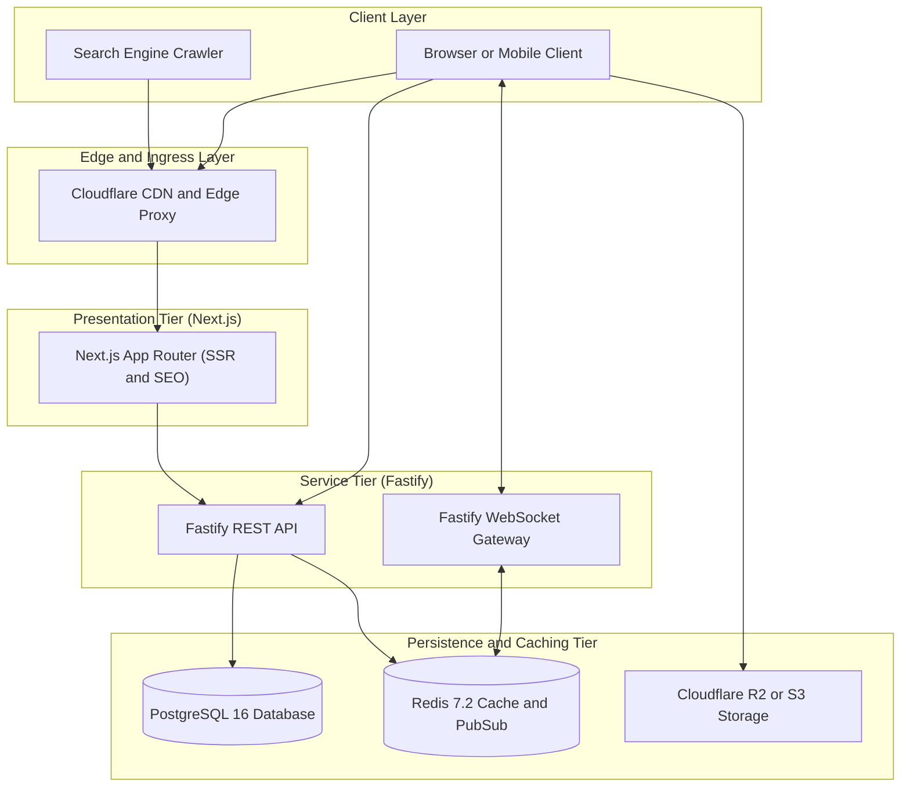
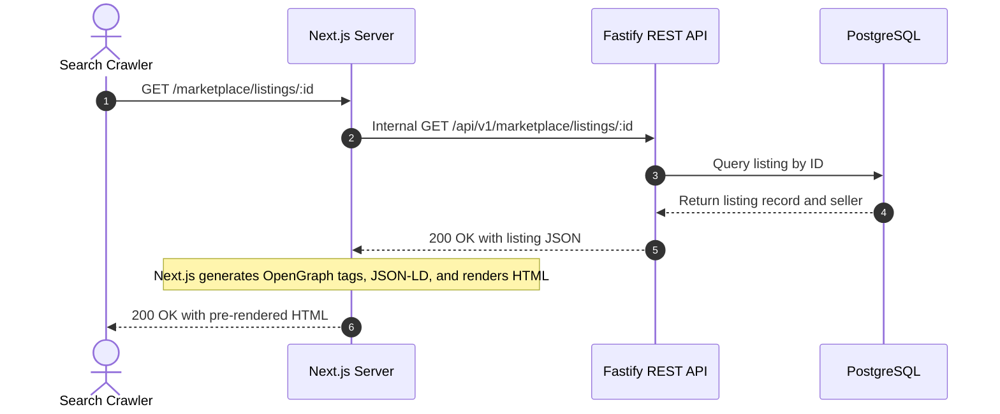
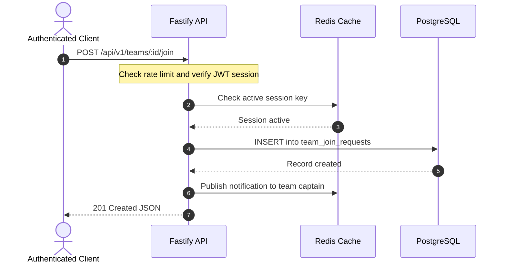
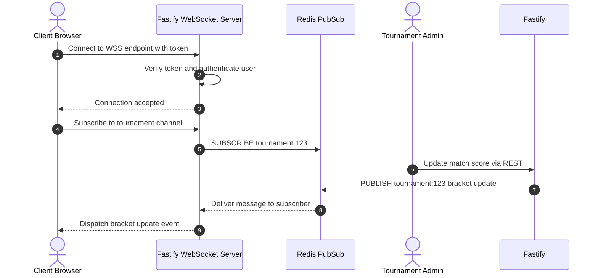
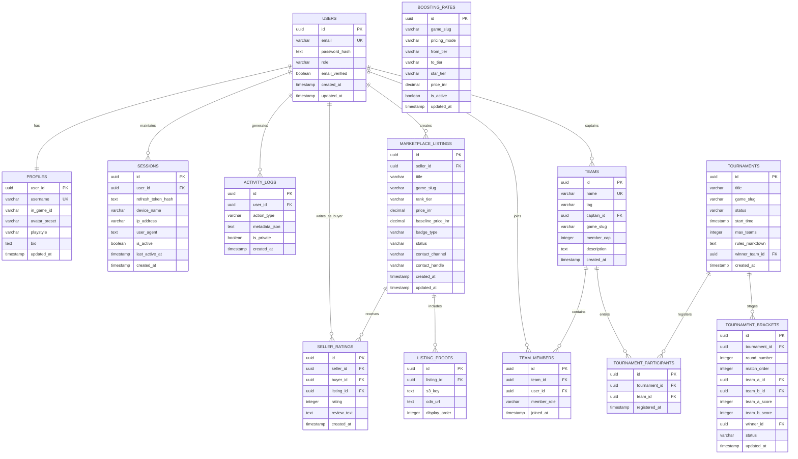
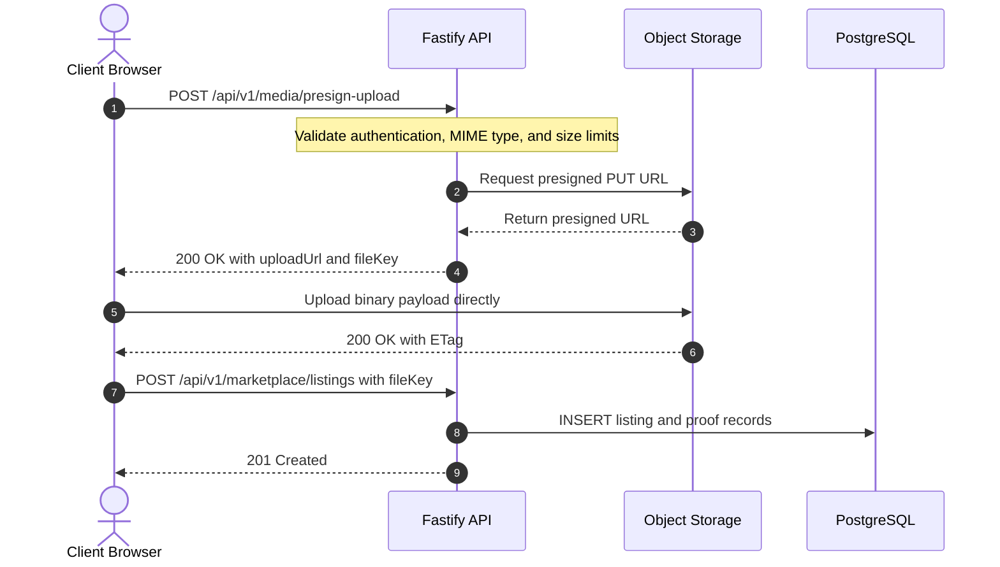

# System High-Level Design (HLD)

## Esports Tournament & Community Platform

---

## 1. Architectural Overview & System Topology

The platform utilizes a **Decoupled Architecture** engineered for optimal organic search discoverability (SEO), real-time low-latency synchronization, and scalable resource isolation.



### 1.1 Physical Tier Specifications

| Tier                        | Technology                     | Responsibilities                                                                                                                | Network Boundary                                         |
| :-------------------------- | :----------------------------- | :------------------------------------------------------------------------------------------------------------------------------ | :------------------------------------------------------- |
| **Presentation Tier** | Next.js 15 (Node.js 20 LTS)    | Server-Side Rendering (SSR), Server Components, dynamic OpenGraph generation, static route caching, client-side SPA navigation. | Internal container network + Public HTTPS ingress.       |
| **Service Tier**      | Fastify 4.x / 5.x (TypeScript) | High-throughput REST API, persistent WebSocket gateway, business logic, authentication token minting, input validation.         | Internal container network + Public API ingress.         |
| **Persistence Tier**  | PostgreSQL 16                  | Primary ACID transactional relational database for users, tournaments, teams, listings, ratings, and audit logs.                | Private VPC / Internal network only (Port 5432).         |
| **Cache & Event Bus** | Redis 7.2                      | Active session tracking, remote logout whitelist, sliding-window rate limiters, multi-instance WebSocket Pub/Sub.               | Private VPC / Internal network only (Port 6379).         |
| **Media Storage**     | Cloudflare R2 / AWS S3         | Encrypted object storage bucket for marketplace screenshot proofs and avatars.                                                  | Direct-to-client presigned upload URLs via public HTTPS. |

---

## 2. Communication & Rendering Patterns

### 2.1 Pattern A: Public SEO & Crawler Pipeline (SSR)

Designed to satisfy the client requirement for maximum organic visibility and instant social link previews.



### 2.2 Pattern B: Client Interactive Mutation Flow (REST)

Direct client-to-API communication for authenticated operations:



### 2.3 Pattern C: Persistent Real-Time WebSocket Pipeline

Bi-directional event dissemination without polling:



---

## 3. Authentication & Device Session Management

The platform employs a stateless access token paired with a stateful, revocable refresh session stored in Redis.

### 3.1 Token Topology

- **Access Token**: Short-lived JSON Web Token (15-minute expiration). Transmitted via `Authorization: Bearer <token>` header. Contains `userId`, `role` (`user` | `admin`), and `sessionId`.
- **Refresh Token**: Long-lived cryptographic random string (30-day expiration). Delivered and stored exclusively in a secure, `HttpOnly`, `SameSite=Strict`, `Secure` cookie (`__Host-refresh-token`).

### 3.2 Redis Session Store Schema

Every authenticated session is registered in Redis under the key namespace:

```text
Key: session:{user_id}:{session_id}
Type: Hash
TTL: 2,592,000 seconds (30 days)

Fields:
  - refresh_token_hash:  SHA-256 hash of current active refresh token
  - device_name:         "Chrome on Windows" / "Safari on iOS"
  - ip_address:          "103.21.244.12"
  - user_agent:          Raw User-Agent string
  - last_active_at:      Unix timestamp (updated on token refresh)
  - created_at:          Unix timestamp
```

### 3.3 Instant Remote Logout / Session Revocation Flow

When a user views their active sessions on the **Device Management** dashboard and clicks **"Revoke Session"**:

1. Client issues: `DELETE /api/v1/auth/sessions/:sessionId`.
2. Fastify deletes the Redis key: `DEL session:{userId}:{targetSessionId}`.
3. Fastify writes a tombstone record to Redis: `SET revoked_token:{targetSessionId} 1 EX 900` (15 minutes = maximum access token lifespan).
4. The target device is immediately disabled:
   - If the target device makes an API call with an unexpired Access Token, the fast-path token blacklist middleware detects the revoked session and returns `401 Unauthorized`.
   - When the target device attempts to rotate its refresh token via `/api/v1/auth/refresh`, the Redis lookup returns `null`, the refresh cookie is cleared, and the device is redirected to `/login`.

---

## 4. Core Domain Relational Model (ERD)



---

## 5. Direct-to-Storage Media Pipeline (S3 / R2)

To prevent file upload buffers from blocking Fastify's event loop and saturating backend network bandwidth, all marketplace proof screenshot uploads bypass the Node.js server using **pre-signed PUT URLs**:



---

## 6. Real-Time WebSocket Protocol & Envelope Schema

### 6.1 Handshake & Authentication

Clients connect via:

```text
WSS: wss://api.smexstore.com/ws?token=<ACCESS_JWT>
```

If the token is missing, expired, or revoked in Redis, the server closes the connection with code `4401 (Unauthorized)`.

### 6.2 Standard Event Envelope

All frames exchanged over WebSockets adhere to the standardized schema:

```json
{
  "event": "bracket:update",
  "channel": "tournament:a1b2c3d4",
  "timestamp": 1728471600000,
  "payload": {
    "matchId": "f7e6d5c4",
    "roundNumber": 2,
    "teamAScore": 2,
    "teamBScore": 1,
    "winnerId": "team_123",
    "status": "completed"
  }
}
```

### 6.3 Event Catalog

| Event Identifier      | Target Channel                | Dispatch Trigger                                               |
| :-------------------- | :---------------------------- | :------------------------------------------------------------- |
| `bracket:update`    | `tournament:{tournamentId}` | Match score updated or winner advanced by Admin.               |
| `tournament:state`  | `tournament:{tournamentId}` | Status transition (e.g.,`upcoming` → `ongoing`).          |
| `team:invite`       | `user:{targetUserId}`       | Team captain sends a squad invitation.                         |
| `team:join_request` | `team:{teamId}`             | Player requests to join a squad.                               |
| `session:revoked`   | `user:{userId}`             | Active session revoked remotely; triggers local client logout. |

---

## 7. Caching, Rate Limiting & Security Guardrails

### 7.1 Redis Sliding-Window Rate Limiting

Implemented at Fastify's `onRequest` hook using Redis sorted sets (`ZADD`, `ZREMRANGEBYSCORE`, `ZCARD`):

| Endpoint Route Pattern                | Window Duration | Max Requests | Target Identifier       | Action on Exceeded    |
| :------------------------------------ | :-------------- | :----------- | :---------------------- | :-------------------- |
| `POST /api/v1/auth/login`           | 60 seconds      | 5            | Client IP + Email       | 429 Too Many Requests |
| `POST /api/v1/auth/register`        | 3600 seconds    | 3            | Client IP               | 429 Too Many Requests |
| `POST /api/v1/marketplace/listings` | 3600 seconds    | 10           | Authenticated`userId` | 429 Too Many Requests |
| `GET /api/v1/search`                | 60 seconds      | 60           | Client IP /`userId`   | 429 Too Many Requests |
| `ALL /api/v1/*` (Global Baseline)   | 60 seconds      | 300          | Client IP               | 429 Too Many Requests |

### 7.2 Password Hashing Standard

All authentication credentials are encrypted using **Argon2id** (OWASP recommended parameters):

- Memory cost: `65536 KB` (64 MB)
- Time cost: `3 iterations`
- Parallelism: `4 threads`

### 7.3 Standardized Error Response Payload

Every non-2xx API failure returns a uniform JSON contract:

```json
{
  "type": "https://api.smexstore.com/errors/validation-failed",
  "title": "Validation Error",
  "status": 422,
  "detail": "The listing price must be greater than or equal to 100 INR.",
  "instance": "/api/v1/marketplace/listings",
  "code": "INVALID_PRICE_FLOOR",
  "invalid_params": [
    {
      "name": "price_inr",
      "reason": "Value 50 is below minimum threshold of 100"
    }
  ]
}
```
