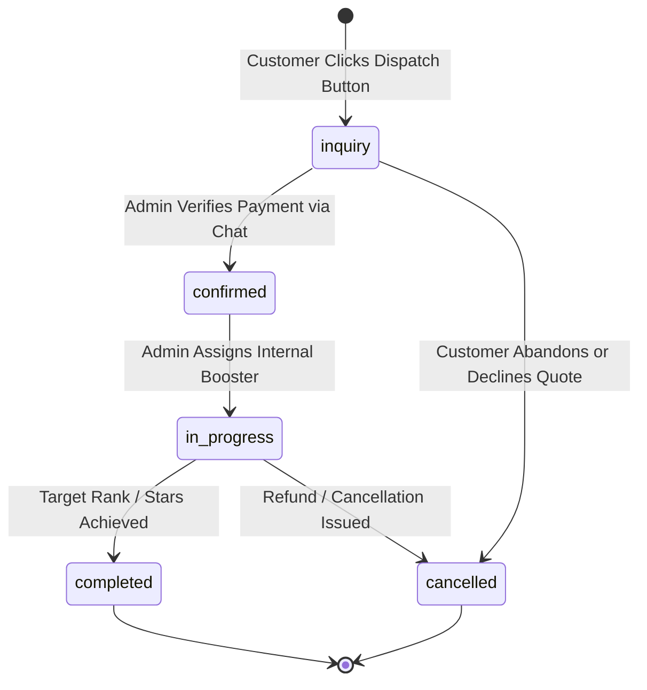

# Bug: Order Lifecycle State Machine Transition Invariants Completely Unenforced

- **Bug ID**: BUG-M6-006
- **Milestone**: Milestone 6: MLBB Dual-Mode Boosting Engine
- **Severity**: Medium (Lifecycle Invariant Omission & Workflow Integrity Failure)
- **Target Files**:
  - `server/src/routes/admin/boosting.ts` (lines 95–118)
  - `server/src/services/boosting-rate.service.ts` (lines 126–146)
- **Status**: Resolved

---

## 1. Description

Section 4.2 of `docs/internal/design/lld/mlbb-boosting.md` defines a formal **Order Lifecycle State Machine**:


### The Unenforced Transitions
In `server/src/routes/admin/boosting.ts`:
```typescript
const updateOrderStatusSchema = z.object({
  status: z.enum(['inquiry', 'confirmed', 'in_progress', 'completed', 'cancelled']),
  notes: z.string().optional(),
});

fastify.patch('/api/v1/admin/boosting/orders/:id/status', async (request, reply) => {
  ...
  const { status, notes } = parseResult.data;
  const updated = await BoostingRateService.updateOrderStatus(id, status, notes, fastify.db);
  ...
});
```

And in `server/src/services/boosting-rate.service.ts`:
```typescript
static async updateOrderStatus(
  id: string,
  status: string,
  notes: string | undefined,
  db: SmexDatabase
): Promise<BoostingOrder> {
  const updatePayload: Record<string, any> = { status: status as any };
  if (notes !== undefined) updatePayload.notes = notes;

  const [updated] = await db
    .update(boostingOrders)
    .set(updatePayload)
    .where(eq(boostingOrders.id, id))
    .returning();

  return updated;
}
```

### Flaw
There is **zero validation of existing order state**.
1. **Reopening Terminal States**: A terminal order in `completed` or `cancelled` state can be mutated back to `inquiry` or `in_progress`.
2. **Invalid Jump Transitions**: An order in `inquiry` can jump directly to `completed` without payment verification (`confirmed`) or booster assignment (`in_progress`).
3. **Cancelled Orders Concluded**: A cancelled or refunded order can be marked `completed`.

---

## 2. Specification & Design Reference

- **LLD Reference**: `docs/internal/design/lld/mlbb-boosting.md` Section 4.2:
  > Sequential allowed transitions:
  > `inquiry -> ['confirmed', 'cancelled']`
  > `confirmed -> ['in_progress', 'cancelled']`
  > `in_progress -> ['completed', 'cancelled']`
  > `completed -> []` (terminal)
  > `cancelled -> []` (terminal)

---

## 3. Reproduction Steps / Proof of Concept

1. Create an order with status `inquiry`.
2. As an administrator, call `PATCH /api/v1/admin/boosting/orders/:id/status` with `{ "status": "completed" }`.
3. The server responds with `200 OK` and sets status directly to `completed`.
4. Send another `PATCH` with `{ "status": "inquiry" }`.
5. The server responds with `200 OK`, reverting a completed order back to an initial inquiry.

---

## 4. Impact

- Violation of domain invariants and audit trail integrity.
- Risk of accidental or unauthorized status overwrites in the admin portal.

---

## 5. Recommended Remediation

In `server/src/services/boosting-rate.service.ts` or `server/src/routes/admin/boosting.ts`:
1. Fetch the existing order row before updating.
2. Validate the target transition against an `ALLOWED_ORDER_TRANSITIONS` map:
   ```typescript
   const ALLOWED_ORDER_TRANSITIONS: Record<string, string[]> = {
     inquiry: ['confirmed', 'cancelled'],
     confirmed: ['in_progress', 'cancelled'],
     in_progress: ['completed', 'cancelled'],
     completed: [],
     cancelled: [],
   };
   ```
3. Return HTTP 400 Bad Request with an informative error message if an illegal transition is attempted.
