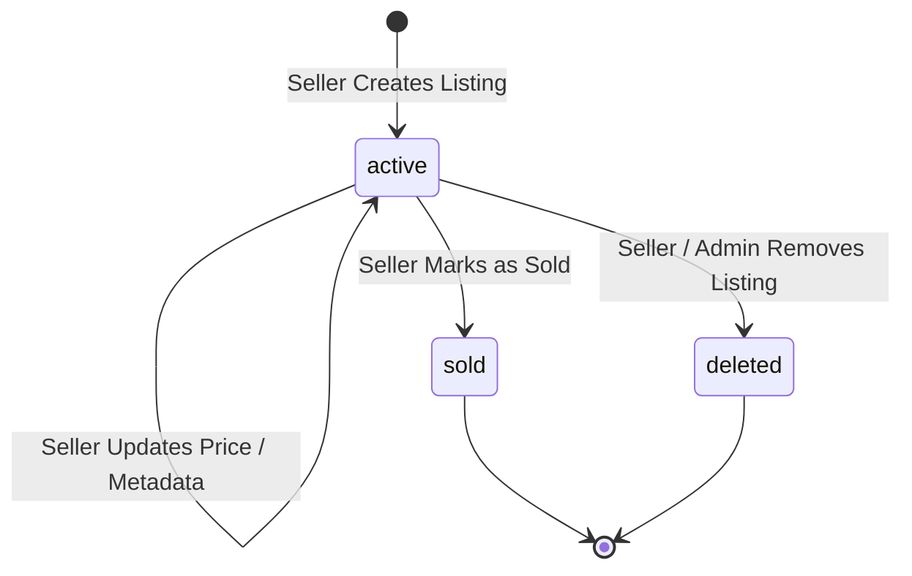

# Bug: Marketplace Listing Lifecycle State Machine Violations (Terminal States Reopened & Mutated)

- **Bug ID**: BUG-M7-002
- **Milestone**: Milestone 7: Marketplace and S3 Presigned Uploads
- **Severity**: High (State Machine Invariant Violation / Business Logic Flaw)
- **Target Files**:
  - `server/src/services/listing.service.ts` (lines 356–454, 456–487)
  - `server/src/routes/marketplace/index.ts` (lines 36–38, 208–247)
- **Status**: Identified

---

## 1. Description

The marketplace listing lifecycle state machine defined in LLD Section 4.1 specifies strict one-way state transitions:

`sold` and `deleted` are explicitly defined as terminal states. Once an account is sold or deleted, it must not be resurrected to active status or edited.

However, in `server/src/services/listing.service.ts`:

1. **`updateListing` (lines 356–454)**:
   Does not check `existing.status`. If a listing has `status: 'sold'` or `status: 'deleted'`, the seller can still invoke `PATCH /api/v1/marketplace/listings/:id` to mutate the title, rank, price, contact handles, and proof screenshots!
2. **`updateListingStatus` (lines 456–487)**:
   ```typescript
   public static async updateListingStatus(
     db: SmexDatabase,
     id: string,
     userId: string,
     isAdmin: boolean,
     status: 'active' | 'sold' | 'deleted'
   ): Promise<MarketplaceListing> {
     // ...
     const [updated] = await db
       .update(marketplaceListings)
       .set({ status, updatedAt: new Date() })
       .where(eq(marketplaceListings.id, id))
       .returning();
     return updated;
   }
   ```
   There is zero transition validation. An existing listing in `sold` or `deleted` state can transition back to `active`. In fact, any transition between any of the three states is blindly accepted.

---

## 2. Specification & Design Reference

- **LLD Reference**: `docs/internal/design/lld/marketplace-media.md` Section 4.1:
  > Explicitly defines the state transition diagram with terminal sinks for `sold` and `deleted`.
- **Business Domain Invariant**: An account already marked as sold cannot be edited or revived into the active public catalog. A deleted listing cannot be un-deleted without formal administrative review.

---

## 3. Reproduction Steps / Proof of Concept

1. Seller creates listing `L1` (status = `active`).
2. Seller marks `L1` as `sold` via `PATCH /api/v1/marketplace/listings/L1/status` with `{"status": "sold"}`.
3. Seller calls `PATCH /api/v1/marketplace/listings/L1` with `{"title": "Updated hacked title", "priceInr": 2000}`.
   - **Result**: HTTP 200 OK. The sold listing's title and price are modified.
4. Seller calls `PATCH /api/v1/marketplace/listings/L1/status` with `{"status": "active"}`.
   - **Result**: HTTP 200 OK. The sold listing is revived and re-enters the active marketplace catalog.

---

## 4. Impact

- **Marketplace Fraud & Confusion**: Sellers can sell an account, mark it sold, alter account details/proofs, and switch it back to active to scam buyers.
- **Audit & History Distortion**: Historical records of completed sales are rendered unreliable if listing metadata can be altered post-sale.

---

## 5. Recommended Remediation

1. **In `updateListing` (`server/src/services/listing.service.ts`)**:
   Reject updates if `existing.status !== 'active'`:
   ```typescript
   if (existing.status !== 'active') {
     throw createListingError(
       `Cannot edit a listing in '${existing.status}' state`,
       400,
       'INVALID_LISTING_STATE'
     );
   }
   ```
2. **In `updateListingStatus` (`server/src/services/listing.service.ts`)**:
   Enforce the valid state transition table:
   ```typescript
   const VALID_TRANSITIONS: Record<string, string[]> = {
     active: ['sold', 'deleted'],
     sold: [], // terminal
     deleted: [], // terminal
   };

   if (!isAdmin && !VALID_TRANSITIONS[existing.status]?.includes(status)) {
     throw createListingError(
       `Invalid status transition from '${existing.status}' to '${status}'`,
       400,
       'INVALID_STATUS_TRANSITION'
     );
   }
   ```
