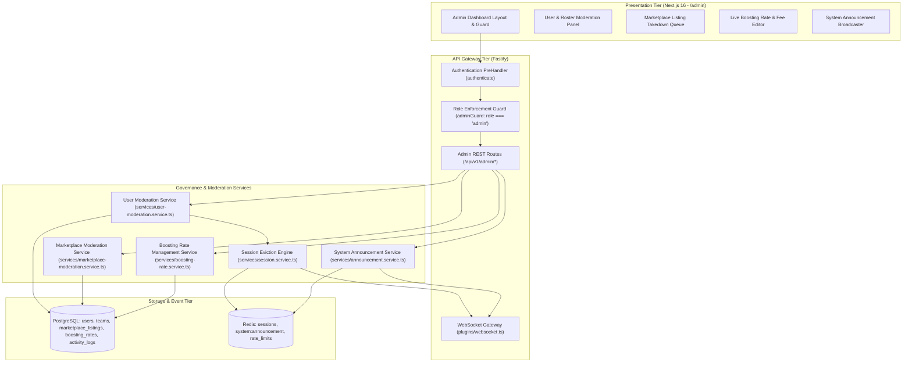
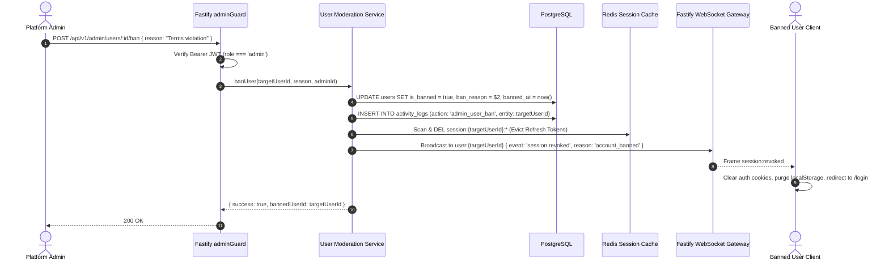
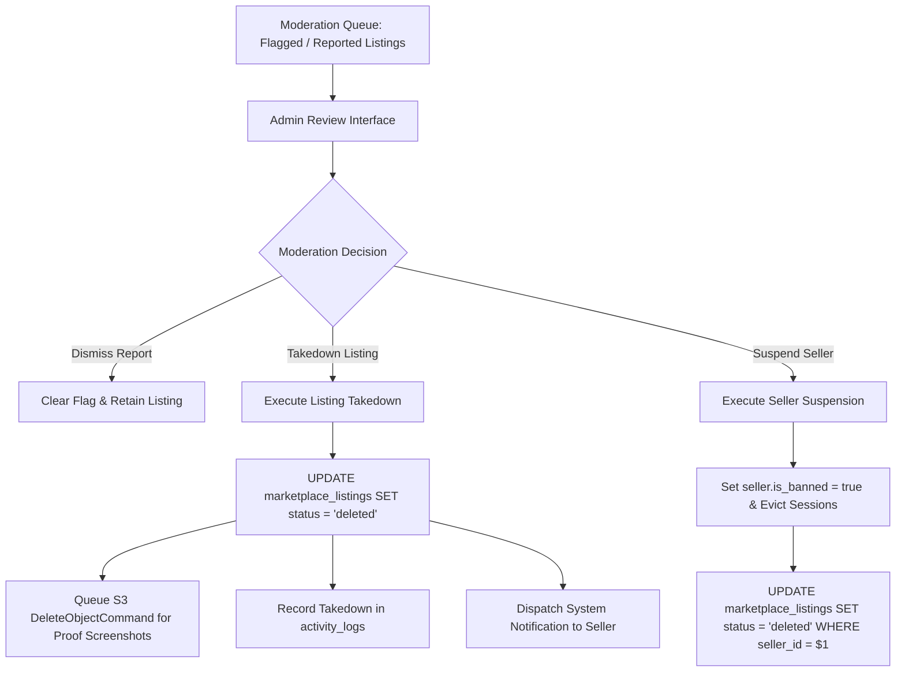

# Admin Dashboard and Governance Suite Design Specification

## 1. Overview and Architecture

This document specifies the Low-Level Design (LLD) for **Milestone 9: Admin Dashboard and Governance Suite** of the Smex Store platform. It defines the administrative moderation subsystem, user suspension and session revocation mechanisms, squad disbandment workflows, marketplace fraudulent listing takedown pipelines, live boosting rate overrides with instant quote preview, system announcement broadcasting, and client admin portal components conforming to:
* `docs/internal/requirements.md` (Sections 5.1, 6.6, 6.8, 9.5, 13.1, 18.13, 19)
* `docs/internal/design/hld.md` (Sections 2.4, 7.1, 7.3)
* `docs/internal/design/lld/data-layer.md` (Section 3.5, 3.6, 3.7)
* `docs/internal/design/ui.md` (AMOLED `#000000`, 120ms hardware transitions, zero frosted glass blur)



---

## 2. User and Roster Moderation Engine

*Target Source: `server/src/services/user-moderation.service.ts`*  
*Target Route: `server/src/routes/admin/users.ts`, `server/src/routes/admin/teams.ts`*

### 2.1 User Ban & Session Eviction State Flow

When an administrator bans a user for fraudulent behavior or terms of service violations, the action executes an atomic, zero-trust eviction:



#### Ban Enforcement Invariants:
1. **PreHandler Gate**: The global `authenticate` hook checks `request.user.isBanned`. If `true`, request is terminated with `HTTP 403 ACCOUNT_BANNED` before hitting domain handlers.
2. **Session Eviction**: All active Redis tokens associated with the user ID are invalidated immediately.
3. **Protected Accounts**: Platform administrators cannot ban themselves or other administrators (`targetUser.role !== 'admin'`).

---

### 2.2 Squad / Roster Disbandment Workflow

*Target Route: `server/src/routes/admin/teams.ts`*

When an administrator disbands a rule-breaking or abandoned squad:
1. **Team Status Transition**: Sets `teams.status = 'disbanded'`.
2. **Tournament Withdrawal**: Automatically removes the team from `tournament_participants` for any upcoming tournaments (`status = 'withdrawn'`).
3. **Member Notification**: Dispatches a `system` notification to all team members: `"Squad '{teamName}' has been disbanded by administration."`
4. **Audit Trail**: Logs the administrative intervention in `activity_logs`.

---

## 3. Marketplace Moderation and Fraud Takedowns

*Target Source: `server/src/services/marketplace-moderation.service.ts`*  
*Target Route: `server/src/routes/admin/marketplace.ts`*



### 3.1 Moderation Endpoints Contract

1. **`GET /api/v1/admin/marketplace/queue`**:
   * Lists reported listings with reporter feedback, timestamp, and seller transaction history.
2. **`POST /api/v1/admin/marketplace/listings/:id/takedown`**:
   * Transitions listing to `status = 'deleted'`.
   * Triggers background S3 object cleanup for `listing_proofs`.
   * Emits audit log entry with `adminId`, `listingId`, and mandatory `takedownReason`.
3. **`POST /api/v1/admin/marketplace/sellers/:id/suspend`**:
   * Bans seller account and executes bulk takedown of all active seller listings in a single database transaction.

---

## 4. Live Boosting Rate Overrides & Announcements

*Target Source: `server/src/services/boosting-rate.service.ts`, `server/src/services/announcement.service.ts`*  
*Target Routes: `server/src/routes/admin/boosting.ts`, `server/src/routes/admin/system.ts`*

### 4.1 Boosting Rate Matrix Editor

Administrators configure base tier leaps and progressive per-star rates directly in PostgreSQL without requiring service redeployment:

```typescript
export interface AdminRateUpdateRequest {
  priceInr: number;       // Must be > 0 (strictly positive)
  isActive?: boolean;
  minStars?: number;      // Applicable only for per_star mode
  maxStars?: number;
}
```

* **Dynamic Cache Invalidation**: Updating any rate row invalidates public cached rate queries (`boosting:rates:active`), ensuring clients receive updated price matrices on their next quote request.
* **Instant Calculation Preview**: The Admin UI evaluates the updated matrix against sample rank transitions (e.g. Mythic 10★ to Honor 30★) in real-time before persisting changes.

---

### 4.2 System Announcement & Maintenance Banner Engine

Administrators can broadcast urgent platform announcements (e.g. scheduled maintenance, tournament broadcasts) sitewide:

```typescript
export interface SystemAnnouncementPayload {
  message: string;
  level: 'info' | 'warning' | 'alert';
  isActive: boolean;
  actionUrl?: string;     // Internal route link
  expiresAt?: string;
}
```

* **Persistence**: Active announcement stored in Redis under key `system:announcement:active`.
* **Real-Time Broadcast**: Fastify publishes to Redis channel `system:announcement`, and the WebSocket Gateway broadcasts an `announcement:update` frame to all connected clients.
* **Client Banner**: Renders at the top of the viewport above the navbar with strict AMOLED `#000000` styling and WCAG AA contrast colors (`#1FAE7A` for info, `#F59E0B` for warning, `#EF4444` for alert).

---

## 5. RESTful API Catalog

*Target Route Prefix: `/api/v1/admin/*`*  
*All endpoints protected by `fastify.authenticate` and `fastify.adminGuard`.*

### 5.1 Endpoints Specification

| Method | Endpoint | Auth | Purpose | Status Codes |
| :--- | :--- | :--- | :--- | :--- |
| `GET` | `/api/v1/admin/metrics` | Admin JWT | Aggregated system stats (users, volume, health) | `200`, `401`, `403` |
| `GET` | `/api/v1/admin/users` | Admin JWT | Paginated user directory with role and ban filters | `200`, `401`, `403` |
| `POST` | `/api/v1/admin/users/:id/ban` | Admin JWT | Ban user, evict sessions, revoke tokens | `200`, `400`, `401`, `403`, `404` |
| `POST` | `/api/v1/admin/users/:id/unban` | Admin JWT | Restore banned user account | `200`, `401`, `403`, `404` |
| `POST` | `/api/v1/admin/teams/:id/disband` | Admin JWT | Disband squad, withdraw from tournaments | `200`, `401`, `403`, `404` |
| `GET` | `/api/v1/admin/marketplace/queue` | Admin JWT | Review reported/flagged marketplace listings | `200`, `401`, `403` |
| `POST` | `/api/v1/admin/marketplace/listings/:id/takedown` | Admin JWT | Delete fraudulent listing & purge proofs | `200`, `400`, `401`, `403`, `404` |
| `POST` | `/api/v1/admin/marketplace/sellers/:id/suspend` | Admin JWT | Ban seller & bulk delete active listings | `200`, `400`, `401`, `403`, `404` |
| `GET` | `/api/v1/admin/boosting/rates` | Admin JWT | Fetch all rates (active and historical) | `200`, `401`, `403` |
| `PATCH`| `/api/v1/admin/boosting/rates/:id` | Admin JWT | Override price or star boundary | `200`, `400`, `401`, `403`, `404` |
| `GET` | `/api/v1/admin/system/announcement` | Admin JWT | Read current announcement configuration | `200`, `401`, `403` |
| `POST` | `/api/v1/admin/system/announcement` | Admin JWT | Update announcement and broadcast live frame | `200`, `400`, `401`, `403` |

---

## 6. Client Admin Governance UI Specification

*Target Route: `client/src/app/admin/*`*

### 6.1 Theme & AMOLED Surface Conformance

Per `docs/internal/design/ui.md`:
* **Surface Background**: AMOLED True-Black (`#000000`).
* **Panels & Tables**: Dark Emerald (`#121C19` to `#16211D`), subtle border `#223530`.
* **Accent Highlights**: Emerald (`#22C58F`), Warning Amber (`#F59E0B`), Danger Coral (`#EF4444`).
* **Transitions**: 120ms hardware transitions (`transition-all duration-120 ease-out`).
* **Prohibited Visuals**: Zero frosted glass blur (`backdrop-filter: blur`), zero opacity fade animations.

### 6.2 UI Wireframes

#### A. Admin Dashboard Shell (`/admin`)

```
+-----------------------------------------------------------------------------------------+
| [SMEX STORE] [ADMIN PORTAL]                                             [Admin: smex_01]|
+-----------------------------------------------------------------------------------------+
| [ Overview ]  [ Moderation Queue ]  [ User Management ]  [ Boosting Rates ]  [ Broadcasts ]|
+-----------------------------------------------------------------------------------------+
|                                                                                         |
|  PLATFORM HEALTH & GOVERNANCE METRICS                                                   |
|                                                                                         |
|  +--------------------+  +--------------------+  +--------------------+  +------------+ |
|  | ACTIVE USERS       |  | ACTIVE LISTINGS    |  | TOURNAMENTS (LIVE) |  | DB LATENCY | |
|  | 1,420              |  | 38 IDs             |  | 2 Ongoing          |  | 4.2ms (OK) | |
|  +--------------------+  +--------------------+  +--------------------+  +------------+ |
|                                                                                         |
|  URGENT ACTION QUEUE (3 PENDING)                                                        |
|  +-----------------------------------------------------------------------------------+  |
|  | [REPORT] User 'ApexTrader' reported for fraudulent screenshot proof.             |  |
|  | Listing ID: 7b8e5c3a | Price: ₹4,500 INR                                          |  |
|  | [ View Listing Proofs ]        [ Takedown Listing ]        [ Suspend Seller ]     |  |
|  +-----------------------------------------------------------------------------------+  |
|  | [REPORT] Squad 'ToxicRoster' reported for unsportsmanlike match fixing.          |  |
|  | [ Inspect Roster Members ]     [ Warning Notice ]          [ Disband Squad ]      |  |
|  +-----------------------------------------------------------------------------------+  |
+-----------------------------------------------------------------------------------------+
```

#### B. Live Boosting Rate Editor (`/admin/rates`)

```
+-----------------------------------------------------------------------------------------+
| LIVE BOOSTING RATE CONFIGURATION                                                        |
| Adjust base rates in INR. Updates take effect immediately with zero server restart.      |
|                                                                                         |
| +-------------------------------------------------------------------------------------+ |
| | SUB-MYTHIC FIXED TIERS                                                              | |
| | • Epic -> Legend:          [ ₹400.00 ] INR   [Active ✓]                             | |
| | • Legend -> Mythic:        [ ₹300.00 ] INR   [Active ✓]                             | |
| | • Epic -> Mythic (Bundle): [ ₹600.00 ] INR   [Active ✓]                             | |
| +-------------------------------------------------------------------------------------+ |
| | MYTHIC+ PROGRESSIVE PER-STAR RATES                                                  | |
| | • Mythic (0-24★):          [ ₹20.00 ] / star [Active ✓]                             | |
| | • Mythical Honor (25-49★): [ ₹30.00 ] / star [Active ✓]                             | |
| | • Mythical Glory (50-99★): [ ₹35.00 ] / star [Active ✓]                             | |
| | • Mythical Immortal (100★):[ ₹40.00 ] / star [Active ✓]                             | |
| +-------------------------------------------------------------------------------------+ |
|                                                                                         |
| LIVE QUOTE PREVIEW CALCULATOR:                                                          |
| Test: Mythic 10★ -> Honor 30★ = 15★@20 + 5★@30 = ₹450.00 INR (Matches Baseline)        |
|                                                                                         |
| [ SAVE RATE OVERRIDES ]                                  [ REVERT TO DEFAULTS ]         |
+-----------------------------------------------------------------------------------------+
```

### 6.3 Client Security & Route Protection

* **Role-Based Layout Guard**: `client/src/app/admin/layout.tsx` validates session credentials via `useAuth()`.
  * If unauthenticated $\rightarrow$ redirects to `/login?redirect=/admin`.
  * If authenticated with `role !== 'admin'` $\rightarrow$ renders dedicated 403 Forbidden screen with "Access Denied: Administrative Credentials Required" message and returns to `/`.
