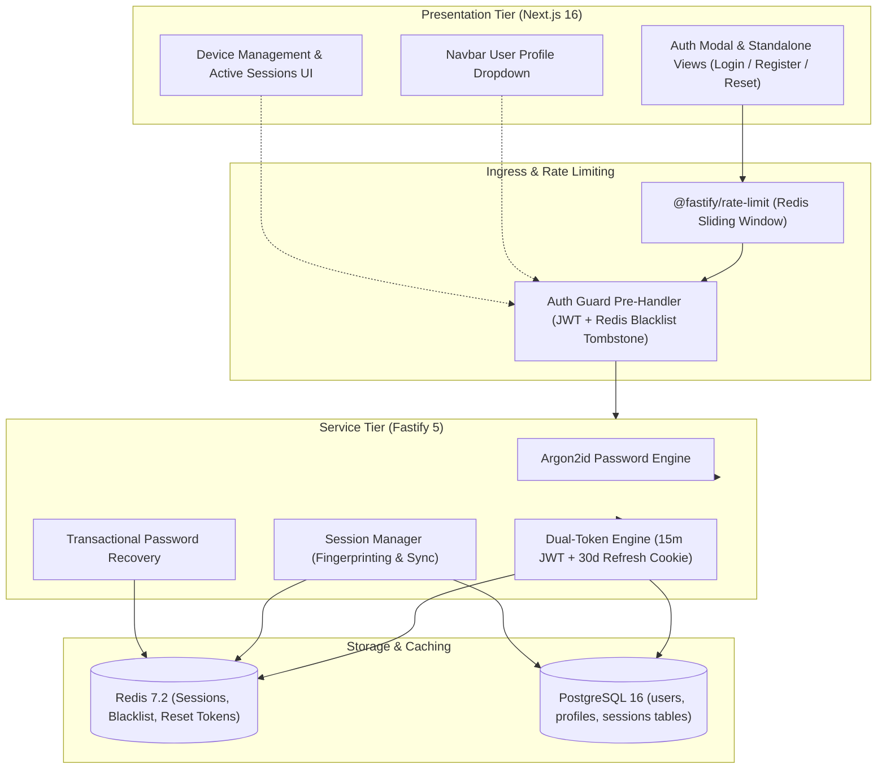
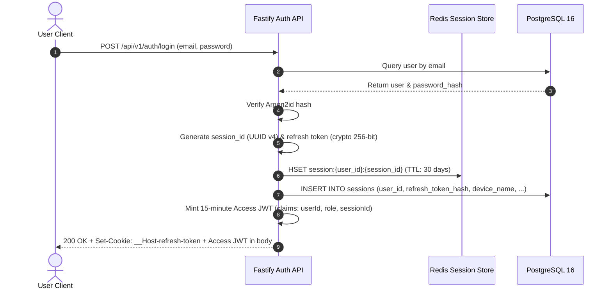
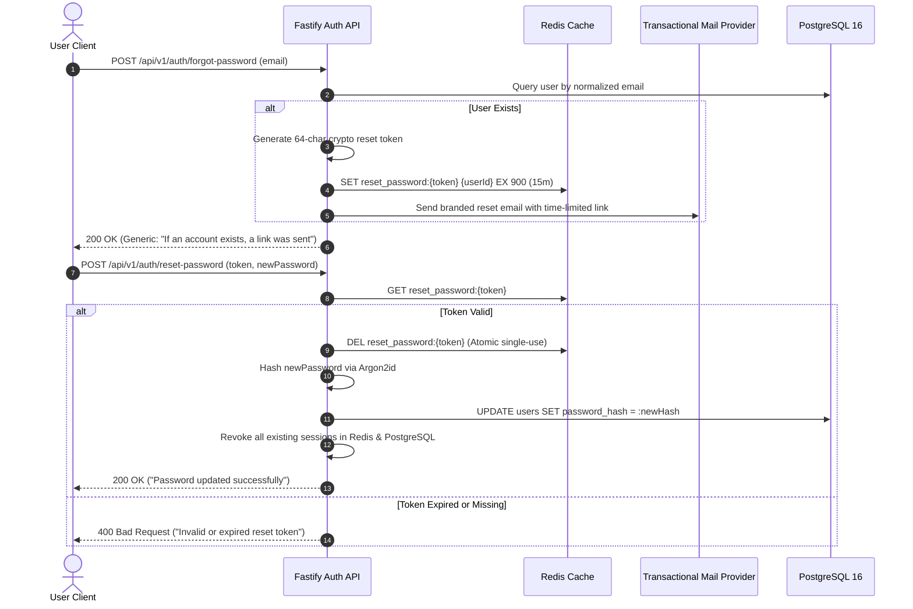

# Zero-Trust Authentication and User Profiles Design Specification

## 1. Overview and Scope

This document specifies the Low-Level Design (LLD) for **Milestone 3: Zero-Trust Authentication and User Profiles** of the Smex Store platform. It defines the cryptographic security primitives, dual-token lifecycle, Redis session cache, instant remote revocation, distributed rate limiting, transactional password recovery, and client authentication and settings interfaces conforming to `docs/internal/requirements.md` (Sections 4, 8, 9, 10, 14), `docs/internal/design/hld.md` (Sections 3, 7), and `docs/internal/design/ui.md`.



---

## 2. Password Security and Cryptographic Primitives

*Target Source: `server/src/utils/crypto.ts`*

### 2.1 Argon2id Configuration Parameters

All user passwords are encrypted exclusively using **Argon2id** (OWASP recommended parameters) to defend against GPU-accelerated brute-force attacks and side-channel timing analysis:

| Parameter | Value | Semantic Purpose |
| :--- | :--- | :--- |
| `type` | `argon2id` | Hybrid defense against side-channel and GPU cracking |
| `memoryCost` | `65536` (64 MB) | Memory-hardness resisting ASIC/GPU parallelization |
| `timeCost` | `3` | Iteration count tuning execution latency (~50-80ms) |
| `parallelism` | `4` | Concurrency thread lanes matching server CPU topology |
| `hashLength` | `32` bytes | Cryptographic digest length |

### 2.2 Interface Contracts

```typescript
export interface PasswordHasher {
  hashPassword: (plainText: string) => Promise<string>;
  verifyPassword: (hash: string, plainText: string) => Promise<boolean>;
}
```

#### Operational Invariants
1. **Plaintext Lifetime**: Plaintext passwords exist in memory only during request parsing and are never logged, cached, or persisted.
2. **Constant-Time Verification**: Verification uses constant-time byte comparisons provided by the underlying Argon2 C-bindings to prevent timing oracle attacks.
3. **Password Policy Enforcement**: Validated prior to hashing via Zod: minimum 8 characters, maximum 128 characters, containing at least one uppercase letter, one lowercase letter, and one number.

---

## 3. Dual-Token Architecture and Redis Session Store

*Target Source: `server/src/plugins/auth.ts` and `server/src/services/session.service.ts`*

### 3.1 Token Topology & Storage Specifications



#### A. Access Token (Short-Lived JWT)
- **Lifetime**: `900` seconds (15 minutes).
- **Transport**: `Authorization: Bearer <token>` HTTP header.
- **Payload Schema**:
  ```typescript
  export interface AccessTokenPayload {
    sub: string;       // userId (UUID v4)
    role: 'user' | 'admin';
    sessionId: string; // matches Redis session key
    iat: number;
    exp: number;
  }
  ```
- **Signing**: Signed with `JWT_SECRET` using `HS256` or `EdDSA`.

#### B. Refresh Token (Long-Lived Cookie)
- **Lifetime**: `2,592,000` seconds (30 days).
- **Transport**: `Set-Cookie: __Host-refresh-token=<random_string>; Path=/api/v1/auth; HttpOnly; Secure; SameSite=Strict; Max-Age=2592000`.
- **Generation**: `crypto.randomBytes(32).toString('hex')` (256 bits of cryptographic entropy).

### 3.2 Redis Session Store Hash Schema

Each active device session is indexed in Redis under the key namespace:

```text
Key: session:{userId}:{sessionId}
Type: Hash
TTL: 2,592,000 seconds (30 days)

Hash Fields:
  - refresh_token_hash:  SHA-256 hex digest of active refresh token
  - device_name:         "Chrome on macOS" / "Safari on iOS"
  - ip_address:          Client IP string (e.g., "103.21.244.12")
  - user_agent:          Raw User-Agent header string
  - last_active_at:      Unix timestamp (ms) updated on token refresh
  - created_at:          Unix timestamp (ms) of initial login
```

---

## 4. Instant Remote Session Revocation & Fast-Path Guard

*Target Source: `server/src/plugins/auth.ts` and `server/src/routes/auth.ts`*

### 4.1 Fast-Path Blacklist Tombstones

To revoke a stateless 15-minute Access Token immediately without waiting for token expiration:

1. When a session is revoked, Fastify writes an ephemeral tombstone key to Redis:
   ```text
   Key: revoked_token:{sessionId}
   Value: "1"
   TTL: 900 seconds (15 minutes — matching max Access Token lifetime)
   ```
2. The authentication pre-handler hook performs a two-stage check:
   - **Stage 1 (Local)**: Decodes and verifies JWT signature and expiry.
   - **Stage 2 (Fast-Path Redis)**: Executes `EXISTS revoked_token:{sessionId}`. If `1`, reject immediately with HTTP 401 Unauthorized.

```mermaid
flowchart TD
    REQ["Incoming API Request"] --> VERIFY_JWT["Verify JWT Signature & Expiry"]
    VERIFY_JWT -->|Invalid / Expired| ERR_401["Return 401 Unauthorized"]
    VERIFY_JWT -->|Valid| BLACKLIST_CHK["Redis: EXISTS revoked_token:{sessionId}"]
    BLACKLIST_CHK -->|Key Exists (Tombstone)| ERR_REVOKED["Return 401 (Session Revoked)"]
    BLACKLIST_CHK -->|Key Missing| ATTACH_USER["Decorate request.user and Proceed"]
```

### 4.2 Revocation Endpoints Specification

#### A. Revoke Single Session: `POST /api/v1/auth/revoke-session`
- **Request Body**: `{ sessionId: string }`
- **Execution Flow**:
  1. Validates `sessionId` belongs to the authenticated `request.user.sub`.
  2. Deletes Redis key: `DEL session:{userId}:{sessionId}`.
  3. Writes Redis tombstone: `SET revoked_token:{sessionId} 1 EX 900`.
  4. Updates PostgreSQL: `UPDATE sessions SET is_active = false WHERE id = :sessionId`.
  5. Dispatches WebSocket termination message `session:revoked` to notify connected browser tabs.
- **Response**: `200 OK` `{ success: true, message: "Session revoked successfully" }`.

#### B. Revoke All Sessions: `POST /api/v1/auth/revoke-all`
- **Request Body**: `{}`
- **Execution Flow**:
  1. Queries Redis keys matching `session:{userId}:*`.
  2. For every active session, sets tombstone `revoked_token:{sessionId} 1 EX 900`.
  3. Deletes all `session:{userId}:*` keys from Redis.
  4. Updates PostgreSQL: `UPDATE sessions SET is_active = false WHERE user_id = :userId`.
  5. Clears client refresh cookie.
- **Response**: `200 OK` `{ success: true, message: "All sessions revoked" }`.

---

## 5. Device Fingerprinting and Metadata Resolution

*Target Source: `server/src/utils/fingerprint.ts`*

```typescript
export interface DeviceMetadata {
  deviceName: string;       // e.g., "Chrome on Windows", "Safari on iOS"
  deviceFingerprint: string; // SHA-256 hash of (User-Agent + Accept-Language)
  ipAddress: string;
  userAgent: string;
}

export function parseDeviceMetadata(userAgent: string, ipAddress: string): DeviceMetadata;
```

### IP and Header Trust Rules
- Reverse-proxy client IP extracted from `request.ip` with Fastify `trustProxy: true`.
- User-Agent parsed into a human-readable label: `<BrowserName> on <OperatingSystem>`. Fallback to `"Unknown Device"`.

---

## 6. Distributed Rate Limiting

*Target Source: `server/src/plugins/rate-limit.ts`*

Backed by `@fastify/rate-limit` using Redis sliding window sorted sets (`ZADD`, `ZCARD`).

### 6.1 Endpoint Limit Policies

| Route Pattern | Window Duration | Max Allowed | Key Identifier | Action on Exceeded |
| :--- | :--- | :--- | :--- | :--- |
| `POST /api/v1/auth/login` | 60 seconds | 5 requests | `rl:login:${clientIp}:${normalizedEmail}` | 429 Too Many Requests |
| `POST /api/v1/auth/register` | 3600 seconds (1 hour) | 3 requests | `rl:register:${clientIp}` | 429 Too Many Requests |
| `POST /api/v1/auth/forgot-password` | 3600 seconds (1 hour) | 3 requests | `rl:forgot:${clientIp}:${normalizedEmail}` | 429 Too Many Requests |
| `ALL /api/v1/*` (Global Default) | 60 seconds | 300 requests | `rl:global:${clientIp}` | 429 Too Many Requests |

### 6.2 Rate Limit Error Contract (RFC 7807)

```json
{
  "type": "https://api.smexstore.com/errors/rate-limit-exceeded",
  "title": "Too Many Requests",
  "status": 429,
  "detail": "Rate limit exceeded. Try again in 48 seconds.",
  "instance": "/api/v1/auth/login",
  "code": "RATE_LIMIT_EXCEEDED"
}
```
*HTTP Response Headers*: `Retry-After: 48`, `X-RateLimit-Limit: 5`, `X-RateLimit-Remaining: 0`.

---

## 7. Transactional Password Recovery Pipeline

*Target Source: `server/src/services/email.service.ts` and `server/src/routes/auth.ts`*

### 7.1 Reset Token Lifecycle



#### Security Safeguards
1. **Timing Attack Defense**: `POST /forgot-password` returns the exact same 200 response and latency whether the email exists or not.
2. **Single-Use Enforcement**: Token is purged immediately via `DEL` upon successful lookup before updating the database.
3. **Session Invalidation**: Resetting a password automatically invokes `revokeAllSessions(userId)` to kick out attackers on stolen sessions.

---

## 8. RESTful Authentication API Specifications

### 8.1 Endpoint Catalog

| Method | Route Path | Auth Required | Description |
| :--- | :--- | :--- | :--- |
| `POST` | `/api/v1/auth/register` | No | Creates new user account & profile; dispatches verification email |
| `POST` | `/api/v1/auth/login` | No | Validates credentials; mints JWT and sets refresh cookie |
| `POST` | `/api/v1/auth/logout` | Yes | Revokes current session from Redis & clears refresh cookie |
| `POST` | `/api/v1/auth/refresh` | No (Cookie) | Rotates refresh token and issues new 15-minute access JWT |
| `GET` | `/api/v1/auth/me` | Yes | Returns authenticated user profile, role, and active session ID |
| `POST` | `/api/v1/auth/forgot-password`| No | Dispatches time-limited password reset email |
| `POST` | `/api/v1/auth/reset-password` | No | Validates single-use token and updates password |
| `GET` | `/api/v1/devices/sessions` | Yes | Lists all active device sessions for authenticated user |
| `DELETE`| `/api/v1/devices/sessions/:id`| Yes | Remotely revokes a specific device session |
| `DELETE`| `/api/v1/devices/sessions/all`| Yes | Remotely revokes all other device sessions |

---

## 9. Client Authentication and Account UI Specification

*Target Source Directory: `client/components/auth/` and `client/app/settings/`*

### 9.1 Authentication Modals and Forms

- **Modal Surface**: Solid Obsidian `#12181D` (Dark) / Pitch Black `#0A0A0A` (AMOLED). **Zero `backdrop-filter: blur`**.
- **Interactive Password Visibility**: Every password input features a dedicated show/hide password toggle button (Requirements Section 6.13 Item 5) styled with Lucide icons (`Eye` / `EyeOff`), keeping touch targets $\ge 44\text{px}$.
- **Active Press Feedback**: Primary submit buttons enforce 80ms `transform: scale(0.98)` physical press.
- **Zero Opacity Fades**: Form state transitions between Login, Registration, and Forgot Password use instant swaps or 120ms directional sliding transforms.

### 9.2 Navbar User Profile Dropdown

- Positioned sticky within Navbar cluster.
- Renders user's preset avatar badge (e.g., `preset_default_01`) and in-game name (IGN).
- Dropdown options:
  * View Profile (`/profile`)
  * Account & Display Settings (`/settings`)
  * Device Management (`/settings/devices`)
  * Logout CTA (`POST /api/v1/auth/logout` trigger).

### 9.3 Device Management Dashboard (`client/app/settings/devices/page.tsx`)

- Lists all active authenticated sessions querying `GET /api/v1/devices/sessions`.
- Card Elements:
  * Device Icon (Desktop / Mobile / Tablet).
  * Device Name (e.g., "Chrome on Windows").
  * IP Address & approximate location.
  * "Current Device" badge for active caller.
  * "Revoke Session" danger button on remote sessions.
- Top Action Bar:
  * "Revoke All Other Sessions" CTA button with confirmation modal.
