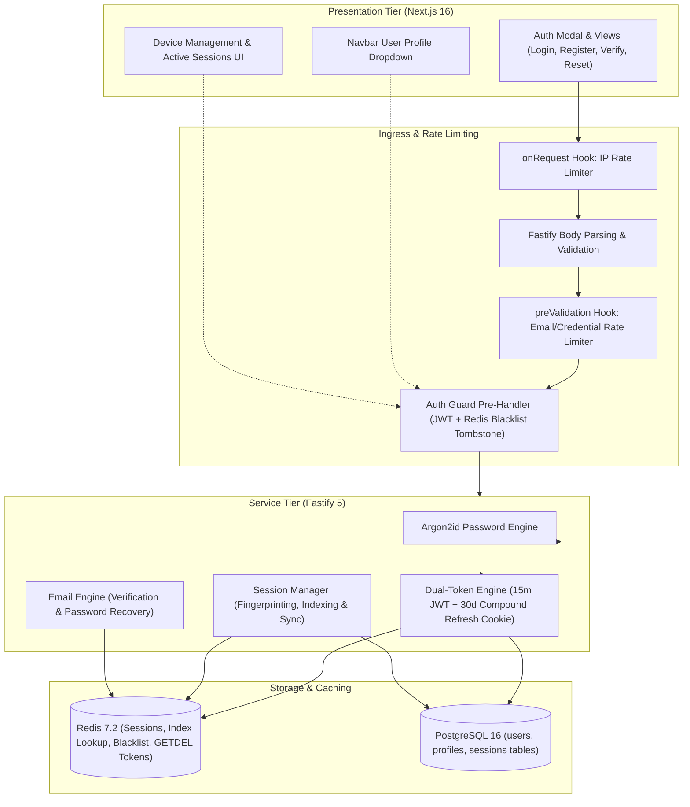
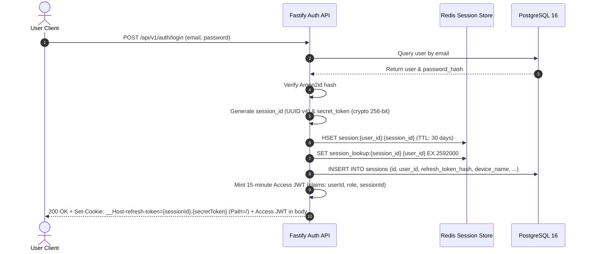
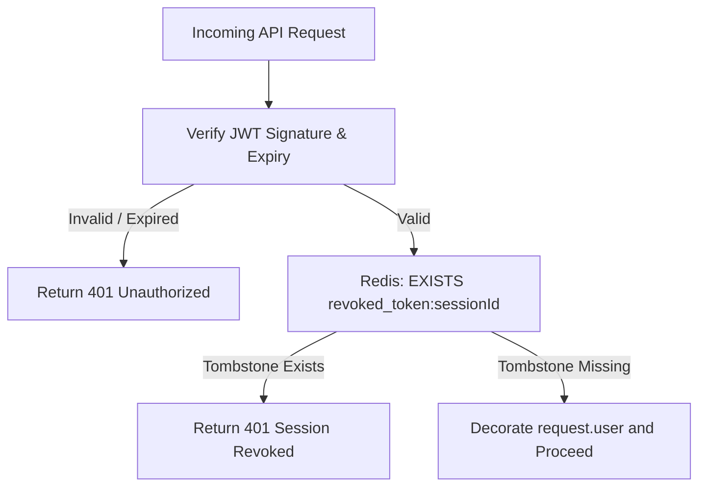
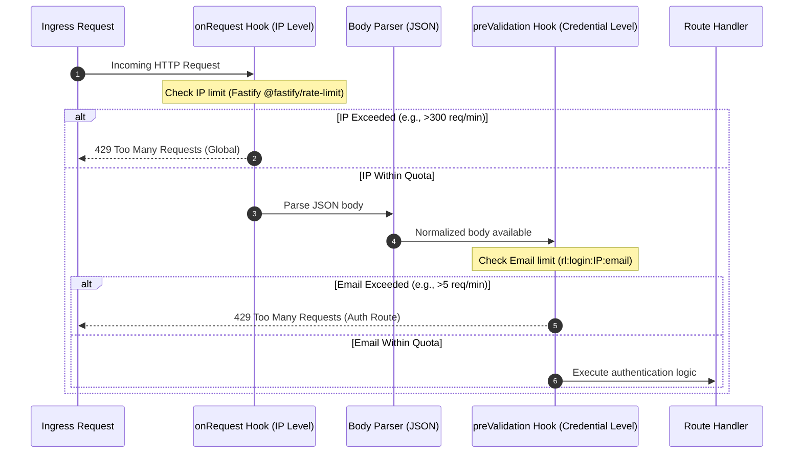
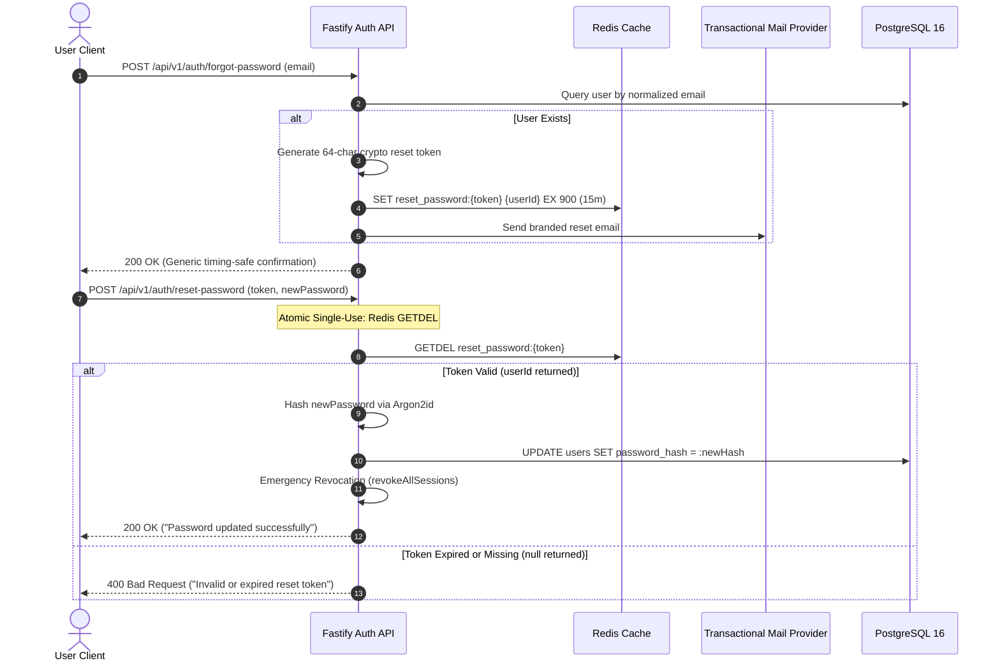

# Zero-Trust Authentication and User Profiles Design Specification

## 1. Overview and Scope

This document specifies the Low-Level Design (LLD) for **Milestone 3: Zero-Trust Authentication and User Profiles** of the Smex Store platform. It defines the cryptographic security primitives, dual-token lifecycle, RFC 6265bis-compliant cookie handling, Redis session caching with secondary index lookup, fast-path remote revocation, multi-stage rate limiting, email verification, transactional password recovery, and client authentication and settings interfaces conforming to `docs/internal/requirements.md` (Sections 4, 8, 9, 10, 14), `docs/internal/design/hld.md` (Sections 3, 7), and `docs/internal/design/ui.md`.



---

## 2. Technical Dependencies and Manifest Prerequisites

The implementation team must register the following packages via `pnpm add` before compiling Milestone 3 modules:

### 2.1 Backend Server Dependencies (`server/package.json`)
* **Cryptography & Hashing**: `argon2`
* **Redis Connection Pool**: `ioredis`
* **Fastify Plugins**:
  * `@fastify/jwt` (stateless token minting & signature verification)
  * `@fastify/cookie` (RFC 6265bis compliant cookie parsing and signing)
  * `@fastify/rate-limit` (distributed rate limiting backed by Redis)
* **Transactional Mailer**: `resend` (or `nodemailer` for SMTP delivery)

### 2.2 Frontend Client Dev Dependencies (`client/package.json`)
* **Component Testing Harness**: `@testing-library/react`, `@testing-library/jest-dom`, `jsdom`

---

## 3. Password Security and Cryptographic Primitives

*Target Source: `server/src/utils/crypto.ts`*

### 3.1 Argon2id Configuration Parameters

All user passwords are encrypted exclusively using **Argon2id** (OWASP recommended parameters) to defend against GPU-accelerated brute-force attacks and side-channel timing analysis:

| Parameter | Value | Semantic Purpose |
| :--- | :--- | :--- |
| `type` | `argon2id` | Hybrid defense against side-channel and GPU cracking |
| `memoryCost` | `65536` (64 MB) | Memory-hardness resisting ASIC/GPU parallelization |
| `timeCost` | `3` | Iteration count tuning execution latency (~50-80ms) |
| `parallelism` | `4` | Concurrency thread lanes matching server CPU topology |
| `hashLength` | `32` bytes | Cryptographic digest length |

### 3.2 Interface Contracts

```typescript
export interface PasswordHasher {
  hashPassword: (plainText: string) => Promise<string>;
  verifyPassword: (hash: string, plainText: string) => Promise<boolean>;
}
```

#### Operational Invariants
1. **Plaintext Lifetime**: Plaintext passwords exist in memory only during request parsing and are never logged, cached, or persisted.
2. **Constant-Time Verification**: Verification uses constant-time byte comparisons provided by the underlying Argon2 C-bindings to prevent timing oracle attacks.
3. **Password Policy Enforcement**: Validated prior to hashing via Zod: minimum 8 characters, maximum 128 characters, containing at least one uppercase letter, one lowercase letter, and one number.

---

## 4. Dual-Token Architecture and Redis Session Store

*Target Source: `server/src/plugins/auth.ts` and `server/src/services/session.service.ts`*

### 4.1 Token Topology & Storage Specifications



#### A. Access Token (Short-Lived JWT)
- **Lifetime**: `900` seconds (15 minutes).
- **Transport**: `Authorization: Bearer <token>` HTTP header.
- **Payload Schema**:
  ```typescript
  export interface AccessTokenPayload {
    sub: string;       // userId (UUID v4)
    role: 'user' | 'admin';
    sessionId: string; // matches Redis session key
    iat: number;
    exp: number;
  }
  ```
- **Signing**: Signed with `JWT_SECRET` using `HS256`.

#### B. Refresh Token Cookie (RFC 6265bis Compliance)
- **RFC 6265bis Rule**: Cookies with the `__Host-` prefix **MUST** have `Path=/`, **MUST** have `Secure`, and **MUST NOT** specify a `Domain` attribute. Any cookie prefixed with `__Host-` specifying a subpath (such as `Path=/api/v1/auth`) will be dropped silently by modern user agents.
- **Header**:
  ```http
  Set-Cookie: __Host-refresh-token=<sessionId>.<secretToken>; Path=/; HttpOnly; Secure; SameSite=Strict; Max-Age=2592000
  ```
- **Compound Payload Structure**:
  * Format: `<sessionId>.<secretToken>`
  * `sessionId`: UUID v4 string matching `sessions.id`.
  * `secretToken`: 256 bits of cryptographic entropy (`crypto.randomBytes(32).toString('hex')`).

### 4.2 O(1) Redis Lookup Strategy for Refresh Token

When the client executes `POST /api/v1/auth/refresh`, Fastify receives only the cookie without an Authorization header. To eliminate the need to scan keys across Redis:

1. **Compound Cookie Extraction**: Fastify parses the cookie into `sessionId` and `secretToken`.
2. **Secondary Index Lookup**:
   - Fastify queries the $O(1)$ lookup index: `GET session_lookup:{sessionId}` to resolve `userId`.
   - If missing, the session has expired or been evicted; return 401 Unauthorized.
3. **Session Hash Verification**:
   - Fastify queries `HGETALL session:{userId}:{sessionId}`.
   - Computes SHA-256 digest of `secretToken`.
   - Performs constant-time comparison against `refresh_token_hash`.
4. **Token Rotation**:
   - Generates a new `newSecretToken`.
   - Updates `refresh_token_hash` in Redis and PostgreSQL.
   - Sets refreshed `__Host-refresh-token` cookie with `Path=/` and mints a new 15-minute Access JWT.

```text
Redis Key Layout:
1. Session Data Hash:
   Key: session:{userId}:{sessionId}
   Type: Hash
   TTL: 2,592,000s (30 days)
   Fields:
     - refresh_token_hash: SHA-256 digest
     - device_name:        "Chrome on Windows"
     - ip_address:         "103.21.244.12"
     - user_agent:         Raw User-Agent string
     - last_active_at:     Unix timestamp (ms)
     - created_at:         Unix timestamp (ms)

2. Direct Session Lookup Index:
   Key: session_lookup:{sessionId}
   Type: String (holds userId)
   TTL: 2,592,000s (30 days)
```

---

## 5. Session Revocation Topology & Fast-Path Guard

*Target Source: `server/src/plugins/auth.ts`, `server/src/routes/devices.ts`, and `server/src/routes/auth.ts`*

### 5.1 Fast-Path Blacklist Tombstones

To revoke a stateless 15-minute Access Token immediately:

1. Fastify writes an ephemeral tombstone key to Redis:
   ```text
   Key: revoked_token:{sessionId}
   Value: "1"
   TTL: 900 seconds (15 minutes — matching max Access Token lifetime)
   ```
2. The authentication pre-handler hook executes a two-stage evaluation:
   - **Stage 1 (Local)**: Decodes and verifies JWT signature and expiry.
   - **Stage 2 (Fast-Path Redis)**: Executes `EXISTS revoked_token:{sessionId}`. If `1`, reject immediately with HTTP 401 Unauthorized.



### 5.2 Disambiguated Revocation Endpoints

The architecture explicitly separates single device eviction, peer device eviction, and emergency kill-switches:

#### A. Single Remote Session Eviction: `DELETE /api/v1/devices/sessions/:sessionId`
- **Caller Context**: User clicks "Revoke" on a specific remote device in Settings.
- **Execution Flow**:
  1. Validates that `:sessionId` belongs to `request.user.sub`.
  2. Deletes Redis keys: `DEL session:{userId}:{sessionId}` and `DEL session_lookup:{sessionId}`.
  3. Writes Redis tombstone: `SET revoked_token:{sessionId} 1 EX 900`.
  4. Updates PostgreSQL: `UPDATE sessions SET is_active = false WHERE id = :sessionId`.
  5. Dispatches WebSocket termination message `session:revoked` targeting `:sessionId`.
- **Response**: `200 OK` `{ success: true, message: "Session revoked successfully" }`.

#### B. Evict All Other Remote Sessions: `DELETE /api/v1/devices/sessions/others`
- **Caller Context**: User clicks "Revoke All Other Sessions" in Settings.
- **Execution Flow**:
  1. Identifies caller's current session: `currentSessionId = request.user.sessionId`.
  2. Queries all active sessions for `userId` from PostgreSQL or Redis.
  3. Filters out `currentSessionId`.
  4. For every peer session:
     - Deletes `session:{userId}:{peerSessionId}` and `session_lookup:{peerSessionId}`.
     - Writes tombstone: `SET revoked_token:{peerSessionId} 1 EX 900`.
     - Updates PostgreSQL `is_active = false`.
  5. Current caller remains authenticated with active tokens intact.
- **Response**: `200 OK` `{ success: true, message: "All other sessions revoked" }`.

#### C. Emergency Account Kill-Switch: `POST /api/v1/auth/revoke-all`
- **Caller Context**: Triggered automatically after password reset, or upon account compromise.
- **Execution Flow**:
  1. Queries all active sessions for `userId`.
  2. Writes tombstones for all active session IDs: `SET revoked_token:{sessionId} 1 EX 900`.
  3. Purges all session and lookup keys from Redis.
  4. Updates all PostgreSQL sessions to `is_active = false`.
  5. Clears caller's `__Host-refresh-token` cookie (`Max-Age=0`).
  6. Disconnects all user WebSockets.
- **Response**: `200 OK` `{ success: true, message: "All sessions terminated" }`.

#### D. Standard Caller Logout: `POST /api/v1/auth/logout`
- **Caller Context**: User clicks Logout in Navbar menu.
- **Execution Flow**:
  1. Revokes caller's `sessionId` via tombstone and Redis key deletion.
  2. Updates PostgreSQL caller session to `is_active = false`.
  3. Clears `__Host-refresh-token` cookie (`Max-Age=0; Path=/`).
- **Response**: `200 OK` `{ success: true, message: "Logged out successfully" }`.

---

## 6. Device Fingerprinting and Metadata Resolution

*Target Source: `server/src/utils/fingerprint.ts`*

```typescript
export interface DeviceMetadata {
  deviceName: string;       // e.g., "Chrome on Windows", "Safari on iOS"
  deviceFingerprint: string; // SHA-256 hash of (User-Agent + Accept-Language)
  ipAddress: string;
  userAgent: string;
}

export function parseDeviceMetadata(
  userAgent: string,
  ipAddress: string,
  acceptLanguage?: string
): DeviceMetadata;
```

### IP and Header Trust Rules
- Reverse-proxy client IP extracted from `request.ip` with Fastify `trustProxy: true`.
- User-Agent parsed into human-readable label: `<BrowserName> on <OperatingSystem>`.
- `deviceFingerprint` computed as `sha256(userAgent + (acceptLanguage ?? ''))`.

---

## 7. Multi-Stage Distributed Rate Limiting

*Target Source: `server/src/plugins/rate-limit.ts`*

### 7.1 Fastify Lifecycle Invariant: `onRequest` vs. `preValidation`

In Fastify, request payloads are not parsed until the parsing lifecycle phase. Attempting to inspect `request.body.email` at `onRequest` results in `undefined` errors. The rate limiting architecture operates in two distinct lifecycle phases:



### 7.2 Rate Limiting Policies

| Target | Hook Phase | Window | Max Req | Key Identifier | Action on Exceeded |
| :--- | :--- | :--- | :--- | :--- | :--- |
| Global API Baseline | `onRequest` | 60s | 300 | `rl:global:${clientIp}` | 429 Too Many Requests |
| `POST /auth/register` | `onRequest` | 3600s | 3 | `rl:register:${clientIp}` | 429 Too Many Requests |
| `POST /auth/login` | `preValidation` | 60s | 5 | `rl:login:${clientIp}:${normalizedEmail}` | 429 Too Many Requests |
| `POST /auth/forgot-password` | `preValidation` | 3600s | 3 | `rl:forgot:${clientIp}:${normalizedEmail}` | 429 Too Many Requests |

*Storage Mechanism*: Backed by `@fastify/rate-limit` using Redis string counters (`INCR` with atomic `EXPIRE`).

---

## 8. Email Verification Lifecycle

*Target Source: `server/src/routes/auth.ts` and `server/src/services/email.service.ts`*

Per Requirements Section 8.1 and Section 14 Item 2, user accounts maintain a formal email verification lifecycle:

### 8.1 Verification Token Mechanics
- **Token**: 64-character cryptographic random hex string.
- **Storage**: `verify_email:{token}` $\rightarrow$ `userId` in Redis (TTL: 86,400s / 24 hours).
- **Atomic Consumption**: Consumed using Redis 6.2+ atomic `GETDEL verify_email:{token}` to prevent token replay attacks.

### 8.2 Endpoints Specification
- `POST /api/v1/auth/verify-email`:
  - Request: `{ token: string }`
  - Action: `GETDEL verify_email:{token}`. If valid, executes `UPDATE users SET email_verified = true WHERE id = :userId`.
  - Response: `200 OK` `{ success: true, message: "Email verified successfully" }`.
- `POST /api/v1/auth/resend-verification`:
  - Request: `{ email: string }`
  - Action: Rate limited to 3 per hour. Dispatches branded verification link.
  - Response: `200 OK` `{ success: true, message: "Verification email dispatched" }`.

### 8.3 Gating Policy & Feature Permissions
- **Permitted While Unverified**: Account login, profile viewing, browsing tournaments and marketplace.
- **Gated Behind `emailVerifiedGuard` (HTTP 403 `EMAIL_VERIFICATION_REQUIRED`)**: Creating marketplace listings (Requirements Section 18 Item 7), joining team rosters, and participating in tournaments.

---

## 9. Transactional Password Recovery Pipeline

*Target Source: `server/src/services/email.service.ts` and `server/src/routes/auth.ts`*

### 9.1 Atomic Reset Token Lifecycle with `GETDEL`

To eliminate race conditions and replay vulnerabilities:



---

## 10. Unified RESTful Authentication & Session Catalog

| Method | Route Path | Hook / Auth | Purpose |
| :--- | :--- | :--- | :--- |
| `POST` | `/api/v1/auth/register` | Rate limited (IP) | Creates account, generates profile, dispatches verification email |
| `POST` | `/api/v1/auth/login` | Rate limited (IP+Email) | Validates credentials; mints JWT; sets `__Host-refresh-token` (`Path=/`) |
| `POST` | `/api/v1/auth/logout` | Auth Guard | Revokes caller session tombstone; clears refresh cookie |
| `POST` | `/api/v1/auth/refresh` | Cookie (`Path=/`) | Rotates refresh token via `session_lookup:{sessionId}`; mints new JWT |
| `GET` | `/api/v1/auth/me` | Auth Guard | Returns authenticated user profile, role, verification status, and sessionId |
| `POST` | `/api/v1/auth/verify-email` | Public | Validates verification token via `GETDEL` and updates `email_verified = true` |
| `POST` | `/api/v1/auth/resend-verification` | Rate limited | Re-dispatches email verification token |
| `POST` | `/api/v1/auth/forgot-password` | Rate limited (IP+Email) | Generates time-limited reset token via Redis; sends email |
| `POST` | `/api/v1/auth/reset-password` | Public | Atomic `GETDEL` validation; updates Argon2id hash; triggers kill-switch |
| `GET` | `/api/v1/devices/sessions` | Auth Guard | Lists all active device sessions for authenticated user |
| `DELETE`| `/api/v1/devices/sessions/:sessionId` | Auth Guard | Revokes a specific remote device session |
| `DELETE`| `/api/v1/devices/sessions/others` | Auth Guard | Revokes all peer sessions, leaving caller logged in |
| `POST` | `/api/v1/auth/revoke-all` | Auth Guard | Emergency kill-switch: purges 100% of user sessions including caller |

---

## 11. Client Authentication and Account UI Specification

*Target Source Directory: `client/components/auth/` and `client/app/settings/`*

### 11.1 Authentication Modals and Forms
- **Modal Surface**:
  * Dark Mode: Solid Obsidian `#12181D`.
  * AMOLED Mode: **Pure True-Black `#000000`** with subtle border `#1F1F1F` (strictly complying with `ui.md` line 24 & line 38 so OLED pixels turn off completely; zero `#0A0A0A`).
  * **Zero `backdrop-filter: blur`**.
- **Interactive Password Visibility**: Every password field includes a dedicated show/hide toggle button (Requirements Section 6.13 Item 5) using Lucide `Eye` / `EyeOff` icons with $\ge 44\text{px}$ touch targets.
- **Physical Transitions**: 80ms active scale press (`scale(0.98)`). Zero opacity fades (uses instant state swaps or 120ms directional transforms).

### 11.2 Navbar User Profile Dropdown
- Positioned sticky within Navbar cluster.
- Displays user avatar preset badge, IGN, and email verification status banner if unverified.
- Actions: Profile (`/profile`), Settings (`/settings`), Device Management (`/settings/devices`), and Logout CTA.

### 11.3 Device Management Dashboard (`client/app/settings/devices/page.tsx`)
- Queries `GET /api/v1/devices/sessions`.
- Renders cards with device icon, device name, IP address, approximate location, and "Current Device" badge.
- Remote cards display "Revoke" button triggering `DELETE /api/v1/devices/sessions/:sessionId`.
- Action bar displays "Revoke All Other Sessions" CTA triggering `DELETE /api/v1/devices/sessions/others`.
