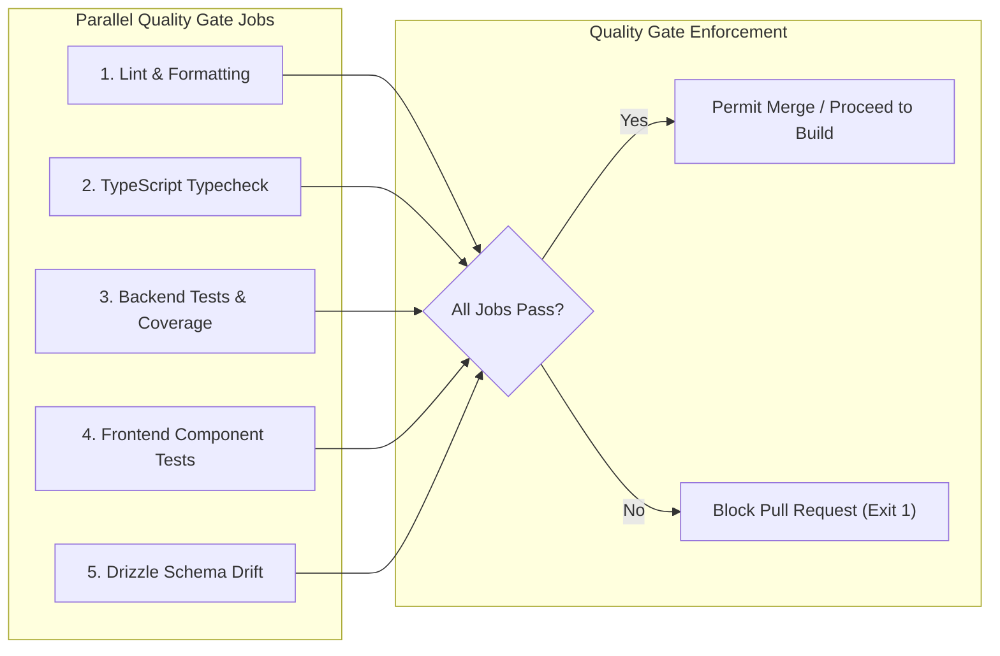
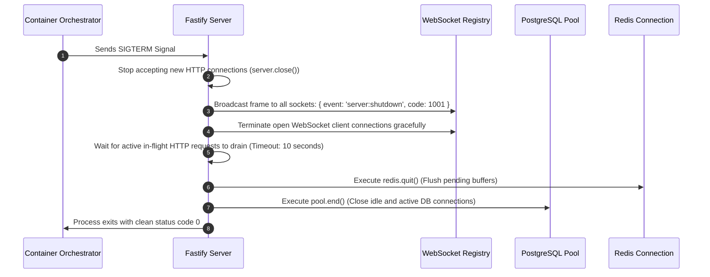
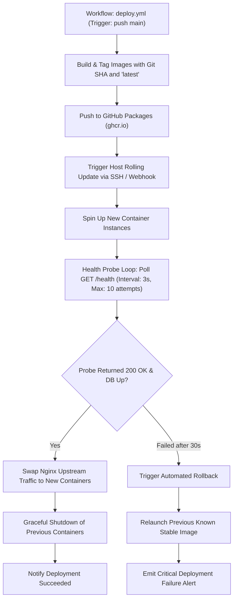

# Production Hardening, CI/CD Pipeline, and Deployment Design Specification

## 1. Overview and Architecture

This document specifies the Low-Level Design (LLD) for **Milestone 10: Production Hardening, CI/CD Pipeline, and Deployment** of the Smex Store platform. It defines the automated Continuous Integration (CI) test and lint matrix, Drizzle schema drift detection, multi-stage production containerization, zero-downtime Continuous Deployment (CD) with automated health probes and rollback, RFC 7807 structured error formatting, and WCAG 2.1 AA / reduced-motion accessibility hardening conforming to:
* `docs/internal/requirements.md` (Sections 10, 18, 20, 21)
* `docs/internal/design/hld.md` (Sections 7.1, 7.2, 7.3)
* `docs/internal/design/lld/core-plumbing.md` (Section 6)
* `docs/internal/design/lld/data-layer.md` (Section 4 & 6)
* `docs/internal/design/ui.md` (Sections 1, 2, 4)

```mermaid
flowchart TD
    subgraph CI["Continuous Integration Pipeline (.github/workflows/ci.yml)"]
        TRIGGER_CI["Git Push / Pull Request to main"] --> LINT_JOB["Job: Monorepo Lint (ESLint)"]
        TRIGGER_CI --> TYPE_JOB["Job: Strict Typecheck (tsc --noEmit)"]
        TRIGGER_CI --> TEST_SERVER["Job: Server Tests & Coverage (node:test + c8 >= 80%)"]
        TRIGGER_CI --> TEST_CLIENT["Job: Client Component Tests (Next.js 16)"]
        TRIGGER_CI --> DRIFT_JOB["Job: Drizzle Schema Drift (drizzle-kit check)"]
        LINT_JOB & TYPE_JOB & TEST_SERVER & TEST_CLIENT & DRIFT_JOB --> BUILD_JOB["Job: Production Build (tsdown + next build)"]
    end

    subgraph CD["Continuous Deployment Pipeline (.github/workflows/deploy.yml)"]
        MERGE_MAIN["Merge to main branch"] --> DOCKER_BUILD["Multi-Stage Container Build"]
        DOCKER_BUILD --> REGISTRY_PUSH["Publish Images to Container Registry"]
        REGISTRY_PUSH --> DEPLOY_TRIGGER["Trigger Zero-Downtime Rolling Deployment"]
        DEPLOY_TRIGGER --> HEALTH_PROBE{"Post-Deployment Health Probe (/health)"}
        HEALTH_PROBE -->|Status 200 OK & DB Up| DEPLOY_SUCCESS["Deployment Finalized (Traffic Swapped)"]
        HEALTH_PROBE -->|Failed within 30s| ROLLBACK["Automated Rollback to Previous Stable Image"]
    end

    subgraph Runtime["Production Container Stack (Docker Compose / Pod)"]
        NGINX_REV["Reverse Proxy & TLS Termination"]
        FASTIFY_APP["Fastify API Server (Node.js Alpine)"]
        NEXTJS_APP["Next.js SSR Frontend (Standalone Output)"]
        POSTGRES_DB[("PostgreSQL 16 Database")]
        REDIS_CACHE[("Redis 7.2 Cache & Pub/Sub")]
        S3_STORAGE[("S3 / MinIO Object Storage")]
    end

    NGINX_REV --> FASTIFY_APP
    NGINX_REV --> NEXTJS_APP
    FASTIFY_APP --> POSTGRES_DB
    FASTIFY_APP --> REDIS_CACHE
    FASTIFY_APP --> S3_STORAGE
```



---

## 2. Continuous Integration (CI) Workflow Specification

*Target File: `.github/workflows/ci.yml`*

The CI pipeline executes on every pull request and push to the `main` branch. It runs jobs in parallel with persistent dependency caching via `pnpm/action-setup` and `actions/cache`.



### 2.1 Job Definitions & Matrix Execution

1. **`lint`**:
   * Runs `pnpm lint` across monorepo packages.
   * Enforces zero ESLint warnings/errors and strict import formatting.
2. **`typecheck`**:
   * Runs `tsc --noEmit` across `server/` and `client/` workspaces.
   * Validates TypeScript strict mode compliance.
3. **`test-server`**:
   * Spins up ephemeral PostgreSQL 16 and Redis 7.2 test service containers.
   * Runs server unit and integration suites with V8 code coverage:
     ```bash
     FASTIFY_AUTOLOAD_TYPESCRIPT=1 node --test --experimental-test-coverage --loader ts-node/esm test/**/*.ts
     ```
   * Enforces quality gate: Line Coverage $\ge 80.0\%$, Branch Coverage $\ge 80.0\%$.
4. **`test-client`**:
   * Runs Next.js 16 test suite verifying DOM component rendering, interactive state management, and WCAG AA contrast compliance.
5. **`schema-drift`**:
   * Executes `pnpm --filter @smex/server db:generate --check` or `drizzle-kit check`.
   * Fails if any TypeScript schema modification in `src/db/schema/` lacks a corresponding generated SQL migration in `src/db/migrations/`.
6. **`build`**:
   * Depends on all upstream verification jobs.
   * Compiles the Fastify bundle (`tsdown`) and builds the Next.js production bundle (`next build`).

---

## 3. Production Containerization and Runtime Hardening

*Target Files: `server/Dockerfile`, `client/Dockerfile`, `docker-compose.prod.yml`*

### 3.1 Multi-Stage Dockerfile Specifications

#### A. Fastify API Backend (`server/Dockerfile`)
* **Stage 1 (Dependencies)**: Installs production and build dependencies with frozen lockfile (`pnpm install --frozen-lockfile`).
* **Stage 2 (Builder)**: Bundles TypeScript sources into minimal CommonJS/ESM distribution via `tsdown`.
* **Stage 3 (Runner)**:
  * Base: `node:22-alpine` for minimal surface area ($< 150\text{MB}$).
  * Security: Drops root privileges (`USER node:node`).
  * Environment: `NODE_ENV=production`.
  * Port: Exposes container port `3001`.
  * Healthcheck: Interrogates `/health` via native Node.js HTTP probe script every 15 seconds.

#### B. Next.js Frontend (`client/Dockerfile`)
* **Stage 1 (Dependencies)**: Installs monorepo dependencies.
* **Stage 2 (Builder)**: Runs `next build` with `output: 'standalone'` configured in `next.config.ts`.
* **Stage 3 (Runner)**:
  * Base: `node:22-alpine`.
  * Standalone Server: Copies `.next/standalone` and `.next/static` assets.
  * Security: Runs as unprivileged `nextjs:nodejs` user (`UID 1001`).
  * Port: Exposes container port `3000`.

---

### 3.2 Signal Handling and Graceful Shutdown Protocol

*Target Source: `server/src/app.ts`, `server/src/server.ts`*

To prevent dropped requests, broken WebSocket frames, and database connection leaks during rolling updates, the server implements an asynchronous shutdown sequence on `SIGTERM` and `SIGINT`:



---

## 4. Continuous Deployment (CD) and Rollback Strategy

*Target File: `.github/workflows/deploy.yml`*

Deployments execute on pushes to `main` following successful CI runs:



---

## 5. Structured Observability and RFC 7807 Error Handling

*Target Source: `server/src/plugins/sensible.ts`, `server/src/plugins/logger.ts`*

### 5.1 Structured Pino JSON Logging

Every log entry is emitted as valid structured JSON containing correlation identifiers:

```json
{
  "level": 30,
  "time": 1729240000000,
  "pid": 124,
  "hostname": "smex-api-prod-01",
  "reqId": "req_8a7c5b3d-1234-4567-89ab-cdef01234567",
  "req": {
    "method": "POST",
    "url": "/api/v1/marketplace/listings",
    "remoteAddress": "192.168.1.50"
  },
  "res": {
    "statusCode": 201
  },
  "responseTime": 14.2,
  "msg": "request completed"
}
```

* **Sensitive Field Redaction**: The logger automatically masks sensitive keys in request headers and bodies: `authorization`, `cookie`, `set-cookie`, `password`, `token`, `secret`.
* **WebSocket Correlation**: When a WebSocket connection upgrades from an HTTP handshake, the handshake `reqId` is associated with the socket session for cross-protocol tracing.

---

### 5.2 RFC 7807 Problem Details Standard

All non-2xx error responses adhere strictly to the **RFC 7807 Problem Details** specification with `Content-Type: application/problem+json`:

```json
{
  "type": "https://api.smexstore.com/errors/validation-failed",
  "title": "Validation Error",
  "status": 422,
  "detail": "The listing price must be greater than or equal to 100 INR.",
  "instance": "/api/v1/marketplace/listings",
  "code": "INVALID_PRICE_FLOOR",
  "invalid_params": [
    {
      "name": "priceInr",
      "reason": "Value 50.00 is below the minimum threshold of 100.00"
    }
  ]
}
```

---

## 6. Accessibility & Motion Physics Compliance

*Target Source: `client/src/app/globals.css`, `client/src/components/*`*

### 6.1 WCAG 2.1 AA Contrast Compliance

Per `docs/internal/design/ui.md`, contrast ratios meet or exceed WCAG AA standards across all three supported theme modes:

| Element / Pair | Color Tokens | Contrast Ratio | WCAG AA Requirement | Status |
| :--- | :--- | :--- | :--- | :--- |
| **Dark Mode Body Text** | `#E9F5F1` on `#0B0F12` | $14.2 : 1$ | $\ge 4.5 : 1$ | Compliant |
| **AMOLED Body Text** | `#FFFFFF` on `#000000` | $21.0 : 1$ | $\ge 4.5 : 1$ | Compliant |
| **Primary Emerald CTA** | `#0B1A15` on `#22C58F` | $7.8 : 1$ | $\ge 4.5 : 1$ | Compliant |
| **Muted Metadata Text** | `#8FA39C` on `#0B0F12` | $6.4 : 1$ | $\ge 4.5 : 1$ | Compliant |
| **Active Focus Ring** | `#3FE6B0` against `#121C19` | $8.1 : 1$ | $\ge 3.0 : 1$ | Compliant |

---

### 6.2 Reduced-Motion Media Query Hardening

When a user enables `prefers-reduced-motion: reduce` at the operating system level, all CSS transitions and animations resolve instantly to prevent vestibular disorientation:

```css
/* client/src/app/globals.css */
@media (prefers-reduced-motion: reduce) {
  *,
  *::before,
  *::after {
    animation-duration: 0.001ms !important;
    animation-iteration-count: 1 !important;
    transition-duration: 0.001ms !important;
    scroll-behavior: auto !important;
  }
}
```
