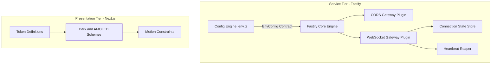
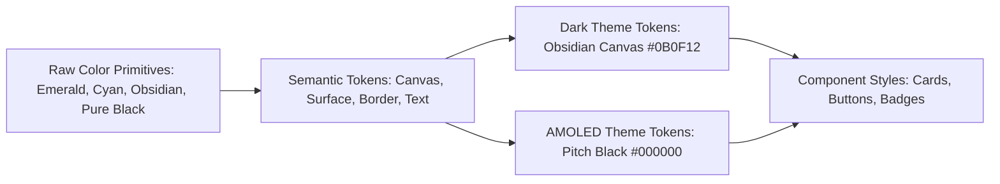
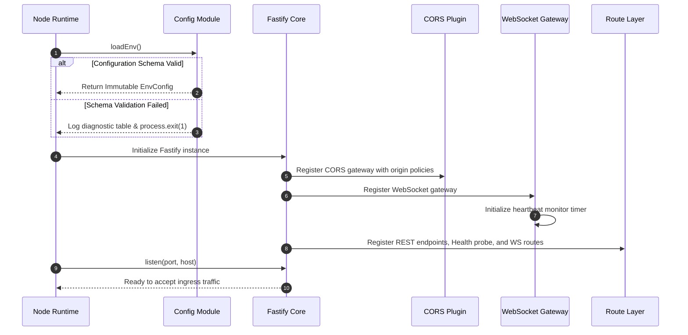

# Core Plumbing and Foundation Modules

## 1. Overview and Scope

This document specifies the Low-Level Design for the foundational platform infrastructure outlined in Milestone 1 of the engineering roadmap. It establishes the interface contracts, data models, state machines, and operational invariants for four core modules:

* **Environment Configuration Engine**: Validated configuration contract and fail-fast startup behavior.
* **Network Security and CORS Gateway**: Origin resolution rules, allowed ingress policies, and caching specifications.
* **WebSocket Gateway and Heartbeat Engine**: Connection state machine, heartbeat protocol, and message envelope schemas.
* **Client Design Token Engine**: Token hierarchy, multi-theme surface contracts, and hardware motion constraints.



---

## 2. Environment Configuration Module

*Target Source: `server/src/config/env.ts`*

### 2.1 Component Responsibility and Boundaries

The configuration module encapsulates all interactions with process environment variables. It enforces type safety, prevents runtime undefined reads across the application, and terminates execution immediately during boot if any required parameter violates schema constraints.

### 2.2 Configuration Schema Contract

| Key | Type | Constraints and Defaults | Semantic Purpose |
| :--- | :--- | :--- | :--- |
| `NODE_ENV` | `enum` | `'development'`, `'test'`, `'production'`; default `'development'` | Runtime environment switch |
| `PORT` | `integer` | Positive integer; default `3001` | TCP port for Fastify HTTP listener |
| `HOST` | `string` | IP string; default `'0.0.0.0'` | Network binding interface |
| `DATABASE_URL` | `string` | Valid URI with `postgresql://` scheme | PostgreSQL primary connection pool |
| `REDIS_URL` | `string` | Valid URI with `redis://` or `rediss://` scheme | Redis session and pub/sub cluster |
| `JWT_SECRET` | `string` | Minimum length 32 characters | Secret for short-lived access tokens |
| `JWT_REFRESH_SECRET` | `string` | Minimum length 32 characters | Secret for long-lived session tokens |
| `CORS_ORIGIN` | `string` | Comma-delimited origins or wildcard; default `'http://localhost:3000'` | Allowed web clients |
| `S3_ENDPOINT` | `string` | Valid HTTP/HTTPS URI; optional | Direct-to-storage API endpoint |
| `S3_REGION` | `string` | Default `'auto'` | Target object storage region |
| `S3_BUCKET` | `string` | Default `'smex-storage'` | Bucket identifier for uploads |
| `S3_ACCESS_KEY_ID` | `string` | Optional in dev, required in production | S3 access key credential |
| `S3_SECRET_ACCESS_KEY`| `string` | Optional in dev, required in production | S3 secret key credential |

### 2.3 Interface Signatures

```typescript
export interface EnvConfig {
  NODE_ENV: 'development' | 'test' | 'production';
  PORT: number;
  HOST: string;
  DATABASE_URL: string;
  REDIS_URL: string;
  JWT_SECRET: string;
  JWT_REFRESH_SECRET: string;
  CORS_ORIGIN: string;
  S3_ENDPOINT?: string;
  S3_REGION: string;
  S3_BUCKET: string;
  S3_ACCESS_KEY_ID?: string;
  S3_SECRET_ACCESS_KEY?: string;
}

export interface ConfigLoader {
  loadEnv: () => EnvConfig;
  getEnv: () => EnvConfig;
}
```

### 2.4 Validation and Fail-Fast Strategy

1. **Bootstrap Precedence**: `loadEnv()` runs synchronously before any database pool, cache client, or Fastify plugin initialization.
2. **Failure Handling**: When schema validation fails, parsing errors are formatted into structured field-level diagnostic records, printed to standard error, and process execution terminates with exit code 1.
3. **Immutability**: Parsed configuration is cached in memory as a read-only object accessible globally and via Fastify instance decoration (`fastify.config`).

---

## 3. Network Security and CORS Module

*Target Source: `server/src/plugins/cors.ts`*

### 3.1 Component Responsibility and Ingress Policies

The CORS plugin guards the Fastify HTTP gateway against unauthorized cross-origin requests while providing permissive access for local development and explicit origins in production.

### 3.2 Configuration Options Interface

```typescript
export interface SecurityCorsOptions {
  allowedOrigins?: string[];
  credentials?: boolean;
  maxAge?: number;
  methods?: string[];
  allowedHeaders?: string[];
  exposedHeaders?: string[];
}
```

### 3.3 Origin Resolution and Preflight Rules

* **Development Origin Policy**: Requests originating from `http://localhost:*` and `http://127.0.0.1:*` are automatically permitted.
* **Production Origin Policy**: Incoming `Origin` headers must match against the parsed `CORS_ORIGIN` allowlist array.
* **Non-Browser Ingress**: Requests without an `Origin` header (health checks, server-to-server RPC, mobile agents) are accepted.
* **Credential Handling**: `credentials` is set to `true` to allow cookies and authorization headers.
* **Preflight Caching**: Preflight `OPTIONS` responses set `Access-Control-Max-Age: 86400` (24 hours) to eliminate duplicate preflight latency.
* **Allowed HTTP Verbs**: `GET`, `POST`, `PUT`, `PATCH`, `DELETE`, `OPTIONS`.
* **Allowed Headers**: `Content-Type`, `Authorization`, `X-Requested-With`, `X-Device-Fingerprint`, `X-CSRF-Token`.

---

## 4. WebSocket Gateway and Heartbeat Module

*Target Source: `server/src/plugins/websocket.ts`*

### 4.1 Gateway Topology and State Contracts

The WebSocket Gateway maintains active duplex channels for tournament real-time events, match updates, and instant notifications.

```typescript
export interface WebSocketClientMeta {
  id: string;
  userId: string | null;
  isAlive: boolean;
  connectedAt: number;
  lastPingAt: number;
  lastPongAt: number;
  subscriptions: Set<string>;
}

export interface WsGatewayState {
  clients: Map<unknown, WebSocketClientMeta>;
  heartbeatIntervalMs: number;
}
```

### 4.2 Connection Lifecycle and Heartbeat Protocol

To detect zombie sockets caused by ungraceful TCP termination (half-open connections), the gateway uses a two-phase ping/pong evaluation cycle:

```mermaid
stateDiagram-v2
    [*] --> Connected: TCP Handshake Completed
    Connected --> Active: Registered with Metadata
    Active --> AwaitingPong: Heartbeat Timer fires; Ping frame dispatched; isAlive set to false
    AwaitingPong --> Active: Pong frame received; isAlive set to true
    AwaitingPong --> Terminated: Next Timer fires and isAlive still false
    Active --> Terminated: Client closes or Socket error
    Terminated --> [*]: Cleared from Gateway Registry
```



#### Protocol Timing Parameters
* **Heartbeat Interval**: 30,000 ms (30 seconds).
* **Dead Connection Threshold**: 1 missed pong cycle (maximum dead connection lifetime: 60 seconds).
* **Termination Action**: Calls immediate socket termination (`terminate`) to release socket file descriptors and memory.
* **Shutdown Hook**: On Fastify server shutdown, the gateway clears the interval timer and sends close code 1001 to all active sockets.

### 4.3 Unified Message Protocol Envelope

All messages across all WebSocket channels must use the standardized JSON envelope:

```typescript
export interface WsEnvelope<T = unknown> {
  event: string;
  channel: string;
  data: T;
  timestamp: number;
  correlationId?: string;
}
```

#### Standard System Events
* `SYSTEM_PING`: `{ event: "ping", channel: "system", data: {}, timestamp: number }`
* `SYSTEM_PONG`: `{ event: "pong", channel: "system", data: {}, timestamp: number }`
* `SYSTEM_ERROR`: `{ event: "error", channel: "system", data: { code: string, message: string }, timestamp: number }`

### 4.4 Broadcast and Channel Abstractions

The plugin decorates Fastify with a publishing interface for route handlers:

```typescript
export interface WsGatewayDecorator {
  broadcastToChannel: (channel: string, message: WsEnvelope) => void;
  sendToUser: (userId: string, message: WsEnvelope) => void;
  getActiveClientCount: () => number;
}
```

---

## 5. Client Design Tokens and Theme Module

*Target Source: `client/app/globals.css`*

### 5.1 Styling Architecture and Token Hierarchy

The client styling layer is built on Tailwind CSS v4 using semantic CSS custom properties. It decouples high-level component styles from raw color codes.



### 5.2 Palette Mapping and Contrast Matrix

| Semantic Token | Dark Mode Value | AMOLED Mode Value | Purpose and Scope |
| :--- | :--- | :--- | :--- |
| `--color-emerald-primary` | `#1FAE7A` | `#1FAE7A` | Primary actions, CTA buttons, active states |
| `--color-emerald-hover` | `#178C62` | `#178C62` | Interactive hover state for primary elements |
| `--color-cyan-depth` | `#1B8F97` | `#1B8F97` | Secondary badges, accents, captain badges |
| `--color-bg-canvas` | `#0B0F12` | `#000000` | Main application viewport background |
| `--color-bg-surface` | `#12181D` | `#0A0A0A` | Card bodies, dropdown panels, modal sheets |
| `--color-bg-elevated` | `#182026` | `#121212` | Popovers, tooltips, elevated containers |
| `--color-border-subtle` | `#1E262C` | `#1F1F1F` | Card outlines, dividers, structural borders |
| `--color-border-focus` | `#1FAE7A` | `#1FAE7A` | Keyboard focus indicator (WCAG 2.1 AA) |
| `--color-text-primary` | `#EDEDED` | `#EDEDED` | Headings, high-contrast readable content |
| `--color-text-secondary` | `#9BA3AF` | `#9BA3AF` | Body text, descriptions, secondary details |
| `--color-text-muted` | `#5B626E` | `#5B626E` | Form placeholders, timestamps, footnotes |

### 5.3 Motion Guardrails and Performance Invariants

* **Maximum Physical Duration**: Transitions must not exceed `120ms` under any circumstance.
* **Prohibited Visual Effects**:
  * Frosted-glass filter effects (`backdrop-filter: blur(...)`) are strictly prohibited due to GPU fill-rate degradation.
  * Heavy layered box-shadow glows are banned to prevent composite thread stalling.
* **Health and Readiness Probe**: Server status, uptime, and system memory metrics reporting.
* **Local Infrastructure Emulation**: Containerized local development stack for PostgreSQL, Redis, and MinIO.

---

## 6. Health Probe and Observability Module

*Target Source: `server/src/routes/health.ts`*

### 6.1 Endpoint Specification and Metric Schema

The health check endpoint provides a lightweight, non-blocking probe for load balancers, orchestrators, and monitoring agents to evaluate process liveness and memory health.

| Field | Type | Description |
| :--- | :--- | :--- |
| `status` | `string` | High-level service status, returns `'ok'` |
| `uptime` | `number` | Process uptime in seconds with floating-point precision |
| `timestamp` | `string` | ISO 8601 formatted UTC timestamp |
| `environment` | `string` | Active runtime environment from configuration |
| `memory.rss` | `integer` | Resident Set Size memory allocation in bytes |
| `memory.heapTotal` | `integer` | Total allocated V8 heap memory in bytes |
| `memory.heapUsed` | `integer` | Actual used V8 heap memory in bytes |
| `memory.external` | `integer` | Memory bound to C++ objects managed by V8 |

### 6.2 Health Response Payload Example

```json
{
  "status": "ok",
  "uptime": 142.85,
  "timestamp": "2026-10-10T07:05:00.000Z",
  "environment": "development",
  "memory": {
    "rss": 54231040,
    "heapTotal": 29818880,
    "heapUsed": 18452304,
    "external": 1945820
  }
}
```

---

## 7. Local Infrastructure Topology

*Target Source: `docker-compose.yml`*

### 7.1 Containerized Backing Services

Local development uses Docker Compose to provide full parity with production backing services without cloud dependencies:

| Service | Container Name | Image | Port Mapping | Purpose |
| :--- | :--- | :--- | :--- | :--- |
| `postgres` | `smex-postgres` | `postgres:16-alpine` | `5432:5432` | Relational database with ACID transaction support |
| `redis` | `smex-redis` | `redis:7.2-alpine` | `6379:6379` | Session store, rate limiter, and pub/sub bus |
| `minio` | `smex-minio` | `minio/minio:latest` | `9000:9000`, `9001:9001` | S3 compatible local object storage for proofs |
| `minio-init` | `smex-minio-init` | `minio/mc:latest` | None | Automated bucket provisioner creating `smex-storage` |

### 7.2 Container Network and Volume Architecture

* **Isolated Bridge Network**: All services communicate across `smex-network`.
* **Named Volumes**: Data persists across restarts via `smex_postgres_data`, `smex_redis_data`, and `smex_minio_data`.
* **Automated Health Probes**: `postgres` runs `pg_isready`, `redis` runs `redis-cli ping`, and `minio` runs `mc ready local`.

---

## 8. Integration and Bootstrap Flow

### 8.1 Server Initialization Sequence



### 8.2 Error Handling and Observability Invariants

* **Zero Silent Failures**: Uncaught configuration errors or unhandled socket exceptions must log structured JSON entries with correlation context.
* **Deterministic Status Codes**: CORS origin rejections return HTTP 403 Forbidden with standard RFC 7807 error responses.
* **Clean Resource Disposal**: Process shutdown triggers graceful socket termination with standard close code 1001 before closing the HTTP listener and database pools.
