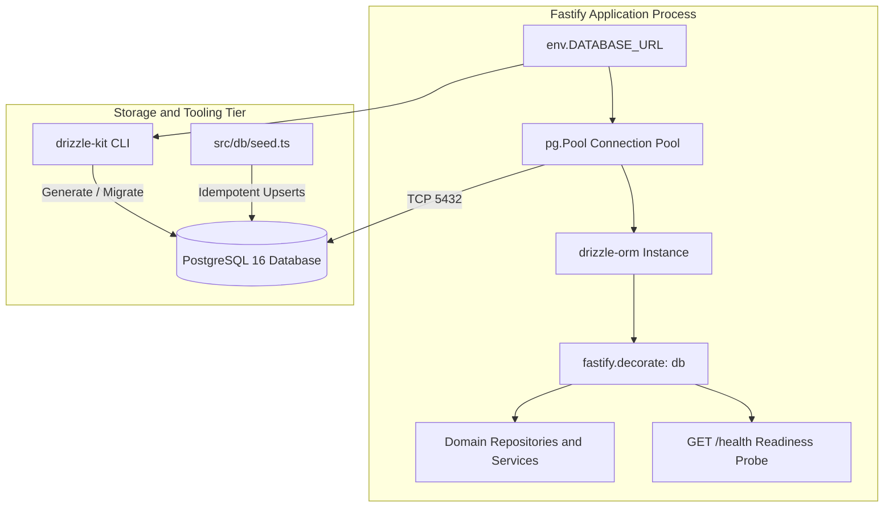
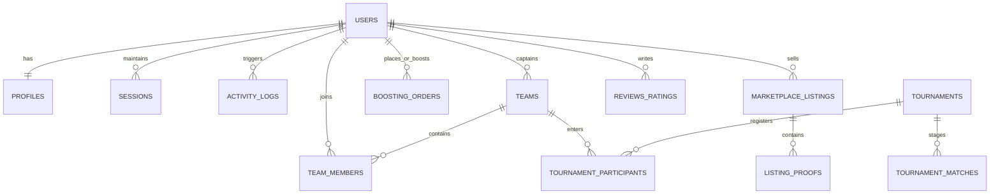
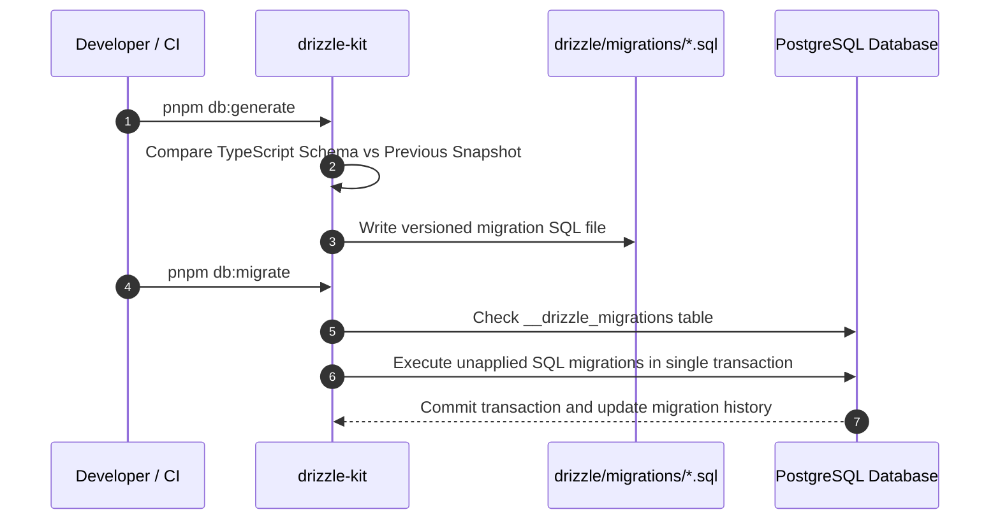
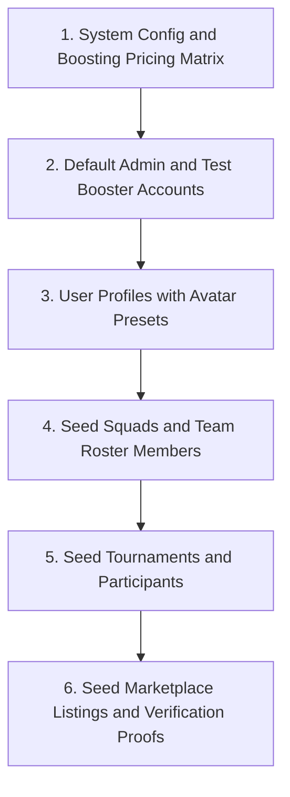

# Data Layer and Persistence Engine

## 1. Overview and Scope

This document specifies the Low-Level Design for the PostgreSQL persistence tier and Drizzle ORM data layer outlined in Milestone 2 of the platform roadmap. It defines the connection pooling topology, relational schema contracts across all core domains, migration lifecycle, idempotent seed pipeline, and dynamic database health probing.



---

## 2. Connection Pool and Lifecycle Architecture

*Target Source: `server/src/db/index.ts`*

### 2.1 Connection Pool Specification

The database client uses `drizzle-orm/node-postgres` atop a managed `pg.Pool` connection pool. The pool configuration enforces bounded connection scaling and fail-fast timeouts:

| Parameter                   | Value     | Operational Purpose                                                          |
| :-------------------------- | :-------- | :--------------------------------------------------------------------------- |
| `max`                     | `20`    | Maximum active connections per server container                              |
| `min`                     | `2`     | Minimum idle connections preserved to eliminate cold-start handshake latency |
| `idleTimeoutMillis`       | `30000` | Reaps connections idle for more than 30 seconds                              |
| `connectionTimeoutMillis` | `2000`  | Fails fast after 2 seconds if the database is unreachable                    |
| `allowExitOnIdle`         | `false` | Keeps node process alive while pool connections exist                        |

### 2.2 Graceful Draining and Shutdown Protocol

To prevent abruptly severing inflight client database transactions during zero-downtime rolling deploys:

1. Fastify registers an `onClose` hook bound to the database pool.
2. Inflight queries are granted a 5-second graceful drain window.
3. The pool executes `pool.end()`, destroying all TCP sockets and releasing database backend processes.

```typescript
export interface DatabaseConnectionManager {
  pool: import('pg').Pool;
  db: import('drizzle-orm/node-postgres').NodePgDatabase<Record<string, unknown>>;
  close: () => Promise<void>;
}
```

---

## 3. Relational Schema and Entity Contracts

*Target Source: `server/src/db/schema/*`*

### 3.1 Entity Relationship Model



### 3.2 Authentication and Identity Tables

*Target Source: `server/src/db/schema/users.ts` and `server/src/db/schema/sessions.ts`*

#### Table: `users`

Represents the core security principal and login identity.

| Column             | Data Type                            | Constraints                               | Description                           |
| :----------------- | :----------------------------------- | :---------------------------------------- | :------------------------------------ |
| `id`             | `uuid`                             | Primary Key, Default`gen_random_uuid()` | Unique immutable user identifier      |
| `email`          | `varchar(255)`                     | Not Null, Unique                          | User email address for authentication |
| `password_hash`  | `text`                             | Not Null                                  | Argon2id cryptographic hash           |
| `role`           | `enum('user', 'admin', 'booster')` | Not Null, Default`'user'`               | Role-based authorization tier         |
| `email_verified` | `boolean`                          | Not Null, Default`false`                | Email verification flag               |
| `created_at`     | `timestamp with time zone`         | Not Null, Default`now()`                | Record creation timestamp             |
| `updated_at`     | `timestamp with time zone`         | Not Null, Default`now()`                | Last modification timestamp           |

#### Table: `profiles`

Holds gaming identity, gamer tags, and visual customizations.

| Column            | Data Type                    | Constraints                                           | Description                             |
| :---------------- | :--------------------------- | :---------------------------------------------------- | :-------------------------------------- |
| `user_id`       | `uuid`                     | Primary Key, FK$\rightarrow$ `users.id` (Cascade) | 1-to-1 link to security principal       |
| `username`      | `varchar(50)`              | Not Null, Unique                                      | Public platform handle                  |
| `in_game_id`    | `varchar(50)`              | Nullable                                              | Primary game account ID (e.g. MLBB IGN) |
| `avatar_preset` | `varchar(50)`              | Not Null, Default`'emerald-warrior'`                | Static SVG avatar identifier            |
| `playstyle`     | `varchar(50)`              | Nullable                                              | Role tag (e.g. Jungler, Roamer, Mid)    |
| `bio`           | `text`                     | Nullable                                              | User-authored profile description       |
| `updated_at`    | `timestamp with time zone` | Not Null, Default`now()`                            | Profile last updated                    |

#### Table: `sessions`

Tracks active sessions for remote multi-device token revocation.

| Column                 | Data Type                    | Constraints                                        | Description                                |
| :--------------------- | :--------------------------- | :------------------------------------------------- | :----------------------------------------- |
| `id`                 | `uuid`                     | Primary Key, Default`gen_random_uuid()`          | Session ID tracked inside Redis            |
| `user_id`            | `uuid`                     | Not Null, FK$\rightarrow$ `users.id` (Cascade) | Owner of the session                       |
| `device_fingerprint` | `varchar(255)`             | Not Null                                           | SHA-256 hash of User-Agent and headers     |
| `ip_address`         | `varchar(45)`              | Not Null                                           | Client IPv4 or IPv6 address                |
| `user_agent`         | `text`                     | Nullable                                           | Raw User-Agent string                      |
| `is_active`          | `boolean`                  | Not Null, Default`true`                          | Session validity status                    |
| `expires_at`         | `timestamp with time zone` | Not Null                                           | Expiration timestamp (matches refresh TTL) |
| `created_at`         | `timestamp with time zone` | Not Null, Default`now()`                         | Session creation timestamp                 |

### 3.3 Squad and Roster Engine Tables

*Target Source: `server/src/db/schema/teams.ts`*

#### Table: `teams`

Represents an esports squad or clan.

| Column          | Data Type                                 | Constraints                               | Description                     |
| :-------------- | :---------------------------------------- | :---------------------------------------- | :------------------------------ |
| `id`          | `uuid`                                  | Primary Key, Default`gen_random_uuid()` | Unique team identifier          |
| `name`        | `varchar(100)`                          | Not Null, Unique                          | Team name                       |
| `tag`         | `varchar(10)`                           | Not Null                                  | Squad tag prefix (e.g.`SMX`)  |
| `captain_id`  | `uuid`                                  | Not Null, FK$\rightarrow$ `users.id`  | Squad captain user              |
| `game_slug`   | `varchar(50)`                           | Not Null, Default`'mlbb'`               | Title slug                      |
| `member_cap`  | `integer`                               | Not Null, Default`5`                    | Maximum roster capacity cap     |
| `open_status` | `enum('open', 'invite_only', 'closed')` | Not Null, Default`'open'`               | Recruitment visibility status   |
| `description` | `text`                                  | Nullable                                  | Squad bio and recruitment terms |
| `created_at`  | `timestamp with time zone`              | Not Null, Default`now()`                | Team founding timestamp         |

#### Table: `team_members`

Maps roster membership with role hierarchies.

| Column          | Data Type                                   | Constraints                                        | Description              |
| :-------------- | :------------------------------------------ | :------------------------------------------------- | :----------------------- |
| `id`          | `uuid`                                    | Primary Key, Default`gen_random_uuid()`          | Unique membership record |
| `team_id`     | `uuid`                                    | Not Null, FK$\rightarrow$ `teams.id` (Cascade) | Target team              |
| `user_id`     | `uuid`                                    | Not Null, FK$\rightarrow$ `users.id` (Cascade) | Member user              |
| `member_role` | `enum('captain', 'co_captain', 'member')` | Not Null, Default`'member'`                      | Roster role permission   |
| `joined_at`   | `timestamp with time zone`                | Not Null, Default`now()`                         | Join timestamp           |

*Index / Constraint*: Unique compound index on `(team_id, user_id)`.

### 3.4 Tournament and Bracket Tables

*Target Source: `server/src/db/schema/tournaments.ts`*

#### Table: `tournaments`

Stores tournament configurations and prize structures.

| Column             | Data Type                                                           | Constraints                               | Description                       |
| :----------------- | :------------------------------------------------------------------ | :---------------------------------------- | :-------------------------------- |
| `id`             | `uuid`                                                            | Primary Key, Default`gen_random_uuid()` | Tournament identifier             |
| `title`          | `varchar(200)`                                                    | Not Null                                  | Public tournament title           |
| `game_slug`      | `varchar(50)`                                                     | Not Null                                  | Target game title                 |
| `format`         | `enum('single_elimination', 'double_elimination', 'round_robin')` | Not Null                                  | Bracket progression rule          |
| `status`         | `enum('upcoming', 'registration_open', 'ongoing', 'completed')`   | Not Null, Default`'upcoming'`           | Tournament lifecycle state        |
| `prize_pool_inr` | `decimal(10,2)`                                                   | Not Null, Default`0.00`                 | Cash or credit prize pool         |
| `max_teams`      | `integer`                                                         | Not Null, Default`16`                   | Maximum allowed registered squads |
| `start_time`     | `timestamp with time zone`                                        | Not Null                                  | Scheduled match kickoff           |
| `rules_markdown` | `text`                                                            | Nullable                                  | Custom match rules and terms      |
| `winner_team_id` | `uuid`                                                            | Nullable, FK$\rightarrow$ `teams.id`  | Crowned championship team         |
| `created_at`     | `timestamp with time zone`                                        | Not Null, Default`now()`                | Creation timestamp                |

#### Table: `tournament_participants`

Stores confirmed roster entries in a tournament.

| Column            | Data Type                    | Constraints                                              | Description               |
| :---------------- | :--------------------------- | :------------------------------------------------------- | :------------------------ |
| `id`            | `uuid`                     | Primary Key, Default`gen_random_uuid()`                | Registration record       |
| `tournament_id` | `uuid`                     | Not Null, FK$\rightarrow$ `tournaments.id` (Cascade) | Tournament reference      |
| `team_id`       | `uuid`                     | Not Null, FK$\rightarrow$ `teams.id` (Cascade)       | Participating team        |
| `seed_number`   | `integer`                  | Nullable                                                 | Bracket seeding placement |
| `registered_at` | `timestamp with time zone` | Not Null, Default`now()`                               | Registration timestamp    |

*Index / Constraint*: Unique compound index on `(tournament_id, team_id)`.

#### Table: `tournament_matches`

Represents individual matches within a tournament bracket.

| Column            | Data Type                                  | Constraints                                              | Description                          |
| :---------------- | :----------------------------------------- | :------------------------------------------------------- | :----------------------------------- |
| `id`            | `uuid`                                   | Primary Key, Default`gen_random_uuid()`                | Match identifier                     |
| `tournament_id` | `uuid`                                   | Not Null, FK$\rightarrow$ `tournaments.id` (Cascade) | Parent tournament                    |
| `round_number`  | `integer`                                | Not Null                                                 | Round index (1 = Ro16, 2 = Quarters) |
| `match_order`   | `integer`                                | Not Null                                                 | Sequential ordering within round     |
| `team_a_id`     | `uuid`                                   | Nullable, FK$\rightarrow$ `teams.id`                 | First seeded competitor team         |
| `team_b_id`     | `uuid`                                   | Nullable, FK$\rightarrow$ `teams.id`                 | Second seeded competitor team        |
| `team_a_score`  | `integer`                                | Not Null, Default`0`                                   | Team A final score                   |
| `team_b_score`  | `integer`                                | Not Null, Default`0`                                   | Team B final score                   |
| `winner_id`     | `uuid`                                   | Nullable, FK$\rightarrow$ `teams.id`                 | Match winner advancing               |
| `status`        | `enum('scheduled', 'live', 'completed')` | Not Null, Default`'scheduled'`                         | Match progress state                 |
| `scheduled_at`  | `timestamp with time zone`               | Nullable                                                 | Scheduled kickoff time               |
| `completed_at`  | `timestamp with time zone`               | Nullable                                                 | Match conclusion timestamp           |

### 3.5 MLBB Boosting and Rate Matrix Tables

*Target Source: `server/src/db/schema/boosting.ts`*

#### Table: `boosting_rates`

Configurable pricing matrices for rank progression calculations.

| Column            | Data Type                            | Constraints                               | Description                          |
| :---------------- | :----------------------------------- | :---------------------------------------- | :----------------------------------- |
| `id`            | `uuid`                             | Primary Key, Default`gen_random_uuid()` | Rate rule identifier                 |
| `game_slug`     | `varchar(50)`                      | Not Null, Default`'mlbb'`               | Target game                          |
| `pricing_mode`  | `enum('tier_to_tier', 'per_star')` | Not Null                                  | Calculation formula mode             |
| `from_tier`     | `varchar(50)`                      | Nullable                                  | Sub-Mythic start tier (e.g. Epic)    |
| `to_tier`       | `varchar(50)`                      | Nullable                                  | Sub-Mythic target tier (e.g. Legend) |
| `star_tier_min` | `integer`                          | Nullable                                  | Mythic minimum stars (e.g. 0)        |
| `star_tier_max` | `integer`                          | Nullable                                  | Mythic maximum stars (e.g. 24)       |
| `price_inr`     | `decimal(10,2)`                    | Not Null                                  | Fixed package or per-star price      |
| `is_active`     | `boolean`                          | Not Null, Default`true`                 | Rate rule active flag                |
| `updated_at`    | `timestamp with time zone`         | Not Null, Default`now()`                | Rate rule last modified              |

#### Table: `boosting_orders`

Stores customer orders and external dispatcher communication metadata.

| Column                   | Data Type                                                                        | Constraints                               | Description                     |
| :----------------------- | :------------------------------------------------------------------------------- | :---------------------------------------- | :------------------------------ |
| `id`                   | `uuid`                                                                         | Primary Key, Default`gen_random_uuid()` | Order identifier                |
| `customer_id`          | `uuid`                                                                         | Not Null, FK$\rightarrow$ `users.id`  | Requesting customer             |
| `booster_id`           | `uuid`                                                                         | Nullable, FK$\rightarrow$ `users.id`  | Assigned booster account        |
| `game_slug`            | `varchar(50)`                                                                  | Not Null, Default`'mlbb'`               | Game title                      |
| `start_rank`           | `varchar(50)`                                                                  | Not Null                                  | Starting rank name              |
| `target_rank`          | `varchar(50)`                                                                  | Not Null                                  | Goal rank name                  |
| `start_stars`          | `integer`                                                                      | Not Null, Default`0`                    | Starting star count             |
| `target_stars`         | `integer`                                                                      | Not Null, Default`0`                    | Target star count               |
| `calculated_price_inr` | `decimal(10,2)`                                                                | Not Null                                  | Total calculated order price    |
| `status`               | `enum('pending_contact', 'assigned', 'in_progress', 'completed', 'cancelled')` | Not Null, Default`'pending_contact'`    | Order state                     |
| `contact_channel`      | `enum('whatsapp', 'telegram', 'discord')`                                      | Not Null                                  | Dispatch channel selected       |
| `customer_ign`         | `varchar(50)`                                                                  | Not Null                                  | Customer in-game character name |
| `created_at`           | `timestamp with time zone`                                                     | Not Null, Default`now()`                | Order placement time            |
| `updated_at`           | `timestamp with time zone`                                                     | Not Null, Default`now()`                | Order status update time        |

### 3.6 Marketplace and Media Proof Tables

*Target Source: `server/src/db/schema/marketplace.ts`*

#### Table: `marketplace_listings`

Game account listings created by verified sellers.

| Column                 | Data Type                                        | Constraints                                        | Description                     |
| :--------------------- | :----------------------------------------------- | :------------------------------------------------- | :------------------------------ |
| `id`                 | `uuid`                                         | Primary Key, Default`gen_random_uuid()`          | Listing identifier              |
| `seller_id`          | `uuid`                                         | Not Null, FK$\rightarrow$ `users.id` (Cascade) | Selling user account            |
| `title`              | `varchar(200)`                                 | Not Null                                           | Listing title                   |
| `game_slug`          | `varchar(50)`                                  | Not Null, Default`'mlbb'`                        | Game category                   |
| `rank_tier`          | `varchar(50)`                                  | Not Null                                           | Current account rank            |
| `price_inr`          | `decimal(10,2)`                                | Not Null                                           | Active listing price            |
| `baseline_price_inr` | `decimal(10,2)`                                | Not Null                                           | Original listed price           |
| `badge_type`         | `enum('good_deal', 'hot', 'verified', 'none')` | Not Null, Default`'none'`                        | Computed promo badge            |
| `status`             | `enum('active', 'sold', 'hidden')`             | Not Null, Default`'active'`                      | Listing visibility              |
| `contact_channel`    | `enum('whatsapp', 'telegram', 'discord')`      | Not Null                                           | Seller contact method           |
| `contact_handle`     | `varchar(100)`                                 | Not Null                                           | Seller username or phone number |
| `created_at`         | `timestamp with time zone`                     | Not Null, Default`now()`                         | Listing created timestamp       |
| `updated_at`         | `timestamp with time zone`                     | Not Null, Default`now()`                         | Listing modified timestamp      |

#### Table: `listing_proofs`

Stores references to screenshot proofs uploaded directly to S3/MinIO.

| Column              | Data Type                    | Constraints                                                       | Description                           |
| :------------------ | :--------------------------- | :---------------------------------------------------------------- | :------------------------------------ |
| `id`              | `uuid`                     | Primary Key, Default`gen_random_uuid()`                         | Proof record identifier               |
| `listing_id`      | `uuid`                     | Not Null, FK$\rightarrow$ `marketplace_listings.id` (Cascade) | Parent listing                        |
| `s3_key`          | `text`                     | Not Null                                                          | Storage bucket object key             |
| `cdn_url`         | `text`                     | Not Null                                                          | Resolved public or presigned view URL |
| `mime_type`       | `varchar(50)`              | Not Null                                                          | Validated MIME type                   |
| `file_size_bytes` | `integer`                  | Not Null                                                          | File size in bytes (max 5MB)          |
| `display_order`   | `integer`                  | Not Null, Default`0`                                            | Carousel display sorting index        |
| `created_at`      | `timestamp with time zone` | Not Null, Default`now()`                                        | Upload timestamp                      |

### 3.7 Governance, Ratings, and Audit Tables

*Target Source: `server/src/db/schema/governance.ts`*

#### Table: `reviews_ratings`

Community ratings and feedback for sellers, teams, and tournaments.

| Column          | Data Type                                | Constraints                                    | Description               |
| :-------------- | :--------------------------------------- | :--------------------------------------------- | :------------------------ |
| `id`          | `uuid`                                 | Primary Key, Default`gen_random_uuid()`      | Review identifier         |
| `reviewer_id` | `uuid`                                 | Not Null, FK$\rightarrow$ `users.id`       | Authoring user            |
| `target_type` | `enum('seller', 'team', 'tournament')` | Not Null                                       | Entity type under review  |
| `target_id`   | `uuid`                                 | Not Null                                       | Entity UUID               |
| `rating`      | `integer`                              | Not Null, Check`rating >= 1 AND rating <= 5` | Numeric score 1 to 5      |
| `feedback`    | `text`                                 | Nullable                                       | Optional text testimonial |
| `created_at`  | `timestamp with time zone`             | Not Null, Default`now()`                     | Review timestamp          |

#### Table: `activity_logs`

Security and administrative audit trail.

| Column            | Data Type                    | Constraints                               | Description                          |
| :---------------- | :--------------------------- | :---------------------------------------- | :----------------------------------- |
| `id`            | `uuid`                     | Primary Key, Default`gen_random_uuid()` | Log entry identifier                 |
| `user_id`       | `uuid`                     | Nullable, FK$\rightarrow$ `users.id`  | Acting user                          |
| `action_type`   | `varchar(100)`             | Not Null                                  | Event name (e.g.`SESSION_REVOKED`) |
| `metadata_json` | `jsonb`                    | Not Null, Default`'{}'::jsonb`          | Contextual event parameters          |
| `ip_address`    | `varchar(45)`              | Nullable                                  | Client IP address                    |
| `created_at`    | `timestamp with time zone` | Not Null, Default`now()`                | Audit record timestamp               |

---

## 4. Drizzle Configuration and Migration Architecture

*Target Source: `server/drizzle.config.ts`*

### 4.1 Drizzle Kit Configuration Specification

Drizzle Kit manages migrations with explicit schema definitions and migration artifact paths:

```typescript
export interface DrizzleConfigContract {
  schema: string;
  out: string;
  dialect: 'postgresql';
  dbCredentials: {
    url: string;
  };
  strict: boolean;
  verbose: boolean;
}
```

* **Schema Path**: `./src/db/schema/index.ts` (barrel file exporting all tables and relations).
* **Output Folder**: `./drizzle/` (stores generated `.sql` files and migration snapshots).
* **Dialect**: `'postgresql'` using native PostgreSQL driver types.

### 4.2 Migration Generation and Application Workflow



### 4.3 Schema Drift Prevention Invariant

In Continuous Integration, the pipeline executes `pnpm db:check` or `drizzle-kit generate --dry-run` to detect any discrepancy between TypeScript schema definitions and committed SQL migration files before any pull request can be merged.

---

## 5. Seed Pipeline and Deterministic Fixtures

*Target Source: `server/src/db/seed.ts`*

### 5.1 Seeding Sequence and Dependency Order

Because foreign keys enforce relational integrity, seeding must execute in a strict dependency sequence:



### 5.2 Deterministic Fixture Specifications

The seed pipeline populates default data for development and integration test environments:

1. **MLBB Boosting Pricing Matrix**:
   * Fixed Sub-Mythic Packages: Epic $\rightarrow$ Legend (₹400), Legend $\rightarrow$ Mythic (₹300), Epic $\rightarrow$ Mythic Bundle (₹600).
   * Per-Star Mythic Tiers: 0-24★ (₹20/★), 25-49★ (₹30/★), 50-99★ (₹35/★), 100+★ (₹40/★).
2. **Default Administrative Principal**:
   * Email: `admin@smex.store`
   * Role: `admin`
   * Password: Deterministic argon2 hash for `AdminPassword123!`
3. **Avatar Presets**:
   * `'emerald-warrior'`, `'obsidian-striker'`, `'cyan-mage'`, `'cyber-marksman'`
4. **Sample Tournament**:
   * Title: `'SMEX MLBB Championship - Season 1'`
   * Format: `'single_elimination'`
   * Prize Pool: ₹10,000.00
   * Status: `'registration_open'`
   * Max Teams: 16

### 5.3 Idempotency and Conflict Invariants

* All insert operations must use PostgreSQL `ON CONFLICT DO NOTHING` or `ON CONFLICT (id) DO UPDATE`.
* Running `pnpm db:seed` multiple times must produce identical database states with zero duplicate record errors or unique key constraint violations.

---

## 6. Persistence Health Probe Extension

*Target Source: `server/src/routes/health.ts`*

### 6.1 Database Query Ping Specification

The `GET /health` endpoint extends from Milestone 1 to execute an active ping query against the PostgreSQL connection pool:

1. Fastify checks `fastify.db`.
2. Executes a lightweight ping: `SELECT 1 AS readiness`.
3. Calculates query response duration (`dbLatencyMs`).
4. **Success State**: If query resolves $\le 1000\text{ms}$, HTTP status code is 200.
5. **Failure State**: If query throws an exception or timeouts, HTTP status code is 503 Service Unavailable, and details report the connection failure reason.

### 6.2 Health Probe Response Contract

```json
{
  "status": "ok",
  "uptime": 234.12,
  "timestamp": "2026-10-10T07:45:00.000Z",
  "environment": "development",
  "memory": {
    "rss": 62410752,
    "heapTotal": 31457280,
    "heapUsed": 21893120,
    "external": 1952100
  },
  "database": {
    "status": "connected",
    "latencyMs": 1.48
  }
}
```
