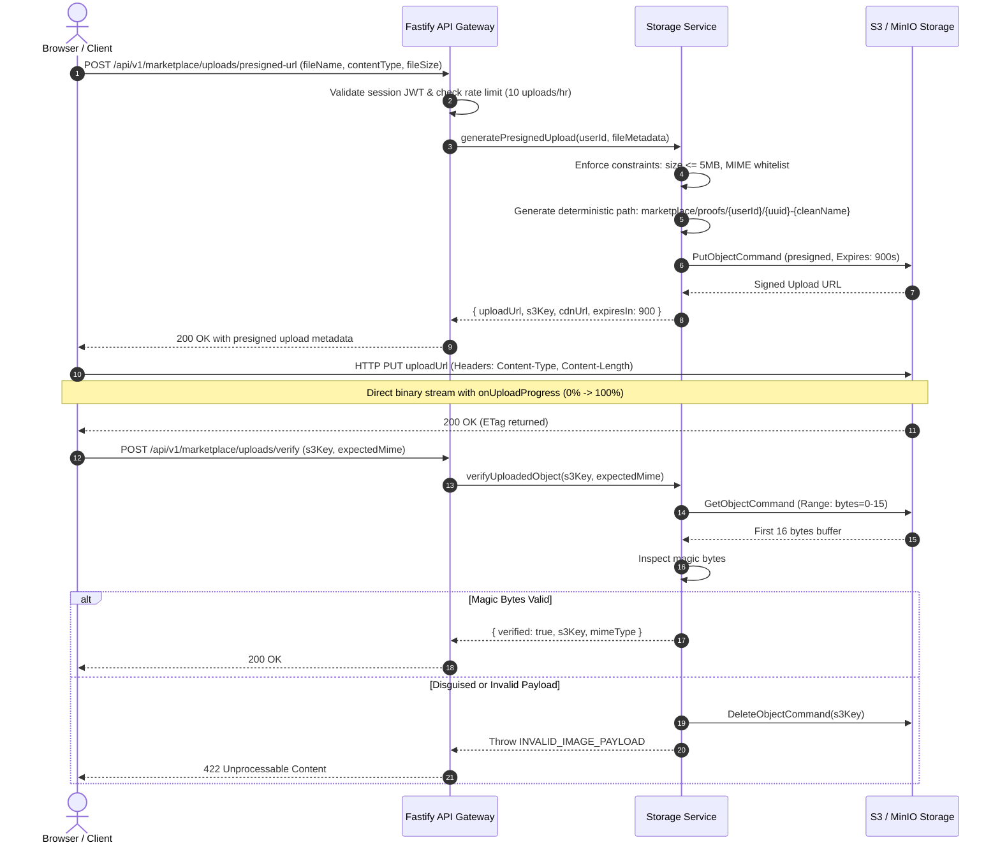
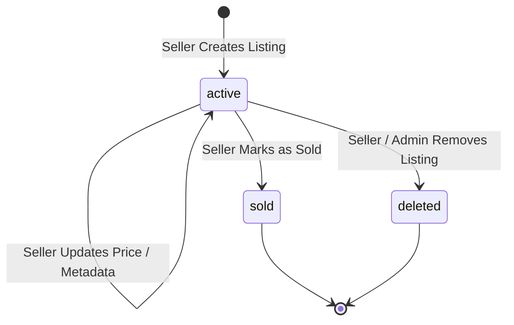
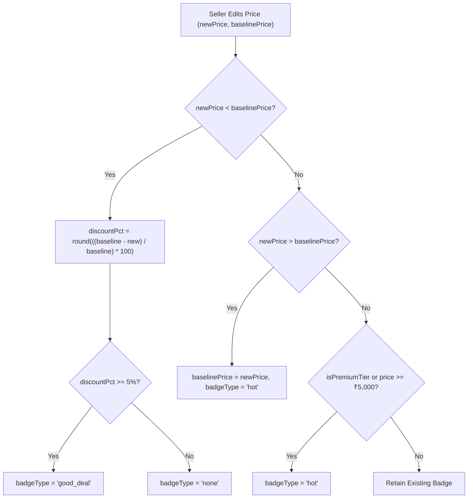

# Marketplace and S3 Presigned Uploads Design Specification

## 1. Overview and Architecture

This document specifies the Low-Level Design (LLD) for **Milestone 7: Marketplace and S3 Presigned Uploads** of the Smex Store platform. It defines the direct-to-storage upload pipeline using S3 presigned URLs, binary magic-byte security inspection, marketplace listing lifecycle and CRUD operations, dynamic price-drop and "Hot" deal badges, seller contact handoff, and client presentation components conforming to:
* `docs/internal/requirements.md` (Sections 5.1, 6.5, 8.6, 9.1, 10)
* `docs/internal/design/hld.md` (Sections 2.4, 5, 7.1, 7.3)
* `docs/internal/design/lld/data-layer.md` (Section 3.6 & 3.7)
* `docs/internal/adr/payment.md` (ADR 0001: External Payment and Communication Links)
* `docs/internal/design/ui.md` (AMOLED `#000000`, 120ms hardware transitions, zero frosted glass blur)

```mermaid
flowchart TD
    subgraph Client["Presentation Tier (Next.js 16)"]
        CATALOG["Marketplace Catalog (/marketplace)"]
        DETAIL["Listing Detail & Lightbox (/marketplace/:id)"]
        CREATE_FORM["Create Listing Form (/marketplace/create)"]
        UPLOAD_UI["Direct-to-S3 Uploader with Progress Bar"]
        CONTACT_MODAL["Seller Contact Modal"]
    end

    subgraph Gateway["API Gateway Tier (Fastify)"]
        PRESIGN_ROUTE["POST /api/v1/marketplace/uploads/presigned-url"]
        VERIFY_ROUTE["POST /api/v1/marketplace/uploads/verify"]
        LISTING_ROUTES["Listing CRUD Endpoints (/api/v1/marketplace/listings/*)"]
    end

    subgraph Services["Core Application Services"]
        STORAGE_SVC["Storage & Presigner Service (services/storage.service.ts)"]
        INSPECT_SVC["Binary Magic Byte Inspector (services/media-inspector.service.ts)"]
        LISTING_SVC["Listing Management Service (services/listing.service.ts)"]
        BADGE_ENGINE["Dynamic Badge Engine (services/badge.service.ts)"]
    end

    subgraph Storage["Storage Tier"]
        PG_DB[("PostgreSQL 16: marketplace_listings, listing_proofs")]
        S3_STORE[("S3 / MinIO Object Storage (Bucket: env.S3_BUCKET)")]
    end

    CREATE_FORM --> UPLOAD_UI
    UPLOAD_UI -->|1. Request Presigned URL| PRESIGN_ROUTE
    PRESIGN_ROUTE --> STORAGE_SVC
    STORAGE_SVC -->|Generate PUT URL with 5MB Limit| S3_STORE
    PRESIGN_ROUTE -->> UPLOAD_UI: { uploadUrl, s3Key, cdnUrl }
    UPLOAD_UI -->|2. Direct Binary PUT (Zero Fastify Traffic)| S3_STORE
    UPLOAD_UI -->|3. Verify Payload Magic Bytes| VERIFY_ROUTE
    VERIFY_ROUTE --> INSPECT_SVC
    INSPECT_SVC -->|Range GET bytes=0-15| S3_STORE
    CREATE_FORM -->|4. Submit Listing Payload| LISTING_ROUTES
    LISTING_ROUTES --> LISTING_SVC
    LISTING_SVC --> BADGE_ENGINE
    LISTING_SVC --> PG_DB
    CATALOG --> LISTING_ROUTES
    DETAIL --> LISTING_ROUTES
    DETAIL --> CONTACT_MODAL
```

---

## 2. Direct-to-Storage Presigned Upload Pipeline

*Target Source: `server/src/services/storage.service.ts`*  
*Target Route: `server/src/routes/marketplace/uploads.ts`*

To prevent high-throughput binary traffic from blocking Fastify's event loop and saturating server bandwidth, clients upload screenshot proofs directly to S3-compatible object storage (MinIO in development, AWS S3 / Cloudflare R2 in production) via presigned `PUT` URLs.



### 2.1 File Invariants and Constraints

1. **Strict File Size Boundary**: Maximum 5 MB ($5 \times 1024 \times 1024 = 5,242,880$ bytes) per file. Requests exceeding 5MB are rejected immediately with `HTTP 422 FILE_TOO_LARGE`.
2. **MIME Whitelist**: Strictly restricted to raster screenshot formats:
   * `image/jpeg` (`.jpg`, `.jpeg`)
   * `image/png` (`.png`)
   * `image/webp` (`.webp`)
   * Vector formats (`image/svg+xml`), executables, PDFs, and archives are strictly rejected.
3. **Presigned URL Expiry**: Exactly 900 seconds (15 minutes). Unused signed URLs expire automatically without leaving orphan state in PostgreSQL.
4. **Object Key Namespacing**:
   `marketplace/proofs/${userId}/${uuidv4()}-${sanitizedFileName}`
   Prevents file collisions and enables tenant-scoped lifecycle pruning.

---

## 3. Media Verification and Binary Inspection

*Target Source: `server/src/services/media-inspector.service.ts`*

File extension and client-provided `Content-Type` headers are user-controlled and trivially forged. To eliminate Trojan, polyglot, and disguised executable attacks, the platform verifies uploaded binaries via S3 HTTP Range requests inspecting the first 16 bytes.

### 3.1 Magic Byte Signatures

| Format | Claimed MIME | Magic Byte Signature (Hexadecimal) | Byte Offset |
| :--- | :--- | :--- | :--- |
| **JPEG** | `image/jpeg` | `FF D8 FF` | 0 |
| **PNG** | `image/png` | `89 50 4E 47 0D 0A 1A 0A` | 0 |
| **WebP** | `image/webp` | `52 49 46 46` ... `57 45 42 50` (`RIFF` at 0, `WEBP` at 8) | 0 & 8 |

```typescript
export interface MagicByteRule {
  mime: string;
  check: (header: Buffer) => boolean;
}

export const SUPPORTED_IMAGE_TYPES: MagicByteRule[] = [
  {
    mime: 'image/jpeg',
    check: (b) => b.length >= 3 && b[0] === 0xff && b[1] === 0xd8 && b[2] === 0xff,
  },
  {
    mime: 'image/png',
    check: (b) =>
      b.length >= 8 &&
      b[0] === 0x89 &&
      b[1] === 0x50 &&
      b[2] === 0x4e &&
      b[3] === 0x47 &&
      b[4] === 0x0d &&
      b[5] === 0x0a &&
      b[6] === 0x1a &&
      b[7] === 0x0a,
  },
  {
    mime: 'image/webp',
    check: (b) =>
      b.length >= 12 &&
      b.toString('ascii', 0, 4) === 'RIFF' &&
      b.toString('ascii', 8, 12) === 'WEBP',
  },
];
```

### 3.2 Next.js Image Optimization Whitelist

To allow Next.js (`<Image />`) to safely optimize and serve verified proof screenshots from object storage, `next.config.ts` declares dynamic remote patterns referencing the configured storage host:

```typescript
// client/next.config.ts
const nextConfig = {
  images: {
    remotePatterns: [
      {
        protocol: (process.env.NEXT_PUBLIC_STORAGE_PROTOCOL as 'http' | 'https') || 'http',
        hostname: process.env.NEXT_PUBLIC_STORAGE_HOSTNAME || 'localhost',
        port: process.env.NEXT_PUBLIC_STORAGE_PORT || '9000',
        pathname: `/${process.env.NEXT_PUBLIC_STORAGE_BUCKET || 'smex-storage'}/**`,
      },
    ],
  },
};
```

---

## 4. Marketplace Listing Management & Dynamic Badges

*Target Source: `server/src/services/listing.service.ts`*  
*Target Source: `server/src/services/badge.service.ts`*

### 4.1 Listing Lifecycle State Machine



### 4.2 Dynamic Badge Computation Engine

*Requirements Reference: Section 6.5 Items 4 & 5*

Every listing maintains `priceInr`, `baselinePriceInr`, and `badgeType` (`'none'`, `'good_deal'`, `'hot'`). Badges are computed deterministically during creation and price updates:



#### Badge Mathematical Rules:
1. **Price Floor Guarantee**: `priceInr >= 100` enforced at database level via `marketplace_price_floor_chk`.
2. **"Good Deal" (Price-Drop)**:
   $$\text{DiscountPct} = \text{round}\left(\frac{\text{baselinePriceInr} - \text{priceInr}}{\text{baselinePriceInr}} \times 100\right)$$
   If $\text{DiscountPct} \ge 5\%$, assign `badge_type = 'good_deal'`. The computed discount percentage is rendered on the UI badge (e.g. `"Good Deal (-15%)"`).
3. **"Hot" (Premium / High-Demand)**:
   * When an existing listing price is raised, `baselinePriceInr` resets to the new price, and `badge_type` becomes `'hot'`.
   * When a listing belongs to top competitive tiers (e.g. `rank_tier` in `['Mythical Glory', 'Mythical Immortal']`) or has `priceInr >= 5000`, the badge is tagged `'hot'`.

---

## 5. RESTful API Catalog

*Target Route: `server/src/routes/marketplace/index.ts`*

### 5.1 Endpoints Specification

| Method | Endpoint | Auth | Purpose | Status Codes |
| :--- | :--- | :--- | :--- | :--- |
| `POST` | `/api/v1/marketplace/uploads/presigned-url` | Bearer JWT | Generate signed S3 upload URL | `200`, `400`, `401`, `422`, `429` |
| `POST` | `/api/v1/marketplace/uploads/verify` | Bearer JWT | Binary magic-byte payload inspection | `200`, `400`, `401`, `422` |
| `GET` | `/api/v1/marketplace/listings` | Public | Filtered catalog with pagination & sort | `200` |
| `GET` | `/api/v1/marketplace/listings/:id` | Public | Full listing detail with ordered proof images | `200`, `404` |
| `POST` | `/api/v1/marketplace/listings` | Bearer JWT | Create new listing with verified proof images | `201`, `400`, `401`, `422` |
| `PATCH`| `/api/v1/marketplace/listings/:id` | Bearer JWT (Owner/Admin) | Edit price or metadata; updates badges | `200`, `400`, `401`, `403`, `404` |
| `PATCH`| `/api/v1/marketplace/listings/:id/status`| Bearer JWT (Owner/Admin) | Mark listing as `'sold'` or `'deleted'` | `200`, `400`, `401`, `403`, `404` |
| `DELETE`| `/api/v1/marketplace/listings/:id` | Bearer JWT (Owner/Admin) | Delete listing and cascade proofs | `200`, `401`, `403`, `404` |

### 5.2 Request / Response Schemas

#### 1. `POST /api/v1/marketplace/uploads/presigned-url`
* **Request**:
  ```json
  {
    "fileName": "account_proof_main.png",
    "contentType": "image/png",
    "fileSize": 1048576
  }
  ```
* **Response `200 OK`**:
  ```json
  {
    "uploadUrl": "http://localhost:9000/smex-storage/marketplace/proofs/user_123/uuid-proof.png?X-Amz-Signature=...",
    "s3Key": "marketplace/proofs/user_123/uuid-proof.png",
    "cdnUrl": "/api/v1/media/marketplace/proofs/user_123/uuid-proof.png",
    "expiresIn": 900
  }
  ```

#### 2. `POST /api/v1/marketplace/listings`
* **Request**:
  ```json
  {
    "title": "MLBB Mythical Glory 75★ Account - 120 Skins, All Heroes",
    "gameSlug": "mlbb",
    "rankTier": "Mythical Glory",
    "priceInr": 3500.00,
    "contactChannel": "whatsapp",
    "contactHandle": "seller_direct_contact",
    "proofImages": [
      { "s3Key": "marketplace/proofs/user_123/proof1.png", "cdnUrl": "/media/proof1.png", "displayOrder": 0 },
      { "s3Key": "marketplace/proofs/user_123/proof2.png", "cdnUrl": "/media/proof2.png", "displayOrder": 1 }
    ]
  }
  ```
* **Response `201 Created`**:
  ```json
  {
    "id": "7b8e5c3a-1234-4567-89ab-cdef01234567",
    "title": "MLBB Mythical Glory 75★ Account - 120 Skins, All Heroes",
    "rankTier": "Mythical Glory",
    "priceInr": "3500.00",
    "baselinePriceInr": "3500.00",
    "badgeType": "hot",
    "status": "active",
    "contactChannel": "whatsapp",
    "createdAt": "2026-10-16T12:00:00.000Z"
  }
  ```

---

## 6. Client Presentation UI Specification

*Target Files: `client/src/app/marketplace/page.tsx`, `client/src/app/marketplace/[id]/page.tsx`, `client/src/app/marketplace/create/page.tsx`*

### 6.1 Theme & AMOLED Surface Conformance

Per `docs/internal/design/ui.md`:
* **Surface Background**: AMOLED True-Black (`#000000`).
* **Cards & Containers**: Dark Emerald Surface (`#121C19` to `#16211D`), subtle border `#223530`.
* **Badge Styles**:
  * `"Good Deal"`: Emerald background (`#1FAE7A`) with deep text (`#0B1A15`), bold contrast.
  * `"Hot"`: Amber / Coral gradient accent (`linear-gradient(135deg, #F59E0B, #EF4444)`).
* **Transitions**: 120ms hardware transitions (`transition-all duration-120 ease-out`).
* **Prohibited Visuals**: Zero frosted glass blur (`backdrop-filter: blur`), zero opacity fades.

### 6.2 UI Wireframes

#### A. Marketplace Catalog (`/marketplace`)

```
+-----------------------------------------------------------------------------------------+
| [SMEX STORE NAVBAR]                                                     [Profile / Auth]|
+-----------------------------------------------------------------------------------------+
|                                                                                         |
|  GAMING ID MARKETPLACE                              [ + Create Account Listing ]         |
|  Verified screenshot proofs. Community seller ratings. Zero in-app fees.                |
|                                                                                         |
|  +--------------------+  +-----------------------------------------------------------+  |
|  | FILTERS            |  | 24 Active Listings Found               [ Sort: Price Low  v ] |  |
|  |                    |  +-----------------------------------------------------------+  |
|  | Rank Tier:         |  | +-----------------------+ +-----------------------+       |  |
|  | [x] Mythic         |  | | [ PROOF PREVIEW IMG ] | | | [ PROOF PREVIEW IMG ] | |       |  |
|  | [x] Glory          |  | | [Good Deal (-20%)]    | | | [Hot]                 | |       |  |
|  | [ ] Legend         |  | | Mythical Glory 65★    | | | Mythic Immortal 110★  | |       |  |
|  |                    |  | | ₹2,400 INR (was 3000) | | | ₹6,500 INR            | |       |  |
|  | Price Range (INR): |  | | Seller: ShadowViper★4.9 | | Seller: TitanMLBB  ★5.0 | |       |  |
|  | [100 - 10000]      |  | | [ View Listing ]      | | | [ View Listing ]      | |       |  |
|  |                    |  | +-----------------------+ +-----------------------+       |  |
|  | Deal Badges:       |  | +-----------------------+ +-----------------------+       |  |
|  | [x] Good Deals     |  | | [ PROOF PREVIEW IMG ] | | | [ PROOF PREVIEW IMG ] | |       |  |
|  | [ ] Hot Premium    |  | | Legend V - 80 Skins   | | | Epic II - Starter     | |       |  |
|  +--------------------+  | | ₹800 INR              | | | ₹350 INR              | |       |  |
|                          | +-----------------------+ +-----------------------+       |  |
|                          +-----------------------------------------------------------+  |
+-----------------------------------------------------------------------------------------+
```

#### B. Listing Detail & Lightbox Modal (`/marketplace/:id`)

```
+-----------------------------------------------------------------------------------------+
| < Back to Marketplace                                                                   |
|                                                                                         |
| +-----------------------------------------------+ +-----------------------------------+ |
| | [ MAIN SCREENSHOT PROOF LIGHTBOX            ] | | MLBB Mythical Glory 75★ Account   | |
| |                                               | | [Good Deal (-15%)] [Active]       | |
| |                                               | |                                   | |
| |                                               | | Price: ₹3,500 INR                 | |
| |                                               | | Original: ₹4,100 INR              | |
| |                                               | |                                   | |
| | [< Prev]                           [Next >]   | | SELLER INFORMATION                | |
| |                                               | | Seller: AceGamer (Rating: ★ 4.9/5)| |
| | +-----------+ +-----------+ +-----------+     | | Completed Sales: 18 IDs           | |
| | | Thumb 1   | | Thumb 2   | | Thumb 3   |     | |                                   | |
| | +-----------+ +-----------+ +-----------+     | | [ CONTACT SELLER (DIRECT CHAT) ]  | |
| +-----------------------------------------------+ +-----------------------------------+ |
+-----------------------------------------------------------------------------------------+
```

#### C. Create Listing with Deterministic S3 Upload (`/marketplace/create`)

1. **Client-Side S3 Uploader**:
   * Drag-and-drop file dropzone accepting up to 5 screenshot proof images.
   * On file selection: validates client-side file size ($\le 5\text{MB}$) and MIME type (`image/jpeg`, `image/png`, `image/webp`).
   * Requests presigned URL from Fastify for each image.
   * Uploads directly to S3 via `XMLHttpRequest` / `axios` with `onUploadProgress` driving a deterministic progress bar (0% $\rightarrow$ 100%).
   * Allows re-ordering screenshots to set `displayOrder`.
2. **Contact Options**:
   * Seller selects preferred contact channel from `contactChannelEnum` (`whatsapp`, `instagram`).
   * Seller enters their contact handle or coordinate.
