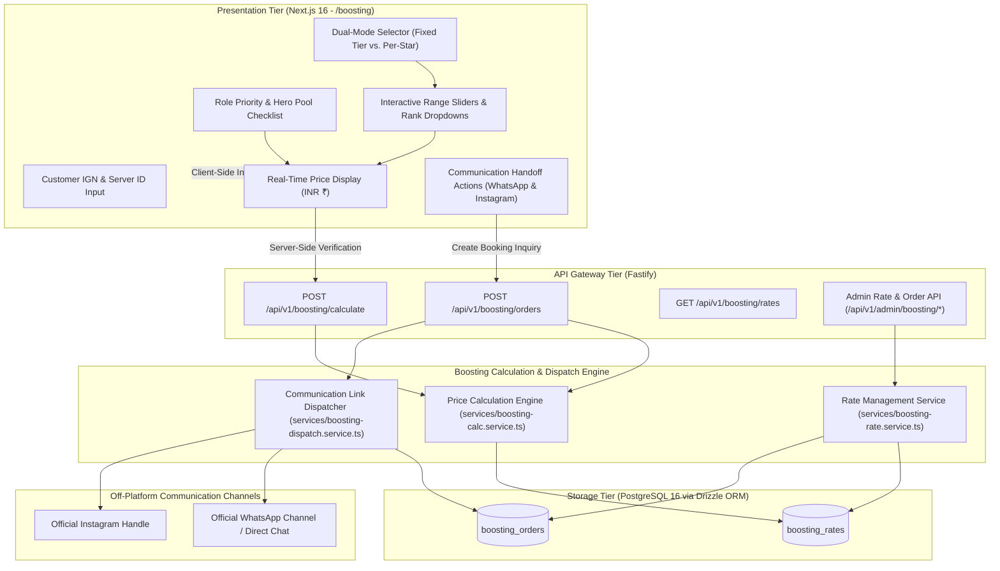
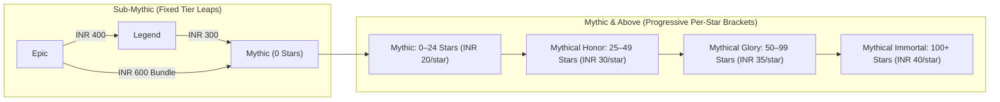
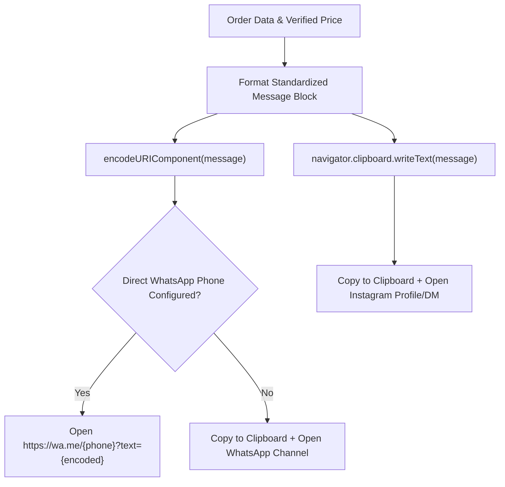
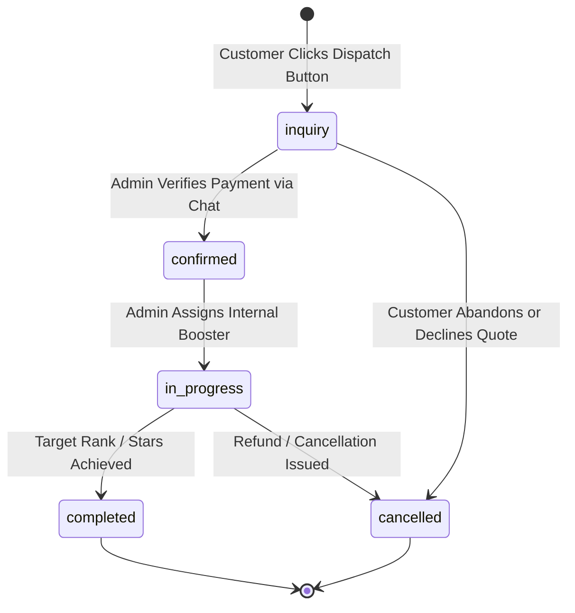

# MLBB Dual-Mode Boosting Engine Design Specification

## 1. Overview and Scope

This document specifies the Low-Level Design (LLD) for **Milestone 6: MLBB Dual-Mode Boosting Engine** of the Smex Store platform. It defines the core mathematical calculation engine for Mobile Legends: Bang Bang (MLBB) rank-boosting progression, multi-bracket traversal algorithms, role/hero surcharge computation, the external communication link dispatcher for off-platform payment handoff, admin rate management, and client presentation components conforming to:
* `docs/internal/requirements.md` (Sections 5.1, 5.2, 6.6, 8.7, 9.2, 11)
* `docs/internal/adr/rank-boosting-model-pricing-system.md` (ADR 0002)
* `docs/internal/adr/payment.md` (ADR 0001)
* `docs/internal/design/lld/data-layer.md` (Section 3.5 & 5.2 B)
* `docs/internal/design/ui.md` (AMOLED `#000000`, 120ms hardware transitions, zero frosted glass blur)



---

## 2. Core Calculation Engine Architecture

*Target Source: `server/src/services/boosting-calc.service.ts`*  
*Shared Client Engine: `client/lib/boosting/calculator.ts`*

The MLBB ranking ladder transitions from discrete division leagues (Sub-Mythic: Warrior, Elite, Master, Grandmaster, Epic, Legend) to continuous Star accumulations (Mythic and above: Mythic, Mythical Honor, Mythical Glory, Mythical Immortal). The engine provides deterministic, mathematical calculation across both regimes, including composite cross-regime progressions.



### 2.1 Sub-Mythic Fixed Tier Jump Matrix

Sub-Mythic progression covers predefined tier leaps. Rates are pulled from `boosting_rates` where `pricing_mode = 'fixed_tier'`:

| From Tier | To Tier | Base Price (INR) | Bundle Discount | Notes |
| :--- | :--- | :--- | :--- | :--- |
| **Epic** | **Legend** | ₹400.00 | None | Standard 1-division leap |
| **Legend** | **Mythic** | ₹300.00 | None | Promotion to Mythic base (0 Stars) |
| **Epic** | **Mythic** | ₹600.00 | ₹100.00 | Full leap package (₹400 + ₹300 − ₹100 discount) |

#### Validation Invariants:
1. Target rank must strictly exceed starting rank in ladder progression.
2. Identical starting and target ranks (`fromTier === toTier`) are rejected with `HTTP 422 INVALID_RANK_PROGRESSION`.
3. Backwards leaps (`fromTier > toTier`) are rejected with `HTTP 422 INVALID_RANK_PROGRESSION`.

---

### 2.2 Mythic & Above Progressive Per-Star Calculation

For ranks with stars ($\ge 0$ Stars in Mythic and above), pricing scales progressively per star across 4 difficulty tiers:

| Tier Bracket Name | Minimum Stars ($L_k$) | Maximum Stars ($U_k$) | Base Rate per Star ($R_k$) |
| :--- | :--- | :--- | :--- |
| **Mythic** | 0 | 24 | ₹20.00 / star |
| **Mythical Honor** | 25 | 49 | ₹30.00 / star |
| **Mythical Glory** | 50 | 99 | ₹35.00 / star |
| **Mythical Immortal** | 100 | 999 | ₹40.00 / star |

#### Multi-Bracket Traversal Algorithm

Let $S_1$ be starting stars and $S_2$ be target stars, where $0 \le S_1 < S_2 \le 999$.  
For each active bracket $k \in \{ \text{Mythic, Honor, Glory, Immortal} \}$ bounded by $[L_k, U_k]$ with rate $R_k$:

$$\text{BracketStars}_k = \max\Big(0, \min(S_2, U_k + 1) - \max(S_1, L_k)\Big)$$

$$\text{MythicBasePrice} = \sum_{k} \Big(\text{BracketStars}_k \times R_k\Big)$$

#### Worked Examples:

* **Example 1: Single Bracket (Mythic 10★ to Mythic 20★)**
  * $S_1 = 10, S_2 = 20$.
  * Mythic Bracket $[0, 24]$: $\min(20, 25) - \max(10, 0) = 20 - 10 = 10$ stars @ ₹20 = ₹200.00.
  * Total = ₹200.00.

* **Example 2: Boundary Traversal (Mythic 10★ to Mythical Honor 30★)**
  * $S_1 = 10, S_2 = 30$.
  * Mythic Bracket $[0, 24]$: $\min(30, 25) - \max(10, 0) = 25 - 10 = 15$ stars @ ₹20 = ₹300.00.
  * Mythical Honor Bracket $[25, 49]$: $\min(30, 50) - \max(10, 25) = 30 - 25 = 5$ stars @ ₹30 = ₹150.00.
  * Total = ₹300.00 + ₹150.00 = **₹450.00** *(conforms exactly to ADR 0002 Section 3)*.

* **Example 3: Grand Multi-Bracket Traversal (Mythic 20★ to Mythical Immortal 105★)**
  * $S_1 = 20, S_2 = 105$.
  * Mythic $[0, 24]$: $\min(105, 25) - \max(20, 0) = 25 - 20 = 5$ stars @ ₹20 = ₹100.00.
  * Honor $[25, 49]$: $\min(105, 50) - \max(20, 25) = 50 - 25 = 25$ stars @ ₹30 = ₹750.00.
  * Glory $[50, 99]$: $\min(105, 100) - \max(20, 50) = 100 - 50 = 50$ stars @ ₹35 = ₹1,750.00.
  * Immortal $[100, 999]$: $\min(105, 1000) - \max(20, 100) = 105 - 100 = 5$ stars @ ₹40 = ₹200.00.
  * Total = ₹100 + ₹750 + ₹1,750 + ₹200 = **₹2,800.00**.

---

### 2.3 Composite Cross-Regime Calculation

When a customer orders progression originating Sub-Mythic (e.g. Epic or Legend) and terminating at a specific Star count in Mythic or above (e.g. Mythical Honor 25★):

$$\text{CompositePrice} = \text{FixedTierJump}(\text{StartRank} \rightarrow \text{Mythic}) + \text{MythicBasePrice}(0 \rightarrow S_2)$$

* **Example: Legend to Mythical Honor 30★**:
  * Fixed Jump (Legend $\rightarrow$ Mythic): ₹300.00.
  * Star Progress (0★ to 30★):
    * 0 to 24★ (25 stars @ ₹20) = ₹500.00.
    * 25 to 30★ (5 stars @ ₹30) = ₹150.00.
  * Total Base Price = ₹300.00 + ₹500.00 + ₹150.00 = **₹950.00**.

---

### 2.4 Role Priority and Hero Surcharge Engine

*Requirements Reference: Roadmap 6.1 & Requirements 6.6*

Customers can configure optional execution preferences. Surcharges are calculated against base progression:

```typescript
export interface BoostingSurchargeConfig {
  rolePriorityPercent: number;    // Default: 15% (+0.15)
  heroPoolFlatInr: number;        // Default: ₹150.00 flat fee
  duoPartyPercent: number;        // Default: 25% (+0.25)
}

export interface BoostingOrderAddons {
  rolePriority?: 'Jungle' | 'Gold' | 'Mid' | 'Roam' | 'EXP';
  restrictedHeroPool?: string[]; // e.g. ['Ling', 'Fanny', 'Hayabusa']
  duoPlayWithBooster?: boolean;  // Customer plays on own account alongside booster
}
```

#### Surcharge Mathematical Formulation

$$\text{PercentageSurchargeMultiplier} = 1 + (\text{hasRole} \times 0.15) + (\text{isDuo} \times 0.25)$$

$$\text{FlatSurcharges} = (\text{hasHeroPool} \times 150)$$

$$\text{FinalPriceInr} = \text{round}\Big(\text{BasePrice} \times \text{PercentageSurchargeMultiplier} + \text{FlatSurcharges}\Big)$$

* **Example**: Base quote = ₹450.00, customer selects "Jungle Role Priority" (+15%) and "Restricted Hero Pool" (+₹150):
  * $\text{Base} \times 1.15 = ₹450 \times 1.15 = ₹517.50$.
  * $+ ₹150.00 = ₹667.50 \rightarrow \mathbf{₹668.00}$ INR.

---

## 3. External Communication Link Dispatcher

*Target Source: `server/src/services/boosting-dispatch.service.ts`*  
*Shared Client Dispatcher: `client/lib/boosting/dispatcher.ts`*

In accordance with **ADR 0001 (Zero In-App Payment Gateway)**, commercial settlement and credential coordination are conducted off-platform via direct external communication channels.

### 3.1 Environment Configuration Parameters

Platform communication channels are resolved dynamically via environment configuration:

```typescript
export interface BoostingDispatchConfig {
  whatsappChannelUrl: string;     // env: NEXT_PUBLIC_SOCIAL_WHATSAPP_CHANNEL
  instagramUrl: string;           // env: NEXT_PUBLIC_SOCIAL_INSTAGRAM
  whatsappDirectPhone?: string;   // env: NEXT_PUBLIC_BOOSTING_WHATSAPP_PHONE (optional direct business number)
}
```

---

### 3.2 Standardized Order Inquiry Message Block

The dispatcher constructs a deterministic message block used across external channels:

```text
[SMEX STORE BOOSTING ORDER]
• Order Ref: #{orderRef}
• Customer IGN: {customerIgn} (Server: {serverId})
• Game: Mobile Legends: Bang Bang
• Progression: {startRank} ({startStars}★) ➔ {targetRank} ({targetStars}★)
• Pricing Mode: {pricingMode}
• Add-ons: {addonsSummary}
• Calculated Price: ₹{totalPriceInr} INR
----------------------------------------
Please confirm booster availability and payment details.
```

---

### 3.3 Channel-Specific Dispatch Schemes



1. **WhatsApp Handoff**:
   * If `NEXT_PUBLIC_BOOSTING_WHATSAPP_PHONE` is configured: opens `https://wa.me/{phone}?text={encodeURIComponent(message)}`.
   * When using the official WhatsApp Channel (`NEXT_PUBLIC_SOCIAL_WHATSAPP_CHANNEL`): copies the formatted quote block to the system clipboard via `navigator.clipboard.writeText` and navigates to the verified channel link.
2. **Instagram Handoff**:
   * Copies the formatted plain-text order block to the system clipboard via `navigator.clipboard.writeText(message)`.
   * Displays toast notification: `"Order details copied to clipboard! Paste into Instagram DM to confirm."`
   * Opens the official Instagram URL (`NEXT_PUBLIC_SOCIAL_INSTAGRAM`).

---

## 4. Admin Rate Management & Persistence Integration

*Target Source: `server/src/services/boosting-rate.service.ts`*  
*Target Routes: `server/src/routes/boosting.ts`, `server/src/routes/admin/boosting.ts`*

### 4.1 Schema Mappings (from `data-layer.md` Section 3.5)

```typescript
// Enums
export const boostingPricingModeEnum = pgEnum('boosting_pricing_mode', ['fixed_tier', 'per_star']);
export const boostingContactChannelEnum = pgEnum('boosting_contact_channel', ['whatsapp', 'instagram']);
export const boostingOrderStatusEnum = pgEnum('boosting_order_status', [
  'inquiry',
  'confirmed',
  'in_progress',
  'completed',
  'cancelled',
]);
```

### 4.2 Order Lifecycle State Machine



### 4.3 Database Check Constraints & Invariants

1. `boosting_rates.price_inr > 0`: Base prices must be strictly positive.
2. `boosting_rates.pricing_mode = 'fixed_tier'`: Must specify non-null `from_tier` and `to_tier`.
3. `boosting_rates.pricing_mode = 'per_star'`: Must specify non-null `star_tier`, `min_stars`, and `max_stars` with `max_stars >= min_stars`.
4. `boosting_orders.calculated_price_inr > 0`: Orders must store positive decimal prices.
5. `boosting_orders.customer_ign`: Non-empty string $\le 50$ characters.

---

## 5. RESTful API Catalog

### 5.1 Public Endpoints

#### 1. `GET /api/v1/boosting/rates`
* **Description**: Returns all currently active boosting rates and surcharge multipliers for the client calculator.
* **Authentication**: None (Public).
* **Response**: `200 OK`
  ```json
  {
    "rates": [
      { "id": "uuid", "pricingMode": "fixed_tier", "fromTier": "Epic", "toTier": "Legend", "priceInr": "400.00" },
      { "id": "uuid", "pricingMode": "fixed_tier", "fromTier": "Legend", "toTier": "Mythic", "priceInr": "300.00" },
      { "id": "uuid", "pricingMode": "fixed_tier", "fromTier": "Epic", "toTier": "Mythic", "priceInr": "600.00" },
      { "id": "uuid", "pricingMode": "per_star", "starTier": "Mythic", "minStars": 0, "maxStars": 24, "priceInr": "20.00" },
      { "id": "uuid", "pricingMode": "per_star", "starTier": "Mythical Honor", "minStars": 25, "maxStars": 49, "priceInr": "30.00" },
      { "id": "uuid", "pricingMode": "per_star", "starTier": "Mythical Glory", "minStars": 50, "maxStars": 99, "priceInr": "35.00" },
      { "id": "uuid", "pricingMode": "per_star", "starTier": "Mythical Immortal", "minStars": 100, "maxStars": 999, "priceInr": "40.00" }
    ],
    "surcharges": {
      "rolePriorityPercent": 0.15,
      "heroPoolFlatInr": 150.00,
      "duoPartyPercent": 0.25
    }
  }
  ```

#### 2. `POST /api/v1/boosting/calculate`
* **Description**: Validates input parameters and performs authoritative server-side price calculation.
* **Authentication**: None (Public).
* **Request Body**:
  ```json
  {
    "pricingMode": "per_star",
    "startingRank": "Mythic",
    "targetRank": "Mythical Honor",
    "startingStars": 10,
    "targetStars": 30,
    "addons": {
      "rolePriority": "Jungle",
      "restrictedHeroPool": ["Ling", "Fanny"],
      "duoPlayWithBooster": false
    }
  }
  ```
* **Response**: `200 OK`
  ```json
  {
    "basePriceInr": "450.00",
    "breakdown": [
      { "tier": "Mythic", "stars": 15, "rate": "20.00", "subtotal": "300.00" },
      { "tier": "Mythical Honor", "stars": 5, "rate": "30.00", "subtotal": "150.00" }
    ],
    "surcharges": [
      { "name": "Role Priority (Jungle)", "type": "percentage", "rate": "15%", "amount": "67.50" },
      { "name": "Restricted Hero Pool", "type": "flat", "rate": "₹150", "amount": "150.00" }
    ],
    "totalPriceInr": "668.00"
  }
  ```

#### 3. `POST /api/v1/boosting/orders`
* **Description**: Persists a new customer booking inquiry record and returns formatted external dispatch links.
* **Authentication**: Optional Bearer JWT (associates `customerId` if authenticated, null if guest).
* **Request Body**:
  ```json
  {
    "pricingMode": "per_star",
    "startingRank": "Mythic",
    "targetRank": "Mythical Honor",
    "startingStars": 10,
    "targetStars": 30,
    "customerIgn": "ViperMLBB",
    "serverId": "2048",
    "contactChannel": "whatsapp",
    "addons": {
      "rolePriority": "Jungle",
      "restrictedHeroPool": ["Ling", "Fanny"],
      "duoPlayWithBooster": false
    },
    "notes": "Prefer games played after 8 PM IST"
  }
  ```
* **Response**: `201 Created`
  ```json
  {
    "orderId": "3fa85f64-5717-4562-b3fc-2c963f66afa6",
    "orderRef": "BST-202610-7492",
    "status": "inquiry",
    "calculatedPriceInr": "668.00",
    "dispatch": {
      "channel": "whatsapp",
      "destinationUrl": "<env:NEXT_PUBLIC_SOCIAL_WHATSAPP_CHANNEL>",
      "formattedText": "[SMEX STORE BOOSTING ORDER] Ref: BST-202610-7492 | Mythic 10★ -> Mythical Honor 30★ | Price: ₹668 INR | IGN: ViperMLBB"
    }
  }
  ```

---

### 5.2 Admin Endpoints (Protected by `adminGuard`)

#### 1. `GET /api/v1/admin/boosting/rates`
* **Description**: Fetches all rates including inactive or historical rate rows.
* **Authentication**: Bearer JWT (`role === 'admin'`).

#### 2. `PATCH /api/v1/admin/boosting/rates/:id`
* **Description**: Updates pricing or star boundaries for a specific tier rate row.
* **Authentication**: Bearer JWT (`role === 'admin'`).
* **Request Body**:
  ```json
  {
    "priceInr": 25.00,
    "isActive": true
  }
  ```
* **Response**: `200 OK`

#### 3. `GET /api/v1/admin/boosting/orders`
* **Description**: Lists all boosting orders with filtering by status, contact channel, and date range.
* **Authentication**: Bearer JWT (`role === 'admin'`).
* **Query Parameters**: `status`, `channel`, `page`, `limit`.

#### 4. `PATCH /api/v1/admin/boosting/orders/:id/status`
* **Description**: Transitions order lifecycle status and updates administrative notes.
* **Authentication**: Bearer JWT (`role === 'admin'`).
* **Request Body**:
  ```json
  {
    "status": "confirmed",
    "notes": "Payment verified via UPI screenshot. Assigned to Booster ID 04."
  }
  ```
* **Response**: `200 OK`

---

## 6. Client Presentation UI Specification (`/boosting`)

*Target File: `client/app/boosting/page.tsx`*  
*Subcomponents: `client/components/boosting/Calculator.tsx`, `client/components/boosting/DispatchActions.tsx`*

### 6.1 Theme & AMOLED Surface Conformance

Per `docs/internal/design/ui.md`:
* **Surface Background**: AMOLED True-Black (`#000000`).
* **Cards & Containers**: Dark Emerald Surface (`#121C19` to `#16211D`), border `#223530`.
* **Accent Highlights**: Emerald (`#22C58F`) and Teal (`#20A6AE`).
* **Focus Glow**: Subtle localized ring `#3FE6B0` at 15% opacity.
* **Transitions**: Snappy 120ms hardware transitions (`transition-all duration-120 ease-out`).
* **Prohibited Effects**: Zero opacity fade animations, zero `backdrop-filter: blur`.

```
+-----------------------------------------------------------------------------------------+
| [SMEX STORE NAVBAR]                                                     [Profile / Auth]|
+-----------------------------------------------------------------------------------------+
|                                                                                         |
|  MLBB RANK BOOSTING CALCULATOR                                                          |
|  Professional, vetted boosters. 100% account safety guaranteed. Zero ban record.         |
|                                                                                         |
|  +-----------------------------------------------------------------------------------+  |
|  | [ Fixed Tier Packages (Sub-Mythic) ]   |   [ Per-Star Ladder (Mythic & Above) ]*  |  |
|  +-----------------------------------------------------------------------------------+  |
|                                                                                         |
|  +---------------------------------------+   +---------------------------------------+  |
|  | 1. SELECT STARTING RANK               |   | 2. SELECT TARGET RANK                 |  |
|  | [ Current Tier: Mythic          v ]   |   | [ Target Tier: Mythical Honor   v ]   |  |
|  | Current Stars: [ 10★ ]                |   | Target Stars:  [ 30★ ]                |  |
|  | [------O----------------------------] |   | [------------O------------------------]  |  |
|  +---------------------------------------+   +---------------------------------------+  |
|                                                                                         |
|  +-----------------------------------------------------------------------------------+  |
|  | 3. SERVICE ADD-ONS (OPTIONAL)                                                     |  |
|  | [ ] Role Priority (+15%): [ Jungle    v ]                                         |  |
|  | [x] Specific Hero Pool (+₹150): [ Ling, Fanny, Hayabusa                          ]  |  |
|  | [ ] Duo Play with Booster (+25%) - Play on your own account                       |  |
|  +-----------------------------------------------------------------------------------+  |
|                                                                                         |
|  +-----------------------------------------------------------------------------------+  |
|  | 4. PLAYER CREDENTIALS (IN-GAME IDENTITY)                                          |  |
|  | Player IGN: [ ViperMLBB              ]   Server ID: [ 2048   ]                     |  |
|  +-----------------------------------------------------------------------------------+  |
|                                                                                         |
|  +-----------------------------------------------------------------------------------+  |
|  | ORDER SUMMARY & LIVE QUOTE                                                        |  |
|  | • Base Progression: 15★ Mythic + 5★ Honor                          ₹450.00        |  |
|  | • Surcharges: Specific Hero Pool (+₹150 flat)                      ₹150.00        |  |
|  | -------------------------------------------------------------------------------   |  |
|  | TOTAL ESTIMATED PRICE:                                             ₹600.00 INR    |  |
|  |                                                                                   |  |
|  | [ 1-CLICK WHATSAPP ]                       [ COPY & OPEN INSTAGRAM ]              |  |
|  +-----------------------------------------------------------------------------------+  |
+-----------------------------------------------------------------------------------------+
```

### 6.2 Interactive State Management & Real-Time Calculation

1. **Zero-Latency Client Calculation**:
   * As the user drags the star sliders or switches dropdowns, the price recalculates instantaneously on the client ($< 5\text{ms}$) without waiting for server network hops.
2. **Server-Side Quote Attestation**:
   * When the user clicks any dispatch button, the client initiates `POST /api/v1/boosting/orders`.
   * Fastify verifies the client's calculations against active database rates in `boosting_rates`. If rates have changed or tampering is detected, the server returns the authoritative price quote.
3. **Dispatch Navigation**:
   * The client opens the verified pre-formatted chat URI in a secure new browser tab (`target="_blank" rel="noopener noreferrer"`).
