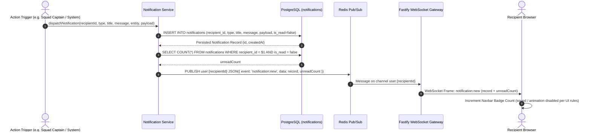
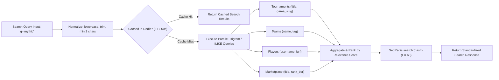

# Real-Time Notifications and Universal Search Design Specification

## 1. Overview and Architecture

This document specifies the Low-Level Design (LLD) for **Milestone 8: Real-Time Notifications and Universal Search** of the Smex Store platform. It defines the hybrid notification delivery pipeline (combining PostgreSQL persistence and WebSocket/Redis pub/sub dispatch), unread counter tracking, PostgreSQL trigram (`pg_trgm`) cross-entity universal search engine, and client presentation components conforming to:
* `docs/internal/requirements.md` (Sections 5.1, 6.10, 6.11, 18.10, 18.11, 19.8)
* `docs/internal/design/hld.md` (Sections 2.4, 6, 7.1)
* `docs/internal/design/lld/data-layer.md` (Section 3 & 4)
* `docs/internal/design/ui.md` (AMOLED `#000000`, 120ms hardware transitions, zero frosted glass blur)

```mermaid
flowchart TD
    subgraph Client["Presentation Tier (Next.js 16)"]
        NAVBAR["Global Navigation Bar (components/shell/Navbar.tsx)"]
        NOTIF_BELL["Notification Center Bell & Dropdown"]
        SEARCH_MODAL["Universal Search Modal (Cmd+K / Ctrl+K)"]
        WS_CLIENT["Client WebSocket Connection (hooks/useWebSocket.ts)"]
    end

    subgraph Gateway["API Gateway Tier (Fastify)"]
        NOTIF_ROUTES["Notification API (/api/v1/notifications/*)"]
        SEARCH_ROUTES["Universal Search API (GET /api/v1/search)"]
        WS_GATEWAY["WebSocket Gateway (plugins/websocket.ts)"]
    end

    subgraph Services["Core Application Services"]
        NOTIF_SVC["Notification Service (services/notification.service.ts)"]
        SEARCH_SVC["Universal Search Service (services/search.service.ts)"]
        TRIGRAM_MATCHER["PostgreSQL Trigram Query Builder"]
    end

    subgraph Persistence["Storage & Event Bus"]
        PG_NOTIFS[("PostgreSQL: notifications")]
        PG_ENTITIES[("PostgreSQL: tournaments, teams, users, marketplace_listings")]
        REDIS_BUS[("Redis Pub/Sub (channel: user:{userId})")]
        REDIS_CACHE[("Redis Cache (search:{hash})")]
    end

    NAVBAR --> NOTIF_BELL
    NAVBAR --> SEARCH_MODAL
    NOTIF_BELL --> NOTIF_ROUTES
    SEARCH_MODAL --> SEARCH_ROUTES
    WS_CLIENT <-->|Duplex WSS| WS_GATEWAY
    NOTIF_ROUTES --> NOTIF_SVC
    SEARCH_ROUTES --> SEARCH_SVC
    SEARCH_SVC --> REDIS_CACHE
    SEARCH_SVC --> TRIGRAM_MATCHER
    TRIGRAM_MATCHER --> PG_ENTITIES
    NOTIF_SVC --> PG_NOTIFS
    NOTIF_SVC --> REDIS_BUS
    REDIS_BUS -->|Subscribe user:{userId}| WS_GATEWAY
    WS_GATEWAY -->|Event: notification:new| WS_CLIENT
```

---

## 2. Real-Time Notification Pipeline

*Target Source: `server/src/services/notification.service.ts`*  
*Target Route: `server/src/routes/notifications.ts`*

The notification system employs a dual-tier architecture:
1. **Durable Persistence Tier**: Every notification record is saved to the PostgreSQL `notifications` table so offline users receive their unread messages upon their next session.
2. **Real-Time Push Tier**: For active online sessions, notifications are dispatched instantaneously via Redis Pub/Sub to Fastify's WebSocket Gateway, which routes them to the connected client socket.



### 2.1 Notification Types and Event Envelopes

Notifications fall into three strict taxonomy categories per Requirements Section 6.10:

```typescript
export type NotificationType = 'request' | 'update' | 'system';

export interface NotificationPayload {
  actionUrl?: string;          // In-app destination route (e.g. "/teams/squad-123")
  entityType?: 'team' | 'tournament' | 'marketplace' | 'boosting' | 'user';
  entityId?: string;
  metadata?: Record<string, unknown>;
}

export interface NotificationEnvelope {
  id: string;
  recipientId: string;
  type: NotificationType;
  title: string;
  message: string;
  payload: NotificationPayload;
  isRead: boolean;
  createdAt: string;
}
```

#### Category Taxonomy:
1. **`request` (Action Requests)**:
   * Squad join requests to team captains.
   * Squad invitations to prospective players.
   * Direct marketplace purchase interest alerts.
2. **`update` (Lifecycle & Match Updates)**:
   * Tournament match schedule updates and round advancements.
   * Tournament check-in announcements.
   * Marketplace listing status transitions (e.g. marked as sold).
3. **`system` (Platform & Administrative Alerts)**:
   * Account security events (password changed, new session registered).
   * Platform announcements and scheduled maintenance notices.

---

## 3. Database Schema: `notifications`

*Target Source: `server/src/db/schema/notifications.ts`*

```typescript
import { pgEnum, pgTable, uuid, varchar, text, boolean, timestamp, jsonb, index } from 'drizzle-orm/pg-core';
import { users } from './users.js';

export const notificationTypeEnum = pgEnum('notification_type', ['request', 'update', 'system']);

export const notifications = pgTable(
  'notifications',
  {
    id: uuid('id').defaultRandom().primaryKey(),
    recipientId: uuid('recipient_id')
      .notNull()
      .references(() => users.id, { onDelete: 'cascade' }),
    type: notificationTypeEnum('type').notNull(),
    title: varchar('title', { length: 150 }).notNull(),
    message: text('message').notNull(),
    entityType: varchar('entity_type', { length: 50 }),
    entityId: uuid('entity_id'),
    payload: jsonb('payload').notNull().default({}),
    isRead: boolean('is_read').notNull().default(false),
    createdAt: timestamp('created_at', { withTimezone: true }).notNull().defaultNow(),
  },
  (t) => [
    index('notifications_recipient_unread_idx').on(t.recipientId, t.isRead, t.createdAt),
    index('notifications_created_at_idx').on(t.createdAt),
  ]
);

export type NotificationRecord = typeof notifications.$inferSelect;
export type NewNotificationRecord = typeof notifications.$inferInsert;
```

### 3.1 Relational Constraints & Indexing Strategy
* **Cascade Deletion**: If a user account is deleted, their notification history cascades automatically (`onDelete: 'cascade'`).
* **Composite Unread Index**: `(recipient_id, is_read, created_at)` enables sub-millisecond query execution for the navbar unread count (`WHERE recipient_id = $1 AND is_read = false`) and paginated inbox retrieval.

---

## 4. Cross-Entity Universal Search Engine

*Target Source: `server/src/services/search.service.ts`*  
*Target Route: `server/src/routes/search.ts`*

The platform indexes four core domain entities: **Tournaments**, **Teams**, **Players**, and **Marketplace Listings**.



### 4.1 PostgreSQL Trigram (`pg_trgm`) Search Queries

Search execution uses PostgreSQL trigram similarity (`pg_trgm`) with generalized inverted index (GIN) acceleration:

```sql
-- GIN Trigram Index Definitions
CREATE EXTENSION IF NOT EXISTS pg_trgm;
CREATE INDEX IF NOT EXISTS tournaments_title_trgm_idx ON tournaments USING gin (title gin_trgm_ops);
CREATE INDEX IF NOT EXISTS teams_name_trgm_idx ON teams USING gin (name gin_trgm_ops);
CREATE INDEX IF NOT EXISTS users_username_trgm_idx ON users USING gin (username gin_trgm_ops);
CREATE INDEX IF NOT EXISTS marketplace_title_trgm_idx ON marketplace_listings USING gin (title gin_trgm_ops);
```

#### Multi-Entity Query Execution:
```sql
-- Parameterized Universal Search Query Pattern
SELECT 
  'tournament' AS entity_type,
  id,
  title AS display_name,
  game_slug AS subtitle,
  status AS status_badge,
  similarity(title, $1) AS score
FROM tournaments
WHERE title % $1 OR title ILIKE '%' || $1 || '%'
UNION ALL
SELECT 
  'team' AS entity_type,
  id,
  name AS display_name,
  tag AS subtitle,
  NULL AS status_badge,
  similarity(name, $1) AS score
FROM teams
WHERE name % $1 OR name ILIKE '%' || $1 || '%'
UNION ALL
SELECT 
  'player' AS entity_type,
  id,
  username AS display_name,
  COALESCE(ign, 'Player') AS subtitle,
  role AS status_badge,
  similarity(username, $1) AS score
FROM users
WHERE username % $1 OR username ILIKE '%' || $1 || '%'
UNION ALL
SELECT 
  'marketplace' AS entity_type,
  id,
  title AS display_name,
  rank_tier AS subtitle,
  status AS status_badge,
  similarity(title, $1) AS score
FROM marketplace_listings
WHERE status = 'active' AND (title % $1 OR title ILIKE '%' || $1 || '%')
ORDER BY score DESC
LIMIT $2 OFFSET $3;
```

---

## 5. RESTful API Catalog

### 5.1 Notification Endpoints (`server/src/routes/notifications.ts`)

| Method | Endpoint | Auth | Purpose | Status Codes |
| :--- | :--- | :--- | :--- | :--- |
| `GET` | `/api/v1/notifications` | Bearer JWT | Fetch user notifications and unread tally | `200`, `401` |
| `PATCH`| `/api/v1/notifications/:id/read` | Bearer JWT | Mark specific notification as read | `200`, `401`, `404` |
| `PATCH`| `/api/v1/notifications/read-all` | Bearer JWT | Mark all user notifications as read | `200`, `401` |
| `DELETE`| `/api/v1/notifications/:id` | Bearer JWT | Delete individual notification | `200`, `401`, `404` |

#### `GET /api/v1/notifications` Response Contract:
```json
{
  "unreadCount": 3,
  "notifications": [
    {
      "id": "8a7c5b3d-1234-4567-89ab-cdef01234567",
      "type": "request",
      "title": "New Squad Join Request",
      "message": "Player 'ViperMLBB' requested to join squad 'Smex Elite'.",
      "entityType": "team",
      "entityId": "3fa85f64-5717-4562-b3fc-2c963f66afa6",
      "payload": {
        "actionUrl": "/teams/3fa85f64-5717-4562-b3fc-2c963f66afa6"
      },
      "isRead": false,
      "createdAt": "2026-10-17T12:00:00.000Z"
    }
  ],
  "pagination": {
    "page": 1,
    "limit": 20,
    "total": 15
  }
}
```

---

### 5.2 Universal Search Endpoint (`server/src/routes/search.ts`)

| Method | Endpoint | Auth | Purpose | Status Codes |
| :--- | :--- | :--- | :--- | :--- |
| `GET` | `/api/v1/search` | Public | Cross-entity search with filters | `200`, `400`, `429` |

#### Query Parameters:
* `q` (string, required, min 2 chars): The search query string.
* `category` (enum: `'all' | 'tournaments' | 'teams' | 'players' | 'marketplace'`, default: `'all'`).
* `limit` (integer, default: 10, max: 50).
* `offset` (integer, default: 0).

#### `GET /api/v1/search?q=mythic` Response Contract:
```json
{
  "query": "mythic",
  "category": "all",
  "totalMatches": 4,
  "results": {
    "tournaments": [
      {
        "id": "uuid",
        "title": "Mythic Legends Championship",
        "gameSlug": "mlbb",
        "status": "registration_open",
        "url": "/tournaments/uuid"
      }
    ],
    "teams": [
      {
        "id": "uuid",
        "name": "Mythic Raiders",
        "tag": "MYTH",
        "gameSlug": "mlbb",
        "url": "/teams/uuid"
      }
    ],
    "players": [
      {
        "id": "uuid",
        "username": "MythicSniper",
        "ign": "ViperMLBB",
        "role": "Jungler",
        "url": "/profile/uuid"
      }
    ],
    "marketplace": [
      {
        "id": "uuid",
        "title": "MLBB Mythic 20★ Account - 60 Skins",
        "rankTier": "Mythic",
        "priceInr": "1200.00",
        "badgeType": "good_deal",
        "url": "/marketplace/uuid"
      }
    ]
  }
}
```

---

## 6. Client Presentation UI Specification

*Target Files: `client/src/components/notifications/NotificationCenter.tsx`, `client/src/components/search/UniversalSearchModal.tsx`*

### 6.1 Theme & AMOLED Surface Conformance

Per `docs/internal/design/ui.md`:
* **Surface Background**: AMOLED True-Black (`#000000`).
* **Modal & Dropdown Surfaces**: Dark Emerald (`#121C19` to `#16211D`), subtle border `#223530`.
* **Badge Accent**: Emerald Accent (`#22C58F`) for unread counts and high-relevance matches.
* **Transitions**: 120ms hardware transitions (`transition-all duration-120 ease-out`).
* **Prohibited Visual Effects**: Zero frosted glass blur (`backdrop-filter: blur`), zero opacity fade animations.

### 6.2 UI Wireframes

#### A. Notification Center Dropdown

```
+-----------------------------------------------------------------------------------------+
| [SMEX STORE NAVBAR]                       [ Search (Cmd+K) ]   [🔔 3]   [Profile / Auth]|
+------------------------------------------------------------------+----------------------+
                                                                   | NOTIFICATIONS  [✓All]|
                                                                   +----------------------+
                                                                   | [●] SQUAD JOIN REQ   |
                                                                   | ViperMLBB -> Smex... |
                                                                   | 5 mins ago           |
                                                                   +----------------------+
                                                                   | [●] MATCH UPCOMING   |
                                                                   | Match 4 begins in 15m|
                                                                   | 20 mins ago          |
                                                                   +----------------------+
                                                                   | [ ] LISTING SOLD     |
                                                                   | Mythic Glory #4 sold |
                                                                   | 2 hours ago          |
                                                                   +----------------------+
                                                                   | [ View All Alerts ]  |
                                                                   +----------------------+
```

#### B. Universal Search Modal (`Cmd+K` / `Ctrl+K`)

```
+-----------------------------------------------------------------------------------------+
|                                                                                         |
|      +---------------------------------------------------------------------------+      |
|      | 🔍 Search tournaments, teams, players, and accounts...             [ ESC ]|      |
|      +---------------------------------------------------------------------------+      |
|      | [ All (4) ]   [ Tournaments (1) ]   [ Teams (1) ]   [ Players (1) ]       |      |
|      +---------------------------------------------------------------------------+      |
|      | TOURNAMENTS                                                               |      |
|      | > 🏆 Mythic Legends Championship (MLBB)             [ Registration Open ] |      |
|      |                                                                           |      |
|      | TEAMS                                                                     |      |
|      | > 🛡️ Mythic Raiders [MYTH]                               [ 4 / 5 Slots ] |      |
|      |                                                                           |      |
|      | PLAYERS                                                                   |      |
|      | > 👤 MythicSniper (IGN: ViperMLBB)                             [ Jungle ] |      |
|      |                                                                           |      |
|      | MARKETPLACE                                                               |      |
|      | > 🛒 MLBB Mythic 20★ Account - 60 Skins         ₹1,200 INR [ Good Deal ]  |      |
|      +---------------------------------------------------------------------------+      |
|      | Navigation: [↑↓] Navigate   [ENTER] Select   [ESC] Close                  |      |
|      +---------------------------------------------------------------------------+      |
|                                                                                         |
+-----------------------------------------------------------------------------------------+
```

### 6.3 Interactive Behavior & Performance Guardrails

1. **Debounced Search Input**: Client input fires queries only after 300ms of user idle time, preventing query flooding.
2. **Keyboard Navigation**: `Cmd+K` / `Ctrl+K` opens the modal instantaneously ($< 5\text{ms}$); `ArrowDown` / `ArrowUp` cycles highlighted items; `Enter` navigates to target route.
3. **Optimistic Unread Tally**: Clicking a notification immediately decrements the navbar unread count in local state before the `PATCH` request resolves over the network.
