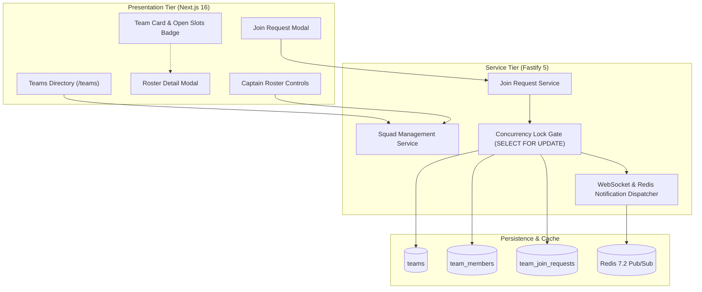
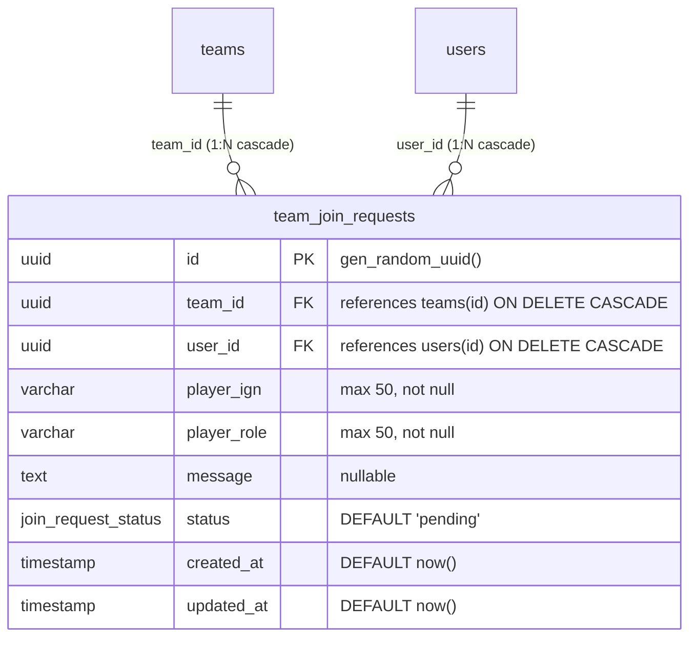
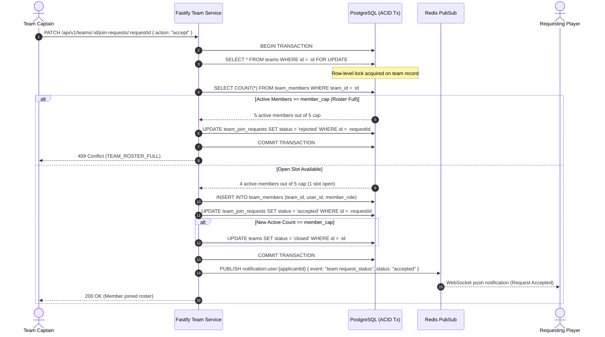

# Squads and Team Recruitment Engine Design Specification

## 1. Overview and Scope

This document specifies the Low-Level Design (LLD) for **Milestone 4: Squads and Team Recruitment Engine** of the Smex Store platform. It defines the squad management domain, roster capacity constraints, atomic join request pipeline, concurrency-safe vacancy locking, real-time notification dispatch, and client presentation components conforming to `docs/internal/requirements.md` (Sections 6.3, 8.4, 12, 13, 18), `docs/internal/design/hld.md` (Sections 2.2, 4, 6.3), `docs/internal/design/ui.md`, and `docs/internal/design/lld/data-layer.md` (Section 3.3).



---

## 2. Relational Schema Expansion: Join Request Entity

*Target Source: `server/src/db/schema/teams.ts`*

In addition to the baseline `teams` and `team_members` tables specified in `docs/internal/design/lld/data-layer.md` (Section 3.3), Milestone 4 introduces the `team_join_requests` table to track applicant lifecycles.



### 2.1 Schema Definition: `team_join_requests`

```typescript
import { pgTable, uuid, varchar, text, timestamp, pgEnum, uniqueIndex, index } from 'drizzle-orm/pg-core';
import { teams } from './teams.js';
import { users } from './users.js';

export const joinRequestStatusEnum = pgEnum('join_request_status', [
  'pending',
  'accepted',
  'rejected',
  'cancelled',
]);

export const teamJoinRequests = pgTable('team_join_requests', {
  id: uuid('id').defaultRandom().primaryKey(),
  teamId: uuid('team_id').notNull().references(() => teams.id, { onDelete: 'cascade' }),
  userId: uuid('user_id').notNull().references(() => users.id, { onDelete: 'cascade' }),
  playerIgn: varchar('player_ign', { length: 50 }).notNull(),
  playerRole: varchar('player_role', { length: 50 }).notNull(),
  message: text('message'),
  status: joinRequestStatusEnum('status').notNull().default('pending'),
  createdAt: timestamp('created_at', { withTimezone: true }).notNull().defaultNow(),
  updatedAt: timestamp('updated_at', { withTimezone: true }).notNull().defaultNow(),
}, (t) => [
  uniqueIndex('team_join_requests_pending_unq').on(t.teamId, t.userId).where(sql`${t.status} = 'pending'`),
  index('team_join_requests_team_status_idx').on(t.teamId, t.status),
  index('team_join_requests_user_idx').on(t.userId),
]);
```

### 2.2 Invariants & Constraints
1. **Spam Prevention**: Partial unique index `team_join_requests_pending_unq` prevents a user from submitting multiple simultaneous `pending` requests to the same squad.
2. **Cascade Cleanup**: Deleting a team or applicant account cascades and automatically purges all linked join requests.
3. **Role Tags**: In-game player roles conform to standardized platform competitive roles (e.g., `'Tank'`, `'Fighter'`, `'Assassin'`, `'Mage'`, `'Marksman'`, `'Support'`, `'Duelist'`, `'IGL'`).

---

## 3. Dynamic Roster Calculation and Vacancy State Machine

### 3.1 Vacancy Calculation Contract

Open roster slots are dynamically computed and never stored as a denormalized counter to avoid state drift:

$$\text{Active Members} = \text{COUNT}(\text{team\_members.id})$$
$$\text{Open Slots} = \max(0, \text{teams.member\_cap} - \text{Active Members})$$

### 3.2 Dynamic Availability Badges
* **Open to Join**: Computed when `teams.status === 'open'` AND $\text{Open Slots} > 0$. Styled with Matrix Emerald (`#1FAE7A`) badge.
* **Full / Closed**: Computed when `teams.status === 'closed'` OR $\text{Open Slots} === 0$. Styled with Muted Border (`#223530`) and neutral text (`#8FA39C`).

---

## 4. Concurrency-Safe Join Request Pipeline

*Target Source: `server/src/services/team-join.service.ts`*

Per Requirements Section 18 Item 3 ("A team reaches capacity while a join request is in flight: system rejects the transaction gracefully and displays 'Team Roster Full'"), approving a join request requires strict transaction isolation to prevent overfilling rosters under concurrent approvals.



### 4.1 Locking Semantics
1. **Pessimistic Row Lock (`SELECT FOR UPDATE`)**: The transaction locks the target `teams` row. Any concurrent transaction attempting to approve another join request for the same team queues until the lock releases.
2. **Post-Lock Vacancy Verification**: The transaction re-counts `team_members` inside the locked scope before executing the `INSERT`. If the team is full, the transaction returns HTTP 409 Conflict with RFC 7807 error code `TEAM_ROSTER_FULL`.
3. **Idempotent Decisioning**: If the join request is already accepted, rejected, or cancelled, Fastify rejects the mutation with HTTP 400 Bad Request (`REQUEST_ALREADY_RESOLVED`).

---

## 5. Real-Time Notification Protocol Integration

*Target Source: `server/src/services/notification.service.ts`*

Per `docs/internal/design/hld.md` (Section 6.3), squad recruitment triggers real-time WebSocket event frames adhering to the platform JSON envelope:

### 5.1 Outgoing Event Envelopes

#### A. Player Submits Join Request $\rightarrow$ Captain Notified
```json
{
  "event": "team:join_request",
  "channel": "user:captain_uuid",
  "timestamp": 1728892800000,
  "data": {
    "teamId": "team_uuid",
    "teamName": "Omega Esports",
    "requestId": "request_uuid",
    "applicantId": "applicant_uuid",
    "playerIgn": "Valkyrie99",
    "playerRole": "Assassin"
  }
}
```

#### B. Captain Resolves Request $\rightarrow$ Applicant Notified
```json
{
  "event": "team:request_status",
  "channel": "user:applicant_uuid",
  "timestamp": 1728892850000,
  "data": {
    "teamId": "team_uuid",
    "teamName": "Omega Esports",
    "status": "accepted"
  }
}
```

---

## 6. RESTful Squad & Recruitment API Specification

*Target Source: `server/src/routes/teams.ts`*

### 6.1 Endpoint Catalog

| Method | Route Path | Auth Guard | Description |
| :--- | :--- | :--- | :--- |
| `GET` | `/api/v1/teams` | Public | Lists squads with filters (`q`, `gameSlug`, `status`), open slot tally, and pagination |
| `POST` | `/api/v1/teams` | Required | Creates squad profile; creator assigned as initial captain in `team_members` |
| `GET` | `/api/v1/teams/:id` | Public | Returns squad details, captain profile, active roster members, and computed open slots |
| `PATCH` | `/api/v1/teams/:id` | Captain Only | Updates squad metadata (`name`, `tag`, `description`, `member_cap`, `status`) |
| `DELETE`| `/api/v1/teams/:id` | Captain Only | Disbands squad and purges roster associations |
| `POST` | `/api/v1/teams/:id/join-requests` | Required | Applicant submits join request with in-game IGN, role, and optional message |
| `GET` | `/api/v1/teams/:id/join-requests` | Captain Only | Lists all pending and historical join requests for the squad |
| `PATCH` | `/api/v1/teams/:id/join-requests/:requestId` | Captain Only | Concurrency-safe acceptance or rejection of a pending join request |
| `DELETE`| `/api/v1/teams/:id/members/:userId` | Captain / Self | Removes a member from squad (kick or leave action) |
| `POST` | `/api/v1/teams/:id/transfer-captaincy` | Captain Only | Reassigns squad captaincy to another verified roster member |

---

## 7. Client Presentation Tier Specification

*Target Source Directory: `client/app/teams/` and `client/components/teams/`*

### 7.1 Teams & Recruitment Directory (`/teams`)
- **Responsive Layout Matrix** (per `docs/internal/design/ui.md` Section 6):
  * Mobile ($< 640\text{px}$): Single-column card stack. Touch targets $\ge 44\text{px}$.
  * Tablet ($640\text{px} - 1023\text{px}$): 2-column card grid with expandable filter drawer.
  * Desktop ($\ge 1024\text{px}$): 3-column card grid with sticky top controls.
- **Search & Filter Controls**:
  * Debounced keyword search input (`name`, `tag`).
  * Status toggle pill: `All` | `Open Only` | `Closed`.
  * Create Squad primary CTA (`#1FAE7A` Matrix Emerald button with 80ms active scale press).

### 7.2 Team Card Component (`TeamCard.tsx`)
- Surface: Solid `#121C19` (Dark) / Pure True-Black `#000000` (AMOLED).
- Border: `#223530` (Dark) / `#1F1F1F` (AMOLED).
- Elements:
  * Squad Tag badge: `[TAG]` styled in Cyan Depth (`#1B8F97`).
  * Squad Name heading in High-Contrast Text (`#E9F5F1`).
  * Member Roster Gauge: `X / Y Members` with dynamic open slot pill (`Z Open Slots`).
  * Availability Status Badge: `Open to Join` vs `Full / Closed`.
  * Action Button: "View Roster" triggering modal display.

### 7.3 Roster Detail & Join Modal (`TeamDetailModal.tsx`)
- **Active Roster Member List**:
  * Preset gaming avatar icon, player username, in-game IGN, and designated role tag.
  * Captain crown indicator icon (`Crown` from Lucide).
- **Conditional Actions**:
  * **Visitor / Non-Member**: "Request to Join" button (disabled if roster is Full or Closed).
  * **Applicant**: "Request Pending" badge if request already in flight.
  * **Captain Controls**:
    * Pending join requests queue with one-click "Approve" and "Reject" buttons.
    * Member row action: "Kick Member" (with confirmation modal).
    * "Disband Squad" danger action.
- **Motion & Accessibility Guardrails**:
  * Transition duration strictly $\le 120\text{ms}$.
  * **Zero `backdrop-filter: blur`** (solid opaque panel `#121C19` or AMOLED `#000000`).
  * **Zero opacity fades** (instant state swap or directional sliding transform).
  * WCAG 2.1 AA text contrast compliance ($\ge 4.5:1$).
