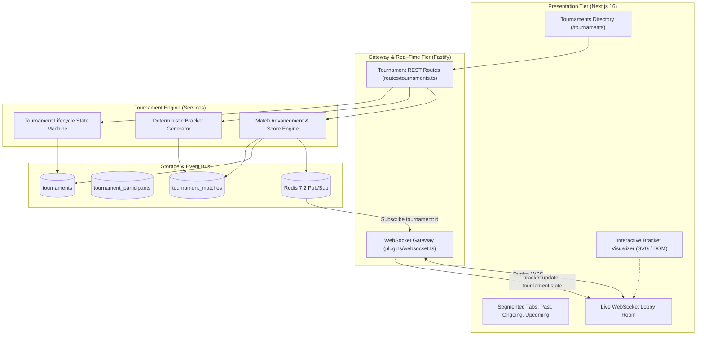
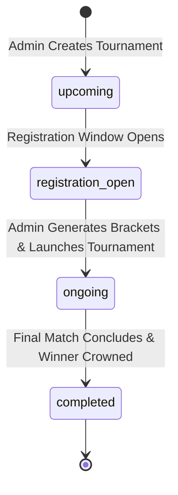
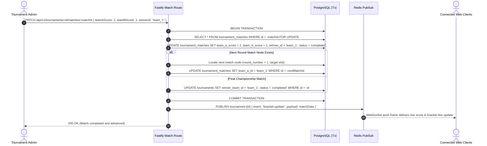

# Tournament Engine and Live Lobbies Design Specification

## 1. Overview and Scope

This document specifies the Low-Level Design (LLD) for **Milestone 5: Tournament Engine and Live Lobbies** of the Smex Store platform. It defines the tournament lifecycle state machine, deterministic bracket generation algorithms (single elimination, double elimination, round-robin), automated bye allocation, real-time WebSocket lobby gateway, and client presentation components conforming to `docs/internal/requirements.md` (Sections 5.2, 6.2, 12, 13, 19), `docs/internal/design/hld.md` (Sections 2.3, 4, 6), `docs/internal/design/ui.md`, and `docs/internal/design/lld/data-layer.md` (Section 3.4).



---

## 2. Tournament Lifecycle State Machine

*Target Source: `server/src/services/tournament-lifecycle.service.ts`*

The platform organizes tournaments across four distinct, strictly sequential lifecycle states:



### 2.1 State Definitions & Permitted Operations

| State | Status Enum | Allowed Operations | Guard Constraints |
| :--- | :--- | :--- | :--- |
| **Upcoming** | `upcoming` | Edit metadata, set prize pool, adjust schedule | No team registrations allowed yet |
| **Registration Open**| `registration_open` | Team captains register squad, withdraw squad | Registered teams $\le \text{max\_teams}$; captain verified |
| **Ongoing (Live)** | `ongoing` | Live match reporting, score updates, bracket progression | Registration frozen; bracket matches generated |
| **Completed** | `completed` | View past brackets, final standings, ratings | Read-only; `winner_team_id` populated and immutable |

### 2.2 State Transition Invariants
1. **Launch Prerequisite**: Transitioning from `registration_open` to `ongoing` requires a minimum of 2 registered teams.
2. **Bracket Locking**: Once state is `ongoing`, team registrations are immutable (no new teams may enter or withdraw).
3. **Completion Guarantee**: Transition to `completed` can only occur once the championship final match record has `status = 'completed'` and a non-null `winner_id`.

---

## 3. Bracket Generation Algorithms

*Target Source: `server/src/services/bracket-generator.service.ts`*

The tournament engine supports three competitive formats per `docs/internal/design/lld/data-layer.md` (Section 3.4):
* `single_elimination`
* `double_elimination`
* `round_robin`

### 3.1 Single-Elimination Bracket Model

#### A. Power-of-Two Normalization & Automated Byes
For any participant count $N \in [2, 128]$:
* Target bracket size: $P = 2^{\lceil \log_2 N \rceil}$
* Automated Byes allocated: $B = P - N$
* Total rounds: $R = \log_2 P$

#### B. Seed Distribution Formula
To ensure top seeds do not meet until the final rounds, seed positions follow standard recursive folding:
$$\text{Match } m \text{ in Round 1 pairs Seed } S \text{ with Seed } (P + 1 - S)$$

If a match node has only one seeded team due to a bye ($S \le B$), the match node is marked `status = 'bye'`, `team_b_id = NULL`, `winner_id = team_a_id`, and the team advances automatically to Round 2 without delay.

### 3.2 Double-Elimination Bracket Model

Double-elimination constructs two coupled sub-brackets:
1. **Upper Bracket (Winners)**: Follows single-elimination progression. Losers drop to the corresponding round in the Lower Bracket.
2. **Lower Bracket (Losers)**: Accommodates teams that lost exactly one match. A second loss eliminates the team from the tournament.
3. **Grand Final**: Upper Bracket winner faces Lower Bracket winner.

### 3.3 Round-Robin Model (Polygon / Berger Algorithm)

For $N$ teams:
* If $N$ is odd, a dummy "Ghost" team is added ($N' = N + 1$) representing a bye.
* Total rounds generated: $N' - 1$.
* Matches per round: $N' / 2$.
* Every team plays every other team exactly once. Standings are ranked by points (3 for win, 0 for loss) with score difference as tiebreaker.

---

## 4. Match Progression & Concurrency-Safe Score Reporting

*Target Source: `server/src/services/match.service.ts`*

When an Admin updates match scores or confirms a winner:



---

## 5. Real-Time WebSocket Lobby Gateway

*Target Source: `server/src/plugins/websocket.ts` and `server/src/routes/tournaments.ts`*

Per `docs/internal/design/hld.md` (Sections 2.3, 6.1, 6.2), clients connect over persistent WebSockets for live lobby updates:

### 5.1 Connection & Channel Subscription
* **Gateway Endpoint**: `GET /ws` with query parameter `?token=<ACCESS_JWT>`.
* **Channel Subscription Action**:
  ```json
  {
    "action": "subscribe",
    "channel": "tournament:a1b2c3d4"
  }
  ```

### 5.2 Broadcast Event Envelopes

#### A. Bracket Update (`bracket:update`)
```json
{
  "event": "bracket:update",
  "channel": "tournament:a1b2c3d4",
  "timestamp": 1728950400000,
  "payload": {
    "matchId": "f7e6d5c4",
    "roundNumber": 2,
    "matchOrder": 1,
    "teamAScore": 2,
    "teamBScore": 1,
    "winnerId": "team_uuid_1",
    "status": "completed",
    "nextMatchId": "next_match_uuid"
  }
}
```

#### B. Tournament State Shift (`tournament:state`)
```json
{
  "event": "tournament:state",
  "channel": "tournament:a1b2c3d4",
  "timestamp": 1728950450000,
  "payload": {
    "tournamentId": "a1b2c3d4",
    "previousStatus": "registration_open",
    "newStatus": "ongoing"
  }
}
```

---

## 6. RESTful Tournament API Specification

*Target Source: `server/src/routes/tournaments.ts`*

### 6.1 Endpoint Catalog

| Method | Route Path | Access Level | Description |
| :--- | :--- | :--- | :--- |
| `GET` | `/api/v1/tournaments` | Public | Lists tournaments filterable by status (`past`, `ongoing`, `upcoming`) and `gameSlug` |
| `POST` | `/api/v1/tournaments` | Admin Only | Creates tournament entry with title, format, max teams, and prize pool |
| `GET` | `/api/v1/tournaments/:id` | Public | Returns tournament metadata, registered participants, and full bracket tree |
| `PATCH` | `/api/v1/tournaments/:id` | Admin Only | Updates tournament details or manually transitions lifecycle status |
| `POST` | `/api/v1/tournaments/:id/register` | Team Captain | Registers authenticated user's squad into tournament |
| `DELETE`| `/api/v1/tournaments/:id/participants/:teamId` | Admin / Captain | Withdraws squad from tournament prior to bracket generation |
| `POST` | `/api/v1/tournaments/:id/bracket/generate` | Admin Only | Generates tournament brackets, seeds teams, and allocates byes |
| `PATCH` | `/api/v1/tournaments/:id/matches/:matchId` | Admin Only | Updates match score, sets winner, and auto-advances to next round |

---

## 7. Client Presentation Tier Specification

*Target Source Directory: `client/app/tournaments/` and `client/components/tournaments/`*

### 7.1 Tournaments Directory Page (`/tournaments`)
- **Segmented Views**:
  * Segmented tabs: `Upcoming` | `Ongoing (Live)` | `Past / Completed`.
  * URL synchronization: Query parameter `?tab=ongoing` with zero page reload.
- **Card Matrix**:
  * Displays tournament title, game tag (`MLBB`), format badge, prize pool in INR (`₹XX,XXX`), and registered count (`X / Y Teams`).
  * Live status indicator with glowing Emerald dot for `ongoing` matches.

### 7.2 Interactive Bracket Visualizer (`BracketVisualizer.tsx`)
- **Rendering Architecture**: High-performance SVG / CSS Grid layout mapping rounds horizontally from left to right.
- **Match Node Components**:
  * Team A vs Team B blocks with seeds, team tags, and score pills.
  * Winning team row highlighted in Matrix Emerald (`#1FAE7A`).
  * Connector curves linking match outputs to subsequent round nodes.
- **Live Real-Time Sync**: Subscribes to `/ws` gateway; upon receiving `bracket:update`, updates match node scores and winner lines with 120ms hardware transitions.

### 7.3 Tournament Match Lobby Room (`TournamentLobbyRoom.tsx`)
- Renders live chat / score updates, current match schedule, and registered team rosters.
- Admin view includes inline score input counters and "Confirm Winner" action buttons.
- UI Styling: Pure AMOLED `#000000` canvas, Obsidian `#0B0F12` card surfaces, zero `backdrop-filter: blur`, zero opacity fades.
