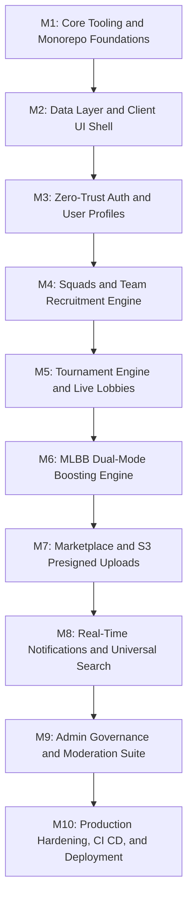

# Smex Store: Comprehensive Production Engineering Roadmap

A battle-tested, milestone-driven implementation plan for the Smex Store platform based on the 22 functional sections in docs/requirements.md and docs/design/hld.md. Each domain milestone is structured as an end-to-end full-stack vertical slice integrating backend services, database schemas, frontend client interfaces, and automated test gates.

---

## Technical Dependencies and Library Stack

All packages must be installed using pnpm add with zero manual version editing:

### Backend Server Stack

* **Core Framework**: `fastify@5`, `fastify-plugin@6`, `@fastify/sensible@6`
* **Network and Sockets**: `@fastify/cors`, `@fastify/websocket`
* **Configuration**: `dotenv`
* **Persistence and ORM**: `pg`, `drizzle-orm`, `drizzle-kit` dev dependency
* **Caching and Sessions**: `ioredis`
* **Rate Limiting**: `@fastify/rate-limit`
* **Validation and Security**: `zod`, `argon2`
* **File Uploads**: `@aws-sdk/client-s3`, `@aws-sdk/s3-request-presigner`
* **Build Engine**: `tsdown` powered by Rolldown in Rust

### Frontend Client Stack

* **Core Framework**: `next@16.4` App Router, Turbopack, React 19
* **Styling**: `tailwindcss@4`, `@tailwindcss/turbopack`, `clsx`, `tailwind-merge`
* **Icons**: `lucide-react`
* **Data Fetching and Cache**: `@tanstack/react-query`

---

## Detailed Milestone Execution Plan

---

### Milestone 1: Core Tooling and Monorepo Foundations

* [X] **1.1 Dependency Installation**: Run pnpm add across server/ and client/ for all baseline packages.
* [X] **1.2 Fastify CORS and Security**: Register `@fastify/cors` configured strictly for `http://localhost:3000` or `CORS_ORIGIN` env.
* [X] **1.3 Fastify WebSocket Registration**: Register `@fastify/websocket` with ping/pong heartbeat handling.
* [X] **1.4 Environment Configuration**: Create typed config parser `src/config/env.ts` using zod for `PORT`, `DATABASE_URL`, `REDIS_URL`, `JWT_SECRET`, `S3_ENDPOINT`.
* [X] **1.5 Client Styling Tokens**: Configure Matrix Emerald `#1FAE7A`, Cyan Depth `#1B8F97`, Obsidian `#0B0F12`, and AMOLED `#000000` tokens inside `client/app/globals.css`.
* [X] **1.6 Health Check Endpoint**: Register `GET /health` returning server uptime, timestamp, memory metrics, and basic server readiness.
* [X] **1.7 Docker Compose Local Stack**: Create `docker-compose.yml` defining local development containers for PostgreSQL, Redis, and MinIO local S3 storage.
* [X] **1.8 Automated Testing Suite**: Execute Node.js test runner suite verifying CORS origin validation, WebSocket ping and pong heartbeats, environment configuration failure parsing, and health probe metrics with >= 80% coverage (14 passing tests, 89.7% coverage documented in docs/internal/testing/llt/core-plumbing.md).

---

### Milestone 2: Data Layer and Client UI Shell

* [X] **2.1 Drizzle Connection Pool**: Set up `drizzle-orm/node-postgres` with pooled `pg.Pool` connection and graceful shutdown handlers.
* [X] **2.2 Relational Schema Definitions**:
  * `users` and `profiles`: UUID, email, password_hash, role, in_game_id, avatar_preset.
  * `sessions`: UUID, user_id, device_fingerprint, ip_address, expires_at.
  * `teams` and `team_members`: Captain ID, squad name, tag, capacity, open_status, roles.
  * `tournaments`, `tournament_participants`, `tournament_matches`: Formats, prize pool, seeds, round states.
  * `boosting_rates` and `boosting_orders`: Rate matrix, calculated_price_inr, status, contact_channel.
  * `marketplace_listings` and `listing_proofs`: Seller ID, price, badges, S3 keys, status.
  * `reviews_ratings` and `activity_logs`: Entity reviews, check constraints, JSONB audit logging.
* [X] **2.3 Migration Scripts and Drizzle Config**: Configure `drizzle.config.ts` and verify automated migration generation via drizzle-kit.
* [X] **2.4 Database Seeding Pipeline**: Create seed script `src/db/seed.ts` populating preset gaming avatars, default MLBB boosting pricing matrix, initial admin account, and sample tournaments.
* [X] **2.5 Data Layer Health Probe**: Extend `GET /health` to verify live PostgreSQL connection pool query readiness and report database latency.
* [X] **2.6 Client Root Layout and AMOLED Shell**:
  * Implement Next.js 16 App Router root layout with TanStack Query provider.
  * Build sticky navigation bar with official logo, navigation links, and theme toggle.
  * Build application footer with owner social channels and legal links.
  * Enforce pure AMOLED `#000000` and Obsidian `#0B0F12` background canvases with 120ms hardware transitions.
* [X] **2.7 Automated Data Layer and UI Shell Testing**: Execute automated test suite validating schema constraints, foreign key cascades, seed idempotency, health probe pings, and client UI shell component rendering (44 server tests passing with 95.47% line coverage, 6 client tests passing).

---

### Milestone 3: Zero-Trust Authentication and User Profiles

* [ ] **3.1 Password Security**: Implement hashing and verification via argon2.
* [ ] **3.2 Dual-Token Session Pipeline**:
  * Short-lived Access Token JWT (15m).
  * Long-lived Refresh Token stored in Redis with unique session_id.
* [ ] **3.3 Remote Session Revocation**:
  * Implement `POST /api/auth/revoke-session` to terminate a single device.
  * Implement `POST /api/auth/revoke-all` to purge all user keys from Redis, triggering immediate WS and HTTP disconnects.
* [ ] **3.4 Device Fingerprinting**: Capture User-Agent and IP to populate active sessions list in Settings.
* [ ] **3.5 Auth Endpoints**: Implement `/register`, `/login`, `/logout`, `/refresh`, `/me`.
* [ ] **3.6 Distributed Rate Limiting**: Register `@fastify/rate-limit` backed by Redis enforcing strict limits on `/api/auth/*` (5 req/min) and global API ingress (100 req/min).
* [ ] **3.7 Transactional Email and Password Recovery**: Integrate transactional email delivery, implement `POST /api/auth/forgot-password` generating expiring single-use reset tokens stored in Redis, and `POST /api/auth/reset-password`.
* [ ] **3.8 Client Authentication and Account UI**:
  * Build modal and standalone views for Login, Registration, and Password Reset.
  * Build User Profile dropdown in navigation bar showing avatar preset and IGN.
  * Build Settings page displaying active sessions with device names, IP addresses, and remote revocation buttons.
* [ ] **3.9 Automated Auth and Security Testing**: Execute automated test suite verifying Argon2 hashing, token rotation, Redis session revocation and purge, rate limiting enforcement, and frontend auth state management.

---

### Milestone 4: Squads and Team Recruitment Engine

* [ ] **4.1 Squad CRUD**: Endpoints for team creation, updating roster limits, and changing open/closed availability.
* [ ] **4.2 Join Request Pipeline**:
  * Player submits join request with in-game IGN and role.
  * Captain receives real-time notification to approve or reject.
  * Concurrency safety: atomic database transactions to prevent joining a full roster.
* [ ] **4.3 Team Rosters and Open Slot Badges**: Calculate open slots dynamically as capacity minus active members.
* [ ] **4.4 Client Teams and Recruitment UI**:
  * Build Teams and Groups directory page with search, game filter, and capacity badges.
  * Build team detail card modal with active roster member listing and role tags.
  * Build Join Request submission modal and Captain roster management controls.
* [ ] **4.5 Automated Squad and Roster Testing**: Execute test suite verifying team CRUD operations, atomic join request acceptance/rejection, roster capacity race condition prevention under concurrent requests, and team UI component interactions.

---

### Milestone 5: Tournament Engine and Live Lobbies

* [ ] **5.1 Tournament Management**: Lifecycle state machine handling upcoming, registration_open, ongoing, and completed states.
* [ ] **5.2 Bracket Generation**: Single-elimination, double-elimination, and round-robin bracket seed generators with automated bye assignments.
* [ ] **5.3 Real-Time WebSocket Lobby Gateway**:
  * `/ws/tournaments/:id/lobby`: Broadcasts live team registrations and bracket advancements without page reload.
  * Channel heartbeat and connection recovery handling.
* [ ] **5.4 Client Tournaments and Bracket UI**:
  * Build Tournaments page with Past, Ongoing, and Upcoming segmented views.
  * Build interactive bracket visualization component rendering rounds, match nodes, and winners.
  * Build live WebSocket tournament match lobby room with real-time score updater.
* [ ] **5.5 Automated Tournament and Bracket Testing**: Execute test suite verifying lifecycle state transitions, bracket generator algorithms, WebSocket lobby event dispatch, and bracket visualizer rendering.

---

### Milestone 6: MLBB Dual-Mode Boosting Engine

* [ ] **6.1 Core Calculation Logic**:
  * Sub-Mythic: Tier jump fixed matrix for Epic to Legend, Legend to Mythic, and Epic to Mythic bundles.
  * Mythic and Above: Progressive difficulty-scaled per-star tiers from Mythic 0-24 stars to Mythical Immortal 100+ stars.
  * Role and hero surcharges and multi-bracket traversal.
* [ ] **6.2 External Communication Link Dispatcher**:
  * Generates pre-formatted URI-encoded WhatsApp, Telegram, and Discord direct links.
  * Formats exact order summary text with starting/target ranks, calculated price in INR, and customer in-game IGN.
* [ ] **6.3 Admin Rate Override**: Secure endpoints allowing admins to update per-tier and per-star rates in PostgreSQL.
* [ ] **6.4 Client Rank Boosting UI**:
  * Build Rank Boosting booking page with dynamic dual-mode slider and dropdown selectors.
  * Implement instant live price computation in INR without page reload.
  * Build one-click dispatch action buttons launching pre-formatted WhatsApp, Telegram, and Discord chats.
* [ ] **6.5 Automated Boosting Engine Testing**: Execute test suite validating sub-mythic fixed tier matrices, mythic progressive per-star pricing, surcharge calculations, order link formatting, and interactive slider UI events.

---

### Milestone 7: Marketplace and S3 Presigned Uploads

* [ ] **7.1 Direct-to-Storage Presigned Uploads**:
  * Fastify endpoint generates signed S3/R2 upload URLs with strict MIME type and file size limits of 5MB per image.
  * Client uploads screenshot proofs directly to S3 with zero binary traffic passing through Fastify.
* [ ] **7.2 Listing Management**: CRUD for game account listings with mark-as-sold and price edit capabilities.
* [ ] **7.3 Dynamic Price-Drop Badges**:
  * Price lowered: automatically compute percentage discount and assign Good Deal badge.
  * Price increased or newly listed premium: assign Hot badge.
* [ ] **7.4 Media Verification and Next Image Whitelist**:
  * Implement image magic byte binary inspection to block disguised malicious payloads.
  * Configure `images.remotePatterns` in Next.js `next.config.ts` for safe image optimization.
* [ ] **7.5 Client Marketplace UI**:
  * Build Marketplace catalog page with rank filters, price range sliders, and dynamic deal badges.
  * Build account detail view with verified screenshot proof lightbox carousel.
  * Build listing creation form with direct client-side S3 upload progress bar.
  * Build direct seller contact modal with WhatsApp/Telegram links.
* [ ] **7.6 Automated Marketplace and Storage Testing**: Execute test suite verifying S3 presigned URL generation, magic-byte inspection, listing CRUD, badge calculations, and marketplace UI interactions.

---

### Milestone 8: Real-Time Notifications and Universal Search

* [ ] **8.1 Notification Dispatcher**:
  * In-memory WebSocket pub/sub and database persistence for unread notification center.
  * Notification types: Squad join requests, tournament schedule alerts, order status updates.
* [ ] **8.2 Cross-Entity Universal Search**:
  * Fast SQL search index with trigram matching across Tournaments, Teams, and Players.
  * Debounced client-side search autocomplete.
* [ ] **8.3 Client Notifications and Search UI**:
  * Build unread notification bell icon in navigation bar with live badge count and dropdown center.
  * Build global search modal with keyboard shortcut trigger (`Cmd+K` / `Ctrl+K`) and debounced autocomplete results across tournaments, teams, and players.
* [ ] **8.4 Automated Notification and Search Testing**: Execute test suite validating WebSocket notification dispatch, unread count tracking, SQL trigram search precision, and client search autocomplete UI.

---

### Milestone 9: Admin Dashboard and Governance Suite

* [ ] **9.1 User and Roster Moderation**: Admin ability to ban users, revoke tokens, and disband rule-breaking squads.
* [ ] **9.2 Marketplace Moderation**: Takedown reported fraudulent listings and suspend seller accounts.
* [ ] **9.3 Rate and Fee Overrides**: Live dashboard controls for boosting rates and platform announcements.
* [ ] **9.4 Client Admin Governance UI**:
  * Build Admin layout and dashboard shell protected by role-based route guards.
  * Build moderation queues for flagged marketplace listings and reported accounts.
  * Build live boosting rate editor with instant pricing preview.
* [ ] **9.5 Automated Governance and RBAC Testing**: Execute test suite verifying role-based access control guards, user ban enforcement, listing takedowns, boosting rate overrides, and admin UI views.

---

### Milestone 10: Production Hardening, CI CD Pipeline, and Deployment

* [ ] **10.1 Full Platform Regression and Quality Gates**:
  * Execute end-to-end integration and regression suites across Fastify API, PostgreSQL, Redis, and Next.js client.
  * Enforce strict CI quality gate requiring >= 80% line and branch coverage across all backend services.
  * Run Drizzle schema drift checks and automated load tests for WebSocket concurrency.
* [ ] **10.2 Continuous Integration Pipeline**:
  * GitHub Actions workflow `.github/workflows/ci.yml` triggered on pull requests and pushes to main.
  * Parallel jobs for monorepo linting, typechecking, unit tests, and build verification with pnpm store caching.
  * Automated Drizzle schema drift check to ensure SQL migrations match the TypeScript data layer.
* [ ] **10.3 Production Containerization**:
  * Multi-stage production Dockerfile for Next.js SSR client and Fastify TSDown bundle.
  * Health check endpoints and graceful shutdown signal handling.
* [ ] **10.4 Continuous Deployment Pipeline**:
  * GitHub Actions workflow `.github/workflows/deploy.yml` for automated container image publishing.
  * Automated deployment webhook or runner trigger to production host upon merge to main.
  * Post-deployment health check probing and automatic rollback trigger on probe failure.
* [ ] **10.5 Accessibility and Motion Compliance**:
  * WCAG 2.1 AA contrast verification across Dark and AMOLED palettes.
  * Reduced-motion media query compliance.
* [ ] **10.6 Structured Observability and RFC 7807 Error Handling**:
  * Configure Pino structured JSON logging with correlation IDs and request ID propagation across HTTP and WebSockets.
  * Enforce RFC 7807 problem details specification for all API errors.
