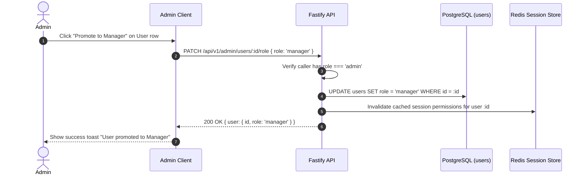
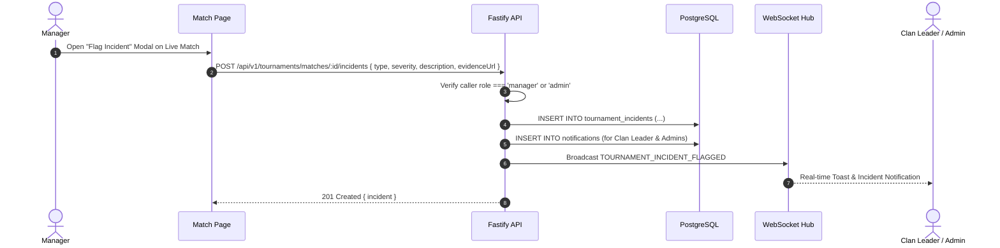
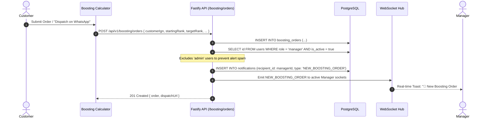

# Sprint 1: High-Level Design (HLD)

## Manager Role, Tournament Incident Monitoring & Boosting Operations

---

## 1. Architectural Overview & System Topology

Sprint 1 introduces the **Manager** operational role into the existing Smex Store decoupled architecture (Next.js 16 App Router + Fastify 5 REST & WebSocket Gateway + PostgreSQL 16 + Redis 7.2 Pub/Sub).

The architectural expansion provides:
1. **Administrative Role Delegation**: Admins can appoint registered users to a standing `manager` role.
2. **Match Incident Engine**: Managers monitor live tournaments and flag suspicious match activity, dispatching real-time WebSocket alerts to Clan Leaders and Admins.
3. **Manager-Exclusive Boosting Pipeline**: Real-time alerts on inbound boosting orders are dispatched exclusively to Managers (shielding Admins from inquiry alert spam).

```mermaid
flowchart TD
    subgraph Clients["Client Tier (Next.js 16)"]
        ADMIN_UI["Admin Governance (/admin/users)"]
        MANAGER_UI["Match Incident Modal (/tournaments/[id])"]
        NOTIF_UI["Real-Time Notifications & Toasts"]
    end

    subgraph Gateway["Service Tier (Fastify 5)"]
        AUTH_GUARD["RBAC Guard (RoleGuard: admin, manager, user)"]
        ADMIN_ROUTES["Admin Role Routes (/api/v1/admin/users/:id/role)"]
        INCIDENT_ROUTES["Incident Routes (/api/v1/tournaments/matches/:id/incidents)"]
        BOOSTING_ROUTES["Boosting Routes (/api/v1/boosting/orders)"]
        WS_HUB["WebSocket Hub & Frame Dispatcher"]
    end

    subgraph Persistence["Persistence & PubSub Tier"]
        PG_USERS[("users (role enum)")]
        PG_INCIDENTS[("tournament_incidents")]
        PG_BOOSTING[("boosting_orders")]
        PG_NOTIFS[("notifications")]
        REDIS_BUS[("Redis 7.2 Pub/Sub")]
    end

    ADMIN_UI -->|PATCH /role (Hire/Fire)| AUTH_GUARD --> ADMIN_ROUTES --> PG_USERS
    MANAGER_UI -->|POST /incidents (Flag Match)| AUTH_GUARD --> INCIDENT_ROUTES --> PG_INCIDENTS
    INCIDENT_ROUTES --> WS_HUB
    INCIDENT_ROUTES --> PG_NOTIFS

    BOOSTING_ROUTES --> PG_BOOSTING
    BOOSTING_ROUTES -->|Query Managers Only| PG_USERS
    BOOSTING_ROUTES --> WS_HUB
    BOOSTING_ROUTES --> PG_NOTIFS

    WS_HUB <--> REDIS_BUS
    WS_HUB -->|Duplex WSS frames| NOTIF_UI
```

---

## 2. Core Subsystems & Interaction Flows

### 2.1 Subsystem 1: Standing Manager Lifecycle (Admin Exclusive Control)

* **Design Invariant**: Only Platform Admins have authority to promote users to `manager` or revoke their standing status back to `user`.
* **Flow**:
  1. Admin navigates to `/admin/users` and selects "Promote to Manager" or "Revoke Manager".
  2. Request hits `PATCH /api/v1/admin/users/:id/role` with `RoleGuard(['admin'])`.
  3. Database updates `users.role` to `'manager'`.
  4. User's active session JWT access token is re-minted or verified on next request with updated claims.
  5. User remains Manager across all matches and platform operations until explicitly dismissed by Admin.



---

### 2.2 Subsystem 2: Tournament Live Monitoring & Incident Reporting

* **Design Invariant**: Any user holding the standing `manager` role (or `admin`) has continuous authority across all tournaments to file match incident reports.
* **Incident Lifecycle**:
  $$\text{flagged} \longrightarrow \text{under\_review} \longrightarrow (\text{resolved} \mid \text{dismissed})$$
* **Alert Routing**:
  * When an incident is flagged, WebSocket event `TOURNAMENT_INCIDENT_FLAGGED` is routed to:
    1. **Clan Leader** of the reported/opposing squad.
    2. **All active Platform Admins**.



---

### 2.3 Subsystem 3: Manager-Exclusive Boosting Order Alerts

* **Design Invariant**: Boosting alerts are dispatched **strictly to Managers**. Admins are excluded from order notifications to eliminate alert spam.
* **Guest & Authenticated Support**: Triggers reliably regardless of whether the customer checked out via guest inquiry or logged-in account.



---

## 3. Data Architecture & Schema Additions

### 3.1 Role Enum Expansion
Update PostgreSQL enum `user_role`:
```sql
ALTER TYPE user_role ADD VALUE IF NOT EXISTS 'manager';
```

### 3.2 Tournament Incidents Table (`tournament_incidents`)
```sql
CREATE TABLE tournament_incidents (
    id UUID PRIMARY KEY DEFAULT gen_random_uuid(),
    tournament_id UUID NOT NULL REFERENCES tournaments(id) ON DELETE CASCADE,
    match_id UUID NOT NULL REFERENCES tournament_matches(id) ON DELETE CASCADE,
    reported_by UUID NOT NULL REFERENCES users(id),
    target_team_id UUID REFERENCES teams(id) ON DELETE SET NULL,
    target_player_ign VARCHAR(50),
    incident_type VARCHAR(50) NOT NULL, -- 'suspected_cheat', 'unauthorized_substitute', 'toxic_behavior', 'connection_manipulation', 'other'
    severity VARCHAR(20) NOT NULL DEFAULT 'medium', -- 'low', 'medium', 'high', 'critical'
    description TEXT NOT NULL,
    evidence_url TEXT,
    status VARCHAR(20) NOT NULL DEFAULT 'flagged', -- 'flagged', 'under_review', 'resolved', 'dismissed'
    resolution_notes TEXT,
    resolved_by UUID REFERENCES users(id),
    resolved_at TIMESTAMPTZ,
    created_at TIMESTAMPTZ NOT NULL DEFAULT NOW(),
    updated_at TIMESTAMPTZ NOT NULL DEFAULT NOW()
);

CREATE INDEX idx_incidents_match_id ON tournament_incidents(match_id);
CREATE INDEX idx_incidents_status ON tournament_incidents(status);
```

---

## 4. WebSocket Event Envelope Specifications

All real-time communications adhere to the platform's standardized JSON WebSocket envelope:

### 4.1 Incident Flagged Frame
```json
{
  "event": "TOURNAMENT_INCIDENT_FLAGGED",
  "payload": {
    "incidentId": "d3b07384-d113-4f44-8846-5f341498b301",
    "tournamentId": "a1b07384-c113-4f44-8846-5f341498b302",
    "matchId": "c2b07384-e113-4f44-8846-5f341498b303",
    "reportedByIgn": "ManagerViper",
    "targetTeamName": "Omega Elites",
    "incidentType": "suspected_cheat",
    "severity": "critical",
    "summary": "Suspicious map-awareness reported in Game 2",
    "timestamp": "2026-11-01T11:30:00.000Z"
  }
}
```

### 4.2 New Boosting Order Frame (Managers Only)
```json
{
  "event": "NEW_BOOSTING_ORDER",
  "payload": {
    "orderId": "e4b07384-f113-4f44-8846-5f341498b304",
    "orderRef": "BOOST-8942-XJ",
    "customerIgn": "SlayerPro",
    "startingRank": "Mythic 15 Stars",
    "targetRank": "Mythic 50 Stars",
    "totalPriceInr": 1450,
    "contactChannel": "whatsapp",
    "timestamp": "2026-11-01T11:30:00.000Z"
  }
}
```

---

## 5. Security & Authorization Matrix

| Operation | User | Manager | Admin |
| :--- | :---: | :---: | :---: |
| Promote / Revoke Manager (`PATCH /admin/users/:id/role`) | ❌ | ❌ | ✅ |
| Monitor Live Matches | ✅ | ✅ | ✅ |
| Flag Match Incident (`POST /matches/:id/incidents`) | ❌ | ✅ | ✅ |
| Resolve / Dismiss Incident (`PATCH /incidents/:id/resolve`) | ❌ | ❌ | ✅ |
| Receive Incident Alerts | ❌ | ❌ | ✅ |
| Receive Boosting Order Alerts | ❌ | ✅ | ❌ |
