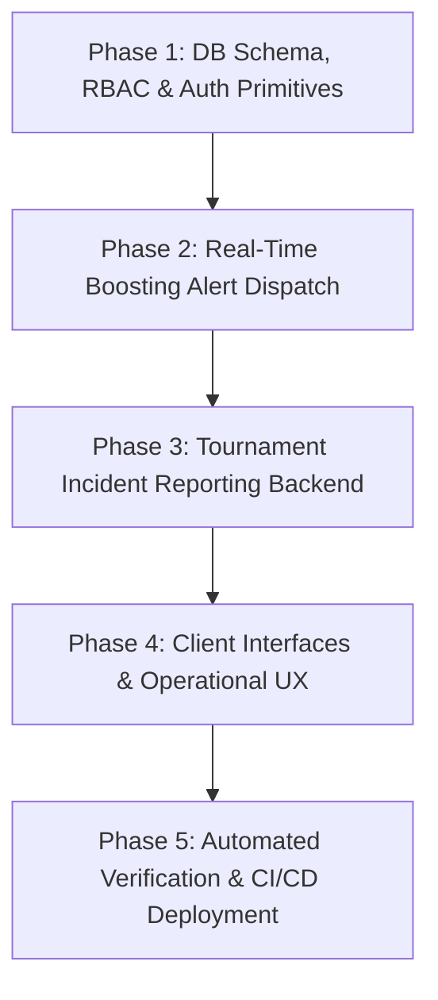

# Sprint 1: Phased Engineering Roadmap

## 1. Overview & Delivery Strategy

This roadmap outlines the phased execution strategy for **Sprint 1: Manager Role, Tournament Incident Monitoring & Boosting Operations**.

To maintain high engineering velocity while safeguarding production stability, Sprint 1 is broken down into **5 sequential phases**. Each phase represents an end-to-end verifiable slice with strict test gates.

---

## 2. Milestone Pipeline

---

## 3. Phased Execution Breakdown

### Phase 1: Database Schema, RBAC & Auth Primitives

*Target Scope: Core Data & Security Layer*

- [ ] **1.1 Schema Migration (`server/src/db/schema.ts`)**:
  - Update `user_role` pgEnum to include `'manager'` (`'user'`, `'manager'`, `'admin'`).
  - Add standing audit fields to track who promoted the user and when.
- [ ] **1.2 Auth & JWT Token Updates (`shared/src/types.ts` & `server/src/middleware/auth.ts`)**:
  - Update `AccessTokenPayload` to reflect `role: 'user' | 'manager' | 'admin'`.
  - Update role authorization guards (`RoleGuard(['admin', 'manager'])`).
- [ ] **1.3 Admin Role Management Endpoints (`server/src/routes/admin.ts`)**:
  - `PATCH /api/v1/admin/users/:id/role` to promote a user to `manager` or demote/fire back to `user`.
  - Audit logging for every hire/fire action.

---

### Phase 2: Real-Time Boosting Alert Dispatch

*Target Scope: Business Alerting Pipeline*

- [ ] **2.1 Manager Query Helper (`server/src/services/notification.service.ts`)**:
  - Add `getManagerRecipients(db)` to fetch user IDs of all active `manager` accounts (excluding Admins).
- [ ] **2.2 Order Route Integration (`server/src/routes/boosting.ts`)**:
  - In `POST /api/v1/boosting/orders`, trigger `NotificationService.dispatchNotification(...)` exclusively to Manager recipients.
  - Emit WebSocket frame `NEW_BOOSTING_ORDER` with order reference, customer IGN, and tier jump details.
  - Ensure alerts fire for both authenticated users and guest checkouts without spamming Admin notifications.

---

### Phase 3: Tournament Incident Reporting Backend

*Target Scope: Incident Management & Live Monitoring*

- [ ] **3.1 Incident Table Schema (`server/src/db/schema.ts`)**:
  - Create `tournament_incidents` table:
    - `id`, `tournamentId`, `matchId`, `reportedBy` (manager user ID), `targetTeamId`, `targetPlayerIgn`, `incidentType`, `severity`, `description`, `evidenceUrl`, `status` (`flagged`, `under_review`, `resolved`, `dismissed`), `resolutionNotes`, `resolvedBy`, `timestamps`.
- [ ] **3.2 Incident Routes (`server/src/routes/tournaments.ts`)**:
  - `POST /api/v1/tournaments/matches/:id/incidents` (Manager & Admin only): File a match report.
  - `GET /api/v1/tournaments/matches/:id/incidents`: Fetch incidents for a match (Manager, Clan Leader, Admin).
  - `PATCH /api/v1/tournaments/incidents/:id/resolve`: Resolve/dismiss incident (Admin & Clan Leader).
- [ ] **3.3 Clan Leader & Admin Alert Dispatch**:
  - Dispatch instant WebSocket frame `TOURNAMENT_INCIDENT_FLAGGED` to affected Clan Leader and all Admins.

---

### Phase 4: Client Interfaces & Operational UX

*Target Scope: Next.js Client & Real-Time UI*

- [ ] **4.1 Admin User Management UI (`client/app/admin/users/page.tsx`)**:
  - Add "Role" management dropdown on user rows: Promote to Manager / Revoke Manager.
- [ ] **4.2 Tournament Live Match Incident Modal (`client/components/tournaments/`)**:
  - Add "Flag Incident" action visible strictly to logged-in Managers and Admins on match cards/lobbies.
  - Form modal with type, severity, player IGN, description, and proof URL.
- [ ] **4.3 Manager & Admin Notification Toasts (`client/components/notifications/`)**:
  - Toast pop-up when `NEW_BOOSTING_ORDER` or `TOURNAMENT_INCIDENT_FLAGGED` WebSocket frames arrive.
  - Badge/Icon indicating Manager status on profile and navigation bar.

---

### Phase 5: Automated Verification & CI/CD Deployment

*Target Scope: Quality Gates & Zero-Regression Release*

- [ ] **5.1 Targeted Unit & Integration Tests**:
  - Test role escalation protection (normal user cannot flag incidents or access manager endpoints).
  - Test boosting order dispatch triggers notifications exclusively to managers (verifying admins are not spammed).
  - Test incident state machine transitions and audit logging.
- [ ] **5.2 Monorepo Typecheck & Linting**:
  - `pnpm --filter @smex/shared build`
  - `pnpm --filter server typecheck`
  - `pnpm --filter client lint`
- [ ] **5.3 Deployment to Production VPS**:
  - Push commit to `main`, GitHub Actions CI/CD deployment, verify live health check.

---

## 4. Definition of Done (DoD)

- [ ] 1. Database migration runs cleanly without data loss on existing `users` or `tournaments` tables.
- [ ] 2. Admins can successfully hire/promote and fire/demote Managers from the dashboard.
- [ ] 3. Submitting any boosting order instantly triggers in-app and WebSocket alerts strictly to all active Managers (Admins excluded from order spam).
- [ ] 4. Managers can report suspicious match activity, and Clan Leaders + Admins receive real-time incident notifications.
- [ ] 5. All automated newly added test cases pass with zero TypeScript errors.
