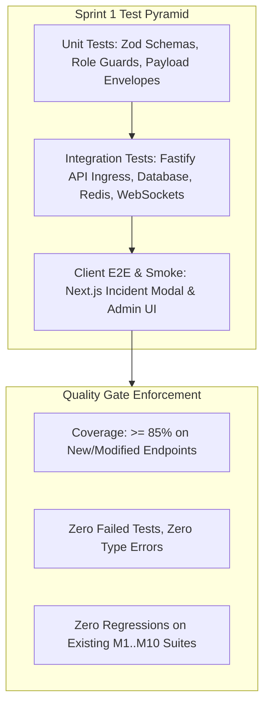

# Sprint 1: Test Plan & Quality Assurance Strategy

## Manager Role, Tournament Incident Monitoring & Boosting Operations

---

## 1. Overview and Quality Philosophy

This document defines the comprehensive test strategy, verification catalogs, and quality gates for **Sprint 1: Manager Role, Tournament Incident Monitoring & Boosting Operations**.

Sprint 1 enforces four strict quality invariants:
1. **Zero Privilege Escalation**: Normal users can never submit incidents, promote themselves or others, or receive manager-exclusive alerts.
2. **Alert Delivery Reliability**: Boosting order notifications must reach active Managers within 200ms of DB insert, without failing the primary order transaction if notification transport fails.
3. **Admin Exclusivity**: Boosting order alerts must never leak to Admin notification feeds.
4. **Deterministic Auditing**: All incident reports and manager role appointments must maintain immutable audit trails (who appointed/reported, when, and IP address).

---

## 2. Test Pyramid & Execution Boundaries



---

## 3. Detailed Test Catalog & Verification Matrix

### 3.1 Module 1: Standing Manager Lifecycle & RBAC (`server/test/admin/manager-role.test.ts`)

| Test ID | Test Scenario | Expected Outcome | Execution Layer |
| :--- | :--- | :--- | :--- |
| **TC-M1.1** | Admin promotes registered user to `manager` via `PATCH /api/v1/admin/users/:id/role` | User role updated in DB to `'manager'`, audit log recorded, HTTP 200 OK. | Integration |
| **TC-M1.2** | Non-admin (normal user or manager) attempts to promote user to `manager` | HTTP 403 Forbidden with `INSUFFICIENT_PERMISSIONS` RFC 7807 error. | Integration |
| **TC-M1.3** | Admin demotes/fires `manager` back to `user` via `PATCH /api/v1/admin/users/:id/role` | User role reverts to `'user'`, active session permissions revoked, HTTP 200 OK. | Integration |
| **TC-M1.4** | JWT access token verification on newly minted manager token | Token payload correctly parses `role === 'manager'`, accepted by `RoleGuard(['manager'])`. | Unit |

---

### 3.2 Module 2: Boosting Notifications (`server/test/boosting/manager-alerts.test.ts`)

| Test ID | Test Scenario | Expected Outcome | Execution Layer |
| :--- | :--- | :--- | :--- |
| **TC-B1.1** | Guest customer places boosting order via `POST /api/v1/boosting/orders` | Order created (`status: 'inquiry'`), notification inserted for all active managers, HTTP 201 Created. | Integration |
| **TC-B1.2** | Registered user places boosting order via `POST /api/v1/boosting/orders` | Customer receives order confirmation, active managers receive `NEW_BOOSTING_ORDER` alert. | Integration |
| **TC-B1.3** | Verify Admin exclusion from boosting alerts | Query notifications table; verify ZERO records generated for users with role `'admin'`. | Integration |
| **TC-B1.4** | WebSocket frame verification for `NEW_BOOSTING_ORDER` | Connected Manager WebSocket client receives valid frame containing `orderRef`, `customerIgn`, and prices. | Integration / WS |
| **TC-B1.5** | Notification dispatch failure resilience | If WebSocket hub throws, order is still successfully committed to DB and returned to customer. | Integration |

---

### 3.3 Module 3: Tournament Incident Reporting (`server/test/tournaments/incidents.test.ts`)

| Test ID | Test Scenario | Expected Outcome | Execution Layer |
| :--- | :--- | :--- | :--- |
| **TC-I1.1** | Standing Manager submits incident report on ongoing match | Record created in `tournament_incidents` (`status: 'flagged'`), HTTP 201 Created. | Integration |
| **TC-I1.2** | Normal user attempts to submit incident report on a match | HTTP 403 Forbidden (`RoleGuard` rejects caller). | Integration |
| **TC-I1.3** | Incident report validation (invalid severity or empty description) | HTTP 422 Unprocessable Entity with Zod validation details. | Unit / API |
| **TC-I1.4** | Incident alert routing to Clan Leader and Admins | WebSocket frame `TOURNAMENT_INCIDENT_FLAGGED` broadcast to Clan Leader and Admin sockets. | Integration / WS |
| **TC-I1.5** | Clan Leader resolves incident for own match | Status updated to `'resolved'`, resolution notes stored, HTTP 200 OK. | Integration |
| **TC-I1.6** | Unrelated Clan Leader attempts to resolve incident for another squad's match | HTTP 403 Forbidden. | Integration |

---

### 3.4 Module 4: Client Interfaces & Operational UX (Playwright / Vitest / RTL)

| Test ID | UI Component / View | Test Verification |
| :--- | :--- | :--- |
| **TC-UI1.1** | `/admin/users` (Admin Governance) | Role selector displays "Manager" option; clicking triggers confirmation and updates UI state. |
| **TC-UI1.2** | Tournament Match Card / Lobby | "Flag Incident" button renders ONLY if logged-in user has role `'manager'` or `'admin'`. |
| **TC-UI1.3** | Incident Submission Modal | Form inputs validate correctly; submitting displays loading state and success feedback. |
| **TC-UI1.4** | Notification Bell & Toasts | Manager receives pop-up toast on new boosting order; clicking routes to order details. |

---

## 4. Test Execution Commands & Quality Gates

Run targeted verification before pushing changes to `main`:

```bash
# 1. Typecheck and Shared Package Build
pnpm --filter @smex/shared build
pnpm --filter server typecheck
pnpm --filter client typecheck

# 2. Targeted Backend Tests
node --test --import tsx server/test/admin/manager-role.test.ts
node --test --import tsx server/test/boosting/manager-alerts.test.ts
node --test --import tsx server/test/tournaments/incidents.test.ts

# 3. Client Linting & Build
pnpm --filter client lint
```

---

## 5. Quality Gate Criteria for Production Release

- [ ] All 15 defined test cases pass with $100\%$ green execution.
- [ ] Zero TypeScript errors across `@smex/shared`, `server`, and `client`.
- [ ] No regressions on existing M1..M10 test catalog.
- [ ] Database migration rolls forward and backward cleanly without corrupting `users` table.
- [ ] Production health check probe (`/api/v1/health`) passes on VPS after deployment.
