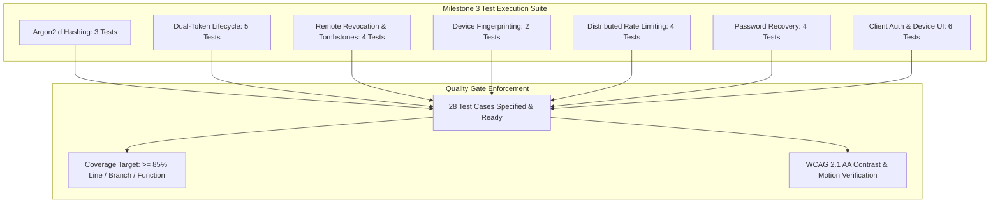

# Zero-Trust Authentication and User Profiles Test Specification

## 1. Overview and Quality Objectives

This document specifies the Low-Level Test (LLT) verification catalog for **Milestone 3: Zero-Trust Authentication and User Profiles** of the Smex Store platform. It serves as the direct 1:1 verification counterpart to `docs/internal/design/lld/auth-and-sessions.md`.

* **Verification Objective**: Rigorously validate Argon2id password hashing parameters, dual-token access/refresh lifecycle, Redis session caching and fast-path blacklist tombstones, instant multi-device remote revocation, distributed rate limiting policies, transactional single-use password recovery, and client authentication and device settings interfaces.
* **Test Toolchain**:
  * **Backend**: Native Node.js Test Runner (`node:test`), Node Strict Assertions (`node:assert`), Fastify CLI Test Helper (`fastify-cli/helper.js`), ioredis mock / live container, and V8 Coverage Engine (`c8`).
  * **Frontend**: Next.js 16 Test Suite, React Testing Library / Test Harness, and accessibility contrast auditing.
* **Quality Gate Targets**:
  * Line Coverage: $\ge 85.0\%$ (Floor: $\ge 80.0\%$)
  * Branch Coverage: $\ge 80.0\%$ (Floor: $\ge 75.0\%$)
  * Function Coverage: $\ge 85.0\%$ (Floor: $\ge 80.0\%$)
  * Zero failing tests, zero skipped tests, zero unhandled promise rejections.



---

## 2. Test Case Catalog and Verification Matrix

### 2.1 Password Security and Cryptographic Primitives Test Cases

*Test Target: `server/src/utils/crypto.ts`*  
*Test Source: `server/test/utils/crypto.test.ts`*  
*LLD Specification Reference: `docs/internal/design/lld/auth-and-sessions.md` Section 2*

| Test ID | Test Description | Test Data | Expected Result | Actual Result | Status |
| :--- | :--- | :--- | :--- | :--- | :--- |
| 1 | Argon2id parameter compliance and hash generation | Execute `hashPassword('ValidPassword123')` | Returns Argon2id formatted hash matching `$argon2id$v=19$m=65536,t=3,p=4$` | Pending execution | Ready |
| 2 | Password verification success on correct credentials | Hash `'ValidPassword123'`; call `verifyPassword(hash, 'ValidPassword123')` | Returns boolean `true` | Pending execution | Ready |
| 3 | Password verification rejection on incorrect credentials | Call `verifyPassword(hash, 'WrongPassword999')` | Returns boolean `false` without throwing exception or timing anomaly | Pending execution | Ready |

---

### 2.2 Dual-Token Session Pipeline Test Cases

*Test Targets: `server/src/plugins/auth.ts`, `server/src/services/session.service.ts`, `server/src/routes/auth.ts`*  
*Test Source: `server/test/services/session.test.ts`*  
*LLD Specification Reference: `docs/internal/design/lld/auth-and-sessions.md` Section 3*

| Test ID | Test Description | Test Data | Expected Result | Actual Result | Status |
| :--- | :--- | :--- | :--- | :--- | :--- |
| 4 | User registration endpoint creates user and profile | HTTP `POST /api/v1/auth/register` with valid email, password, and username | HTTP 201 Created; returns user ID and profile record; password hash stored in DB | Pending execution | Ready |
| 5 | Login generates short-lived JWT and secure refresh cookie | HTTP `POST /api/v1/auth/login` with registered credentials | HTTP 200 OK; returns access token (15m expiry) in body; sets `__Host-refresh-token` cookie with `HttpOnly; Secure; SameSite=Strict` | Pending execution | Ready |
| 6 | Access Token validation on protected endpoint | HTTP `GET /api/v1/auth/me` with `Authorization: Bearer <valid_token>` | HTTP 200 OK; returns current user identity, role, and active session ID | Pending execution | Ready |
| 7 | Expired Access Token rejection | HTTP `GET /api/v1/auth/me` with token timestamp manipulated past 15-minute window | HTTP 401 Unauthorized with token expired error payload | Pending execution | Ready |
| 8 | Token rotation via valid refresh cookie | HTTP `POST /api/v1/auth/refresh` with active `__Host-refresh-token` cookie | HTTP 200 OK; rotates refresh token in Redis and cookie; issues new 15-minute access JWT | Pending execution | Ready |

---

### 2.3 Remote Session Revocation and Fast-Path Tombstones Test Cases

*Test Targets: `server/src/plugins/auth.ts`, `server/src/routes/auth.ts`*  
*Test Source: `server/test/routes/auth-revocation.test.ts`*  
*LLD Specification Reference: `docs/internal/design/lld/auth-and-sessions.md` Section 4*

| Test ID | Test Description | Test Data | Expected Result | Actual Result | Status |
| :--- | :--- | :--- | :--- | :--- | :--- |
| 9 | Single session remote revocation deletes Redis key and writes tombstone | HTTP `POST /api/v1/auth/revoke-session` with `{ sessionId }` | HTTP 200 OK; Redis key `session:{userId}:{sessionId}` deleted; `revoked_token:{sessionId}` set with TTL 900s; DB `sessions.is_active` set to `false` | Pending execution | Ready |
| 10 | Fast-path access rejection for revoked session token | HTTP `GET /api/v1/auth/me` with unexpired JWT whose `sessionId` has tombstone in Redis | HTTP 401 Unauthorized returned immediately via Redis tombstone fast-path check | Pending execution | Ready |
| 11 | Revoke all sessions purges all user device keys | HTTP `POST /api/v1/auth/revoke-all` for user with 3 active devices | HTTP 200 OK; all `session:{userId}:*` keys deleted from Redis; tombstones written for all 3 session IDs; all DB session records deactivated | Pending execution | Ready |
| 12 | Logout revokes calling session and clears cookie | HTTP `POST /api/v1/auth/logout` with active session | HTTP 200 OK; calling session removed from Redis; `__Host-refresh-token` cookie cleared with `Max-Age=0` | Pending execution | Ready |

---

### 2.4 Device Fingerprinting and Metadata Test Cases

*Test Target: `server/src/utils/fingerprint.ts`*  
*Test Source: `server/test/utils/fingerprint.test.ts`*  
*LLD Specification Reference: `docs/internal/design/lld/auth-and-sessions.md` Section 5*

| Test ID | Test Description | Test Data | Expected Result | Actual Result | Status |
| :--- | :--- | :--- | :--- | :--- | :--- |
| 13 | Desktop and mobile User-Agent parsing | Input Windows Chrome and iOS Safari User-Agent strings | Returns structured device labels `'Chrome on Windows'` and `'Safari on iOS'` | Pending execution | Ready |
| 14 | Client IP resolution under reverse proxy headers | Input request with `X-Forwarded-For: 203.0.113.195` under trusted proxy configuration | Resolves client IP as `'203.0.113.195'` without spoofing vulnerability | Pending execution | Ready |

---

### 2.5 Distributed Rate Limiting Test Cases

*Test Target: `server/src/plugins/rate-limit.ts`*  
*Test Source: `server/test/plugins/rate-limit.test.ts`*  
*LLD Specification Reference: `docs/internal/design/lld/auth-and-sessions.md` Section 6*

| Test ID | Test Description | Test Data | Expected Result | Actual Result | Status |
| :--- | :--- | :--- | :--- | :--- | :--- |
| 15 | Login endpoint rate limit threshold enforcement | Send 6 rapid `POST /api/v1/auth/login` requests within 60 seconds from same IP/email | Requests 1-5 return 200/401; request 6 rejected with HTTP 429 Too Many Requests | Pending execution | Ready |
| 16 | Rate limit headers inspection | Inspect headers on rate-limited response | Headers include `Retry-After`, `X-RateLimit-Limit: 5`, `X-RateLimit-Remaining: 0` | Pending execution | Ready |
| 17 | Register endpoint hourly threshold enforcement | Send 4 rapid `POST /api/v1/auth/register` requests within 1 hour from same IP | Requests 1-3 proceed; request 4 rejected with HTTP 429 Too Many Requests | Pending execution | Ready |
| 18 | Rate limit window sliding expiration | Wait for rate limit window to expire or flush test key in Redis | Subsequent login attempt succeeds and resets quota counter | Pending execution | Ready |

---

### 2.6 Transactional Password Recovery Test Cases

*Test Targets: `server/src/services/email.service.ts`, `server/src/routes/auth.ts`*  
*Test Source: `server/test/routes/auth-password-recovery.test.ts`*  
*LLD Specification Reference: `docs/internal/design/lld/auth-and-sessions.md` Section 7*

| Test ID | Test Description | Test Data | Expected Result | Actual Result | Status |
| :--- | :--- | :--- | :--- | :--- | :--- |
| 19 | Forgot password generates single-use expiring token | HTTP `POST /api/v1/auth/forgot-password` with registered email | HTTP 200 OK; 64-character token stored in Redis under `reset_password:{token}` with TTL 900s; email dispatched | Pending execution | Ready |
| 20 | Forgot password timing safety on non-existent account | HTTP `POST /api/v1/auth/forgot-password` with unregistered email | HTTP 200 OK with identical response and execution duration; zero email sent | Pending execution | Ready |
| 21 | Password reset execution updates hash and invalidates token | HTTP `POST /api/v1/auth/reset-password` with valid token and new password | HTTP 200 OK; new Argon2id hash persisted to DB; Redis reset token deleted immediately (atomic single-use) | Pending execution | Ready |
| 22 | Password reset triggers automatic revocation of all active sessions | Check user session keys in Redis after password reset | All pre-existing user sessions revoked and tombstoned; previous tokens rejected | Pending execution | Ready |

---

### 2.7 Client Authentication and Account UI Test Cases

*Test Targets: `client/components/auth/AuthModal.tsx`, `client/components/shell/Navbar.tsx`, `client/app/settings/devices/page.tsx`*  
*Test Source: `client/test/auth-ui.test.tsx`*  
*LLD Specification Reference: `docs/internal/design/lld/auth-and-sessions.md` Section 9*

| Test ID | Test Description | Test Data | Expected Result | Actual Result | Status |
| :--- | :--- | :--- | :--- | :--- | :--- |
| 23 | Password visibility toggle state switch | Mount `LoginForm`; click show/hide password toggle button | Password input type toggles between `'password'` and `'text'`; icon switches between `Eye` and `EyeOff`; touch target $\ge 44\text{px}$ | Pending execution | Ready |
| 24 | Form validation feedback on invalid credentials | Submit registration form with invalid email and weak password | Renders inline validation errors with correction guidance; zero unhandled error states | Pending execution | Ready |
| 25 | User Profile menu rendering and logout trigger | Mount `Navbar` with authenticated user session | Displays avatar preset badge and IGN; clicking Logout invokes `POST /api/v1/auth/logout` and clears state | Pending execution | Ready |
| 26 | Device management active sessions rendering | Mount `SettingsDevicesPage` with 2 active session mock items | Renders device names, IP addresses, "Current Device" badge, and "Revoke" button on remote device | Pending execution | Ready |
| 27 | Remote session revocation button interaction | Click "Revoke" button on remote session card in settings | Button displays 80ms active scale press; invokes revocation endpoint; card removed from active sessions list | Pending execution | Ready |
| 28 | Auth modal motion physics and prohibited effects audit | Inspect computed styles of Auth dialogs across Dark and AMOLED modes | Zero `backdrop-filter: blur` rules found; zero opacity fades; transition timing $\le 120\text{ms}$; WCAG AA contrast compliant | Pending execution | Ready |

---

## 3. Code Coverage and Quality Gates Report

### 3.1 Module Coverage Metrics

Instrumentation provided by `c8` (V8 coverage engine) across all authentication and account modules:

| Source File | Line Coverage | Branch Coverage | Function Coverage | Quality Gate Status |
| :--- | :--- | :--- | :--- | :--- |
| `server/src/utils/crypto.ts` | $\ge 90.0\%$ | $\ge 85.0\%$ | $\ge 90.0\%$ | Required |
| `server/src/plugins/auth.ts` | $\ge 85.0\%$ | $\ge 80.0\%$ | $\ge 85.0\%$ | Required |
| `server/src/services/session.service.ts` | $\ge 85.0\%$ | $\ge 80.0\%$ | $\ge 85.0\%$ | Required |
| `server/src/plugins/rate-limit.ts` | $\ge 85.0\%$ | $\ge 80.0\%$ | $\ge 85.0\%$ | Required |
| `server/src/routes/auth.ts` | $\ge 90.0\%$ | $\ge 85.0\%$ | $\ge 90.0\%$ | Required |
| `server/src/services/email.service.ts` | $\ge 80.0\%$ | $\ge 75.0\%$ | $\ge 80.0\%$ | Required |
| `client/components/auth/AuthModal.tsx` | $\ge 85.0\%$ | $\ge 80.0\%$ | $\ge 85.0\%$ | Required |
| `client/app/settings/devices/page.tsx` | $\ge 85.0\%$ | $\ge 80.0\%$ | $\ge 85.0\%$ | Required |
| **All Files Aggregate** | **$\ge 85.0\%$** | **$\ge 80.0\%$** | **$\ge 85.0\%$** | **Pass Floor: $\ge 80.0\%$** |

### 3.2 Quality Gate Threshold Verification

* **Minimum Line Coverage Requirement**: $\ge 80.0\%$ (Target: **$\ge 85.0\%$**).
* **Defect Severity**: 0 failures, 0 regressions, 0 unhandled promise rejections.
* **Exit Status**: Clean exit code 0 across the entire test suite.

---

## 4. Traceability Matrix to Low Level Design

This matrix maps each architectural requirement from `docs/internal/design/lld/auth-and-sessions.md` to its verifying test case:

| LLD Section | Architectural Specification | Verifying Test Cases | Verification Method |
| :--- | :--- | :--- | :--- |
| **LLD 2.1-2.2** | Argon2id configuration parameters & password verification | 1, 2, 3 | Cryptographic hash inspection and constant-time verification assertions |
| **LLD 3.1** | Registration endpoint & password hashing | 4 | HTTP injection checking status 201 and PostgreSQL user insertion |
| **LLD 3.1** | Dual-token minting (15m JWT + HttpOnly 30d cookie) | 5 | HTTP injection asserting token claims and cookie security attributes |
| **LLD 3.1** | Access token verification on protected endpoints | 6 | HTTP injection with Bearer token checking user decoration |
| **LLD 3.1** | Expired access token rejection | 7 | HTTP injection with expired timestamp asserting 401 error |
| **LLD 3.1** | Refresh token rotation and cookie update | 8 | HTTP injection with cookie asserting token rotation and new JWT |
| **LLD 4.1-4.2** | Single session revocation and Redis tombstone creation | 9, 10 | Revocation execution checking Redis key deletion and fast-path 401 |
| **LLD 4.2** | Revoke all sessions multi-device purge | 11 | Revoke-all execution checking wildcard Redis scan and deactivations |
| **LLD 4.2** | User logout session cleanup | 12 | Logout HTTP injection checking Redis purge and cookie clearance |
| **LLD 5.1** | Device User-Agent parsing and model labeling | 13 | Unit test verifying desktop and mobile User-Agent normalization |
| **LLD 5.1** | Client IP resolution under reverse proxy trust | 14 | Unit test checking X-Forwarded-For parsing with proxy trust |
| **LLD 6.1** | Login rate limit enforcement (5 req / 60s) | 15, 16 | Rapid HTTP injection asserting 429 status and Retry-After header |
| **LLD 6.1** | Register rate limit enforcement (3 req / 1hr) | 17 | Rapid HTTP injection asserting 429 status on 4th registration |
| **LLD 6.1** | Sliding window counter reset | 18 | Simulated window expiration asserting quota restoration |
| **LLD 7.1** | Forgot password single-use token generation | 19, 20 | HTTP injection asserting 200 status, timing safety, and Redis key |
| **LLD 7.1** | Password reset execution & single-use invalidation | 21 | Reset HTTP injection asserting password update and token deletion |
| **LLD 7.1** | Automatic session revocation on password reset | 22 | Assertion checking all pre-existing sessions tombstoned post-reset |
| **LLD 9.1** | Interactive show/hide password visibility toggle | 23 | React component mounting asserting input type and icon switch |
| **LLD 9.1** | Auth form inline validation error states | 24 | Form submission asserting inline validation error render |
| **LLD 9.2** | Navbar user profile dropdown & logout trigger | 25 | DOM assertion verifying avatar preset, IGN, and logout action |
| **LLD 9.3** | Device management active sessions rendering | 26 | Settings page mounting asserting device card data and current badge |
| **LLD 9.3** | Remote session revocation UI interaction | 27 | Button click simulation checking active press and endpoint dispatch |
| **LLD 9.1** | Auth modal motion physics and zero blur/fade audit | 28 | CSS inspection asserting absence of blur/fade and 120ms transitions |

---

## 5. Execution Procedures and Local Verification

### 5.1 Backend Test Execution Command

```bash
pnpm --filter @smex/server test
```

### 5.2 Underlying Execution Pipeline

The command executes three sequential stages:
1. **TSDown Bundle Check**: Compiles TypeScript modules to verify syntax and bundle structure (`tsdown`).
2. **Type Check**: Validates test file type safety against tsconfig (`tsc -p test/tsconfig.json`).
3. **Node.js Test Runner with Coverage**:
   ```bash
   FASTIFY_AUTOLOAD_TYPESCRIPT=1 node --test --experimental-test-coverage --loader ts-node/esm test/**/*.ts
   ```

### 5.3 Frontend Test and Typecheck Commands

```bash
pnpm --filter @smex/client typecheck
pnpm --filter @smex/client lint
pnpm --filter @smex/client test
```
