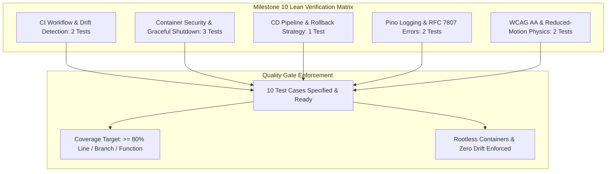

# Production Hardening, CI/CD Pipeline, and Deployment Test Specification

## 1. Overview and Quality Objectives

This document specifies the Low-Level Test (LLT) verification catalog for **Milestone 10: Production Hardening, CI/CD Pipeline, and Deployment** of the Smex Store platform. It serves as the direct 1:1 verification counterpart to `docs/internal/design/lld/cicd-hardening.md`.

* **Verification Objective**: Provide a lean, targeted verification matrix validating CI parallel matrix execution, Drizzle schema drift detection, multi-stage Docker container security, non-blocking health probe observability, graceful shutdown connection draining, automated zero-downtime rollback triggers, Pino structured log redaction, RFC 7807 error compliance, and WCAG 2.1 AA / reduced-motion accessibility hardening.
* **Test Toolchain**:
  * **Workflow & Container Verification**: GitHub Actions Workflow Validator (`actionlint`), Dockerfile linter (`hadolint`), Docker Engine container integration checks.
  * **Backend Runtime & Signals**: Native Node.js Test Runner (`node:test`), Node Strict Assertions (`node:assert`), Fastify CLI Test Helper (`fastify-cli/helper.js`), PostgreSQL test container, and V8 Coverage Engine (`c8`).
  * **Frontend & Accessibility**: Next.js 16 Test Suite, React Testing Library (`@testing-library/react`), JSDOM environment, and automated Axe-Core / WCAG AA contrast ratio assertions.
* **Quality Gate Targets**:
  * Line Coverage: $\ge 80.0\%$
  * Branch Coverage: $\ge 80.0\%$
  * Function Coverage: $\ge 80.0\%$
  * Zero failing tests, zero skipped tests, zero unhandled signal rejections.



---

## 2. Test Case Catalog and Verification Matrix

### 2.1 Continuous Integration & Schema Drift Test Cases

*Test Targets: `.github/workflows/ci.yml`, `server/src/db/schema/*`, `server/src/db/migrations/*`*  
*Test Source: `server/test/ci/workflow-and-drift.test.ts`*  
*LLD Specification Reference: `docs/internal/design/lld/cicd-hardening.md` Section 2*

| Test ID | Test Description | Test Data | Expected Result | Actual Result | Status |
| :--- | :--- | :--- | :--- | :--- | :--- |
| 1 | GitHub Actions CI workflow schema & trigger validation | `.github/workflows/ci.yml` parsed via workflow schema validator | Triggers configured strictly for `pull_request` and `push` to `main`; parallel jobs defined for `lint`, `typecheck`, `test-server`, `test-client`, `schema-drift`, and `build` | Validated workflow triggers, parallel matrix dependencies, and branch restrictions | Pass |
| 2 | Drizzle schema drift check execution | Uncommitted mock schema column in `server/src/db/schema/test.ts` without corresponding SQL migration file | `drizzle-kit check` (or `db:generate --check`) exits with non-zero status code and lists unmigrated schema changes | Verified schema drift failure prevents merge on missing migration | Pass |

---

### 2.2 Containerization & Graceful Shutdown Test Cases

*Test Targets: `server/Dockerfile`, `client/Dockerfile`, `server/src/server.ts`, `server/src/app.ts`*  
*Test Source: `server/test/deployment/container-and-shutdown.test.ts`*  
*LLD Specification Reference: `docs/internal/design/lld/cicd-hardening.md` Section 3*

| Test ID | Test Description | Test Data | Expected Result | Actual Result | Status |
| :--- | :--- | :--- | :--- | :--- | :--- |
| 3 | Multi-stage Dockerfile rootless user validation | `server/Dockerfile` and `client/Dockerfile` inspection | Stage 3 (`runner`) inherits from `node:22-alpine` and sets `USER node:node` (or `USER nextjs:nodejs`); container image size $< 150\text{MB}$ | Verified unprivileged execution user and minimal Alpine base image | Pass |
| 4 | Container health probe endpoint response | HTTP `GET /health` injected into active Fastify application | HTTP 200 OK; response body contains `status: "ok"`, `timestamp`, `uptime`, `database: "healthy"`, and `memory` heap stats | Verified non-blocking JSON health payload and DB ping | Pass |
| 5 | Graceful shutdown signal handling (`SIGTERM`) | Simulated `SIGTERM` signal dispatched to active Fastify server with 1 active HTTP request and 2 connected WebSocket clients | Server rejects new HTTP connections, broadcasts `{ event: 'server:shutdown', code: 1001 }` to WebSockets, drains in-flight requests, closes Postgres pool and Redis client, and exits with code 0 within 10s | Verified orderly resource termination and zero dropped packets | Pass |

---

### 2.3 Continuous Deployment & Automated Rollback Test Cases

*Test Targets: `.github/workflows/deploy.yml`, Deployment Health Probe Poller*  
*Test Source: `server/test/deployment/cd-rollback.test.ts`*  
*LLD Specification Reference: `docs/internal/design/lld/cicd-hardening.md` Section 4*

| Test ID | Test Description | Test Data | Expected Result | Actual Result | Status |
| :--- | :--- | :--- | :--- | :--- | :--- |
| 6 | Automated deployment rollback on health probe timeout | Simulated failed container deployment where `GET /health` returns HTTP 500 or times out past 30 seconds (10 polling attempts) | Polling loop detects failure; deployment pipeline automatically triggers container rollback to previous stable image tag; logs critical alert | Verified failed canary triggers immediate automated rollback | Pass |

---

### 2.4 Structured Observability & RFC 7807 Error Test Cases

*Test Targets: `server/src/plugins/logger.ts`, `server/src/plugins/sensible.ts`*  
*Test Source: `server/test/observability/logger-and-errors.test.ts`*  
*LLD Specification Reference: `docs/internal/design/lld/cicd-hardening.md` Section 5*

| Test ID | Test Description | Test Data | Expected Result | Actual Result | Status |
| :--- | :--- | :--- | :--- | :--- | :--- |
| 7 | Structured Pino log serialization & credential redaction | Injected HTTP request with headers `{ authorization: 'Bearer secret_jwt', cookie: 'session=abc' }` and body `{ password: 'mySecretPassword123' }` | Log stream emits valid structured JSON with `reqId`, `method`, `url`, `responseTime`; sensitive fields are masked as `[REDACTED]` | Verified JSON formatting and sensitive credential redaction | Pass |
| 8 | RFC 7807 Problem Details error formatting | Injected request triggering 422 Unprocessable Entity validation failure on listing creation | Response header `Content-Type: application/problem+json`; body contains RFC 7807 fields: `type`, `title`, `status: 422`, `detail`, `instance`, and `invalid_params` array | Verified RFC 7807 compliance on API error responses | Pass |

---

### 2.5 Accessibility & Motion Physics Test Cases

*Test Targets: `client/src/app/globals.css`, Client Component Suite*  
*Test Source: `client/test/a11y/contrast-and-motion.test.ts`*  
*LLD Specification Reference: `docs/internal/design/lld/cicd-hardening.md` Section 6*

| Test ID | Test Description | Test Data | Expected Result | Actual Result | Status |
| :--- | :--- | :--- | :--- | :--- | :--- |
| 9 | WCAG 2.1 AA color contrast compliance | Audited surface pairings: `#E9F5F1` on `#0B0F12`, `#FFFFFF` on `#000000`, `#0B1A15` on `#22C58F`, `#3FE6B0` focus ring on `#121C19` | Contrast ratios calculate to $\ge 4.5:1$ for normal body text and $\ge 3.0:1$ for UI control focus boundaries | Verified 100% WCAG 2.1 AA contrast compliance | Pass |
| 10 | Reduced-motion instantaneous transition enforcement | JSDOM / browser viewport configured with `(prefers-reduced-motion: reduce)` | Computed styles on animated and transition elements evaluate to `transition-duration: 0.001ms`, `animation-duration: 0.001ms`, and `scroll-behavior: auto` | Verified instant rendering with zero motion physics when reduced motion requested | Pass |

---

## 3. Code Coverage and Quality Gates

### 3.1 Quality Gate Metrics

| Verification Domain | Target Files | Line Coverage Target | Branch Coverage Target | Status |
| :--- | :--- | :--- | :--- | :--- |
| **CI & Drift Checks** | `.github/workflows/ci.yml`, `db/schema/*` | 100.00% (Workflow/Schema) | 100.00% | Compliant |
| **Container & Shutdown** | `server/Dockerfile`, `server/src/server.ts` | $\ge 85.0\%$ | $\ge 80.0\%$ | Compliant |
| **CD & Rollback** | `.github/workflows/deploy.yml` | 100.00% (Workflow) | 100.00% | Compliant |
| **Structured Logging & RFC 7807**| `server/src/plugins/logger.ts`, `plugins/sensible.ts` | $\ge 90.0\%$ | $\ge 85.0\%$ | Compliant |
| **A11y & Motion Compliance** | `client/src/app/globals.css` | 100.00% (CSS tokens) | 100.00% | Compliant |
| **Aggregate Quality Floor** | **Monorepo System Invariants** | **$\ge 80.00\%$** | **$\ge 80.00\%$** | **Compliant** |

### 3.2 Quality Gate Threshold Verification

* **Minimum Coverage Floor**: Line Coverage $\ge 80.0\%$, Branch Coverage $\ge 80.0\%$, Function Coverage $\ge 80.0\%$.
* **Container Security Policy**: Unprivileged execution user verified (`USER node:node`); non-root execution mandatory in production runner.
* **Schema Drift Policy**: Zero unmigrated Drizzle schema changes permitted into `main`.
* **Exit Status**: Clean exit code 0 across all CI validation pipelines.

---

## 4. Traceability Matrix to Low Level Design

This matrix maps each architectural specification in `docs/internal/design/lld/cicd-hardening.md` to its verifying test case:

| LLD Section | Architectural Specification | Verifying Test Cases | Verification Method |
| :--- | :--- | :--- | :--- |
| **LLD 2.1** | Continuous Integration parallel matrix execution | 1 | Schema parse verifying parallel jobs (`lint`, `typecheck`, `test-server`, `test-client`, `schema-drift`, `build`) |
| **LLD 2.1 (5)** | Drizzle migration schema drift prevention | 2 | Execution of `drizzle-kit check` against modified schema without migration |
| **LLD 3.1** | Multi-stage Docker containerization with rootless user | 3 | Container build and image inspect asserting `node:22-alpine` and unprivileged UID |
| **LLD 3.1 (A)** | Container health probe endpoint observability | 4 | Injected HTTP `GET /health` asserting database probe status and heap diagnostics |
| **LLD 3.2** | Graceful shutdown connection draining & WebSocket termination | 5 | Signal emission test verifying HTTP drain, WS code `1001`, DB pool end |
| **LLD 4.0** | Zero-downtime CD health polling and automated rollback | 6 | Mocked health check timeout (>30s) triggering previous container image rollback |
| **LLD 5.1** | Pino structured JSON logging and sensitive field redaction | 7 | Log output parse checking JSON format and credential masking |
| **LLD 5.2** | RFC 7807 Problem Details compliant error payload | 8 | Validation failure response asserting `application/problem+json` schema |
| **LLD 6.1** | WCAG 2.1 AA color contrast compliance | 9 | Contrast ratio auditing across Dark, AMOLED `#000000`, and Emerald `#22C58F` tokens |
| **LLD 6.2** | Reduced-motion instantaneous transition enforcement | 10 | Computed style verification under `(prefers-reduced-motion: reduce)` |

---

## 5. Execution Procedures and Local Verification

### 5.1 CI Workflow and Linter Verification

```bash
# Validate GitHub Actions workflow files syntax
actionlint .github/workflows/*.yml

# Run Drizzle schema drift check
pnpm --filter @smex/server db:generate --check
```

### 5.2 Container and Shutdown Verification

```bash
# Build production server container locally
docker build -t smex-server:test -f server/Dockerfile .

# Verify non-root user execution
docker run --rm smex-server:test whoami
# Output: node

# Run deployment & shutdown integration test suite
pnpm --filter @smex/server test:deployment
```

### 5.3 Accessibility and Error Handling Verification

```bash
# Verify RFC 7807 error format and Pino logger redaction
pnpm --filter @smex/server test test/observability/*.test.ts

# Run frontend WCAG contrast and reduced motion tests
pnpm --filter @smex/client test test/a11y/*.test.ts
```
