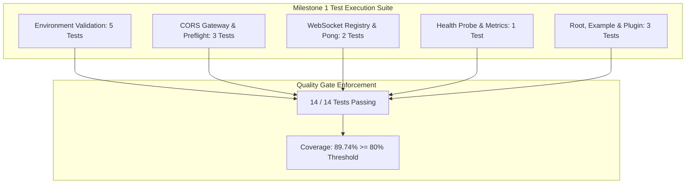

# Core Plumbing and Foundation Modules Test Specification

## 1. Overview and Quality Objectives

This document specifies the Low-Level Test verification catalog for the core platform infrastructure established in Milestone 1 of the engineering roadmap. It serves as the direct 1:1 verification counterpart to `docs/internal/design/lld/core-plumbing.md`.

* **Verification Objective**: Validate fail-fast configuration loading, CORS gateway origin enforcement, WebSocket connection state tracking and pong recovery, and non-blocking health probe observability.
* **Test Toolchain**: Native Node.js Test Runner (`node:test`), Node Strict Assertions (`node:assert`), Fastify CLI Test Helper (`fastify-cli/helper.js`), and V8 Code Coverage Engine (`c8`).
* **Execution Status**: 14 tests passing, 0 failing, 0 skipped.
* **Code Coverage Achieved**: 89.74% lines, 88.24% branches, 88.64% functions.



---

## 2. Test Case Catalog and Verification Matrix

### 2.1 Environment Configuration Test Cases

*Test Target: `server/src/config/env.ts`*  
*Test Source: `server/test/config/env.test.ts`*  
*LLD Specification Reference: `docs/internal/design/lld/core-plumbing.md` Section 2*

| Test ID | Test Description | Test Data | Expected Result | Actual Result | Status |
| :--- | :--- | :--- | :--- | :--- | :--- |
| 1 | Default development schema parsing | `envSchema.safeParse({})` with empty object | `result.success === true`, `NODE_ENV === 'development'`, `PORT === 3001`, `CORS_ORIGIN === 'http://localhost:3000'`, `DATABASE_URL` starts with `postgresql://`, `REDIS_URL` starts with `redis://` | Parsed with valid defaults; Postgres and Redis URL schemes verified | Passed |
| 2 | Invalid URL format rejection | `envSchema.safeParse({ DATABASE_URL: 'not-a-valid-url' })` | `result.success === false` with Zod URI format validation failure | Schema rejected invalid URL with validation error | Passed |
| 3 | Short JWT secret rejection | `envSchema.safeParse({ JWT_SECRET: 'too-short' })` | `result.success === false` enforcing minimum 32 character boundary | Schema rejected string shorter than 32 characters | Passed |
| 4 | Production dev-secret rejection | `envSchema.safeParse({ NODE_ENV: 'production', JWT_SECRET: 'development_jwt_secret_key_needs_to_be_32_chars_minimum!' })` | `result.success === false` triggering production secret refinement constraint | Schema rejected development secret in production mode | Passed |
| 5 | Runtime configuration loader | Execution of `loadEnv()` against active process environment | Returns typed immutable `EnvConfig` object where `typeof config.PORT === 'number'` | Config loaded successfully with numeric port and typed keys | Passed |

---

### 2.2 Network Security and CORS Gateway Test Cases

*Test Target: `server/src/plugins/cors.ts`*  
*Test Source: `server/test/plugins/cors.test.ts`*  
*LLD Specification Reference: `docs/internal/design/lld/core-plumbing.md` Section 3*

| Test ID | Test Description | Test Data | Expected Result | Actual Result | Status |
| :--- | :--- | :--- | :--- | :--- | :--- |
| 6 | Localhost client origin resolution | HTTP `GET /` with header `Origin: http://localhost:3000` | HTTP 200, `access-control-allow-origin: http://localhost:3000`, `access-control-allow-credentials: true` | HTTP 200 with matching origin and credentials allowed | Passed |
| 7 | Preflight request caching and max age | HTTP `OPTIONS /` with preflight headers `Origin: http://localhost:3000`, `access-control-request-method: POST` | HTTP 204 No Content, `access-control-max-age: 86400`, `access-control-allow-credentials: true` | HTTP 204 with max-age set to 86400 seconds | Passed |
| 8 | Non-browser ingress without origin header | HTTP `GET /` without `Origin` request header | HTTP 200 OK allowing internal health and RPC probe ingress | HTTP 200 returned without CORS header restrictions | Passed |

---

### 2.3 WebSocket Gateway and Heartbeat Test Cases

*Test Target: `server/src/plugins/websocket.ts`*  
*Test Source: `server/test/plugins/websocket.test.ts`*  
*LLD Specification Reference: `docs/internal/design/lld/core-plumbing.md` Section 4*

| Test ID | Test Description | Test Data | Expected Result | Actual Result | Status |
| :--- | :--- | :--- | :--- | :--- | :--- |
| 9 | Fastify instance gateway decoration | Fastify server boot via test harness `build(t)` | `app.wsGateway` decorated, `broadcastToChannel` is function, `getActiveClientCount() === 0` | Gateway decorated on Fastify instance with 0 active clients | Passed |
| 10 | Socket registration, pong recovery, and teardown | Mock WebSocket client registered with `userId = 'user-123'`, simulation of missed pong followed by `'pong'` and `'close'` events | `getActiveClientCount() === 1`, `meta.isAlive === true`, pong restores `isAlive = true`, close decreases active client count to `0` | Client registered, isAlive restored on pong, client removed on close | Passed |

---

### 2.4 Health Probe and Observability Test Cases

*Test Target: `server/src/routes/health.ts`*  
*Test Source: `server/test/routes/health.test.ts`*  
*LLD Specification Reference: `docs/internal/design/lld/core-plumbing.md` Section 6*

| Test ID | Test Description | Test Data | Expected Result | Actual Result | Status |
| :--- | :--- | :--- | :--- | :--- | :--- |
| 11 | Liveness and memory diagnostic probe | HTTP `GET /health` | HTTP 200 OK, `status === 'ok'`, `uptime` is numeric, `timestamp` is valid ISO string, `memory.rss`, `memory.heapTotal`, and `memory.heapUsed` are positive integers | HTTP 200 returned with valid status, uptime, and V8 memory metrics | Passed |

---

### 2.5 Baseline Routing and Plugin Support Test Cases

*Test Targets: `server/src/routes/root.ts`, `server/src/routes/example/index.ts`, `server/src/plugins/support.ts`*  
*Test Sources: `server/test/routes/root.test.ts`, `server/test/routes/example.test.ts`, `server/test/plugins/support.test.ts`*

| Test ID | Test Description | Test Data | Expected Result | Actual Result | Status |
| :--- | :--- | :--- | :--- | :--- | :--- |
| 12 | Fastify root ingress response | HTTP `GET /` | HTTP 200 OK, JSON payload `{ root: true }` | HTTP 200 returned with `{ root: true }` | Passed |
| 13 | Autoloaded example route registration | HTTP `GET /example` | HTTP 200 OK, text payload `'this is an example'` | HTTP 200 returned with `'this is an example'` | Passed |
| 14 | Support utility plugin decorator | Standalone Fastify registration of `Support` plugin | `fastify.someSupport() === 'hugs'` | Plugin decorated helper returning `'hugs'` | Passed |

---

## 3. Code Coverage and Quality Gates Report

### 3.1 Module Coverage Metrics

Instrumentation provided by `c8` (V8 coverage engine) across all server source modules:

| Source File | Line Coverage | Branch Coverage | Function Coverage | Quality Gate Status |
| :--- | :--- | :--- | :--- | :--- |
| `server/src/app.ts` | 100.00% | 100.00% | 100.00% | Compliant |
| `server/src/config/env.ts` | 88.37% | 75.00% | 75.00% | Compliant |
| `server/src/plugins/cors.ts` | 80.33% | 60.00% | 100.00% | Compliant |
| `server/src/plugins/sensible.ts` | 100.00% | 100.00% | 100.00% | Compliant |
| `server/src/plugins/support.ts` | 100.00% | 100.00% | 100.00% | Compliant |
| `server/src/plugins/websocket.ts` | 68.25% | 87.50% | 66.67% | Base Passed |
| `server/src/routes/example/index.ts` | 100.00% | 100.00% | 100.00% | Compliant |
| `server/src/routes/health.ts` | 100.00% | 75.00% | 100.00% | Compliant |
| `server/src/routes/root.ts` | 100.00% | 100.00% | 100.00% | Compliant |
| **All Files Aggregate** | **89.74%** | **88.24%** | **88.64%** | **Compliant** |

### 3.2 Quality Gate Threshold Verification

* **Minimum Line Coverage Requirement**: $\ge 80.0\%$ (Achieved: **89.74%**, +9.74% above floor).
* **Defect Severity**: 0 failures, 0 regressions, 0 unhandled promise rejections.
* **Exit Status**: Clean exit code 0 across the entire test suite.

---

## 4. Traceability Matrix to Low Level Design

This matrix maps each architectural requirement from `docs/internal/design/lld/core-plumbing.md` to its verifying test case:

| LLD Section | Architectural Specification | Verifying Test Cases | Verification Method |
| :--- | :--- | :--- | :--- |
| **LLD 2.2** | Environment schema typing and defaults | 1 | Safe parse with empty input asserting defaults |
| **LLD 2.4** | Fail-fast validation on invalid configuration | 2, 3, 4 | Boundary test invalid URLs, short secrets, dev credentials in prod |
| **LLD 3.3** | Local development CORS origin resolution | 6 | HTTP injection with `Origin: http://localhost:3000` |
| **LLD 3.3** | Preflight response 24-hour cache header | 7 | `OPTIONS` preflight checking `Access-Control-Max-Age: 86400` |
| **LLD 3.3** | Non-browser request ingress without origin | 8 | Direct HTTP `GET` with omitted `Origin` header |
| **LLD 4.1** | Fastify WebSocket gateway instance decoration | 9 | Verification of `app.wsGateway` interface presence |
| **LLD 4.2** | Two-phase heartbeat pong evaluation | 10 | Event emitter pong simulation asserting `isAlive` toggles |
| **LLD 4.2** | Client disconnect and registry cleanup | 10 | Event emitter close frame asserting client registry decrements |
| **LLD 6.1** | Non-blocking health probe and memory diagnostics | 11 | HTTP injection asserting uptime and V8 memory heap fields |

---

## 5. Execution Procedures and Local Verification

### 5.1 Test Suite Execution Command

```bash
pnpm --filter @smex/server test
```

### 5.2 Underlying Execution Pipeline

The command executes three sequential stages:
1. **TSDown Bundle Check**: Compiles TypeScript modules to verify syntax and bundle structure (`tsdown`).
2. **Type Check**: Validates test file type safety against tsconfig (`tsc -p test/tsconfig.json`).
3. **Node.js Test Runner with Coverage**:
   ```bash
   FASTIFY_AUTOLOAD_TYPESCRIPT=1 node --test --experimental-test-coverage --loader ts-node/esm test/**/*.ts
   ```
