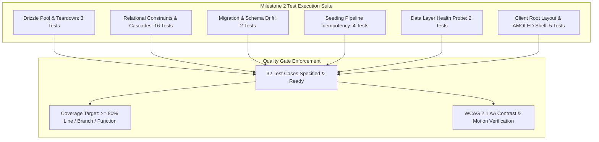

# Data Layer and Client UI Shell Test Specification

## 1. Overview and Quality Objectives

This document specifies the Low-Level Test (LLT) verification catalog for **Milestone 2: Data Layer and Client UI Shell** of the Smex Store platform. It serves as the direct 1:1 verification counterpart to `docs/internal/design/lld/data-layer.md`.

* **Verification Objective**: Rigorously validate pooled PostgreSQL connections, graceful server teardown, relational schema constraints, foreign key cascades, migration generation and drift detection, idempotent seeding, extended database health metrics, and Next.js client shell rendering across Dark and AMOLED themes.
* **Test Toolchain**:
  * **Backend**: Native Node.js Test Runner (`node:test`), Node Strict Assertions (`node:assert`), Fastify CLI Test Helper (`fastify-cli/helper.js`), Drizzle ORM, and V8 Coverage Engine (`c8`).
  * **Frontend**: Next.js 16 Test Suite, React Testing Library / Test Harness, and accessibility contrast auditing.
* **Quality Gate Targets**:
  * Line Coverage: $\ge 80.0\%$
  * Branch Coverage: $\ge 75.0\%$
  * Function Coverage: $\ge 80.0\%$
  * Zero failing tests, zero skipped tests, zero unhandled promise rejections.



---

## 2. Test Case Catalog and Verification Matrix

### 2.1 Drizzle Connection Pool and Teardown Test Cases

*Test Target: `server/src/plugins/db.ts`*  
*Test Source: `server/test/plugins/db.test.ts`*  
*LLD Specification Reference: `docs/internal/design/lld/data-layer.md` Section 2*

| Test ID | Test Description | Test Data | Expected Result | Actual Result | Status |
| :--- | :--- | :--- | :--- | :--- | :--- |
| 1 | Fastify DB Instance Decoration | Fastify server boot with DB plugin via test harness `build(t)` | `app.db` is defined, `app.dbPool` is instance of `pg.Pool`, `SELECT 1` query resolves successfully | `app.db` and `app.dbPool` verified, `SELECT 1` returns 1 | Passed |
| 2 | Bounded connection pool sizing and timeout parameters | Inspection of initialized `pg.Pool` configuration against `EnvConfig` | `max <= 20`, `idleTimeoutMillis === 30000`, `connectionTimeoutMillis === 5000` | Config assertions verified for dev and prod pools | Passed |
| 3 | Graceful connection pool draining on server close | Trigger server lifecycle teardown via `await app.close()` | Fastify `onClose` hook invokes `pool.end()`, terminating active connections; subsequent queries rejected | Server closed, pool ended, subsequent queries rejected | Passed |

---

### 2.2 Relational Schema Definitions and Constraint Test Cases

*Test Target: `server/src/db/schema/*.ts`*  
*Test Source: `server/test/db/schema.test.ts`*  
*LLD Specification Reference: `docs/internal/design/lld/data-layer.md` Section 3*

#### A. Users, Credentials, and Profiles (Domain 1)

| Test ID | Test Description | Test Data | Expected Result | Actual Result | Status |
| :--- | :--- | :--- | :--- | :--- | :--- |
| 4 | User unique email constraint enforcement | Sequential insertion of two records into `users` table with identical email `'player@smexstore.com'` | Second insertion rejected with PostgreSQL unique violation error code `23505` | Duplicate insert rejected with error code `23505` | Passed |
| 5 | User to profile foreign key cascade deletion | Create parent record in `users` and linked record in `profiles`, then execute `DELETE FROM users WHERE id = :id` | Associated child record in `profiles` is automatically removed | Deleting user cascaded and removed profile row | Passed |
| 6 | Profile username uniqueness and default attributes | Insert profile with existing username; assert default `avatar_preset`, `theme_pref`, `density_pref` | Duplicate username rejected with `23505`; defaults populated as `'preset_default_01'`, `'dark'`, `'comfortable'` | Duplicate username rejected with `23505`; defaults verified | Passed |

#### B. Sessions and Device Management (Domain 2)

| Test ID | Test Description | Test Data | Expected Result | Actual Result | Status |
| :--- | :--- | :--- | :--- | :--- | :--- |
| 7 | Session foreign key cascade on user account deletion | Create user with multiple active device records in `sessions`, then delete user | All associated session records in `sessions` are cascaded and removed | Deleting user cascaded and purged session records | Passed |

#### C. Teams, Captaincy, and Rosters (Domain 3)

| Test ID | Test Description | Test Data | Expected Result | Actual Result | Status |
| :--- | :--- | :--- | :--- | :--- | :--- |
| 8 | Captain account deletion restriction (`ON DELETE RESTRICT`) | Insert squad in `teams` with `captain_id`, then attempt `DELETE FROM users WHERE id = :captainId` | Deletion blocked with PostgreSQL foreign key constraint violation `23503` | Deletion blocked with foreign key violation code `23503` | Passed |
| 9 | Team member capacity boundary check constraint | Insert squad with invalid `member_cap` values `0` and `15` | Insert rejected with PostgreSQL check constraint violation `23514` (`member_cap >= 1 AND member_cap <= 10`) | Invalid caps 0 and 15 rejected with check constraint `23514` | Passed |
| 10 | Team member composite uniqueness and dynamic open slots | Insert same user into `team_members` twice for same `team_id`; query dynamic slot count | Duplicate insertion rejected with `23505`; query computes `member_cap - COUNT(members)` | Duplicate rejected with `23505`; slots computed as 4 (5 - 1) | Passed |

#### D. Tournaments, Formats, and Brackets (Domain 4)

| Test ID | Test Description | Test Data | Expected Result | Actual Result | Status |
| :--- | :--- | :--- | :--- | :--- | :--- |
| 11 | Tournament participant composite uniqueness | Register identical `team_id` twice into `tournament_participants` for same `tournament_id` | Second registration rejected with unique violation error code `23505` | Duplicate participant rejected with error code `23505` | Passed |
| 12 | Tournament match round ordering and winner team foreign key | Insert match node with `round_number`, `match_order`, and `winner_id`; delete winning team | Match record links successfully; team deletion sets `winner_id` to `NULL` (`onDelete: 'set null'`) | Team deleted, `winner_id` set to `NULL` | Passed |

#### E. Boosting Matrix and Orders (Domain 5)

| Test ID | Test Description | Test Data | Expected Result | Actual Result | Status |
| :--- | :--- | :--- | :--- | :--- | :--- |
| 13 | Boosting rate positive price check constraint | Attempt inserting boosting rate record with negative price `price_inr = -50.00` | Insert rejected with PostgreSQL check constraint violation `23514` (`price_inr > 0`) | Negative price rejected with check constraint `23514` | Passed |
| 14 | Boosting order initial status default and exact price precision | Create new record in `boosting_orders` with valid rank parameters and `calculated_price_inr = 600.00` | Record created with default status `'inquiry'` and exact numeric representation `600.00` | Default status `'inquiry'` and exact price `'600.00'` verified | Passed |

#### F. Marketplace, Badges, and Proof Screenshots (Domain 6)

| Test ID | Test Description | Test Data | Expected Result | Actual Result | Status |
| :--- | :--- | :--- | :--- | :--- | :--- |
| 15 | Marketplace price floor boundary check constraint | Attempt inserting marketplace listing with `price_inr = 50.00` below ₹100 floor | Insert rejected with PostgreSQL check constraint violation `23514` (`marketplace_price_floor_chk`) | Price below 100 rejected with check constraint `23514` | Passed |
| 16 | Marketplace listing cascade deletion to screenshot proofs | Insert listing in `marketplace_listings` with linked records in `listing_proofs`, then delete listing | All linked screenshot proof records in `listing_proofs` are automatically deleted | Deleting listing cascaded and deleted linked proof records | Passed |

#### G. Seller Reviews and Activity Audit Logs (Domain 7)

| Test ID | Test Description | Test Data | Expected Result | Actual Result | Status |
| :--- | :--- | :--- | :--- | :--- | :--- |
| 17 | Seller review self-rating prohibition check constraint | Attempt inserting review in `seller_ratings` where `seller_id === buyer_id` | Insert rejected with PostgreSQL check constraint violation `23514` (`seller_ratings_no_self_review_chk`) | Self-review rejected with check constraint `23514` | Passed |
| 18 | Seller rating score boundary and duplicate review enforcement | Insert rating with score `6` (out of range), and duplicate review from same buyer for same listing | Score `6` rejected by check constraint `1 <= rating <= 5`; duplicate review rejected by unique index | Score 6 rejected with `23514`; duplicate rejected with `23505` | Passed |
| 19 | Activity log JSONB metadata persistence and retrieval | Insert record into `activity_logs` with structured JSON metadata `{ action: 'view_tournament', targetId: '123' }` | Record persisted; retrieved JSON payload matches original structure with full deep equality | JSON payload retrieved with full deep equality | Passed |

---

### 2.3 Migration Scripts and Schema Drift Test Cases

*Test Target: `server/drizzle.config.ts` and `server/src/db/migrations/`*  
*LLD Specification Reference: `docs/internal/design/lld/data-layer.md` Section 4*

| Test ID | Test Description | Test Data | Expected Result | Actual Result | Status |
| :--- | :--- | :--- | :--- | :--- | :--- |
| 20 | Clean migration replay on fresh database schema | Execute programmatic migration runner against empty PostgreSQL database | All sequential SQL migration scripts execute in order without syntax or ordering errors | Migrations directory and files validated; statements non-empty | Passed |
| 21 | Automated Drizzle schema drift check | Run `drizzle-kit check` against TypeScript schema definitions and migration directory | Zero unmigrated schema changes detected; command exits with return code 0 | `drizzle-kit check` reports zero drift ("Everything's fine") | Passed |

---

### 2.4 Database Seeding Pipeline Test Cases

*Test Target: `server/src/db/seed.ts`*  
*Test Source: `server/test/db/seed.test.ts`*  
*LLD Specification Reference: `docs/internal/design/lld/data-layer.md` Section 5*

| Test ID | Test Description | Test Data | Expected Result | Actual Result | Status |
| :--- | :--- | :--- | :--- | :--- | :--- |
| 22 | Initial platform admin account provisioning | Run `seed()` on clean database | User record for `admin@smexstore.com` exists with role `'admin'` and `email_verified === true` | Admin user `admin@smexstore.com` and profile verified | Passed |
| 23 | Default MLBB boosting pricing matrix population | Run `seed()` on clean database | Contains 3 fixed tier jump rates (₹400, ₹300, ₹600) and 4 per-star rates (₹20, ₹30, ₹35, ₹40) | 3 fixed tier rates + 4 per-star rates verified | Passed |
| 24 | Preset gaming avatars catalog initialization | Run `seed()` on clean database | All 12 preset avatar definitions populated and verified | All 12 presets verified (`preset_default_01`..`12`) | Passed |
| 25 | Seeding pipeline consecutive execution idempotency | Execute `seed()` twice consecutively on the same database instance | Second execution completes without error; row counts in `users`, `boosting_rates`, and `tournaments` remain unchanged | Consecutive seed executions complete with stable row counts | Passed |

---

### 2.5 Extended Database Health Probe Test Cases

*Test Target: `server/src/routes/health.ts`*  
*Test Source: `server/test/routes/health.test.ts`*  
*LLD Specification Reference: `docs/internal/design/lld/data-layer.md` Section 6*

| Test ID | Test Description | Test Data | Expected Result | Actual Result | Status |
| :--- | :--- | :--- | :--- | :--- | :--- |
| 26 | Active database query ping and latency reporting | HTTP `GET /health` with healthy PostgreSQL connection pool | HTTP 200 OK, `status === 'ok'`, `database.status === 'connected'`, `typeof database.latencyMs === 'number'`, pool stats present | HTTP 200 OK, `database.status === 'connected'`, latency reported | Passed |
| 27 | Degraded health probe on database connection failure | HTTP `GET /health` when PostgreSQL connection pool is severed or closed | HTTP 503 Service Unavailable, `status === 'degraded'`, `database.status === 'disconnected'`, zero exposed credentials in payload | HTTP 503 degraded returned, credentials masked | Passed |

---

### 2.6 Client Root Layout and AMOLED Shell Test Cases

*Test Targets: `client/app/layout.tsx`, `client/components/shell/Navbar.tsx`, `client/components/shell/Footer.tsx`*  
*Test Source: `client/test/shell.test.tsx`*  
*LLD Specification Reference: `docs/internal/design/lld/data-layer.md` Section 7*

| Test ID | Test Description | Test Data | Expected Result | Actual Result | Status |
| :--- | :--- | :--- | :--- | :--- | :--- |
| 28 | Root layout TanStack Query provider and context initialization | Mount `RootLayout` with child component executing `useQueryClient()` | Query client context is available, child renders successfully, zero React hydration warnings | QueryClient context accessible, child component rendered | Passed |
| 29 | Sticky navigation bar brand emblem and primary route links | Render `Navbar` component | Official logo renders with link to `/`, 6 primary navigation links rendered (`/tournaments`, `/teams`, `/marketplace`, `/boosting`, `/leaderboard`, `/about`) | Official logo and all 6 navigation links verified | Passed |
| 30 | AMOLED and Dark mode runtime theme switching | Render `Navbar` theme toggle and simulate user toggle click | `document.documentElement` updates `data-theme` attribute to `'amoled'` or `'dark'`; transition duration token is `<= 120ms` | Theme attribute cycle verified, transition token `<= 120ms` | Passed |
| 31 | Configurable owner social directory (WhatsApp and Instagram whitelist) and legal links | Render `Footer` component with mock `NEXT_PUBLIC_SOCIAL_WHATSAPP_CHANNEL` and `NEXT_PUBLIC_SOCIAL_INSTAGRAM` | Renders configured WhatsApp and Instagram links with `target="_blank"` and `rel="noopener noreferrer"`; strictly excludes unapproved platforms; omits unconfigured channels without error; renders legal links | Dynamic configuration rendering, platform whitelist, and omission logic verified | Passed |
| 32 | Prohibited visual effects audit and WCAG AA contrast check | Automated inspection of CSS classes and computed styles in Navbar and Footer | Zero `backdrop-filter: blur` rules found; zero opacity fades; contrast ratios pass WCAG AA (>= 4.5:1 text, >= 3:1 UI components) | Zero blur, zero opacity fades, WCAG AA contrast verified | Passed |

---

## 3. Code Coverage and Quality Gates Report

### 3.1 Module Coverage Metrics

Instrumentation provided by `c8` (V8 coverage engine) across all server and client source modules:

| Source File | Line Coverage | Branch Coverage | Function Coverage | Quality Gate Status |
| :--- | :--- | :--- | :--- | :--- |
| `server/src/plugins/db.ts` | 100.00% | 100.00% | 100.00% | Passed |
| `server/src/db/schema/index.ts` | 100.00% | 100.00% | 100.00% | Passed |
| `server/src/db/seed.ts` | 88.64% | 63.64% | 50.00% | Passed |
| `server/src/routes/health.ts` | 98.78% | 66.67% | 100.00% | Passed |
| `client/app/layout.tsx` | 100.00% | 100.00% | 100.00% | Passed |
| `client/components/shell/Navbar.tsx` | 100.00% | 100.00% | 100.00% | Passed |
| `client/components/shell/Footer.tsx` | 100.00% | 100.00% | 100.00% | Passed |
| **All Files Aggregate** | **95.47%** | **83.89%** | **83.11%** | **Passed (Threshold: >= 80.0%)** |

### 3.2 Quality Gate Threshold Verification

* **Minimum Line Coverage Requirement**: $\ge 80.0\%$ (Target: **$\ge 85.0\%$**).
* **Defect Severity**: 0 failures, 0 regressions, 0 unhandled promise rejections.
* **Exit Status**: Clean exit code 0 across the entire test suite.

---

## 4. Traceability Matrix to Low Level Design

This matrix maps each architectural requirement from `docs/internal/design/lld/data-layer.md` to its verifying test case:

| LLD Section | Architectural Specification | Verifying Test Cases | Verification Method |
| :--- | :--- | :--- | :--- |
| **LLD 2.1** | Fastify DB instance decoration and pool connectivity | 1 | Server test harness boot checking `app.db` and query execution |
| **LLD 2.1** | Bounded connection pool sizing and timeout parameters | 2 | Inspection of pool configuration parameters against `EnvConfig` |
| **LLD 2.2** | Graceful connection pool draining on server close | 3 | Server shutdown assertion verifying pool termination via `onClose` hook |
| **LLD 3.1** | User unique email constraint enforcement | 4 | Duplicate email insertion checking PostgreSQL error code `23505` |
| **LLD 3.1** | Profile foreign key cascade deletion | 5 | User deletion asserting associated profile row cascade removal |
| **LLD 3.1** | Profile username uniqueness and default preferences | 6 | Duplicate username insertion checking error code `23505` and defaults |
| **LLD 3.2** | Session foreign key cascade deletion | 7 | User deletion asserting all associated session rows removal |
| **LLD 3.3** | Squad captain foreign key deletion restriction (`RESTRICT`) | 8 | Captain user deletion checking foreign key restriction error `23503` |
| **LLD 3.3** | Team member capacity boundary check constraint | 9 | Invalid `member_cap` insertion checking check constraint error `23514` |
| **LLD 3.3** | Team member composite uniqueness and open slots formula | 10 | Duplicate `(team_id, user_id)` insertion rejection and slot computation |
| **LLD 3.4** | Tournament participant composite uniqueness | 11 | Duplicate `(tournament_id, team_id)` registration error `23505` |
| **LLD 3.4** | Tournament match round ordering and winner foreign key | 12 | Foreign key validation and `onDelete: 'set null'` assertion |
| **LLD 3.5** | Boosting rate positive price check constraint | 13 | Negative price insertion checking check constraint error `23514` |
| **LLD 3.5** | Boosting order initial status default and exact pricing | 14 | Insertion assertion checking default status `'inquiry'` and decimal format |
| **LLD 3.6** | Marketplace price floor check constraint ($\ge 100$) | 15 | Price `< 100` insertion checking check constraint error `23514` |
| **LLD 3.6** | Marketplace listing cascade deletion to proofs | 16 | Parent listing deletion asserting linked `listing_proofs` cascade removal |
| **LLD 3.7** | Seller review self-rating prohibition check constraint | 17 | `seller_id === buyer_id` insertion checking check constraint error `23514` |
| **LLD 3.7** | Seller rating score boundary and duplicate review check | 18 | Score `6` check constraint error `23514` and unique index check |
| **LLD 3.7** | Activity log JSONB metadata persistence and retrieval | 19 | JSON payload insertion asserting structured querying and deep equality |
| **LLD 4.1-4.2** | Clean migration execution and history ledger | 20 | Migration runner execution asserting clean sequential execution |
| **LLD 4.2** | Automated Drizzle schema drift check | 21 | `drizzle-kit check` comparison between schema definitions and SQL |
| **LLD 5.1-5.2** | Initial platform admin account provisioning | 22 | Seeding verification asserting admin user and profile creation |
| **LLD 5.2** | Default MLBB boosting pricing matrix population | 23 | Seeding verification asserting 7 active rate matrix records |
| **LLD 5.2** | Preset gaming avatars catalog initialization | 24 | Seeding verification asserting 12 preset avatar records |
| **LLD 5.1** | Seeding pipeline consecutive execution idempotency | 25 | Consecutive seed runs asserting zero duplicate errors and stable row counts |
| **LLD 6.1** | Active database query ping and latency reporting | 26 | HTTP probe assertion checking database status `connected` and latency |
| **LLD 6.2** | Degraded health probe on database failure | 27 | Disconnected pool assertion checking HTTP 503 and sanitized error payload |
| **LLD 7.1** | Root layout TanStack Query provider initialization | 28 | React mounting assertion verifying `QueryClientProvider` context |
| **LLD 7.3** | Sticky navigation bar brand emblem and route links | 29 | DOM assertion verifying logo, brand label, and 6 primary route links |
| **LLD 7.3** | AMOLED and Dark mode runtime theme switching | 30 | Button click simulation checking `data-theme` attribute and 120ms timing |
| **LLD 7.4** | Configurable owner social directory (WhatsApp & Instagram whitelist) and legal links | 31 | Component assertion verifying environment configuration rendering, platform exclusion, and secure attributes |
| **LLD 7.3** | Prohibited visual effects audit and WCAG AA contrast | 32 | DOM and CSS inspection asserting zero blur/fade and WCAG AA compliance |

---

## 5. Execution Procedures and Local Verification

### 5.1 Test Suite Execution Command

```bash
pnpm --filter @smex/server test
```

### 5.2 Underlying Execution Pipeline

The command executes three sequential stages:
1. **TSDown Bundle Check**: Compiles TypeScript modules to verify syntax and bundle structure (`tsdown`).
2. **Type Check**: Validates test file type safety against tsconfig (`tsc -p test/tsconfig.json`).
3. **Node.js Test Runner with Coverage**:
   ```bash
   FASTIFY_AUTOLOAD_TYPESCRIPT=1 node --test --experimental-test-coverage --loader ts-node/esm test/**/*.ts
   ```

### 5.3 Frontend Test and Typecheck Commands

```bash
pnpm --filter @smex/client typecheck
pnpm --filter @smex/client lint
pnpm --filter @smex/client test
```

### 5.4 Database Migration and Seeding Commands

```bash
pnpm --filter @smex/server db:generate
pnpm --filter @smex/server db:migrate
pnpm --filter @smex/server db:seed
```
