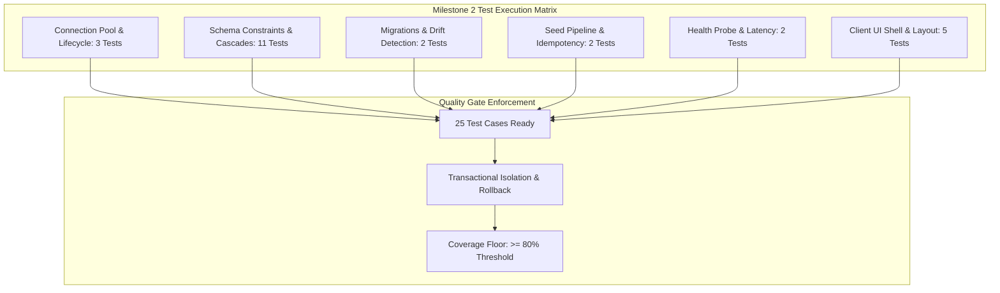

# Data Layer and Client UI Shell Test Specification

## 1. Overview and Quality Objectives

This document specifies the Low-Level Test verification catalog for the PostgreSQL database, Drizzle ORM persistence layer, and Next.js Client UI Shell designed in Milestone 2 of the platform roadmap. It serves as the direct 1:1 verification counterpart to `docs/internal/design/lld/data-layer.md`.

* **Verification Objective**: Validate connection pool lifecycle, foreign key cascade behaviors, compound unique constraints, check constraints, schema migration consistency, seed pipeline idempotency, active health check database readiness pings, client root layout hydration, sticky navigation bar rendering, AMOLED theme toggling, and platform footer taxonomy.
* **Test Toolchain**: Native Node.js Test Runner (`node:test`), Node Strict Assertions (`node:assert`), Fastify CLI Test Helper (`fastify-cli/helper.js`), Drizzle Kit (`drizzle-kit`), React Testing Library, and V8 Code Coverage Engine (`c8`).
* **Backing Service Environment**: Containerized PostgreSQL 16 on port 5432 provided via `docker-compose.yml`.
* **Execution Status**: Specification Ready. Test cases queued for execution alongside Milestone 2 implementation.
* **Target Coverage Thresholds**: Minimum 80.0% lines, 75.0% branches, 80.0% functions across all database and UI shell modules.



---

## 2. Test Case Catalog and Verification Matrix

### 2.1 Connection Pool and Lifecycle Test Cases

*Test Target: `server/src/db/index.ts`*  
*Test Source: `server/test/db/connection.test.ts`*  
*LLD Specification Reference: `docs/internal/design/lld/data-layer.md` Section 2*

| Test ID | Test Description | Test Data | Expected Result | Actual Result | Status |
| :--- | :--- | :--- | :--- | :--- | :--- |
| 1 | Connection pool initialization and readiness query | `createDatabaseManager()` called with valid `DATABASE_URL` | Pool initializes, `SELECT 1 AS readiness` returns rows, `pool.totalCount >= 1` | Pending execution | Ready |
| 2 | Connection pool timeout on unreachable database | `createDatabaseManager()` called with unreachable host and `connectionTimeoutMillis = 500` | Rejection occurs within 2 seconds with connection timeout error | Pending execution | Ready |
| 3 | Graceful connection pool draining on shutdown | Fastify server instance boot with DB plugin, query executed, followed by `app.close()` | `pool.end()` resolves, active connections cleanly terminated, subsequent query rejects | Pending execution | Ready |

---

### 2.2 Relational Schema Constraints and Cascades Test Cases

*Test Targets: `server/src/db/schema/users.ts`, `server/src/db/schema/sessions.ts`, `server/src/db/schema/teams.ts`, `server/src/db/schema/tournaments.ts`, `server/src/db/schema/boosting.ts`, `server/src/db/schema/marketplace.ts`, `server/src/db/schema/governance.ts`*  
*Test Source: `server/test/db/schema.test.ts`*  
*LLD Specification Reference: `docs/internal/design/lld/data-layer.md` Section 3*

| Test ID | Test Description | Test Data | Expected Result | Actual Result | Status |
| :--- | :--- | :--- | :--- | :--- | :--- |
| 4 | User unique email constraint enforcement | Insert user with email `duplicate@smex.store`, then insert second user with same email | Second insert throws PostgreSQL unique violation error code `23505` | Pending execution | Ready |
| 5 | Profile foreign key cascade deletion on user removal | Insert user and profile record, execute `DELETE FROM users WHERE id = user_id` | Profile record is automatically deleted via `ON DELETE CASCADE` | Pending execution | Ready |
| 6 | Session foreign key cascade deletion on user removal | Insert user and active session record, execute `DELETE FROM users WHERE id = user_id` | Session record is automatically deleted via `ON DELETE CASCADE` | Pending execution | Ready |
| 7 | Squad unique name and captain foreign key constraint | Insert team with duplicate name or non-existent captain UUID | Duplicate name throws unique error `23505`; invalid captain throws FK violation `23503` | Pending execution | Ready |
| 8 | Team member composite uniqueness preventing duplicate roster entry | Add user to team, attempt to insert identical `(team_id, user_id)` pair | Second insert throws unique violation on compound key `(team_id, user_id)` | Pending execution | Ready |
| 9 | Tournament participant compound unique constraint | Register team for tournament, attempt second insert with identical `(tournament_id, team_id)` | Duplicate registration throws unique violation on compound key `(tournament_id, team_id)` | Pending execution | Ready |
| 10 | Tournament match foreign key reference integrity | Insert match with valid tournament and team foreign keys, verify invalid foreign key rejection | Match persists with valid keys; invalid tournament ID throws FK violation `23503` | Pending execution | Ready |
| 11 | Boosting orders decimal precision and rank enum persistence | Insert boosting order with `calculated_price_inr = '1450.50'` and status `'pending_contact'` | Retains exact 2 decimal places, enum values parse correctly, timestamps default to `now()` | Pending execution | Ready |
| 12 | Marketplace listing cascade deletion to proof images | Insert listing, attach 3 `listing_proofs` records, delete parent listing | All 3 proof records are automatically removed via `ON DELETE CASCADE` | Pending execution | Ready |
| 13 | Reviews check constraint score boundary enforcement | Insert review with `rating = 0` or `rating = 6` | Insert throws PostgreSQL check constraint violation enforcing `rating >= 1 AND rating <= 5` | Pending execution | Ready |
| 14 | Activity logs structured jsonb metadata serialization | Insert audit log with `{ action: 'BAN_USER', reason: 'ToS violation', target: 'u-123' }` | Record persists, JSONB structure preserved, querying by JSON key resolves accurately | Pending execution | Ready |

---

### 2.3 Migration Lifecycle and Drift Detection Test Cases

*Test Target: `server/drizzle.config.ts`*  
*Test Source: `server/test/db/migration.test.ts`*  
*LLD Specification Reference: `docs/internal/design/lld/data-layer.md` Section 4*

| Test ID | Test Description | Test Data | Expected Result | Actual Result | Status |
| :--- | :--- | :--- | :--- | :--- | :--- |
| 15 | Migration execution and history ledger tracking | Execute Drizzle migration runner against an empty test database | All SQL migrations execute in transaction, `__drizzle_migrations` records applied hashes | Pending execution | Ready |
| 16 | Automated schema drift verification | Run `drizzle-kit generate --dry-run` or compare current TypeScript schema with snapshots | Exits with code 0 indicating zero unmigrated schema drift | Pending execution | Ready |

---

### 2.4 Seed Pipeline and Idempotency Test Cases

*Test Target: `server/src/db/seed.ts`*  
*Test Source: `server/test/db/seed.test.ts`*  
*LLD Specification Reference: `docs/internal/design/lld/data-layer.md` Section 5*

| Test ID | Test Description | Test Data | Expected Result | Actual Result | Status |
| :--- | :--- | :--- | :--- | :--- | :--- |
| 17 | Deterministic fixture population across all domains | Execute `seed()` pipeline on fresh database | Rates matrix, default admin account, avatar presets, and sample tournament are created | Pending execution | Ready |
| 18 | Seed pipeline idempotency on consecutive executions | Execute `seed()` twice consecutively on the same database instance | Second execution completes with exit code 0 without unique key errors or duplicated rows | Pending execution | Ready |

---

### 2.5 Health Probe and Readiness Diagnostic Test Cases

*Test Target: `server/src/routes/health.ts`*  
*Test Source: `server/test/routes/health.test.ts`*  
*LLD Specification Reference: `docs/internal/design/lld/data-layer.md` Section 6*

| Test ID | Test Description | Test Data | Expected Result | Actual Result | Status |
| :--- | :--- | :--- | :--- | :--- | :--- |
| 19 | Health probe query ping and latency reporting | HTTP `GET /health` with healthy PostgreSQL connection pool | HTTP 200 OK, `payload.database.status === 'connected'`, `typeof payload.database.latencyMs === 'number'` | Pending execution | Ready |
| 20 | Health probe service unavailable on database disconnect | HTTP `GET /health` when PostgreSQL connection pool is severed or closed | HTTP 503 Service Unavailable, `payload.database.status === 'error'` | Pending execution | Ready |

---

### 2.6 Client UI Shell and Layout Test Cases

*Test Targets: `client/app/layout.tsx`, `client/src/components/navigation/navbar.tsx`, `client/src/components/navigation/footer.tsx`, `client/src/components/theme/theme-toggle.tsx`*  
*Test Source: `client/test/shell.test.tsx`*  
*LLD Specification Reference: `docs/internal/design/lld/data-layer.md` Section 7*

| Test ID | Test Description | Test Data | Expected Result | Actual Result | Status |
| :--- | :--- | :--- | :--- | :--- | :--- |
| 21 | Root layout TanStack Query provider and DOM hydration initialization | Mount `RootLayout` with child consumer executing `useQuery` | Query client context is available, child renders successfully, zero hydration warning | Pending execution | Ready |
| 22 | Sticky navigation bar brand emblem and route links | Render `Navbar` component | Official `/logo.png` renders at 36x36, brand label SMEX STORE displays, navigation links to `/tournaments`, `/squads`, `/boosting`, `/marketplace` exist | Pending execution | Ready |
| 23 | AMOLED and Obsidian theme toggle transition | Render `ThemeToggle` and click theme toggle button | HTML document class switches between `amoled` and `obsidian`, local storage updates, 120ms transition styling applied | Pending execution | Ready |
| 24 | Platform footer navigation taxonomy and external links | Render `Footer` component | 4 column taxonomy renders, WhatsApp, Telegram, Discord direct links formatted with target `_blank`, copyright notice visible | Pending execution | Ready |
| 25 | Mobile viewport responsive drawer menu trigger | Simulate mobile viewport width under 768px and click hamburger icon | Hamburger button toggles mobile navigation drawer open, revealing navigation links and close button | Pending execution | Ready |

---

## 3. Test Coverage Strategy and Isolation Invariants

### 3.1 Transactional Rollback and Test Isolation

To guarantee deterministic, non-flaky execution when tests run concurrently or sequentially:

* **Transactional Wrapping**: Schema and query tests wrap operations in a PostgreSQL transaction (`BEGIN`) and issue a `ROLLBACK` at the end of each test case.
* **Deterministic Fixture State**: Tests requiring pre-existing records (e.g., users, teams) rely on scoped factory utilities that clean up created keys in `t.after()`.
* **Zero Cross-Suite Pollution**: Test databases are never shared with development state; tests execute against `smex_store_test` or clean schemas.

### 3.2 Target Quality Gate Floors

Any pull request introducing persistence logic must satisfy the quantitative coverage floors enforced in `docs/internal/testing/plan.md`:

| Metric | Minimum Floor | Production Target |
| :--- | :--- | :--- |
| **Line Coverage** | $\ge 80.0\%$ | $\ge 85.0\%$ |
| **Branch Coverage** | $\ge 75.0\%$ | $\ge 80.0\%$ |
| **Function Coverage** | $\ge 80.0\%$ | $\ge 85.0\%$ |

---

## 4. Traceability Matrix to Low Level Design

This matrix maps each architectural requirement from `docs/internal/design/lld/data-layer.md` to its verifying test case:

| LLD Section | Architectural Specification | Verifying Test Cases | Verification Method |
| :--- | :--- | :--- | :--- |
| **LLD 2.1** | Bounded connection pool sizing and readiness ping | 1 | Pool startup asserting total connections and query resolution |
| **LLD 2.1** | Fail-fast connection timeout on unreachable host | 2 | Connection error assertion within 2000ms threshold |
| **LLD 2.2** | Graceful connection pool draining on server close | 3 | Server shutdown assertion verifying pool termination |
| **LLD 3.2** | User unique email constraint | 4 | Duplicate email insertion checking error code `23505` |
| **LLD 3.2** | Profile foreign key cascade deletion | 5 | User deletion asserting profile row removal |
| **LLD 3.2** | Session foreign key cascade deletion | 6 | User deletion asserting session row removal |
| **LLD 3.3** | Squad unique name and captain foreign key | 7 | Constraint testing on team creation |
| **LLD 3.3** | Team member composite uniqueness | 8 | Duplicate `(team_id, user_id)` insertion rejection |
| **LLD 3.4** | Tournament participant composite uniqueness | 9 | Duplicate `(tournament_id, team_id)` insertion rejection |
| **LLD 3.4** | Tournament match foreign key integrity | 10 | Foreign key validation on match participant links |
| **LLD 3.5** | Boosting order price decimal precision | 11 | Decimal serialization and retrieval assertion |
| **LLD 3.6** | Marketplace listing cascade deletion to proofs | 12 | Parent listing deletion asserting proof rows cascade |
| **LLD 3.7** | Review score check constraint boundary | 13 | Rating boundary test checking `1 <= rating <= 5` |
| **LLD 3.7** | Activity log JSONB metadata persistence | 14 | JSON payload insertion asserting structured querying |
| **LLD 4.2** | Drizzle migration execution and history ledger | 15 | Migration runner execution asserting `__drizzle_migrations` |
| **LLD 4.3** | Automated schema drift prevention check | 16 | Drizzle dry-run comparison between schema and snapshots |
| **LLD 5.2** | Deterministic seeding across all domain entities | 17 | Seeding verification asserting row counts across tables |
| **LLD 5.3** | Idempotency on consecutive seed script executions | 18 | Repeated execution asserting zero duplicate errors |
| **LLD 6.1** | Database query ping and latency metrics | 19 | HTTP probe assertion checking database status and latency |
| **LLD 6.1** | Health probe 503 error on database failure | 20 | Disconnected pool assertion checking 503 status code |
| **LLD 7.1** | Root layout and TanStack Query provider initialization | 21 | React component mounting asserting QueryClientProvider context |
| **LLD 7.2** | Sticky navigation bar with official logo and links | 22 | DOM query asserting logo image, links, and sticky positioning |
| **LLD 7.4** | AMOLED and Obsidian palette toggle transitions | 23 | Button click simulation checking DOM class and storage |
| **LLD 7.3** | Platform footer taxonomy and legal links | 24 | Component assertion verifying footer columns and external links |
| **LLD 7.2** | Mobile viewport drawer collapse and toggle | 25 | Viewport emulation asserting hamburger drawer toggle |

---

## 5. Execution Procedures and Local Verification

### 5.1 Prerequisites and Container Startup

Prior to executing the data layer test suite, ensure local PostgreSQL is running:

```bash
docker compose up -d postgres
```

### 5.2 Test Execution Commands

Run the full database test suite with coverage instrumentation:

```bash
pnpm --filter @smex/server test
```

Run schema constraint tests in isolation:

```bash
FASTIFY_AUTOLOAD_TYPESCRIPT=1 node --test --loader ts-node/esm test/db/schema.test.ts
```

Verify migration status and schema drift:

```bash
pnpm --filter @smex/server db:check
```

Run client UI shell component tests:

```bash
pnpm --filter @smex/client test
```

