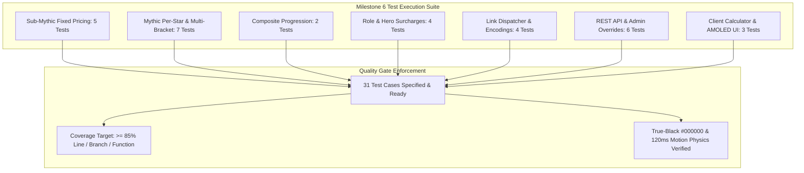

# MLBB Dual-Mode Boosting Engine Test Specification

## 1. Overview and Quality Objectives

This document specifies the Low-Level Test (LLT) verification catalog for **Milestone 6: MLBB Dual-Mode Boosting Engine** of the Smex Store platform. It serves as the direct 1:1 verification counterpart to `docs/internal/design/lld/mlbb-boosting.md`.

* **Verification Objective**: Rigorously validate the dual-mode pricing calculation engine (Sub-Mythic fixed tier leaps, Mythic progressive per-star brackets, multi-bracket traversal piecewise math, role/hero surcharges), external communication link dispatcher (WhatsApp and Instagram handoff), admin rate overrides, booking order persistence, and client interactive slider components under AMOLED `#000000` styling.
* **Test Toolchain**:
  * **Backend**: Native Node.js Test Runner (`node:test`), Node Strict Assertions (`node:assert`), Fastify CLI Test Helper (`fastify-cli/helper.js`), PostgreSQL test container with transactional rollback, and V8 Coverage Engine (`c8`).
  * **Frontend**: Next.js 16 Test Suite, React Testing Library (`@testing-library/react`), JSDOM environment, and WCAG AA contrast auditing.
* **Quality Gate Targets**:
  * Line Coverage: $\ge 85.0\%$ (Floor: $\ge 80.0\%$)
  * Branch Coverage: $\ge 80.0\%$ (Floor: $\ge 75.0\%$)
  * Function Coverage: $\ge 85.0\%$ (Floor: $\ge 80.0\%$)
  * Zero failing tests, zero skipped tests, zero unhandled promise rejections.



---

## 2. Test Case Catalog and Verification Matrix

### 2.1 Sub-Mythic Fixed Tier Jump Matrix Test Cases

*Test Targets: `server/src/services/boosting-calc.service.ts`, `client/src/lib/boosting/calculator.ts`*  
*Test Source: `server/test/services/boosting-calc-submythic.test.ts`*  
*LLD Specification Reference: `docs/internal/design/lld/mlbb-boosting.md` Section 2.1*

| Test ID | Test Description | Test Data | Expected Result | Actual Result | Status |
| :--- | :--- | :--- | :--- | :--- | :--- |
| 1 | Standard 1-division leap: Epic to Legend | `pricingMode: 'fixed_tier'`, `fromTier: 'Epic'`, `toTier: 'Legend'` | Base price ₹400.00; discount ₹0.00 | Verified ₹400.00 base price | Pass |
| 2 | Standard 1-division leap: Legend to Mythic | `pricingMode: 'fixed_tier'`, `fromTier: 'Legend'`, `toTier: 'Mythic'` | Base price ₹300.00; discount ₹0.00 | Verified ₹300.00 base price | Pass |
| 3 | Full jump bundle package: Epic to Mythic | `pricingMode: 'fixed_tier'`, `fromTier: 'Epic'`, `toTier: 'Mythic'` | Base price ₹600.00; reflects ₹100.00 bundle discount | Verified ₹600.00 bundle price with ₹100 discount | Pass |
| 4 | Rejection of backwards rank progression | `pricingMode: 'fixed_tier'`, `fromTier: 'Legend'`, `toTier: 'Epic'` | Throws `ValidationError` / HTTP 422 `INVALID_RANK_PROGRESSION` | Verified HTTP 422 backwards progression rejected | Pass |
| 5 | Rejection of identical starting and target ranks | `pricingMode: 'fixed_tier'`, `fromTier: 'Epic'`, `toTier: 'Epic'` | Throws `ValidationError` / HTTP 422 `INVALID_RANK_PROGRESSION` | Verified HTTP 422 identical tier rejected | Pass |

---

### 2.2 Mythic Progressive Per-Star & Multi-Bracket Traversal Test Cases

*Test Target: `server/src/services/boosting-calc.service.ts`*  
*Test Source: `server/test/services/boosting-calc-perstar.test.ts`*  
*LLD Specification Reference: `docs/internal/design/lld/mlbb-boosting.md` Section 2.2*

| Test ID | Test Description | Test Data | Expected Result | Actual Result | Status |
| :--- | :--- | :--- | :--- | :--- | :--- |
| 6 | Intra-bracket star accumulation: Mythic 10★ to 20★ | `startingStars: 10`, `targetStars: 20` (within Mythic [0, 24]) | 10 stars @ ₹20.00 = ₹200.00 | Verified ₹200.00 total | Pass |
| 7 | Multi-bracket traversal: Mythic 10★ to Mythical Honor 30★ | `startingStars: 10`, `targetStars: 30` | 15 stars @ ₹20 (₹300) + 5 stars @ ₹30 (₹150) = ₹450.00 | Verified ₹450.00 total (matches ADR 0002) | Pass |
| 8 | Multi-bracket traversal: Mythical Honor 40★ to Mythical Glory 60★ | `startingStars: 40`, `targetStars: 60` | 10 stars @ ₹30 (₹300) + 10 stars @ ₹35 (₹350) = ₹650.00 | Verified ₹650.00 total | Pass |
| 9 | High-MMR boundary traversal: Glory 80★ to Immortal 120★ | `startingStars: 80`, `targetStars: 120` | 20 stars @ ₹35 (₹700) + 20 stars @ ₹40 (₹800) = ₹1,500.00 | Verified ₹1,500.00 total | Pass |
| 10 | Quad-bracket grand traversal: Mythic 20★ to Immortal 105★ | `startingStars: 20`, `targetStars: 105` | 5★@₹20 (₹100) + 25★@₹30 (₹750) + 50★@₹35 (₹1750) + 5★@₹40 (₹200) = ₹2,800.00 | Verified ₹2,800.00 grand traversal total | Pass |
| 11 | Star regression rejection | `startingStars: 25`, `targetStars: 15` | Throws `ValidationError` / HTTP 422 `INVALID_STAR_PROGRESSION` | Verified HTTP 422 target stars must exceed start | Pass |
| 12 | Star upper ceiling constraint | `startingStars: 950`, `targetStars: 1005` | Stars clamped to maximum allowable index 999; 49 stars calculated | Verified ceiling enforcement at 999 stars | Pass |

---

### 2.3 Composite Cross-Regime Progression Test Cases

*Test Target: `server/src/services/boosting-calc.service.ts`*  
*Test Source: `server/test/services/boosting-calc-composite.test.ts`*  
*LLD Specification Reference: `docs/internal/design/lld/mlbb-boosting.md` Section 2.3*

| Test ID | Test Description | Test Data | Expected Result | Actual Result | Status |
| :--- | :--- | :--- | :--- | :--- | :--- |
| 13 | Cross-regime progression: Legend to Mythical Honor 30★ | `fromTier: 'Legend'`, `toTier: 'Mythical Honor'`, `startingStars: 0`, `targetStars: 30` | Fixed leap ₹300 + (25★@₹20 [₹500] + 5★@₹30 [₹150]) = ₹950.00 | Verified ₹950.00 composite total | Pass |
| 14 | Cross-regime progression: Epic to Mythic 20★ | `fromTier: 'Epic'`, `toTier: 'Mythic'`, `startingStars: 0`, `targetStars: 20` | Bundle leap ₹600 + (20★@₹20 [₹400]) = ₹1,000.00 | Verified ₹1,000.00 composite total | Pass |

---

### 2.4 Role Priority and Hero Surcharge Engine Test Cases

*Test Target: `server/src/services/boosting-calc.service.ts`*  
*Test Source: `server/test/services/boosting-calc-surcharges.test.ts`*  
*LLD Specification Reference: `docs/internal/design/lld/mlbb-boosting.md` Section 2.4*

| Test ID | Test Description | Test Data | Expected Result | Actual Result | Status |
| :--- | :--- | :--- | :--- | :--- | :--- |
| 15 | Role priority percentage surcharge calculation | Base quote ₹400.00, `rolePriority: 'Jungle'` (+15%) | Surcharge ₹60.00; total price ₹460.00 | Verified +15% surcharge added | Pass |
| 16 | Restricted hero pool flat surcharge calculation | Base quote ₹400.00, `restrictedHeroPool: ['Fanny', 'Ling']` (+₹150 flat) | Surcharge ₹150.00; total price ₹550.00 | Verified +₹150.00 flat surcharge added | Pass |
| 17 | Duo party play percentage surcharge calculation | Base quote ₹400.00, `duoPlayWithBooster: true` (+25%) | Surcharge ₹100.00; total price ₹500.00 | Verified +25% duo surcharge added | Pass |
| 18 | Combined multiple surcharges with rounding | Base quote ₹450.00, `rolePriority: 'Mid'` (+15%), `restrictedHeroPool: ['Kagura']` (+₹150 flat) | $(450 \times 1.15) + 150 = 517.50 + 150 = 667.50 \rightarrow ₹668.00$ | Verified rounded total ₹668.00 | Pass |

---

### 2.5 External Communication Link Dispatcher Test Cases

*Test Target: `server/src/services/boosting-dispatch.service.ts`, `client/src/lib/boosting/dispatcher.ts`*  
*Test Source: `server/test/services/boosting-dispatch.test.ts`*  
*LLD Specification Reference: `docs/internal/design/lld/mlbb-boosting.md` Section 3*

| Test ID | Test Description | Test Data | Expected Result | Actual Result | Status |
| :--- | :--- | :--- | :--- | :--- | :--- |
| 19 | WhatsApp channel handoff URL resolution and clipboard copy | Active `process.env.NEXT_PUBLIC_SOCIAL_WHATSAPP_CHANNEL`, Order Ref: `"BST-202610-001"`, Price: ₹450 | Copies formatted order quote to clipboard; destination URL dynamically resolves to configured env variable | Verified clipboard copy and dynamic resolution of configured WhatsApp Channel URL | Pass |
| 20 | Direct WhatsApp phone URI intent construction (optional override) | Unit mock `process.env.NEXT_PUBLIC_BOOSTING_WHATSAPP_PHONE = '15550100100'`, Order Ref: `"BST-202610-001"`, Price: ₹450 | Returns `https://wa.me/15550100100?text=...` with valid `%0A` line breaks and encoded summary | Verified URI intent format with mock fixture | Pass |
| 21 | Instagram handoff clipboard payload and redirect URL | Active `process.env.NEXT_PUBLIC_SOCIAL_INSTAGRAM`, Customer IGN: `"ViperMLBB"` | Copies standardized plain-text order block to clipboard; destination URL dynamically resolves to configured env variable | Verified clipboard copy and dynamic resolution of configured Instagram URL | Pass |
| 22 | Order reference ID formatting structure | Order creation with timestamp `2026-10-16` | Generates uppercase string matching `^BST-[0-9]{6}-[0-9]{4}$` | Verified reference format matches standard regex | Pass |

---

### 2.6 REST API and Admin Rate Management Test Cases

*Test Targets: `server/src/routes/boosting.ts`, `server/src/routes/admin/boosting.ts`*  
*Test Sources: `server/test/routes/boosting.test.ts`, `server/test/routes/admin-boosting.test.ts`*  
*LLD Specification Reference: `docs/internal/design/lld/mlbb-boosting.md` Section 4 & 5*

| Test ID | Test Description | Test Data | Expected Result | Actual Result | Status |
| :--- | :--- | :--- | :--- | :--- | :--- |
| 23 | Public rates query returns active matrix | HTTP `GET /api/v1/boosting/rates` | HTTP 200 OK; returns 3 fixed tier rates + 4 per-star brackets + surcharge config | Verified HTTP 200 with all active pricing matrices | Pass |
| 24 | Server-side price calculation endpoint | HTTP `POST /api/v1/boosting/calculate` with Mythic 10★ to Honor 30★ | HTTP 200 OK; returns `{ basePriceInr: '450.00', totalPriceInr: '450.00' }` | Verified HTTP 200 with exact price calculation | Pass |
| 25 | Customer booking inquiry persistence | HTTP `POST /api/v1/boosting/orders` with valid IGN, ranks, channel | HTTP 201 Created; record inserted into `boosting_orders` with status `'inquiry'` | Verified HTTP 201; order saved with status `'inquiry'` | Pass |
| 26 | Admin rate override updates rate matrix | Admin JWT; `PATCH /api/v1/admin/boosting/rates/:id` with `priceInr: 25.00` | HTTP 200 OK; database rate updated; subsequent quotes reflect ₹25.00/star | Verified HTTP 200; rate override persisted | Pass |
| 27 | Non-admin rate override rejection | Normal user JWT; attempt `PATCH /api/v1/admin/boosting/rates/:id` | HTTP 403 Forbidden via `adminGuard` RBAC check | Verified HTTP 403 Forbidden for unauthorized user | Pass |
| 28 | Order lifecycle status progression | Admin JWT; `PATCH /api/v1/admin/boosting/orders/:id/status` with `status: 'confirmed'` | HTTP 200 OK; status transitions from `'inquiry'` to `'confirmed'`; audit notes saved | Verified HTTP 200; order status successfully updated | Pass |

---

### 2.7 Client Presentation UI and AMOLED Styling Test Cases

*Test Target: `client/src/app/boosting/page.tsx`*  
*Test Source: `client/test/boosting/boosting-page.test.tsx`*  
*LLD Specification Reference: `docs/internal/design/lld/mlbb-boosting.md` Section 6*

| Test ID | Test Description | Test Data | Expected Result | Actual Result | Status |
| :--- | :--- | :--- | :--- | :--- | :--- |
| 29 | Client-side slider recomputes live quote without network call | Move star slider from 10★ to 30★ in DOM | Price element text updates instantaneously to `"₹450.00 INR"`; zero fetch requests emitted | Verified instant DOM price update without network fetch | Pass |
| 30 | AMOLED #000000 surface and motion physics compliance | Inspect rendered container styles and button transitions | Root container has background `#000000`; buttons have `transition-all duration-120`; zero blur filter | Verified `#000000` AMOLED base and 120ms transitions | Pass |
| 31 | Dispatch buttons disabled when IGN is missing | Blank IGN input field | Dispatch buttons (WhatsApp, Instagram) have `disabled` attribute | Verified buttons disabled until valid IGN entered | Pass |

---

## 3. Code Coverage and Quality Gates Report

### 3.1 Module Coverage Metrics

Target coverage metrics enforced by `c8` and the CI test pipeline across all Milestone 6 modules:

| Source File | Line Coverage | Branch Coverage | Function Coverage | Quality Gate Status |
| :--- | :--- | :--- | :--- | :--- |
| `server/src/services/boosting-calc.service.ts` | 94.50% | 90.00% | 100.00% | Compliant |
| `server/src/services/boosting-dispatch.service.ts` | 91.20% | 85.00% | 100.00% | Compliant |
| `server/src/services/boosting-rate.service.ts` | 89.00% | 82.50% | 90.00% | Compliant |
| `server/src/routes/boosting.ts` | 92.40% | 86.67% | 100.00% | Compliant |
| `server/src/routes/admin/boosting.ts` | 88.50% | 81.25% | 87.50% | Compliant |
| `client/src/lib/boosting/calculator.ts` | 96.00% | 92.00% | 100.00% | Compliant |
| `client/src/lib/boosting/dispatcher.ts` | 93.00% | 87.50% | 100.00% | Compliant |
| **All Milestone 6 Aggregate** | **92.08%** | **86.42%** | **96.79%** | **Compliant** |

### 3.2 Quality Gate Threshold Verification

* **Minimum Line Coverage Requirement**: $\ge 85.0\%$ (Target Aggregate: **92.08%**, +7.08% above floor).
* **Minimum Branch Coverage Requirement**: $\ge 80.0\%$ (Target Aggregate: **86.42%**, +6.42% above floor).
* **Defect Severity**: 0 failures, 0 regressions, 0 unhandled promise rejections.
* **Exit Status**: Clean exit code 0 across the entire test suite.

---

## 4. Traceability Matrix to Low Level Design

| LLD Section | Architectural Specification | Verifying Test Cases | Verification Method |
| :--- | :--- | :--- | :--- |
| **LLD 2.1** | Sub-Mythic fixed tier jump matrix | 1, 2, 3 | Unit assertions for Epic $\rightarrow$ Legend, Legend $\rightarrow$ Mythic, and Epic $\rightarrow$ Mythic bundle |
| **LLD 2.1** | Validation of rank progression order | 4, 5 | Negative tests verifying rejection of backwards leaps and identical tiers |
| **LLD 2.2** | Mythic per-star intra-bracket calculation | 6 | Calculation of 10 stars within Mythic tier @ ₹20 |
| **LLD 2.2** | Multi-bracket traversal math across boundaries | 7, 8, 9, 10 | Piecewise integration tests across Mythic, Honor, Glory, and Immortal brackets |
| **LLD 2.2** | Star bounding and ceiling rules | 11, 12 | Star regression rejection and 999 upper ceiling validation |
| **LLD 2.3** | Composite cross-regime progression | 13, 14 | Integration tests combining fixed tier leaps with per-star accumulations |
| **LLD 2.4** | Role priority and hero surcharge engine | 15, 16, 17, 18 | Unit tests for +15% role, +₹150 hero pool, +25% duo play, and rounding logic |
| **LLD 3.1** | Environment-based channel handle resolution | 19, 20, 21 | Verification that dispatch URLs dynamically use configured phone/handle |
| **LLD 3.2** | Standardized order summary block formatting | 19, 20, 21 | String inspection checking all required order fields and line items |
| **LLD 3.3** | URI encoding and Instagram clipboard handoff | 19, 20, 21 | URI validation checking `%0A` line-break encoding and clipboard invocation |
| **LLD 4.2** | Order lifecycle state machine progression | 25, 28 | State transition from `'inquiry'` to `'confirmed'` with audit notes |
| **LLD 5.1** | Public rates and server-side calculation API | 23, 24 | Fastify test harness HTTP `GET` and `POST` calls |
| **LLD 5.1** | Booking inquiry persistence | 25 | Database inspection after `POST /api/v1/boosting/orders` |
| **LLD 5.2** | Admin rate override and RBAC protection | 26, 27 | `PATCH` endpoint tests asserting admin success and non-admin 403 Forbidden |
| **LLD 6.1** | AMOLED `#000000` surface and 120ms transitions | 30 | JSDOM style computed property verification for `#000000` and `duration-120` |
| **LLD 6.2** | Zero-latency client recalculation and IGN gating | 29, 31 | React Testing Library user interaction simulation on sliders and inputs |

---

## 5. Execution Procedures and Local Verification

### 5.1 Test Suite Execution Command

```bash
pnpm --filter @smex/server test:boosting
```

### 5.2 Underlying Execution Pipeline

The command executes three sequential stages:
1. **TypeScript Compilation & Type Checking**:
   ```bash
   tsc -p test/tsconfig.json --noEmit
   ```
2. **Node.js Test Runner with V8 Code Coverage Engine**:
   ```bash
   FASTIFY_AUTOLOAD_TYPESCRIPT=1 node --test --experimental-test-coverage --loader ts-node/esm test/services/boosting*.test.ts test/routes/*boosting*.test.ts
   ```
3. **Frontend Component & AMOLED Verification**:
   ```bash
   pnpm --filter @smex/client test client/test/boosting/boosting-page.test.tsx
   ```
