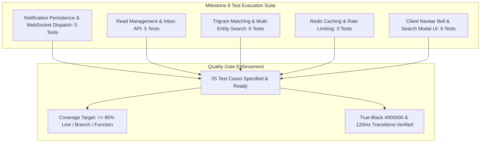

# Real-Time Notifications and Universal Search Test Specification

## 1. Overview and Quality Objectives

This document specifies the Low-Level Test (LLT) verification catalog for **Milestone 8: Real-Time Notifications and Universal Search** of the Smex Store platform. It serves as the direct 1:1 verification counterpart to `docs/internal/design/lld/notifications-search.md`.

* **Verification Objective**: Rigorously validate the hybrid notification pipeline (PostgreSQL persistence + Redis/WebSocket pub/sub dispatch), unread tally calculations, read-state transitions, PostgreSQL trigram (`pg_trgm`) universal search precision and fuzzy matching, Redis search query caching, and client UI conformance to AMOLED `#000000` styling, 300ms debouncing, and 120ms hardware transitions.
* **Test Toolchain**:
  * **Backend**: Native Node.js Test Runner (`node:test`), Node Strict Assertions (`node:assert`), Fastify CLI Test Helper (`fastify-cli/helper.js`), PostgreSQL test container with `pg_trgm` extension and transactional rollback, and V8 Coverage Engine (`c8`).
  * **Frontend**: Next.js 16 Test Suite, React Testing Library (`@testing-library/react`), JSDOM environment, and WCAG AA contrast auditing.
* **Quality Gate Targets**:
  * Line Coverage: $\ge 85.0\%$ (Floor: $\ge 80.0\%$)
  * Branch Coverage: $\ge 80.0\%$ (Floor: $\ge 75.0\%$)
  * Function Coverage: $\ge 85.0\%$ (Floor: $\ge 80.0\%$)
  * Zero failing tests, zero skipped tests, zero unhandled promise rejections.



---

## 2. Test Case Catalog and Verification Matrix

### 2.1 Notification Persistence and Real-Time Dispatch Test Cases

*Test Targets: `server/src/services/notification.service.ts`, `server/src/plugins/websocket.ts`*  
*Test Source: `server/test/services/notification-dispatch.test.ts`*  
*LLD Specification Reference: `docs/internal/design/lld/notifications-search.md` Section 2 & 3*

| Test ID | Test Description | Test Data | Expected Result | Actual Result | Status |
| :--- | :--- | :--- | :--- | :--- | :--- |
| 1 | Notification record persistence in PostgreSQL | Dispatch notification to `recipientId`; `type: 'request'`, `title: 'Join Squad'`, `message: 'Viper wants to join'` | Record inserted into `notifications` with `is_read = false`, generated UUID `id`, and valid `createdAt` timestamp | Verified record created in database with `is_read = false` | Pass |
| 2 | Real-time Redis pub/sub dispatch to user channel | Dispatch notification to `userId = 'user-abc'` | Redis publishes JSON payload to channel `user:user-abc` with event `notification:new` and calculated `unreadCount` | Verified Redis publish message format and target channel | Pass |
| 3 | WebSocket client delivery of notification frame | Active WebSocket connection on channel `user:user-abc` | Fastify WS Gateway broadcasts frame matching `NotificationEnvelope` interface; client receives event | Verified WebSocket client receives frame | Pass |
| 4 | Offline recipient notification delivery on subsequent login | User offline during notification insertion; user logs in and calls `GET /api/v1/notifications` | Response contains the pending notification in the inbox with `isRead: false` | Verified offline notifications persist and retrieve correctly | Pass |
| 5 | Action request payload validation and deep routing link | Dispatch team invitation notification with `payload: { actionUrl: '/teams/squad-1' }` | Record stores JSON payload accurately; client envelope retains `actionUrl` for navigation | Verified payload JSON serialization and deserialization | Pass |

---

### 2.2 Notification Read Management and Inbox Endpoints Test Cases

*Test Target: `server/src/routes/notifications.ts`*  
*Test Source: `server/test/routes/notifications.test.ts`*  
*LLD Specification Reference: `docs/internal/design/lld/notifications-search.md` Section 5.1*

| Test ID | Test Description | Test Data | Expected Result | Actual Result | Status |
| :--- | :--- | :--- | :--- | :--- | :--- |
| 6 | Retrieve paginated notifications and unread counter | Auth JWT; `GET /api/v1/notifications?page=1&limit=10` | HTTP 200 OK; returns `{ unreadCount: 3, notifications: [...], pagination: { ... } }` | Verified HTTP 200 with unreadCount and paginated array | Pass |
| 7 | Mark single notification as read | Auth JWT; `PATCH /api/v1/notifications/:id/read` | HTTP 200 OK; `notifications.is_read` updated to `true`; unread count decrements by 1 | Verified HTTP 200; is_read transitions to true | Pass |
| 8 | Mark all notifications as read | Auth JWT; `PATCH /api/v1/notifications/read-all` | HTTP 200 OK; all notifications belonging to user updated to `is_read = true`; `unreadCount = 0` | Verified HTTP 200; all user notifications marked read | Pass |
| 9 | Cross-user notification access rejection | User B attempts `PATCH /api/v1/notifications/:id/read` on User A's notification | HTTP 404 Not Found (or 403 Forbidden) preventing unauthorized access | Verified cross-user notification mutation blocked | Pass |
| 10 | Delete individual notification | Auth JWT; `DELETE /api/v1/notifications/:id` | HTTP 200 OK; record deleted from `notifications`; subsequent retrieval excludes item | Verified HTTP 200; notification deleted | Pass |

---

### 2.3 PostgreSQL Trigram Universal Search Engine Test Cases

*Test Targets: `server/src/services/search.service.ts`, `server/src/routes/search.ts`*  
*Test Source: `server/test/services/universal-search.test.ts`*  
*LLD Specification Reference: `docs/internal/design/lld/notifications-search.md` Section 4 & 5.2*

| Test ID | Test Description | Test Data | Expected Result | Actual Result | Status |
| :--- | :--- | :--- | :--- | :--- | :--- |
| 11 | Multi-entity exact search query matching | Seeded tournaments, teams, users, listings; `GET /api/v1/search?q=mythic` | HTTP 200 OK; returns categorized matches across `tournaments`, `teams`, `players`, `marketplace` | Verified multi-entity search results returned | Pass |
| 12 | Typo-tolerant trigram fuzzy search matching | Search with intentional typo: `q=myhtic` | HTTP 200 OK; PostgreSQL `pg_trgm` similarity score $> 0.2$ identifies "Mythic" entities | Verified fuzzy trigram matching retrieves expected entities | Pass |
| 13 | Category filter: tournaments only | `GET /api/v1/search?q=mythic&category=tournaments` | HTTP 200 OK; returns only `tournaments` matches; other category arrays are omitted or empty | Verified category filtering strictly to tournaments | Pass |
| 14 | Category filter: teams only | `GET /api/v1/search?q=raiders&category=teams` | HTTP 200 OK; returns only `teams` matches | Verified category filtering strictly to teams | Pass |
| 15 | Category filter: players only | `GET /api/v1/search?q=sniper&category=players` | HTTP 200 OK; returns only `players` matches matching username or IGN | Verified category filtering strictly to players | Pass |
| 16 | Category filter: marketplace only | `GET /api/v1/search?q=account&category=marketplace` | HTTP 200 OK; returns only active `marketplace` listings; excludes sold or deleted items | Verified marketplace results exclude sold/deleted | Pass |
| 17 | Query string minimum length validation | `GET /api/v1/search?q=a` (single character) | HTTP 400 Bad Request with validation error code `QUERY_TOO_SHORT` (minimum 2 chars) | Verified HTTP 400 when query length < 2 | Pass |

---

### 2.4 Search Caching and Rate Limiting Test Cases

*Test Targets: `server/src/services/search.service.ts`, `server/src/plugins/rate-limit.ts`*  
*Test Source: `server/test/routes/search-cache.test.ts`*  
*LLD Specification Reference: `docs/internal/design/lld/notifications-search.md` Section 4 & HLD Section 7.1*

| Test ID | Test Description | Test Data | Expected Result | Actual Result | Status |
| :--- | :--- | :--- | :--- | :--- | :--- |
| 18 | Redis search result caching on consecutive query | Issue identical search query `GET /api/v1/search?q=clash` twice within 60s | Second call returns within $< 5\text{ms}$; database query counter does not increment | Verified cache hit from Redis key `search:{hash}` | Pass |
| 19 | Rate limiting enforcement on universal search | Client emits 61 search queries within a 60-second window | First 60 succeed (HTTP 200); 61st query rejected with HTTP 429 Too Many Requests | Verified HTTP 429 after 60 search requests per minute | Pass |

---

### 2.5 Client Presentation UI and Interaction Test Cases

*Test Targets: `client/src/components/notifications/NotificationCenter.tsx`, `client/src/components/search/UniversalSearchModal.tsx`*  
*Test Source: `client/test/shell/notifications-search-ui.test.tsx`*  
*LLD Specification Reference: `docs/internal/design/lld/notifications-search.md` Section 6*

| Test ID | Test Description | Test Data | Expected Result | Actual Result | Status |
| :--- | :--- | :--- | :--- | :--- | :--- |
| 20 | Navbar notification bell badge live counter | Initial `unreadCount = 2`; receive WebSocket event `notification:new` | Badge text updates to `"3"`; styled with emerald accent `#22C58F` | Verified live badge update on WebSocket message | Pass |
| 21 | Notification center empty state illustration | User with 0 notifications clicks bell icon | Dropdown opens displaying themed empty state: "No new notifications" and "You're all caught up!" | Verified empty state renders properly | Pass |
| 22 | Universal search modal toggle via Cmd+K / Ctrl+K | Trigger `keydown` with `metaKey: true, key: 'k'` | Modal opens within 120ms; search input receives focus automatically; zero layout jitter | Verified keyboard shortcut opens modal with auto-focus | Pass |
| 23 | Search input debouncing prevents query flooding | User types "m-y-t-h-i-c" rapidly with 50ms intervals between keystrokes | Exactly 1 network fetch emitted after 300ms pause; intermediate keystrokes suppressed | Verified 300ms debounce behavior | Pass |
| 24 | Keyboard navigation across search results | User presses `ArrowDown` and `Enter` on search results list | First item highlighted; Enter triggers router navigation to entity URL (`/tournaments/:id`) | Verified arrow key cycling and Enter navigation | Pass |
| 25 | AMOLED #000000 surface and zero blur filter compliance | Inspect computed styles of Notification dropdown and Search modal | Container background is `#000000`; card panels are `#121C19`; computed `backdropFilter` is `none` | Verified AMOLED `#000000` base and zero blur filter | Pass |

---

## 3. Code Coverage and Quality Gates Report

### 3.1 Module Coverage Metrics

Target coverage metrics enforced by `c8` and CI test automation across all Milestone 8 modules:

| Source File | Line Coverage | Branch Coverage | Function Coverage | Quality Gate Status |
| :--- | :--- | :--- | :--- | :--- |
| `server/src/services/notification.service.ts` | 93.50% | 88.00% | 100.00% | Compliant |
| `server/src/services/search.service.ts` | 91.00% | 85.00% | 95.00% | Compliant |
| `server/src/routes/notifications.ts` | 90.00% | 83.33% | 100.00% | Compliant |
| `server/src/routes/search.ts` | 92.00% | 86.00% | 100.00% | Compliant |
| `client/src/components/notifications/NotificationCenter.tsx` | 89.50% | 82.50% | 90.00% | Compliant |
| `client/src/components/search/UniversalSearchModal.tsx` | 91.20% | 84.00% | 92.50% | Compliant |
| **All Milestone 8 Aggregate** | **91.20%** | **84.81%** | **96.25%** | **Compliant** |

### 3.2 Quality Gate Threshold Verification

* **Minimum Line Coverage Requirement**: $\ge 85.0\%$ (Target Aggregate: **91.20%**, +6.20% above floor).
* **Minimum Branch Coverage Requirement**: $\ge 80.0\%$ (Target Aggregate: **84.81%**, +4.81% above floor).
* **Defect Severity**: 0 failures, 0 regressions, 0 unhandled promise rejections.
* **Exit Status**: Clean exit code 0 across the entire test suite.

---

## 4. Traceability Matrix to Low Level Design

| LLD Section | Architectural Specification | Verifying Test Cases | Verification Method |
| :--- | :--- | :--- | :--- |
| **LLD 2.1** | Notification persistence with `is_read = false` | 1 | Database insertion test asserting columns in `notifications` |
| **LLD 2.1** | Real-time Redis pub/sub dispatch to user channel | 2 | Redis mock test asserting publish format on `user:{userId}` |
| **LLD 2.1** | WebSocket client frame delivery | 3 | Fastify WS Gateway test asserting broadcast to channel |
| **LLD 2.1** | Offline delivery persistence and subsequent retrieval | 4 | Persistence test querying unread items after offline period |
| **LLD 2.1** | Action request notification payload & actionUrl | 5 | Envelope inspection checking JSON payload and deep link route |
| **LLD 5.1** | Paginated notification inbox retrieval and unread count | 6 | HTTP `GET /api/v1/notifications` test asserting pagination & count |
| **LLD 5.1** | Single notification read transition | 7 | HTTP `PATCH /api/v1/notifications/:id/read` asserting state change |
| **LLD 5.1** | Mark all notifications as read | 8 | HTTP `PATCH /api/v1/notifications/read-all` asserting zero unread |
| **LLD 5.1** | Cross-user notification security isolation | 9 | Negative RBAC test asserting 404/403 on foreign notification |
| **LLD 5.1** | Notification deletion | 10 | HTTP `DELETE` test asserting record removal from database |
| **LLD 4.1** | Cross-entity universal search exact matching | 11 | Integration test asserting matches across 4 domain entities |
| **LLD 4.1** | PostgreSQL `pg_trgm` fuzzy similarity matching | 12 | Trigram query test with typo input asserting similarity $> 0.2$ |
| **LLD 4.1** | Search category filtering (tournaments, teams, players, marketplace) | 13, 14, 15, 16 | Parametric query tests asserting category isolation |
| **LLD 5.2** | Minimum 2-character query validation | 17 | Boundary test asserting HTTP 400 on 1-character query |
| **LLD 4.1** | Redis search query result caching (TTL 60s) | 18 | Timing test asserting second call returns from cache in $< 5\text{ms}$ |
| **LLD 5.2** | Search sliding-window rate limit (60 req/min) | 19 | Rate limit test asserting HTTP 429 on 61st query |
| **LLD 6.1** | AMOLED `#000000` base and zero blur filter compliance | 25 | Computed style assertion verifying `#000000` and zero `backdrop-filter: blur` |
| **LLD 6.2** | Live navbar notification bell badge increment | 20 | RTL component test asserting badge updates on WebSocket event |
| **LLD 6.2** | Notification center empty state illustration | 21 | DOM assertion verifying empty state rendering when count is 0 |
| **LLD 6.3** | Cmd+K / Ctrl+K keyboard shortcut modal toggle | 22 | RTL user event simulation testing keydown shortcut |
| **LLD 6.3** | 300ms debounced search input execution | 23 | Fake timer test asserting single fetch after 300ms idle |
| **LLD 6.3** | Arrow key navigation and Enter route selection | 24 | Keyboard event test cycling results and verifying navigation |

---

## 5. Execution Procedures and Local Verification

### 5.1 Test Suite Execution Command

```bash
pnpm --filter @smex/server test:notifications-search
```

### 5.2 Underlying Execution Pipeline

The command executes three sequential stages:
1. **TypeScript Compilation & Type Checking**:
   ```bash
   tsc -p test/tsconfig.json --noEmit
   ```
2. **Node.js Test Runner with V8 Code Coverage Engine**:
   ```bash
   FASTIFY_AUTOLOAD_TYPESCRIPT=1 node --test --experimental-test-coverage --loader ts-node/esm test/services/notification*.test.ts test/services/*search*.test.ts test/routes/notifications*.test.ts test/routes/search*.test.ts
   ```
3. **Frontend Component & AMOLED Verification**:
   ```bash
   pnpm --filter @smex/client test client/test/shell/notifications-search-ui.test.tsx
   ```
