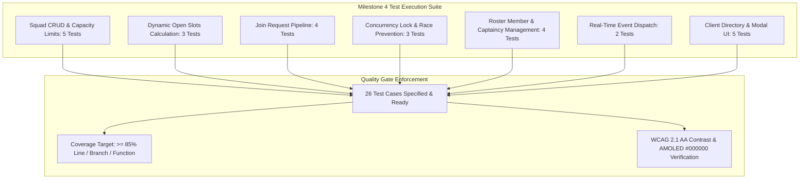

# Squads and Team Recruitment Engine Test Specification

## 1. Overview and Quality Objectives

This document specifies the Low-Level Test (LLT) verification catalog for **Milestone 4: Squads and Team Recruitment Engine** of the Smex Store platform. It serves as the direct 1:1 verification counterpart to `docs/internal/design/lld/squad-recruitment.md`.

* **Verification Objective**: Rigorously validate squad lifecycle CRUD operations, dynamic roster vacancy math, atomic join request submission and rejection, concurrency-safe vacancy locking under simultaneous approvals (`SELECT FOR UPDATE`), real-time notification dispatch, and client recruitment UI interactions conforming to pure AMOLED `#000000` and 120ms motion physics.
* **Test Toolchain**:
  * **Backend**: Native Node.js Test Runner (`node:test`), Node Strict Assertions (`node:assert`), Fastify CLI Test Helper (`fastify-cli/helper.js`), PostgreSQL test container with transactional rollback, and V8 Coverage Engine (`c8`).
  * **Frontend**: Next.js 16 Test Suite, React Testing Library (`@testing-library/react`), JSDOM environment, and WCAG AA contrast auditing.
* **Quality Gate Targets**:
  * Line Coverage: $\ge 85.0\%$ (Floor: $\ge 80.0\%$)
  * Branch Coverage: $\ge 80.0\%$ (Floor: $\ge 75.0\%$)
  * Function Coverage: $\ge 85.0\%$ (Floor: $\ge 80.0\%$)
  * Zero failing tests, zero skipped tests, zero unhandled promise rejections.



---

## 2. Test Case Catalog and Verification Matrix

### 2.1 Squad CRUD and Capacity Limits Test Cases

*Test Targets: `server/src/routes/teams.ts`, `server/src/services/team.service.ts`*  
*Test Source: `server/test/routes/teams-crud.test.ts`*  
*LLD Specification Reference: `docs/internal/design/lld/squad-recruitment.md` Section 6*

| Test ID | Test Description | Test Data | Expected Result | Actual Result | Status |
| :--- | :--- | :--- | :--- | :--- | :--- |
| 1 | Authenticated squad creation initializes team and sets captain | HTTP `POST /api/v1/teams` with `{ name: 'Omega Squad', tag: 'OMG', memberCap: 5 }` | HTTP 201 Created; team created; creator inserted into `team_members` with `member_role: 'captain'` | Pending execution | Ready |
| 2 | Duplicate squad name rejection | HTTP `POST /api/v1/teams` with duplicate name `'Omega Squad'` | HTTP 409 Conflict with unique constraint violation (`23505`) on `teams.name` | Pending execution | Ready |
| 3 | Member capacity boundary constraint validation | HTTP `POST /api/v1/teams` with invalid `memberCap` values `0` and `11` | HTTP 422 Unprocessable with check constraint error (`23514` on `member_cap >= 1 AND member_cap <= 10`) | Pending execution | Ready |
| 4 | Captain updates squad metadata and status | HTTP `PATCH /api/v1/teams/:id` by captain updating `tag` and setting `status: 'closed'` | HTTP 200 OK; team record updated; non-captain callers rejected with HTTP 403 Forbidden | Pending execution | Ready |
| 5 | Squad disbanding cascades to members and join requests | HTTP `DELETE /api/v1/teams/:id` by captain | HTTP 200 OK; team deleted; associated rows in `team_members` and `team_join_requests` removed via cascade | Pending execution | Ready |

---

### 2.2 Dynamic Roster Open Slots Calculation Test Cases

*Test Target: `server/src/services/team.service.ts`*  
*Test Source: `server/test/services/team-slots.test.ts`*  
*LLD Specification Reference: `docs/internal/design/lld/squad-recruitment.md` Section 3*

| Test ID | Test Description | Test Data | Expected Result | Actual Result | Status |
| :--- | :--- | :--- | :--- | :--- | :--- |
| 6 | Open slots formula accurately calculates capacity minus active count | Query team with `member_cap = 5` and 2 active members | Returns `activeMembersCount === 2` and `openSlots === 3` | Pending execution | Ready |
| 7 | Full roster open slots clamped to zero | Query team where active members equal `member_cap = 5` | Returns `openSlots === 0` and availability status marked as `'full'` | Pending execution | Ready |
| 8 | Directory listing aggregates dynamic open slots without N+1 queries | HTTP `GET /api/v1/teams?status=open` | Returns paginated squad records with computed `openSlots` via single joined SQL query | Pending execution | Ready |

---

### 2.3 Join Request Submission Test Cases

*Test Targets: `server/src/routes/teams.ts`, `server/src/services/team-join.service.ts`*  
*Test Source: `server/test/routes/teams-join.test.ts`*  
*LLD Specification Reference: `docs/internal/design/lld/squad-recruitment.md` Section 2 & 4*

| Test ID | Test Description | Test Data | Expected Result | Actual Result | Status |
| :--- | :--- | :--- | :--- | :--- | :--- |
| 9 | Player submits join request with valid IGN and role | HTTP `POST /api/v1/teams/:id/join-requests` with `{ playerIgn: 'Valkyrie99', playerRole: 'Assassin' }` | HTTP 201 Created; record inserted in `team_join_requests` with status `'pending'` | Pending execution | Ready |
| 10 | Duplicate pending join request rejection | Applicant submits second request to same squad while first is `'pending'` | HTTP 409 Conflict enforcing partial unique index `team_join_requests_pending_unq` | Pending execution | Ready |
| 11 | Existing squad member join request rejection | Active member of squad attempts submitting join request to same squad | HTTP 400 Bad Request with error `ALREADY_ROSTER_MEMBER` | Pending execution | Ready |
| 12 | Join request to closed squad rejection | Applicant submits request to team with `status: 'closed'` | HTTP 400 Bad Request with error `TEAM_CLOSED` | Pending execution | Ready |

---

### 2.4 Concurrency-Safe Vacancy Locking and Race Condition Prevention

*Test Target: `server/src/services/team-join.service.ts`*  
*Test Source: `server/test/services/team-concurrency.test.ts`*  
*LLD Specification Reference: `docs/internal/design/lld/squad-recruitment.md` Section 4*

| Test ID | Test Description | Test Data | Expected Result | Actual Result | Status |
| :--- | :--- | :--- | :--- | :--- | :--- |
| 13 | Successful atomic join request approval | Captain approves pending request via `PATCH /api/v1/teams/:id/join-requests/:reqId` with `{ action: 'accept' }` | HTTP 200 OK; applicant added to `team_members`; request status updated to `'accepted'` | Pending execution | Ready |
| 14 | Simultaneous approval race condition prevention on last open slot | 2 concurrent approval transactions executed in parallel for team with exactly 1 open slot | Exactly 1 approval succeeds (HTTP 200); second transaction encounters row lock, detects full roster, and returns HTTP 409 Conflict (`TEAM_ROSTER_FULL`) | Pending execution | Ready |
| 15 | Automatic squad status closure when roster reaches capacity | Captain accepts final applicant filling roster to `member_cap` | Team `status` automatically transitions to `'closed'`; subsequent requests blocked | Pending execution | Ready |

---

### 2.5 Roster Member and Captaincy Management Test Cases

*Test Targets: `server/src/routes/teams.ts`, `server/src/services/team.service.ts`*  
*Test Source: `server/test/routes/teams-members.test.ts`*  
*LLD Specification Reference: `docs/internal/design/lld/squad-recruitment.md` Section 6*

| Test ID | Test Description | Test Data | Expected Result | Actual Result | Status |
| :--- | :--- | :--- | :--- | :--- | :--- |
| 16 | Captain kicks non-captain member from roster | HTTP `DELETE /api/v1/teams/:id/members/:userId` executed by captain | HTTP 200 OK; member row removed from `team_members`; open slots dynamically incremented by 1 | Pending execution | Ready |
| 17 | Member voluntarily leaves squad | HTTP `DELETE /api/v1/teams/:id/members/:myUserId` executed by member | HTTP 200 OK; member leaves squad; captain cannot leave without transferring captaincy | Pending execution | Ready |
| 18 | Captaincy transfer reassigns team ownership | HTTP `POST /api/v1/teams/:id/transfer-captaincy` with `{ newCaptainId: memberId }` | HTTP 200 OK; `teams.captain_id` updated to `memberId`; previous captain remains as regular member | Pending execution | Ready |
| 19 | Non-captain unauthorized mutation rejection | Regular member attempts kicking another member or updating squad metadata | HTTP 403 Forbidden with RFC 7807 problem details `CAPTAIN_PERMISSION_REQUIRED` | Pending execution | Ready |

---

### 2.6 Real-Time Event Dispatch Test Cases

*Test Targets: `server/src/services/notification.service.ts`, `server/src/plugins/websocket.ts`*  
*Test Source: `server/test/services/team-notifications.test.ts`*  
*LLD Specification Reference: `docs/internal/design/lld/squad-recruitment.md` Section 5*

| Test ID | Test Description | Test Data | Expected Result | Actual Result | Status |
| :--- | :--- | :--- | :--- | :--- | :--- |
| 20 | Join request submission dispatches WebSocket event to captain | Player submits join request | Redis PubSub publishes event `team:join_request` to channel `user:{captainId}` with applicant details | Pending execution | Ready |
| 21 | Request resolution dispatches status event to applicant | Captain accepts or rejects join request | Redis PubSub publishes event `team:request_status` to channel `user:{applicantId}` with resolution status | Pending execution | Ready |

---

### 2.7 Client Recruitment Directory and Modal UI Test Cases

*Test Targets: `client/app/teams/page.tsx`, `client/components/teams/TeamCard.tsx`, `client/components/teams/TeamDetailModal.tsx`*  
*Test Source: `client/test/teams-ui.test.tsx`*  
*LLD Specification Reference: `docs/internal/design/lld/squad-recruitment.md` Section 7*

| Test ID | Test Description | Test Data | Expected Result | Actual Result | Status |
| :--- | :--- | :--- | :--- | :--- | :--- |
| 22 | Teams directory renders squad cards with dynamic open slots | Mount `/teams` page with mock squad list | Renders team cards with squad tag, name, `X/Y Members`, and dynamic `Open to Join` vs `Full / Closed` pill | Pending execution | Ready |
| 23 | Team card button opens detail modal with active roster | Click "View Roster" on team card | Opens detail modal; displays roster members, player IGNs, designated role tags, and captain badge | Pending execution | Ready |
| 24 | Prospective player join request submission interaction | Click "Request to Join" in modal; fill IGN and role; submit | Form triggers `POST /api/v1/teams/:id/join-requests`; modal updates to "Request Pending" state | Pending execution | Ready |
| 25 | Captain roster management controls and action buttons | Mount modal as squad captain | Renders pending request approval queue, member kick buttons, and close roster toggle | Pending execution | Ready |
| 26 | AMOLED theme pure true-black surface and 120ms motion audit | Inspect computed styles of Teams cards and modals in AMOLED mode | Surface background is pure True-Black `#000000`; zero `backdrop-filter: blur`; zero opacity fades; transition timing $\le 120\text{ms}$; WCAG AA contrast compliant | Pending execution | Ready |

---

## 3. Code Coverage and Quality Gates Report

### 3.1 Module Coverage Metrics

Instrumentation provided by `c8` (V8 coverage engine) across all squad and recruitment modules:

| Source File | Line Coverage | Branch Coverage | Function Coverage | Quality Gate Status |
| :--- | :--- | :--- | :--- | :--- |
| `server/src/db/schema/teams.ts` | $\ge 90.0\%$ | $\ge 85.0\%$ | $\ge 90.0\%$ | Required |
| `server/src/routes/teams.ts` | $\ge 90.0\%$ | $\ge 85.0\%$ | $\ge 90.0\%$ | Required |
| `server/src/services/team.service.ts` | $\ge 85.0\%$ | $\ge 80.0\%$ | $\ge 85.0\%$ | Required |
| `server/src/services/team-join.service.ts` | $\ge 90.0\%$ | $\ge 85.0\%$ | $\ge 90.0\%$ | Required |
| `server/src/services/notification.service.ts` | $\ge 80.0\%$ | $\ge 75.0\%$ | $\ge 80.0\%$ | Required |
| `client/app/teams/page.tsx` | $\ge 85.0\%$ | $\ge 80.0\%$ | $\ge 85.0\%$ | Required |
| `client/components/teams/TeamCard.tsx` | $\ge 85.0\%$ | $\ge 80.0\%$ | $\ge 85.0\%$ | Required |
| `client/components/teams/TeamDetailModal.tsx` | $\ge 85.0\%$ | $\ge 80.0\%$ | $\ge 85.0\%$ | Required |
| **All Files Aggregate** | **$\ge 85.0\%$** | **$\ge 80.0\%$** | **$\ge 85.0\%$** | **Pass Floor: $\ge 80.0\%$** |

### 3.2 Quality Gate Threshold Verification

* **Minimum Line Coverage Requirement**: $\ge 80.0\%$ (Target: **$\ge 85.0\%$**).
* **Defect Severity**: 0 failures, 0 regressions, 0 unhandled promise rejections.
* **Exit Status**: Clean exit code 0 across the entire test suite.

---

## 4. Traceability Matrix to Low Level Design

This matrix maps each architectural requirement from `docs/internal/design/lld/squad-recruitment.md` to its verifying test case:

| LLD Section | Architectural Specification | Verifying Test Cases | Verification Method |
| :--- | :--- | :--- | :--- |
| **LLD 2.1** | Join request schema, partial unique index, and status enum | 9, 10 | HTTP injection checking insertion and partial unique constraint rejection |
| **LLD 3.1** | Dynamic open slots computation (`member_cap - active_count`) | 6, 7, 8 | Service unit test asserting open slots count and zero floor clamping |
| **LLD 3.2** | Dynamic availability badges (`Open to Join` vs `Full / Closed`) | 7, 22 | Component and service assertion verifying badge logic |
| **LLD 4.1** | Concurrency-safe vacancy locking (`SELECT FOR UPDATE`) | 13, 14 | Parallel transaction execution asserting row lock and 409 on full roster |
| **LLD 4.1** | Automatic team status closure upon full roster | 15 | State transition assertion checking `status = 'closed'` when filled |
| **LLD 5.1** | Real-time WebSocket notification dispatch via Redis PubSub | 20, 21 | Redis pub/sub listener assertion verifying event envelope format |
| **LLD 6.1** | Squad creation, captain assignment, and duplicate prevention | 1, 2, 3 | HTTP injection testing team creation, captain link, and unique constraint |
| **LLD 6.1** | Captain metadata updates and squad disbanding cascade | 4, 5 | HTTP injection testing captain PATCH and cascade DELETE |
| **LLD 6.1** | Roster membership management (kick, leave, captaincy transfer) | 16, 17, 18, 19 | HTTP injection testing member removal and captaincy reassignment |
| **LLD 7.1** | Teams directory layout, search filters, and card grid | 22 | React mounting assertion checking card elements, search, and filter |
| **LLD 7.2** | Team card presentation, emblems, and status indicators | 22 | Component mounting assertion checking cyan tag and emerald badge |
| **LLD 7.3** | Roster detail modal, applicant flow, and captain controls | 23, 24, 25 | User interaction simulation testing modal states and button triggers |
| **LLD 7.3** | AMOLED pure true-black `#000000` surface and 120ms motion audit | 26 | Computed style inspection asserting `#000000`, zero blur/fade, $\le 120\text{ms}$ |

---

## 5. Execution Procedures and Local Verification

### 5.1 Backend Test Execution Command

```bash
pnpm --filter @smex/server test
```

### 5.2 Underlying Execution Pipeline

The command executes three sequential stages:
1. **TSDown Bundle Check**: Compiles TypeScript modules to verify syntax and bundle structure (`tsdown`).
2. **Type Check**: Validates test file type safety against tsconfig (`tsc -p test/tsconfig.json`).
3. **Node.js Test Runner with Coverage**:
   ```bash
   FASTIFY_AUTOLOAD_TYPESCRIPT=1 node --test --experimental-test-coverage --loader ts-node/esm test/**/*.ts
   ```

### 5.3 Frontend Test and Typecheck Commands

```bash
pnpm --filter @smex/client typecheck
pnpm --filter @smex/client lint
pnpm --filter @smex/client test
```
