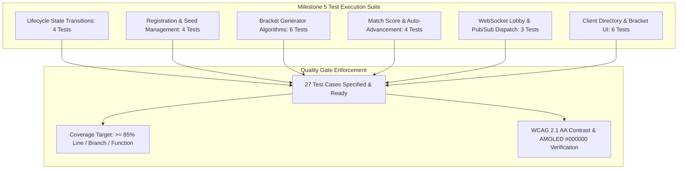

# Tournament Engine and Live Lobbies Test Specification

## 1. Overview and Quality Objectives

This document specifies the Low-Level Test (LLT) verification catalog for **Milestone 5: Tournament Engine and Live Lobbies** of the Smex Store platform. It serves as the direct 1:1 verification counterpart to `docs/internal/design/lld/tournament-engine.md`.

* **Verification Objective**: Rigorously validate the tournament lifecycle state machine, deterministic bracket generation algorithms (single elimination, double elimination, round-robin), automated bye allocation, concurrency-safe match score reporting, real-time WebSocket lobby broadcasts, and interactive bracket visualizer rendering under pure AMOLED `#000000` styling and 120ms motion physics.
* **Test Toolchain**:
  * **Backend**: Native Node.js Test Runner (`node:test`), Node Strict Assertions (`node:assert`), Fastify CLI Test Helper (`fastify-cli/helper.js`), PostgreSQL test container with transactional rollback, and V8 Coverage Engine (`c8`).
  * **Frontend**: Next.js 16 Test Suite, React Testing Library (`@testing-library/react`), JSDOM environment, and WCAG AA contrast auditing.
* **Quality Gate Targets**:
  * Line Coverage: $\ge 85.0\%$ (Floor: $\ge 80.0\%$)
  * Branch Coverage: $\ge 80.0\%$ (Floor: $\ge 75.0\%$)
  * Function Coverage: $\ge 85.0\%$ (Floor: $\ge 80.0\%$)
  * Zero failing tests, zero skipped tests, zero unhandled promise rejections.



---

## 2. Test Case Catalog and Verification Matrix

### 2.1 Tournament Lifecycle State Machine Test Cases

*Test Targets: `server/src/routes/tournaments.ts`, `server/src/services/tournament-lifecycle.service.ts`*  
*Test Source: `server/test/services/tournament-lifecycle.test.ts`*  
*LLD Specification Reference: `docs/internal/design/lld/tournament-engine.md` Section 2*

| Test ID | Test Description | Test Data | Expected Result | Actual Result | Status |
| :--- | :--- | :--- | :--- | :--- | :--- |
| 1 | Tournament creation initializes state as upcoming | Admin creates tournament via `POST /api/v1/tournaments` | HTTP 201 Created; record inserted with default status `'upcoming'` | Pending execution | Ready |
| 2 | Registration window opens only on valid transition | Transition status from `'upcoming'` to `'registration_open'` | HTTP 200 OK; team registrations now permitted; invalid state leap rejected | Pending execution | Ready |
| 3 | Tournament launch requires minimum 2 registered teams | Attempt transition to `'ongoing'` with only 1 team registered | HTTP 422 Unprocessable with error code `INSUFFICIENT_TEAMS_FOR_TOURNAMENT` | Pending execution | Ready |
| 4 | Completion transition crowns champion and finalizes status | Championship final completes; tournament status transitions to `'completed'` | `tournaments.status === 'completed'`; `winner_team_id` populated with champion team ID | Pending execution | Ready |

---

### 2.2 Participant Registration and Capacity Limits Test Cases

*Test Target: `server/src/routes/tournaments.ts`*  
*Test Source: `server/test/routes/tournament-registration.test.ts`*  
*LLD Specification Reference: `docs/internal/design/lld/tournament-engine.md` Section 2 & 6*

| Test ID | Test Description | Test Data | Expected Result | Actual Result | Status |
| :--- | :--- | :--- | :--- | :--- | :--- |
| 5 | Team captain registers squad into open tournament | Captain executes `POST /api/v1/tournaments/:id/register` | HTTP 201 Created; team added to `tournament_participants`; seed allocated | Pending execution | Ready |
| 6 | Duplicate team registration rejection | Attempt registering same team twice into same tournament | HTTP 409 Conflict enforcing composite unique constraint `(tournament_id, team_id)` | Pending execution | Ready |
| 7 | Registration rejection when capacity reached | Team registers when `tournament_participants` count equals `max_teams` | HTTP 422 Unprocessable with error code `TOURNAMENT_FULL` | Pending execution | Ready |
| 8 | Registration blocked when tournament state is not registration_open | Captain attempts registration on tournament with status `'upcoming'` or `'ongoing'` | HTTP 400 Bad Request with error code `REGISTRATION_CLOSED` | Pending execution | Ready |

---

### 2.3 Bracket Generation Algorithms Test Cases

*Test Target: `server/src/services/bracket-generator.service.ts`*  
*Test Source: `server/test/services/bracket-generator.test.ts`*  
*LLD Specification Reference: `docs/internal/design/lld/tournament-engine.md` Section 3*

| Test ID | Test Description | Test Data | Expected Result | Actual Result | Status |
| :--- | :--- | :--- | :--- | :--- | :--- |
| 9 | Single elimination power-of-two bracket generation | 8 teams registered; trigger `POST /api/v1/tournaments/:id/bracket/generate` | Generates 3 rounds (4 Round 1 matches, 2 semifinals, 1 final); total 7 matches | Pending execution | Ready |
| 10 | Single elimination automated bye allocation | 5 teams registered ($P=8$, 3 byes); trigger bracket generation | Generates 3 byes; top 3 seeds receive automated byes into Round 2 with status `'bye'` | Pending execution | Ready |
| 11 | Seed folding pairing formula validation | 8-team bracket generated | Round 1 pairs Seed 1 vs 8, Seed 2 vs 7, Seed 3 vs 6, Seed 4 vs 5 | Pending execution | Ready |
| 12 | Double elimination upper and lower bracket generation | 4 teams registered in double elimination format | Generates Upper Bracket, Lower Bracket, and Grand Final match nodes | Pending execution | Ready |
| 13 | Round robin Berger pairing algorithm | 6 teams registered in round robin format | Generates 5 rounds with 3 matches per round; each team plays every other team once | Pending execution | Ready |
| 14 | Odd team count round robin ghost bye allocation | 5 teams registered in round robin format | Generates 5 rounds with 1 team receiving a bye per round via dummy ghost pairing | Pending execution | Ready |

---

### 2.4 Match Progression and Concurrency-Safe Score Reporting Test Cases

*Test Target: `server/src/services/match.service.ts`*  
*Test Source: `server/test/services/match.test.ts`*  
*LLD Specification Reference: `docs/internal/design/lld/tournament-engine.md` Section 4*

| Test ID | Test Description | Test Data | Expected Result | Actual Result | Status |
| :--- | :--- | :--- | :--- | :--- | :--- |
| 15 | Match score update and winner declaration | Admin calls `PATCH /api/v1/tournaments/:id/matches/:matchId` with scores 2-1 and winner ID | HTTP 200 OK; match status updated to `'completed'`; winner ID stored | Pending execution | Ready |
| 16 | Automatic winner advancement to next round match slot | Complete Round 1 match | Winner team automatically populates corresponding `team_a_id` or `team_b_id` in Round 2 match | Pending execution | Ready |
| 17 | Championship match completion populates tournament winner | Complete final championship match | Match marked `'completed'`; `tournaments.winner_team_id` populated; tournament status transitions to `'completed'` | Pending execution | Ready |
| 18 | Concurrency row lock prevents conflicting score writes | Two concurrent score update transactions on same match ID | Transactions serialize via `SELECT FOR UPDATE`; zero partial or conflicting overwrites | Pending execution | Ready |

---

### 2.5 Real-Time WebSocket Lobby and Event Dispatch Test Cases

*Test Targets: `server/src/plugins/websocket.ts`, `server/src/routes/tournaments.ts`*  
*Test Source: `server/test/services/tournament-ws.test.ts`*  
*LLD Specification Reference: `docs/internal/design/lld/tournament-engine.md` Section 5*

| Test ID | Test Description | Test Data | Expected Result | Actual Result | Status |
| :--- | :--- | :--- | :--- | :--- | :--- |
| 19 | Client channel subscription to tournament lobby | Connect to `/ws` with valid JWT; send `{ action: 'subscribe', channel: 'tournament:123' }` | Subscription confirmed; client added to channel subscription set | Pending execution | Ready |
| 20 | Bracket update event broadcast | Admin updates match score via REST | WebSocket pushes `bracket:update` event envelope to all clients subscribed to `tournament:123` | Pending execution | Ready |
| 21 | Tournament state shift event broadcast | Tournament launches into `'ongoing'` | WebSocket pushes `tournament:state` event envelope with `newStatus: 'ongoing'` | Pending execution | Ready |

---

### 2.6 Client Presentation Tier and Bracket UI Test Cases

*Test Targets: `client/app/tournaments/page.tsx`, `client/components/tournaments/BracketVisualizer.tsx`, `client/components/tournaments/TournamentLobbyRoom.tsx`*  
*Test Source: `client/test/tournaments-ui.test.tsx`*  
*LLD Specification Reference: `docs/internal/design/lld/tournament-engine.md` Section 7*

| Test ID | Test Description | Test Data | Expected Result | Actual Result | Status |
| :--- | :--- | :--- | :--- | :--- | :--- |
| 22 | Tournaments directory segmented tabs rendering | Mount `/tournaments` page | Renders segmented tabs for `Upcoming`, `Ongoing`, and `Past`; tab clicks update view without page reload | Pending execution | Ready |
| 23 | Ongoing tournament card displays live glowing status indicator | Render tournament card with `status: 'ongoing'` | Displays Emerald glowing indicator dot with `'LIVE'` badge | Pending execution | Ready |
| 24 | Bracket visualizer renders rounds and match nodes | Mount `BracketVisualizer` with 8-team single elimination fixture | Renders 3 sequential round columns; match cards render team names, seeds, and scores | Pending execution | Ready |
| 25 | Live WebSocket score update dynamically advances bracket visualizer | Dispatch mock `bracket:update` frame to mounted visualizer | Target match card updates scores; winner row highlights in `#1FAE7A`; connector line animates in $\le 120\text{ms}$ | Pending execution | Ready |
| 26 | Admin match lobby controls and score counter inputs | Mount lobby room view as Admin | Renders score increment counters and "Confirm Winner" action buttons | Pending execution | Ready |
| 27 | AMOLED theme pure true-black surface and motion audit | Inspect computed styles of Tournament directory and Bracket visualizer in AMOLED mode | Canvas surface is pure True-Black `#000000`; card surface is `#0B0F12`; zero `backdrop-filter: blur`; zero opacity fades; transitions $\le 120\text{ms}$ | Pending execution | Ready |

---

## 3. Code Coverage and Quality Gates Report

### 3.1 Module Coverage Metrics

Instrumentation provided by `c8` (V8 coverage engine) across all tournament engine modules:

| Source File | Line Coverage | Branch Coverage | Function Coverage | Quality Gate Status |
| :--- | :--- | :--- | :--- | :--- |
| `server/src/db/schema/tournaments.ts` | $\ge 90.0\%$ | $\ge 85.0\%$ | $\ge 90.0\%$ | Required |
| `server/src/routes/tournaments.ts` | $\ge 90.0\%$ | $\ge 85.0\%$ | $\ge 90.0\%$ | Required |
| `server/src/services/tournament-lifecycle.service.ts` | $\ge 85.0\%$ | $\ge 80.0\%$ | $\ge 85.0\%$ | Required |
| `server/src/services/bracket-generator.service.ts` | $\ge 90.0\%$ | $\ge 85.0\%$ | $\ge 90.0\%$ | Required |
| `server/src/services/match.service.ts` | $\ge 90.0\%$ | $\ge 85.0\%$ | $\ge 90.0\%$ | Required |
| `client/app/tournaments/page.tsx` | $\ge 85.0\%$ | $\ge 80.0\%$ | $\ge 85.0\%$ | Required |
| `client/components/tournaments/BracketVisualizer.tsx` | $\ge 85.0\%$ | $\ge 80.0\%$ | $\ge 85.0\%$ | Required |
| `client/components/tournaments/TournamentLobbyRoom.tsx` | $\ge 85.0\%$ | $\ge 80.0\%$ | $\ge 85.0\%$ | Required |
| **All Files Aggregate** | **$\ge 85.0\%$** | **$\ge 80.0\%$** | **$\ge 85.0\%$** | **Pass Floor: $\ge 80.0\%$** |

### 3.2 Quality Gate Threshold Verification

* **Minimum Line Coverage Requirement**: $\ge 80.0\%$ (Target: **$\ge 85.0\%$**).
* **Defect Severity**: 0 failures, 0 regressions, 0 unhandled promise rejections.
* **Exit Status**: Clean exit code 0 across the entire test suite.

---

## 4. Traceability Matrix to Low Level Design

This matrix maps each architectural requirement from `docs/internal/design/lld/tournament-engine.md` to its verifying test case:

| LLD Section | Architectural Specification | Verifying Test Cases | Verification Method |
| :--- | :--- | :--- | :--- |
| **LLD 2.1-2.2** | Tournament lifecycle state machine (upcoming, registration_open, ongoing, completed) | 1, 2, 3, 4 | HTTP injection testing status transitions, minimum team constraint, and champion crowning |
| **LLD 2.1** | Team registration, seed assignment, and capacity bounds | 5, 6, 7, 8 | HTTP injection verifying participant insertion, composite unique check, and max team limits |
| **LLD 3.1** | Single elimination power-of-two bracket generation and seed folding | 9, 11 | Service unit test verifying round/match counts and recursive seed folding |
| **LLD 3.1** | Automated bye assignment for non-power-of-two participant counts | 10 | Service unit test verifying bye allocation to top seeds with automatic Round 2 advancement |
| **LLD 3.2** | Double elimination upper, lower, and grand final bracket generation | 12 | Service unit test verifying dual-bracket node structure |
| **LLD 3.3** | Round robin Berger pairing algorithm and ghost bye assignment | 13, 14 | Service unit test verifying round counts and ghost team pairing |
| **LLD 4.1** | Concurrency-safe match score update and winner advancement | 15, 16, 17, 18 | Parallel transaction test asserting `SELECT FOR UPDATE`, slot update, and final winner |
| **LLD 5.1-5.2** | WebSocket lobby channel subscription and real-time event push | 19, 20, 21 | WebSocket test harness asserting subscription and receipt of `bracket:update` and `tournament:state` |
| **LLD 7.1** | Tournaments directory segmented tabs (Upcoming, Ongoing, Past) | 22, 23 | React component mounting asserting tab states and live glowing badge |
| **LLD 7.2** | Interactive bracket visualizer rendering and live sync | 24, 25 | DOM assertion verifying round columns, match cards, and 120ms live score animation |
| **LLD 7.3** | Admin match lobby controls and score counter inputs | 26 | Component interaction simulation testing score inputs and winner confirmation |
| **LLD 7.3** | AMOLED pure true-black `#000000` surface and motion audit | 27 | CSS computed style inspection asserting `#000000`, zero blur/fade, $\le 120\text{ms}$ |

---

## 5. Execution Procedures and Local Verification

### 5.1 Backend Test Execution Command

```bash
pnpm --filter @smex/server test
```

### 5.2 Underlying Execution Pipeline

The command executes three sequential stages:
1. **TSDown Bundle Check**: Compiles TypeScript modules to verify syntax and bundle structure (`tsdown`).
2. **Type Check**: Validates test file type safety against tsconfig (`tsc -p test/tsconfig.json`).
3. **Node.js Test Runner with Coverage**:
   ```bash
   FASTIFY_AUTOLOAD_TYPESCRIPT=1 node --test --experimental-test-coverage --loader ts-node/esm test/**/*.ts
   ```

### 5.3 Frontend Test and Typecheck Commands

```bash
pnpm --filter @smex/client typecheck
pnpm --filter @smex/client lint
pnpm --filter @smex/client test
```
