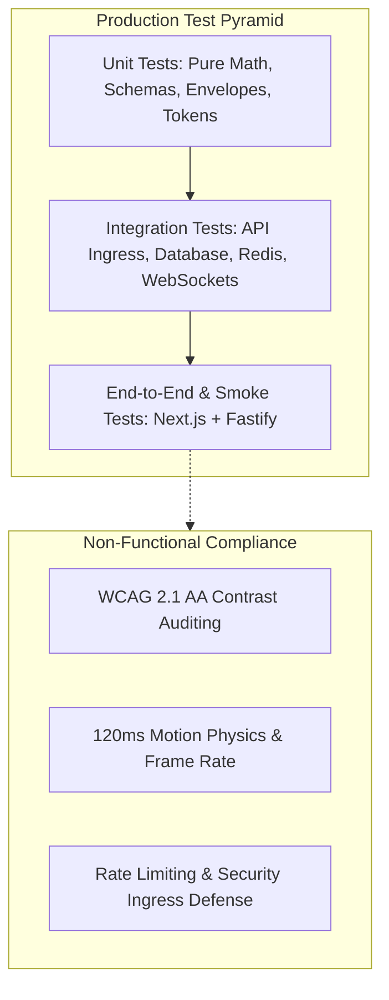

# Master Test Plan and Quality Strategy

## 1. Overview and Quality Philosophy

This document defines the comprehensive testing strategy, quality gates, execution frameworks, and environment requirements for the Smex Store platform. The testing philosophy enforces four production invariants:

* **Zero Silent Failures**: All critical application logic must fail fast with structured errors and verifiable assertions rather than degrading silently.
* **1:1 Design to Test Parity**: Every module designed in `docs/internal/design/lld/*.md` maps to a twin verification catalog in `docs/internal/testing/llt/*.md`.
* **Isolated Determinism**: Tests must be completely deterministic; running the test suite repeatedly in local containers or CI must yield identical results without leaking shared state.
* **Continuous Quality Enforcement**: Code cannot be merged without passing strict automated test coverage, type safety, and linting gates.

---

## 2. Test Pyramid and Scope Boundaries

### 2.1 Unit Testing Layer

* **Target Scope**: Pure utility functions, pricing algorithms, mathematical formulas, schema definitions, and protocol envelopes.
* **Execution Boundary**: Zero network calls, zero external database dependencies.
* **Core Domains Tested**:
  * Zod environment and request payload validation schemas.
  * MLBB boosting pricing calculators (Sub-Mythic jump matrix and Mythic per-star math).
  * Single-elimination and round-robin tournament bracket generator algorithms.
  * WebSocket protocol envelope serialization and parsing.

### 2.2 Integration Testing Layer

* **Target Scope**: Component boundaries, database queries, Redis caching, HTTP route handlers, and WebSocket connection state machines.
* **Execution Boundary**: In-process Fastify server instance (`helper.build()`) with simulated HTTP injection (`app.inject()`) and live backing services (PostgreSQL 16, Redis 7.2).
* **Core Domains Tested**:
  * Fastify plugin lifecycle (`cors`, `websocket`, `sensible`, `support`).
  * Drizzle ORM relational queries, constraint enforcement, and cascade rules.
  * Redis session creation, TTL expiration, and remote multi-device purge calls.
  * Distributed rate limiter enforcement (`@fastify/rate-limit`).
  * WebSocket heartbeat ping/pong sweeps and zombie connection termination.

### 2.3 End to End and Flow Verification Layer

* **Target Scope**: Multi-step business workflows spanning presentation and service tiers.
* **Execution Boundary**: Next.js App Router client communicating with live Fastify API service.
* **Core Flows Tested**:
  * User registration $\rightarrow$ login $\rightarrow$ session fingerprint capture $\rightarrow$ logout.
  * Squad creation $\rightarrow$ join request submission $\rightarrow$ captain approval transaction.
  * Tournament registration $\rightarrow$ seed generation $\rightarrow$ live WebSocket match advancement.
  * Marketplace account listing $\rightarrow$ presigned S3 upload $\rightarrow$ public listing browse.

### 2.4 Non-Functional and Compliance Testing

* **Accessibility (WCAG 2.1 AA)**: Contrast ratio verification ($\ge 4.5:1$ for normal text, $\ge 3:1$ for large text and UI components) across Dark (`#0B0F12`) and AMOLED (`#000000`) palettes.
* **Motion Physics**: Transition duration audit ensuring micro-interactions do not exceed `120ms` and strictly avoid prohibited `backdrop-filter: blur` styling.
* **Security & Ingress Defense**: CORS policy enforcement, brute-force rate limit tripping, and binary magic-bytes inspection.

---

## 3. Test Toolchain and Infrastructure

### 3.1 Backend Execution Stack

| Responsibility | Technology / Tool | Configuration Target |
| :--- | :--- | :--- |
| **Test Runner** | Native Node.js Test Runner | `node --test` |
| **Assertion Library** | Native Node.js Assertions | `node:assert` and `node:assert/strict` |
| **TypeScript Loader** | ts-node ESM | `--loader ts-node/esm` |
| **Coverage Engine** | c8 (V8 native instrumentation) | `--experimental-test-coverage` |
| **HTTP Injection** | Fastify CLI Helper | `fastify-cli/helper.js` |

### 3.2 Frontend Execution Stack

| Responsibility | Technology / Tool | Configuration Target |
| :--- | :--- | :--- |
| **Framework Testing** | Next.js 16 App Router Test Harness | `pnpm --filter @smex/client test` |
| **Type Verification** | TypeScript Compiler | `tsc --noEmit` |
| **Linting & Rules** | ESLint 9 + Next.js Plugin | `eslint .` |

### 3.3 Backing Services and Environment Parity

All integration and data layer tests rely on containerized backing services provided by `docker-compose.yml`:
* **PostgreSQL 16**: Port 5432, pre-configured database `smex_store`.
* **Redis 7.2**: Port 6379, standard in-memory caching and pub/sub.
* **MinIO**: Port 9000, local S3 emulator with auto-initialized `smex-storage` bucket.

---

## 4. Quality Gates and Coverage Thresholds

### 4.1 Quantitative Code Coverage Gates

Continuous Integration pipelines enforce strict quantitative coverage floors. Any pull request dropping below these metrics fails the build automatically:

| Metric | Minimum Floor | Production Target |
| :--- | :--- | :--- |
| **Line Coverage** | $\ge 80.0\%$ | $\ge 85.0\%$ |
| **Branch Coverage** | $\ge 75.0\%$ | $\ge 80.0\%$ |
| **Function Coverage** | $\ge 80.0\%$ | $\ge 85.0\%$ |

### 4.2 Defect Severity and Blockers

No release or milestone is marked complete if any of the following conditions exist:
* Any failing, skipped, or unhandled rejection in the automated test suite.
* Any TypeScript compiler error (`tsc --noEmit` exits with non-zero code).
* Any uncaught promise rejection or unhandled socket error during lifecycle teardown.

---

## 5. Test Data Management and State Isolation

### 5.1 Relational Database Isolation Strategy

* **Transactional Test Wrapping**: Integration test cases run inside isolated database transactions whenever possible, rolling back state upon completion.
* **Deterministic Seeds**: The test harness uses `src/db/seed.ts` to populate clean fixtures prior to integration test runs.
* **Idempotent Cleanup**: Truncation or cascade cleanup scripts run between suite executions to guarantee zero cross-suite pollution.

### 5.2 Cache and Key-Value Isolation Strategy

* **Key Namespacing**: Test keys use explicit test prefixes (e.g., `test:session:*`, `test:rate:*`).
* **Suite Flush**: Redis test setups selectively purge keys created during the test lifecycle using Redis pattern scan or ephemeral Redis test databases.

---

## 6. Milestone Test Matrix Mapping

Every milestone in `docs/internal/roadmap.md` is structured as a full-stack vertical slice verified by a dedicated test catalog document matching the Low-Level Design file:

| Milestone Domain | Low-Level Design Document | Milestone Test Specification |
| :--- | :--- | :--- |
| **Milestone 1: Core Tooling and Monorepo Foundations** | `lld/core-plumbing.md` | `testing/llt/core-plumbing.md` |
| **Milestone 2: Data Layer and Client UI Shell** | `lld/data-layer.md` | `testing/llt/data-layer.md` |
| **Milestone 3: Zero-Trust Authentication and User Profiles** | `lld/auth-and-sessions.md` | `testing/llt/auth-and-sessions.md` |
| **Milestone 4: Squads and Team Recruitment Engine** | `lld/squad-recruitment.md` | `testing/llt/squad-recruitment.md` |
| **Milestone 5: Tournament Engine and Live Lobbies** | `lld/tournament-engine.md` | `testing/llt/tournament-engine.md` |
| **Milestone 6: MLBB Dual-Mode Boosting Engine** | `lld/mlbb-boosting.md` | `testing/llt/mlbb-boosting.md` |
| **Milestone 7: Marketplace and S3 Presigned Uploads** | `lld/marketplace-media.md` | `testing/llt/marketplace-media.md` |
| **Milestone 8: Real-Time Notifications and Universal Search** | `lld/notifications-search.md` | `testing/llt/notifications-search.md` |
| **Milestone 9: Admin Dashboard and Governance Suite** | `lld/admin-governance.md` | `testing/llt/admin-governance.md` |
| **Milestone 10: Production Hardening, CI CD, and Deployment** | `lld/cicd-hardening.md` | `testing/llt/cicd-hardening.md` |

