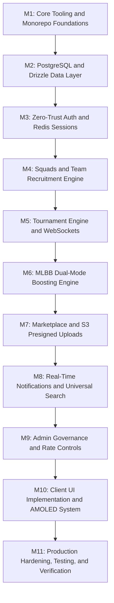

# Smex Store: Comprehensive Production Engineering Roadmap

A battle-tested, milestone-driven implementation plan for the Smex Store platform based on the 22 functional sections in docs/requirements.md and docs/design/hld.md.

---

## Technical Dependencies and Library Stack

All packages must be installed using pnpm add with zero manual version editing:

### Backend Server Stack
* **Core Framework**: `fastify@5`, `fastify-plugin@6`, `@fastify/sensible@6`
* **Network and Sockets**: `@fastify/cors`, `@fastify/websocket`
* **Configuration**: `dotenv`
* **Persistence and ORM**: `pg`, `drizzle-orm`, `drizzle-kit` dev dependency
* **Caching and Sessions**: `ioredis`
* **Validation and Security**: `zod`, `argon2`
* **File Uploads**: `@aws-sdk/client-s3`, `@aws-sdk/s3-request-presigner`
* **Build Engine**: `tsdown` powered by Rolldown in Rust

### Frontend Client Stack
* **Core Framework**: `next@16.4` App Router, Turbopack, React 19
* **Styling**: `tailwindcss@4`, `@tailwindcss/turbopack`, `clsx`, `tailwind-merge`
* **Icons**: `lucide-react`
* **Data Fetching and Cache**: `@tanstack/react-query`

---

## Detailed Milestone Execution Plan

---

### Milestone 1: Core Tooling and Monorepo Foundations
* [ ] **1.1 Dependency Installation**: Run pnpm add across server/ and client/ for all baseline packages.
* [ ] **1.2 Fastify CORS and Security**: Register `@fastify/cors` configured strictly for `http://localhost:3000` or `CORS_ORIGIN` env.
* [ ] **1.3 Fastify WebSocket Registration**: Register `@fastify/websocket` with ping/pong heartbeat handling.
* [ ] **1.4 Environment Configuration**: Create typed config parser `src/config/env.ts` using zod for `PORT`, `DATABASE_URL`, `REDIS_URL`, `JWT_SECRET`, `S3_ENDPOINT`.
* [ ] **1.5 Client Styling Tokens**: Configure Matrix Emerald `#1FAE7A`, Cyan Depth `#1B8F97`, Obsidian `#0B0F12`, and AMOLED `#000000` tokens inside `client/app/globals.css`.

---

### Milestone 2: PostgreSQL and Drizzle Data Layer
* [ ] **2.1 Drizzle Connection Pool**: Set up `drizzle-orm/node-postgres` with pooled `pg.Pool` connection and graceful shutdown handlers.
* [ ] **2.2 Schema Definitions**:
  * `users` table: UUID, email, password_hash, role, game_ign, avatar_preset, created_at.
  * `sessions` table: UUID, user_id, device_fingerprint, ip_address, expires_at.
  * `teams` and `team_members` tables: Captain ID, squad name, game title, max_capacity, open_status.
  * `tournaments` and `tournament_participants` and `matches`: Formats, prize pool, schedule, round states.
  * `boosting_orders`: Customer ID, booster ID, start_rank/stars, target_rank/stars, calculated_price_inr, status, contact_channel.
  * `marketplace_listings`: Seller ID, game_account_title, price, proof_images, status.
  * `reviews_ratings`: Reviewer ID, target_type, rating, feedback.
* [ ] **2.3 Migration Scripts**: Configure `drizzle.config.ts` and verify automated migration generation via drizzle-kit.

---

### Milestone 3: Zero-Trust Authentication and Redis Session Engine
* [ ] **3.1 Password Security**: Implement hashing and verification via argon2.
* [ ] **3.2 Dual-Token Session Pipeline**:
  * Short-lived Access Token JWT, 15m.
  * Long-lived Refresh Token stored in Redis with unique session_id.
* [ ] **3.3 Remote Session Revocation**:
  * Implement `POST /api/auth/revoke-session` to terminate a single device.
  * Implement `POST /api/auth/revoke-all` to purge all user keys from Redis, triggering immediate WS and HTTP disconnects.
* [ ] **3.4 Device Fingerprinting**: Capture User-Agent and IP to populate active sessions list in Settings.
* [ ] **3.5 Auth Endpoints**: Implement `/register`, `/login`, `/logout`, `/refresh`, `/me`.

---

### Milestone 4: Squads and Team Recruitment Engine
* [ ] **4.1 Squad CRUD**: Endpoints for team creation, updating roster limits, and changing open/closed availability.
* [ ] **4.2 Join Request Pipeline**:
  * Player submits join request with in-game IGN and role.
  * Captain receives real-time notification to approve or reject.
  * Concurrency safety: atomic database transactions to prevent joining a full roster.
* [ ] **4.3 Team Rosters and Open Slot Badges**: Calculate open slots dynamically as capacity minus active members.

---

### Milestone 5: Tournament Engine and Real-Time Sockets
* [ ] **5.1 Tournament Management**: Lifecycle state machine handling upcoming, registration_open, ongoing, and completed states.
* [ ] **5.2 Bracket Generation**: Single-elimination and round-robin bracket seed generators.
* [ ] **5.3 Real-Time WebSocket Lobby**:
  * `/ws/tournaments/:id/lobby`: Broadcasts live team registrations and bracket advancements without page reload.
  * Channel heartbeat and connection recovery handling.

---

### Milestone 6: MLBB Dual-Mode Boosting Engine
* [ ] **6.1 Core Calculation Logic**:
  * Sub-Mythic: Tier jump fixed matrix for Epic to Legend, Legend to Mythic, and Epic to Mythic bundles.
  * Mythic and Above: Progressive difficulty-scaled per-star tiers from Mythic 0-24 stars to Mythical Immortal 100+ stars.
  * Role and hero surcharges and multi-bracket traversal.
* [ ] **6.2 External Communication Link Dispatcher**:
  * Generates pre-formatted URI-encoded WhatsApp, Telegram, and Discord direct links.
  * Formats exact order summary text with starting/target ranks, calculated price in INR, and customer in-game IGN.
* [ ] **6.3 Admin Rate Override**: Secure endpoints allowing admins to update per-tier and per-star rates in PostgreSQL.

---

### Milestone 7: Marketplace and S3 Presigned Uploads
* [ ] **7.1 Direct-to-Storage Presigned Uploads**:
  * Fastify endpoint generates signed S3/R2 upload URLs with strict MIME type and file size limits of 5MB per image.
  * Client uploads screenshot proofs directly to S3 with zero binary traffic passing through Fastify.
* [ ] **7.2 Listing Management**: CRUD for game account listings with mark-as-sold and price edit capabilities.
* [ ] **7.3 Dynamic Price-Drop Badges**:
  * Price lowered: automatically compute percentage discount and assign Good Deal badge.
  * Price increased or newly listed premium: assign Hot badge.

---

### Milestone 8: Real-Time Notifications and Universal Search
* [ ] **8.1 Notification Dispatcher**:
  * In-memory WebSocket pub/sub and database persistence for unread notification center.
  * Notification types: Squad join requests, tournament schedule alerts, order status updates.
* [ ] **8.2 Cross-Entity Universal Search**:
  * Fast SQL search index with trigram matching across Tournaments, Teams, and Players.
  * Debounced client-side search autocomplete.

---

### Milestone 9: Admin Dashboard and Governance Suite
* [ ] **9.1 User and Roster Moderation**: Admin ability to ban users, revoke tokens, and disband rule-breaking squads.
* [ ] **9.2 Marketplace Moderation**: Takedown reported fraudulent listings and suspend seller accounts.
* [ ] **9.3 Rate and Fee Overrides**: Live dashboard controls for boosting rates and platform announcements.

---

### Milestone 10: Client UI Implementation and AMOLED Design System
* [ ] **10.1 Fresh App Router UI Shell**:
  * Build sticky navigation bar with unread notification badge and user profile dropdown.
  * Build hero carousel and live platform statistics counter.
* [ ] **10.2 Fresh Domain Pages**:
  * Build Tournaments page with Past, Ongoing, and Upcoming segmented views.
  * Build Teams and Groups page with capacity badges and join request modals.
  * Build Marketplace page with verified screenshot galleries, seller ratings, and direct contact buttons.
  * Build Rank Boosting page with dynamic dual-mode slider and WhatsApp order dispatch.
* [ ] **10.3 Pure AMOLED and Dark Theme Engine**:
  * Implement Matrix Emerald `#1FAE7A`, Cyan Depth `#1B8F97`, Obsidian `#0B0F12`, and AMOLED `#000000` via Tailwind v4.
  * Enforce strict 120ms physical transforms with zero frosted glass blur.

---

### Milestone 11: Production Hardening, Testing, and Verification
* [ ] **11.1 Automated Test Suites**:
  * Unit tests for pricing logic and bracket advancement.
  * Fastify integration tests for auth and session revocation.
* [ ] **11.2 Build Verification**:
  * Next.js Turbopack client build via `pnpm --filter @smex/client build`.
  * TSDown Rolldown server bundle via `pnpm --filter @smex/server build`.
* [ ] **11.3 Accessibility and Motion Compliance**:
  * WCAG 2.1 AA contrast verification across Dark and AMOLED palettes.
  * Reduced-motion media query compliance.
* [ ] **11.4 Production Containerization**:
  * Multi-stage production Dockerfile for Next.js SSR client and Fastify backend.
  * Health check endpoints and graceful shutdown handling.
