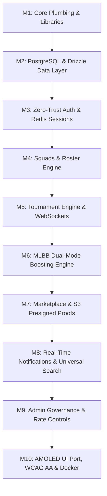

# Smex Store: Comprehensive Production Engineering Roadmap

A battle-tested, milestone-driven implementation plan for the Smex Store platform based on the 22 functional sections in [docs/requirements.md](requirements.md) and [docs/design/hld.md](design/hld.md).

---

## Technical Dependencies & Library Stack

All packages must be installed using `pnpm add`:

### Backend (`server/`)

* **Core Framework**: `fastify@5`, `fastify-plugin@6`, `@fastify/sensible@6`
* **Network & Sockets**: `@fastify/cors`, `@fastify/websocket`
* **Configuration**: `dotenv`
* **Persistence & ORM**: `pg`, `drizzle-orm`, `drizzle-kit` (dev)
* **Caching & Sessions**: `ioredis`
* **Validation & Security**: `zod`, `argon2`
* **File Uploads**: `@aws-sdk/client-s3`, `@aws-sdk/s3-request-presigner`
* **Build Engine**: `tsdown` (powered by Rolldown in Rust)

### Frontend (`client/`)

* **Core Framework**: `next@16.4` (App Router, Turbopack, React 19)
* **Styling**: `tailwindcss@4`, `@tailwindcss/turbopack`, `clsx`, `tailwind-merge`
* **Icons**: `lucide-react`
* **Data Fetching & Cache**: `@tanstack/react-query`

---

## Detailed Milestone Execution Plan

---

### Milestone 1: Core Plumbing & Library Foundations

* [ ] **1.1 Dependency Installation**: Run `pnpm add` across `server/` and `client/` for all foundational packages.
* [ ] **1.2 Fastify CORS & Security**: Register `@fastify/cors` configured strictly for `http://localhost:3000` (or `CORS_ORIGIN` env).
* [ ] **1.3 Fastify WebSocket Registration**: Register `@fastify/websocket` with ping/pong heartbeat handling.
* [ ] **1.4 Environment Configuration**: Create typed config parser (`src/config/env.ts`) using `zod` for `PORT`, `DATABASE_URL`, `REDIS_URL`, `JWT_SECRET`, `S3_ENDPOINT`.
* [ ] **1.5 Client Styling Tokens**: Configure Matrix Emerald (`#1FAE7A`), Cyan Depth (`#1B8F97`), Obsidian (`#0B0F12`), and AMOLED (`#000000`) tokens inside `client/app/globals.css`.

---

### Milestone 2: PostgreSQL & Drizzle Data Layer

* [ ] **2.1 Drizzle Connection Pool**: Set up `drizzle-orm/node-postgres` with pooled `pg.Pool` connection and graceful shutdown handlers.
* [ ] **2.2 Schema Definitions**:
  * `users` table: UUID, email, password_hash, role (`user`, `admin`, `booster`), game_ign, avatar_preset, created_at.
  * `sessions` table: UUID, user_id, device_fingerprint, ip_address, expires_at.
  * `teams` & `team_members` tables: Captain ID, squad name, game title, max_capacity, open_status.
  * `tournaments` & `tournament_participants` & `matches`: Formats (Single/Double elimination), prize pool, schedule, round states.
  * `boosting_orders`: Customer ID, booster ID, start_rank/stars, target_rank/stars, calculated_price_inr, status, contact_channel.
  * `marketplace_listings`: Seller ID, game_account_title, price, proof_images, status (`active`, `sold`, `hidden`).
  * `reviews_ratings`: Reviewer ID, target_type (`tournament`, `seller`, `team`), rating (1-5), feedback.
* [ ] **2.3 Migration Scripts**: Configure `drizzle.config.ts` and verify automated migration generation via `drizzle-kit generate`.

---

### Milestone 3: Zero-Trust Auth & Redis Remote Revocation

* [ ] **3.1 Password Security**: Implement hashing and verification via `argon2`.
* [ ] **3.2 Dual-Token Session Pipeline**:
  * Short-lived Access Token (JWT, 15m).
  * Long-lived Refresh Token stored in Redis with unique `session_id`.
* [ ] **3.3 Remote Session Revocation (HLD Section 2)**:
  * Implement `POST /api/auth/revoke-session` (terminates single device).
  * Implement `POST /api/auth/revoke-all` (purges all user keys from Redis, triggering immediate WS and HTTP disconnects).
* [ ] **3.4 Device Fingerprinting**: Capture User-Agent and IP to populate the active sessions list in Settings.
* [ ] **3.5 Auth Endpoints**: `/register`, `/login`, `/logout`, `/refresh`, `/me`.

---

### Milestone 4: Squads & Team Recruitment Engine (Section 6.3)

* [ ] **4.1 Squad CRUD**: Endpoints for team creation, updating roster limits, and changing open/closed availability.
* [ ] **4.2 Join Request Pipeline**:
  * Player submits join request with in-game IGN and role.
  * Captain receives real-time notification to approve or reject.
  * Concurrency safety: atomic database transactions to prevent joining a full roster (max member cap).
* [ ] **4.3 Team Rosters & Open Slot Badges**: Calculate open slots dynamically (`capacity - active_members`).

---

### Milestone 5: Tournament Engine & Real-Time Brackets (Section 6.2, 6.17)

* [ ] **5.1 Tournament Management**: Lifecycle state machine: `upcoming` $\rightarrow$ `registration_open` $\rightarrow$ `ongoing` $\rightarrow$ `completed`.
* [ ] **5.2 Bracket Generation**: Single elimination and round-robin bracket seed generators.
* [ ] **5.3 Real-Time WebSocket Lobby**:
  * `/ws/tournaments/:id/lobby`: Broadcasts live team registrations and bracket advancements without page reload.
  * Channel heartbeat and connection recovery handling.

---

### Milestone 6: MLBB Dual-Mode Boosting Engine (Section 6.6, ADR 0002)

* [ ] **6.1 Core Calculation Logic**:
  * Sub-Mythic: Tier jump fixed matrix (Epic $\rightarrow$ Legend: ₹400, Legend $\rightarrow$ Mythic: ₹300, Bundle: ₹600).
  * Mythic & Above: Progressive difficulty-scaled per-star tiers (0-24★: ₹20, 25-49★: ₹30, 50-99★: ₹35, 100+★: ₹40).
  * Role / Hero surcharges and multi-bracket traversal.
* [ ] **6.2 External Communication Link Dispatcher (ADR 0001)**:
  * Generates pre-formatted URI-encoded WhatsApp, Telegram, and Discord direct links.
  * Formats exact order summary text with starting/target ranks, calculated price (₹), and customer in-game IGN.
* [ ] **6.3 Admin Rate Override**: Secure endpoints allowing admins to update per-tier and per-star rates in PostgreSQL.

---

### Milestone 7: Marketplace with S3 Presigned Uploads (Section 6.5, HLD Section 4)

* [ ] **7.1 Direct-to-Storage Presigned Uploads**:
  * Fastify endpoint generates signed S3/R2 upload URLs with strict MIME type and file size limits (5MB per image).
  * Client uploads screenshot proofs directly to S3 (zero binary traffic passing through Fastify).
* [ ] **7.2 Listing Management**: CRUD for game account listings with mark-as-sold and price edit capabilities.
* [ ] **7.3 Dynamic Price-Drop Badges**:
  * Price lowered $\rightarrow$ automatically compute percentage discount and assign **"Good Deal"** badge.
  * Price increased or newly listed premium $\rightarrow$ assign **"Hot"** badge.

---

### Milestone 8: Real-Time Notifications & Universal Search (Section 6.8, 6.11)

* [ ] **8.1 Notification Dispatcher**:
  * In-memory WebSocket pub/sub + database persistence for unread notification center.
  * Notification types: Squad join requests, tournament schedule alerts, order status updates.
* [ ] **8.2 Cross-Entity Universal Search**:
  * Fast SQL search index with `tsvector` or trigram matching across Tournaments, Teams, and Players.
  * Debounced client-side search autocomplete.

---

### Milestone 9: Admin Dashboard & Governance Suite (Section 6.14)

* [ ] **9.1 User & Roster Moderation**: Admin ability to ban users, revoke tokens, and disband rule-breaking squads.
* [ ] **9.2 Marketplace Moderation**: Takedown reported fraudulent listings and suspend seller accounts.
* [ ] **9.3 Rate & Fee Overrides**: Live dashboard controls for boosting rates and platform announcements.

---

### Milestone 10: AMOLED UI Port, WCAG AA, & Production Hardening

* [ ] **10.1 Port UI from `anitikrish-ai/smexstore`**:
  * Migrate components (`RankPackageCard`, Tournament cards, Marketplace cards) into Next.js App Router structure.
  * Re-skin all legacy Crimson colors with Matrix Emerald (`#1FAE7A`) and pure AMOLED (`#000000`).
* [ ] **10.2 Strict Motion Compliance**: Audit all transitions to ensure 120ms physical limit with zero frosted glass blur.
* [ ] **10.3 Accessibility (WCAG 2.1 AA)**: Contrast verification across both Dark and AMOLED palettes.
* [ ] **10.4 Build & Containerization**:
  * Multi-stage production `Dockerfile` for Next.js SSR client and Fastify backend.
  * Automated `pnpm build` and unit test verification in CI pipeline.
