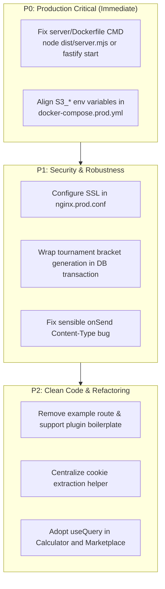

# Comprehensive Code Quality Analysis: Smex Store Monorepo

**Repository Target:** `smex-store`
**Monorepo Architecture:** PNPM Workspaces (`client`, `server`, `shared`)
**Stack Overview:** Node.js 22, Fastify v5, Next.js 16 (App Router), React 19, Tailwind CSS v4, PostgreSQL 16, Redis 7.2, Drizzle ORM, Vitest, Playwright.

---

## 1. Executive Summary & Health Scorecard

The `smex-store` codebase represents a mature, high-performance esports platform and digital marketplace. It exhibits disciplined engineering across type safety, data modeling, database constraint design, and accessibility. However, critical deployment gaps in container entrypoints and environment configuration drift exist alongside minor architectural anti-patterns.

### Overall Score: **86 / 100 (Grade: A-)**

| Dimension                            |        Score        |  Status  | Key Highlights                                                                                                                                           |
| :----------------------------------- | :-----------------: | :-------: | :------------------------------------------------------------------------------------------------------------------------------------------------------- |
| **Type Safety & Compilation**  | **100 / 100** |   PASS   | Zero TypeScript errors across all 3 workspaces (`tsc --noEmit`); strict type definitions; clean shared contracts.                                      |
| **Code Style & Linting**       | **100 / 100** |   PASS   | Zero ESLint errors or warnings across client and server.                                                                                                 |
| **Architecture & Layering**    | **88 / 100** |  STRONG  | Clean Fastify plugin hierarchy; Drizzle schema modularity; standalone Next.js build.                                                                     |
| **Database & Concurrency**     | **90 / 100** | EXCELLENT | Zero schema drift; partial unique indexes; pessimistic row locking (`FOR UPDATE`) on roster mutations.                                                 |
| **Security Posture**           | **82 / 100** |   GOOD   | Argon2id password hashing; binary magic-byte inspection; Redis session tombstones. Nuances in login rate limiting and cookie flags.                      |
| **Testing & Verification**     | **84 / 100** |   GOOD   | Full cross-browser Playwright suite (Chromium, Firefox, WebKit); automated WCAG 2.1 AA luminance tests. Source text string assertion smells in UI tests. |
| **Production Readiness / Ops** | **68 / 100** |  WARNING  | Critical container crash bug in `server/Dockerfile` (`node dist/app.mjs`); environment variable drift in compose; incomplete SSL in Nginx.           |

---

## 2. Codebase Composition & Metrics

Analysis performed via [`scripts/cloc.js`](file:///home/hrutav-modha/Documents/smex-store/scripts/cloc.js):

| Language     | files | blank | comment | code  |
| ------------ | ----- | ----- | ------- | ----- |
| TypeScript   | 205   | 4160  | 1547    | 31438 |
| Markdown     | 54    | 2159  | 0       | 7736  |
| SQL          | 7     | 0     | 16      | 270   |
| JavaScript   | 5     | 40    | 13      | 191   |
| CSS          | 1     | 18    | 9       | 81    |
| Dockerfile   | 2     | 35    | 11      | 66    |
| SVG          | 5     | 0     | 0       | 5     |
| Bourne Shell | 1     | 1     | 0       | 2     |
| SUM:         | 280   | 6413  | 1596    | 39789 |

- **Total Source Files:** 280
- **Total Executable Code Lines:** 39,789
- **Core TypeScript Code:** 31,438 lines across 205 files
- **Package Separation:**
  - [`@smex/shared`](file:///home/hrutav-modha/Documents/smex-store/shared/src/index.ts): Domain types, contracts, DTOs, and RFC 7807 error formatting.
  - [`@smex/server`](file:///home/hrutav-modha/Documents/smex-store/server/src/app.ts): Fastify REST & WebSocket microservices, Drizzle ORM, Redis caches.
  - [`@smex/client`](file:///home/hrutav-modha/Documents/smex-store/client/app/layout.tsx): Next.js 16 App Router with standalone output, React 19, Tailwind v4.

---

## 3. Critical Findings & Operational Defects

### Critical Defect 1: Server Container Exits Immediately on Startup (Production Blocker)

- **Location:** [`server/Dockerfile#L52`](file:///home/hrutav-modha/Documents/smex-store/server/Dockerfile#L52)
- **Root Cause:**
  [`server/src/app.ts`](file:///home/hrutav-modha/Documents/smex-store/server/src/app.ts#L38-L80) is written as a Fastify plugin function (`FastifyPluginAsync`) exported as default. When bundled by [`server/tsdown.config.ts`](file:///home/hrutav-modha/Documents/smex-store/server/tsdown.config.ts#L4) into `dist/app.mjs`, running `node dist/app.mjs` executes module definitions and immediately exits with exit code 0 because no HTTP listener (`server.listen()`) is ever invoked.
- **Verification:**
  Executing `node server/dist/app.mjs` returns immediately (`exited immediately without listening`).
- **Remediation:**
  Update the runner stage in [`server/Dockerfile`](file:///home/hrutav-modha/Documents/smex-store/server/Dockerfile) to invoke Fastify CLI or compile [`server/src/server.ts`](file:///home/hrutav-modha/Documents/smex-store/server/src/server.ts) as the entrypoint:
  ```dockerfile
  # Option A: Compile and execute server.ts
  CMD ["node", "dist/server.mjs"]

  # Option B: Run via Fastify CLI runner
  CMD ["npx", "fastify", "start", "-p", "3001", "-a", "0.0.0.0", "-l", "info", "dist/app.mjs"]
  ```

---

### Critical Defect 2: Object Storage Environment Variable Drift

- **Location:** [`docker-compose.prod.yml#L32-L35`](file:///home/hrutav-modha/Documents/smex-store/docker-compose.prod.yml#L32-L35) vs [`server/src/config/env.ts#L34-L38`](file:///home/hrutav-modha/Documents/smex-store/server/src/config/env.ts#L34-L38)
- **Root Cause:**
  [`docker-compose.prod.yml`](file:///home/hrutav-modha/Documents/smex-store/docker-compose.prod.yml) passes:
  ```yaml
  STORAGE_ENDPOINT: http://minio:9000
  STORAGE_ACCESS_KEY: ${MINIO_ROOT_USER:-minioadmin}
  STORAGE_SECRET_KEY: ${MINIO_ROOT_PASSWORD:-minioadmin}
  STORAGE_BUCKET: smex-storage
  ```

  However, [`server/src/config/env.ts`](file:///home/hrutav-modha/Documents/smex-store/server/src/config/env.ts) and [`StorageService`](file:///home/hrutav-modha/Documents/smex-store/server/src/services/storage.service.ts#L53-L65) validate and read:
  `S3_ENDPOINT`, `S3_ACCESS_KEY_ID`, `S3_SECRET_ACCESS_KEY`, and `S3_BUCKET`.
- **Impact:**
  When deployed via production compose, the server does not receive MinIO credentials and falls back to local defaults (`minioadmin` / `auto` / `http://localhost:9000`), breaking presigned URL generation and media verification in production.
- **Remediation:**
  Align environment keys in [`docker-compose.prod.yml`](file:///home/hrutav-modha/Documents/smex-store/docker-compose.prod.yml) with the Zod schema in [`server/src/config/env.ts`](file:///home/hrutav-modha/Documents/smex-store/server/src/config/env.ts).

---

### Critical Defect 3: Nginx Production Configuration Lacks SSL Termination

- **Location:** [`docker-compose.prod.yml#L7-L8`](file:///home/hrutav-modha/Documents/smex-store/docker-compose.prod.yml#L7-L8) vs [`nginx.prod.conf#L9-L12`](file:///home/hrutav-modha/Documents/smex-store/nginx.prod.conf#L9-L12)
- **Root Cause:**
  `docker-compose.prod.yml` exposes ports `80` and `443`. However, [`nginx.prod.conf`](file:///home/hrutav-modha/Documents/smex-store/nginx.prod.conf) only declares a single `listen 80;` block. There is no `listen 443 ssl;` server block, nor are any certificate or key volume mounts defined.
- **Impact:**
  HTTPS requests connecting to port 443 will be rejected with connection reset or handshake timeouts.

---

## 4. Security & Authentication Analysis

### Strengths

1. **Password Hashing:**
   [`server/src/utils/crypto.ts`](file:///home/hrutav-modha/Documents/smex-store/server/src/utils/crypto.ts) uses Argon2id with memory cost `65536` KiB (64 MiB), `timeCost: 3`, and `parallelism: 4`, fully compliant with OWASP password storage recommendations.
2. **Session Revocation Fast-Path:**
   [`authPlugin`](file:///home/hrutav-modha/Documents/smex-store/server/src/plugins/auth.ts#L94-L104) checks `revoked_token:${sessionId}` in Redis during authentication to provide instant token revocation without waiting for the 15-minute JWT expiration.
3. **Magic-Byte Binary Inspection:**
   [`MediaInspectorService`](file:///home/hrutav-modha/Documents/smex-store/server/src/services/media-inspector.service.ts#L54-L113) fetches the first 16 bytes directly from S3 via HTTP Range request and checks against valid JPEG, PNG, and WebP signatures, while explicitly blocking Windows PE/DOS executable headers (`MZ` / `0x4D 0x5A`).
4. **SQL Injection Defense:**
   All queries use Drizzle ORM parametrized query builders or [`escapeLikeWildcards`](file:///home/hrutav-modha/Documents/smex-store/server/src/services/search.service.ts#L20-L22) before executing PostgreSQL trigram / `ILIKE` queries.

### Areas for Improvement

#### 1. Rate Limiting Key Pattern on Login

- **Location:** [`server/src/plugins/rate-limit.ts#L39-L44`](file:///home/hrutav-modha/Documents/smex-store/server/src/plugins/rate-limit.ts#L39-L44)
- **Issue:**
  ```typescript
  keyGenerator: (req) => {
    const email = String((req.body as EmailBody | undefined)?.email || '').toLowerCase().trim();
    return `rl:login:${req.ip}:${email}`;
  }
  ```

  The rate limiting key is keyed on the composite of `IP + email`. While this mitigates single-account brute forcing, an attacker performing a credential-stuffing attack against 100 different emails from a single IP will receive 5 attempts per email (500 total requests) before the generic global IP limit triggers.
- **Recommendation:** Implement dual-tier rate limiting: a per-IP cap on total login requests (e.g., 20/minute) in addition to the per-account limit.

#### 2. Hardcoded `secure: true` on Session Cookies

- **Location:** [`server/src/routes/auth.ts#L216`](file:///home/hrutav-modha/Documents/smex-store/server/src/routes/auth.ts#L216) & [`#L224`](file:///home/hrutav-modha/Documents/smex-store/server/src/routes/auth.ts#L224)
- **Issue:**
  Cookies are set with `secure: true` unconditionally. In local development or testing without HTTPS (e.g., when testing over internal Docker networking or connecting via IP `192.168.x.x`), browsers compliant with RFC 6265bis will reject the cookie.
- **Recommendation:**
  Set `secure: env.NODE_ENV === 'production'`.

#### 3. Error Plugin Header Mutation Bug

- **Location:** [`server/src/plugins/sensible.ts#L54-L69`](file:///home/hrutav-modha/Documents/smex-store/server/src/plugins/sensible.ts#L54-L69)
- **Issue:**
  ```typescript
  fastify.addHook('onSend', async (request, reply, payload) => {
    if (reply.statusCode >= 400 && typeof payload === 'string') {
      reply.header('content-type', 'application/problem+json; charset=utf-8');
      try {
        const parsed = JSON.parse(payload);
        if (typeof parsed === 'object' && parsed !== null && !parsed.instance) {
          parsed.instance = request.url;
          return JSON.stringify(parsed);
        }
      } catch {
        // payload is not json
      }
    }
    return payload;
  });
  ```

  `reply.header('content-type', ...)` is modified *before* the JSON validation. If an upstream handler or proxy returns an HTML error page or raw string, the response content type is forced to `application/problem+json` with non-JSON content.
- **Recommendation:** Only set the header if `JSON.parse` succeeds or within the RFC 7807 error formatter.

---

## 5. Database Architecture & Concurrency Control

### Strengths

- **Drizzle Kit Validation:** `drizzle-kit check` verifies 0 schema drift against migration files.
- **Partial Unique Indexes:**
  In [`server/src/db/schema/teams.ts#L71-L73`](file:///home/hrutav-modha/Documents/smex-store/server/src/db/schema/teams.ts#L71-L73):
  ```typescript
  uniqueIndex('team_join_requests_pending_unq')
    .on(t.teamId, t.userId)
    .where(sql`${t.status} = 'pending'`)
  ```

  Prevents duplicate active requests while preserving request history.
- **Pessimistic Concurrency Locking:**
  In [`TeamJoinService.resolveJoinRequest`](file:///home/hrutav-modha/Documents/smex-store/server/src/services/team-join.service.ts#L224-L231), the service executes `.for('update')` on both the squad and the join request records inside a PostgreSQL transaction, eliminating race conditions during simultaneous accept operations on full rosters.

### Opportunity: Non-Transactional Bracket Generation

- **Location:** [`server/src/routes/tournaments.ts#L446-L459`](file:///home/hrutav-modha/Documents/smex-store/server/src/routes/tournaments.ts#L446-L459)
- **Issue:**
  [`BracketGeneratorService.generateBracket`](file:///home/hrutav-modha/Documents/smex-store/server/src/services/bracket-generator.service.ts#L24) deletes old matches and inserts new matches, followed by [`TournamentLifecycleService.transitionStatus`](file:///home/hrutav-modha/Documents/smex-store/server/src/services/tournament-lifecycle.service.ts). These operations are not wrapped in a single database transaction. If the status transition fails, the matches remain generated while the tournament status is out of sync.
- **Recommendation:** Wrap both operations in `fastify.db.transaction(async (tx) => ...)`.

---

## 6. Code Smells, Dead Code & Technical Debt

### 1. Fastify CLI Starter Boilerplate Left in Production

- **Files:**
  - [`server/src/routes/example/index.ts`](file:///home/hrutav-modha/Documents/smex-store/server/src/routes/example/index.ts): Route returning `'this is an example'`.
  - [`server/src/plugins/support.ts`](file:///home/hrutav-modha/Documents/smex-store/server/src/plugins/support.ts): Plugin decorating Fastify with `.someSupport()` returning `'hugs'`.
- **Issue:** Registered directly in [`server/src/app.ts#L55`](file:///home/hrutav-modha/Documents/smex-store/server/src/app.ts#L55) and [`#L75`](file:///home/hrutav-modha/Documents/smex-store/server/src/app.ts#L75). Violates production purity and clutters the router.
- **Action:** Delete both boilerplate files and their associated tests ([`server/test/plugins/support.test.ts`](file:///home/hrutav-modha/Documents/smex-store/server/test/plugins/support.test.ts) and [`server/test/routes/example.test.ts`](file:///home/hrutav-modha/Documents/smex-store/server/test/routes/example.test.ts)).

### 2. Duplicated Manual Cookie Parsing

- **Files:**
  - [`server/src/plugins/auth.ts#L40-L45`](file:///home/hrutav-modha/Documents/smex-store/server/src/plugins/auth.ts#L40-L45)
  - [`server/src/routes/auth.ts#L274-L278`](file:///home/hrutav-modha/Documents/smex-store/server/src/routes/auth.ts#L274-L278)
  - [`server/src/routes/auth.ts#L335-L339`](file:///home/hrutav-modha/Documents/smex-store/server/src/routes/auth.ts#L335-L339)
- **Issue:**
  The snippet `request.headers.cookie.split(';').find(c => c.trim().startsWith('...'))?.split('=')[1]` is duplicated across multiple handlers. If a cookie value contains `=` (such as padding), `split('=')[1]` truncates the token.
- **Action:** Extract into a robust utility function in `server/src/utils/cookies.ts` or rely consistently on `@fastify/cookie`.

### 3. Underutilization of TanStack Query on Client

- **Files:**
  - [`client/components/boosting/Calculator.tsx#L75-L86`](file:///home/hrutav-modha/Documents/smex-store/client/components/boosting/Calculator.tsx#L75-L86)
  - [`client/hooks/useCatalogListings.ts#L37-L40`](file:///home/hrutav-modha/Documents/smex-store/client/hooks/useCatalogListings.ts#L37-L40)
- **Issue:**
  `@tanstack/react-query` is configured in [`client/providers/QueryProvider.tsx`](file:///home/hrutav-modha/Documents/smex-store/client/providers/QueryProvider.tsx), but major pages roll their own manual `useEffect` + `fetch` data loading, manual loading booleans, and state adjustments during render.
- **Action:** Refactor data fetching to use `useQuery` with structured query keys for automatic caching, deduping, and retry handling.

### 4. Source Text String Testing in Client Tests

- **File:** [`client/test/teams-ui.test.tsx#L266-L274`](file:///home/hrutav-modha/Documents/smex-store/client/test/teams-ui.test.tsx#L266-L274)
- **Issue:**
  Tests import `TeamCard.tsx?raw` and run assertions like:
  ```typescript
  expect(teamCardSource.includes('backdrop-blur')).toBe(false);
  expect(teamCardSource.includes('duration-[120ms]') || teamCardSource.includes('duration-[80ms]')).toBe(true);
  ```

  Asserting on raw source code strings is brittle and does not test rendered DOM behavior or actual visual output.
- **Action:** Test computed styles or verify visual classes on rendered elements via `@testing-library/react`.

---

## 7. Prioritized Action Plan



|   Priority   | Task                                               | Target Files                                                                                                                                                                                                               | Estimated Effort |
| :----------: | :------------------------------------------------- | :------------------------------------------------------------------------------------------------------------------------------------------------------------------------------------------------------------------------- | :--------------: |
| **P0** | Fix container execution command                    | [`server/Dockerfile`](file:///home/hrutav-modha/Documents/smex-store/server/Dockerfile)                                                                                                                                   |     15 mins     |
| **P0** | Align MinIO S3 environment variables               | [`docker-compose.prod.yml`](file:///home/hrutav-modha/Documents/smex-store/docker-compose.prod.yml)                                                                                                                       |     10 mins     |
| **P1** | Add SSL certificate & HTTPS block                  | [`nginx.prod.conf`](file:///home/hrutav-modha/Documents/smex-store/nginx.prod.conf)                                                                                                                                       |     30 mins     |
| **P1** | Wrap bracket generation in transaction             | [`server/src/routes/tournaments.ts`](file:///home/hrutav-modha/Documents/smex-store/server/src/routes/tournaments.ts)                                                                                                     |     20 mins     |
| **P1** | Fix error handler `onSend` header timing         | [`server/src/plugins/sensible.ts`](file:///home/hrutav-modha/Documents/smex-store/server/src/plugins/sensible.ts)                                                                                                         |     15 mins     |
| **P2** | Delete dead boilerplate (`example`, `support`) | [`server/src/routes/example`](file:///home/hrutav-modha/Documents/smex-store/server/src/routes/example), [`server/src/plugins/support.ts`](file:///home/hrutav-modha/Documents/smex-store/server/src/plugins/support.ts) |     20 mins     |
| **P2** | Centralize cookie parsing helper                   | [`server/src/utils/crypto.ts`](file:///home/hrutav-modha/Documents/smex-store/server/src/utils/crypto.ts) or new util                                                                                                     |     25 mins     |
| **P2** | Migrate manual `useEffect` fetch to `useQuery` | [`client/components/boosting/Calculator.tsx`](file:///home/hrutav-modha/Documents/smex-store/client/components/boosting/Calculator.tsx)                                                                                   |     45 mins     |
